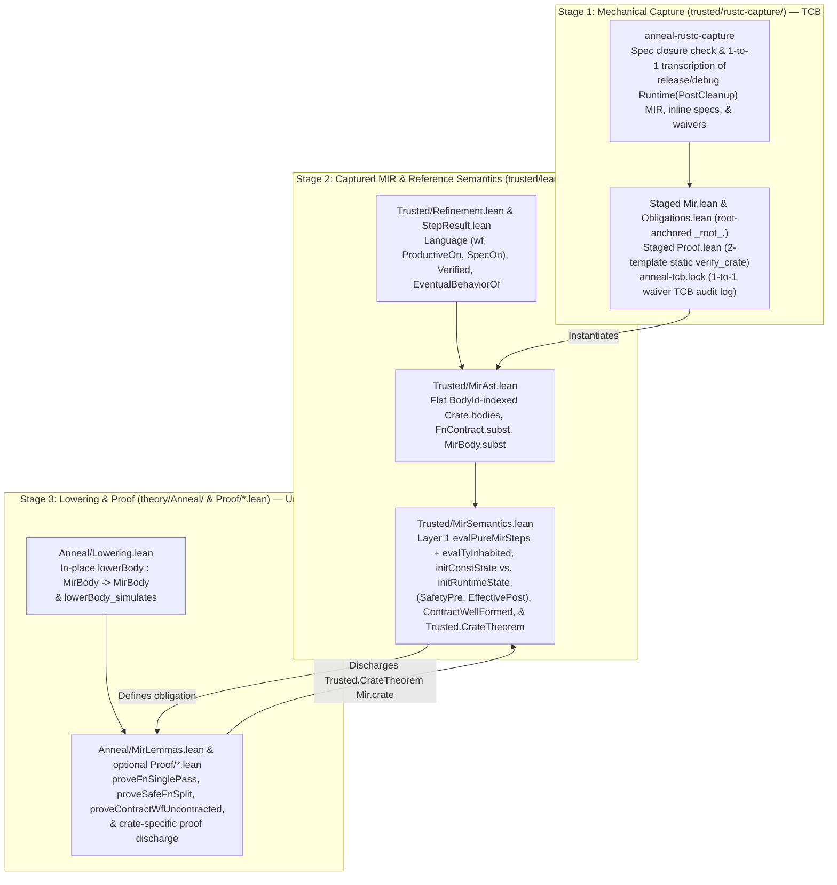

<!-- Copyright 2026 The Fuchsia Authors

Licensed under a BSD-style license <LICENSE-BSD>, Apache License, Version 2.0
<LICENSE-APACHE or https://www.apache.org/licenses/LICENSE-2.0>, or the MIT
license <LICENSE-MIT or https://opensource.org/licenses/MIT>, at your option.
This file may not be copied, modified, or distributed except according to
those terms. -->

# Multi-Step MIR and Toolchain Architecture

> **Note:** Anneal is under active development. Parts of the design and
> architecture described in this document are not yet implemented or may be
> implemented differently; this document may be aspirational or stale relative
> to the codebase.

Anneal verifies Rust crates by extracting their Mid-level Intermediate
Representation (MIR) from `rustc` and proving verification obligations over
that MIR in the Lean 4 theorem prover. Designing this pipeline requires
balancing **Trusted Computing Base (TCB) auditability** against **proof
ergonomics and stability**:

- **Auditability pulls toward raw `rustc` MIR and simple, first-order code:**
  Any transformation performed inside the Rust extractor happens outside the
  Lean kernel. If the extractor rewrites control flow, desugars projections, or
  synthesizes Lean `Prop` formulas in Rust, a bug in that Rust code can silently
  alter what is being proved. Likewise, if the Lean semantics inside `trusted/`
  rely on tactic blocks, well-founded recursion proofs, or mutual inductive
  types, Lean's elaborator generates complex auxiliary definitions in the
  compiled `.olean` environment. Keeping the TCB small and auditable requires a
  thin, purely syntactic Rust extractor and a transparent, tactic-free Lean
  semantic model.
- **Verification ergonomics and stability pull toward normalized MIR:**
  `rustc`'s `Runtime(PostCleanup)` MIR contains low-level control-flow chains,
  storage markers, and `nop` statements that are tedious to step through
  directly and can shift across compiler releases.

Anneal resolves this tension with a **three-stage MIR pipeline** split across
the repository's `trusted/` and `theory/` boundary:

1. **Stage 1 — Mechanical, First-Order Capture (`trusted/rustc-capture/`):** A
   thin `rustc_driver` wrapper checks that every local definition referenced by
   a stated specification carries `#[anneal::spec]`, extracts the crate's
   `Runtime(PostCleanup)` MIR across `release` and `debug` configurations, and
   performs zero semantic normalization in Rust. It emits tactic-free,
   root-anchored first-order Lean data and obligation modules (`Mir.crate :
   Trusted.Crate` in `<target>/anneal/<crate-id>/lean/Mir.lean` and
   `Obligations.lean`), one of two static proof entrypoints (`Proof.lean`), and
   the crate's TCB audit log (`anneal-tcb.lock`, in 1-to-1 bijection with
   `Mir.crate.tcbWaivedIds`).
2. **Stage 2 — Flat Captured MIR & Reference Semantics
   (`trusted/lean/Trusted/`):** A tactic-free, fuel-bounded Lean AST and
   small-step operational semantics evaluate captured MIR over a flat,
   `BodyId`-indexed table (`Crate.bodies`) and a value-tree memory model with
   explicit uninitialized leaves (`MirVal.uninit`). `Trusted/MirAst.lean`
   represents the full `Runtime(PostCleanup)` MIR statement, rvalue, terminator,
   operand, and projection syntax without `.unsupported` AST placeholders;
   unmodeled operations fail closed at the semantic layer in
   `Trusted/MirSemantics.lean` only when a verified obligation reaches them.
3. **Stage 3 — In-Place Verified Lowering & Compositional Proof Engine
   (`theory/Anneal/` and optional crate `Proof/*.lean`):** Untrusted,
   kernel-checked passes in `theory/` normalize `MirBody` in place (`lowerBody :
   MirBody → MirBody`), prove a backward simulation (`lowerBody_simulates`) back
   to the Stage 2 semantics, and discharge `Trusted.CrateTheorem`
   compositionally across all crate obligations (`Anneal.proveCrate`, or
   crate-local proof scripts in `Proof/*.lean` rooted at `Proof/Main.lean`).

Because Stage 3 (`theory/` in Stage A and `Proof/*.lean` in Stage B) is audited
by `trusted/audit/` to be pure, `opaque`-free, and axiom-free and is rechecked
by the standalone Lean 4 kernel (`trustLevel := 0`, `loadExts := false`), all
control-flow normalization, compositional checkers, and crate-specific proof
scripts remain **outside the human-audited TCB**.

For related context, see:

- [`META_PRINCIPLES.md`](../META_PRINCIPLES.md),
  [`PRINCIPLES.md`](../PRINCIPLES.md), and
  [`THREAT_MODEL.md`](../THREAT_MODEL.md) for Anneal's controlling
  meta-principles, correctness promise, and threat model.
- [`docs/design.md`](design.md) for Anneal's end-to-end user workflow,
  library-centric verification model, and incremental adoption.
- [`docs/trust-model.md`](trust-model.md) for how `trusted/` and
  `trusted/audit/` enforce the boundary between stated specifications, the TCB
  audit log, untrusted proofs, and verified Rust implementation bodies.

## Architectural goals

Anneal's MIR pipeline is organized around six concrete goals:

1. **No semantic desugaring or formula synthesis in Rust:** Stage 1 maps
   `rustc` data structures directly to first-order Lean constructors. It never
   rewrites places or control flow, never silently skips uncalled or unverified
   items, and never synthesizes per-function tactic scripts.
2. **Static two-template `Proof.lean` entrypoint:** Every crate receives one of
   two fixed, crate-independent `Proof.lean` templates in
   `<target>/anneal/<crate-id>/lean/`, pinning `theorem Proof.verify_crate :
   Trusted.CrateTheorem Mir.crate` to either `Anneal.proveCrate Mir.crate rfl`
   (Template A, when `Proof/Main.lean` is absent) or `Proof.Main.verify_crate`
   (Template B, when `Proof/Main.lean` is present). No crate name, function
   name, or user annotation is ever interpolated into `Proof.lean`.
3. **Tactic-free, flat, and `opaque`-free `trusted/lean/`:** Stage 2 uses a
   flat `BodyId` table instead of mutual inductive types, uses structural
   recursion on explicit `Nat` fuel instead of `partial` or `WellFounded.fix`,
   contains zero `by` tactic blocks, and contains zero `opaque` constants
   (explicit waivers are represented as first-order data in
   `Mir.crate.tcbWaivedIds` in 1-to-1 bijection with `[[waivers]]` in
   `anneal-tcb.lock`).
4. **Unconditional MIR syntax capture with semantic-layer fail-closed
   evaluation:** `Trusted/MirAst.lean` represents the complete
   `Runtime(PostCleanup)` MIR statement, expression, projection, and
   control-flow grammar (`PlaceElem`, `Operand`, `BinOp`, `UnOp`, `CastKind`,
   `BorrowKind`, `RawPtrKind`, `Rvalue`, `Stmt`, `Terminator`) without
   `.unsupported` syntax placeholders, keeping only a bounded `.unmodeled` leaf
   fallback on `MirTy` for exotic compiler-internal types (`Dynamic`, `Alias`,
   `Coroutine`, `Pat`, `UnsafeBinder`). Stage 1 translates MIR syntax
   unconditionally, while Stage 2 (`Trusted/MirSemantics.lean`) is the sole
   place that defines which operations evaluate to a value versus stepping to
   `.failed` (undefined behavior).
5. **In-place Stage 3 normalization without AST duplication:** Rather than
   duplicating `MirBody`, `Stmt`, `Rvalue`, and `MirVal` into a parallel AST
   hierarchy, Stage 3 normalizes `Trusted.MirBody` in place (`lowerBody`) and
   verifies obligations compositionally.
6. **Source-span diagnostics:** Captured declarations, statements, and
   terminators carry Rust source `Span` metadata (`file`, `line`, `col`) so
   verification failures identify the exact Rust statement or assertion that
   could not be discharged.

## The three-stage MIR pipeline



### Stage 1: Mechanical, first-order `rustc` capture (`trusted/rustc-capture/`)

`trusted/rustc-capture/` links against `rustc_driver` and `rustc_middle` to
check post-resolution specification closure (`#[anneal::spec]`) and extract the
compiled crate's `Runtime(PostCleanup)` MIR, layout facts, inline specification
attributes (`#[anneal::*]` and `/// anneal:...`), and complete crate item
inventory into staged `Mir.lean`, `Obligations.lean`, and `Proof.lean` modules
plus `anneal-tcb.lock`.

#### 1-to-1 transcription without Rust-side desugaring

Stage 1 translates each `rustc_middle::mir` construct directly into its
corresponding constructor in `Trusted/MirAst.lean`:

- **Places and projections (`Place`, `PlaceElem`):** A MIR `Place` is emitted
  directly as `(LocalId, List PlaceElem)` with `.deref` and `.field idx`
  projection elements. Stage 1 never pattern-matches projection chains in Rust
  to synthesize special-case rvalues.
- **Operands and rvalues (`Operand`, `Rvalue`):** `Operand::Copy(p)`,
  `Operand::Move(p)`, and `Operand::Constant(...)` map 1-to-1 to
  `Operand.copy`, `Operand.move`, and `Operand.constVal` / `Operand.constParam`.
  `Rvalue::Use`, `Rvalue::Ref`, `Rvalue::RawPtr`, `Rvalue::BinaryOp`,
  `Rvalue::Aggregate`, and `Rvalue::Cast(Transmute)` map directly to `Rvalue`
  constructors.
- **Statements and terminators (`Stmt`, `Terminator`):** `Assign`,
  `StorageLive`, `StorageDead`, `PlaceMention`, and `Nop` map 1-to-1 to `Stmt`;
  `Return`, `Goto`, `SwitchInt`, `Call`, and `Assert` map 1-to-1 to
  `Terminator`.

Because Stage 1 performs no control-flow restructuring or expression
simplification, a human reviewer can audit each arm in
`trusted/rustc-capture/src/extract.rs` directly against the cited `rustc`
definition.

#### Root-anchored `Mir.lean` and two-template static `Proof.lean`

Stage 1 separates the crate-specific specification payload from the proof
entrypoint, staging all generated Lean modules in
`<target>/anneal/<crate-id>/lean/` outside the repository checkout:

- **Staged `Mir.lean` and `Obligations.lean` use explicit `_root_.`-anchored
  constructors:** `Mir.lean` begins with `prelude`, imports `Trusted` (plus
  `Spec.<Mod>` only when Mode 3 specifications reference user mathematical
  models in `Spec/*.lean`), and defines `def crate : Trusted.Crate := ...`
  inside `namespace Mir ... end Mir` with zero `open` or `export` commands,
  zero tactic blocks, and zero overloaded operators or numeric literals. Every
  global type, AST constructor, primitive value, and function reference in
  `Mir.lean` and `Obligations.lean` is emitted with an explicit `_root_.`
  prefix and raw kernel literals (`_root_.Trusted.Crate.mk`,
  `_root_.Trusted.Stmt.assign`, `_root_.Bool.true`, `_root_.Option.some`,
  `_root_.List.cons`, `nat_lit n`, `_root_.Int.ofNat (nat_lit n)`,
  `_root_.Int.negSucc (nat_lit n)`, `_root_.Spec.<Mod>.<item>`). Combined with
  the `.olean` namespace and environment-extension checks in
  [`docs/trust-model.md`](trust-model.md#unambiguous-mirlean-and-obligationslean-codegen),
  an imported `Spec.<Mod>` module can never shadow identifiers or hijack
  elaboration in `Mir.lean` or `Obligations.lean`.
- **Staged `Proof.lean` is one of two static, crate-independent templates:**
  - **Template A (when `Proof/Main.lean` is absent):**

    ```lean
    prelude
    import Trusted
    import Mir
    import Anneal

    namespace Proof
    theorem verify_crate : Trusted.CrateTheorem Mir.crate :=
      Anneal.proveCrate Mir.crate rfl
    end Proof
    ```

  - **Template B (when `Proof/Main.lean` is present):**

    ```lean
    prelude
    import Trusted
    import Mir
    import Proof.Main

    namespace Proof
    theorem verify_crate : Trusted.CrateTheorem Mir.crate :=
      Proof.Main.verify_crate
    end Proof
    ```

  Because `rustc-capture` generates the root `Proof.lean` file in the isolated
  build directory in both cases and Stage B (`trusted/audit/`) verifies that
  `Proof.verify_crate` has empty `levelParams` and a kernel `ConstantInfo.type`
  structurally equal to `Trusted.CrateTheorem Mir.crate`, untrusted files in
  `Proof/*.lean` cannot alter the theorem statement or inject commands into
  `Proof.lean`.

#### Unconditional MIR syntax capture and semantic-layer gating

Anneal intentionally avoids `.unsupported` placeholder constructors on MIR
syntax AST nodes and instead pushes unsupported-feature handling into the
semantic layer (`Trusted/MirSemantics.lean`):

- **Why unsupported constructs are handled in semantics, not syntax:**
  `rustc`'s `Runtime(PostCleanup)` MIR operational grammar (`PlaceElem`,
  `Operand`, `BinOp`, `UnOp`, `CastKind`, `BorrowKind`, `RawPtrKind`,
  `NonDivergingIntrinsic`, `Rvalue`, `Stmt`, and `Terminator`) is small and
  finite. Collapsing unmodeled MIR constructs into `.unsupported` inside
  `trusted/rustc-capture/` would force the Rust extractor to encode semantic
  feature-subsetting policy, discard structural detail from staged `Mir.lean`,
  and require coordinated edits across both `trusted/rustc-capture/` and
  `trusted/lean/` whenever Stage 2 adds rules for another MIR construct. By
  capturing the MIR operational syntax unconditionally in `Trusted/MirAst.lean`
  and defining feature support solely in `Trusted/MirSemantics.lean`, Stage 1
  remains a purely syntactic 1-to-1 transcriber and `Trusted/MirSemantics.lean`
  is the single source of truth for what is semantically modeled.
- **Which AST nodes may be `.unmodeled`:**
  - **Operational MIR syntax (`PlaceElem`, `Operand`, `BinOp`, `UnOp`,
    `CastKind`, `BorrowKind`, `RawPtrKind`, `NonDivergingIntrinsic`, `Rvalue`,
    `Stmt`, `Terminator`):** Represented unconditionally in
    `Trusted/MirAst.lean` with **no** `.unsupported` or `.unmodeled`
    constructors.
  - **Compiler type internals (`MirTy`):** Only `MirTy` retains a single
    bounded `.unmodeled` leaf constructor for non-MIR compiler type-system
    internals (`Dynamic` trait-object existential binders, unnormalized `Alias`
    projections/opaques, `Coroutine`/`CoroutineWitness`, pattern types `Pat`,
    and `UnsafeBinder`) whose representation would otherwise pull `rustc`'s
    trait-solver and binder machinery into `Trusted/MirAst.lean`. Standard Rust
    types (scalars, tuples, arrays, slices, references, raw pointers, ADTs,
    function pointers/items, closures, `Never`, and `Param`) are represented
    explicitly in `MirTy`.

All semantic gating happens fail-closed in `Trusted/MirSemantics.lean`:

- `evalTyByteSize` returns `none` whenever a type contains `MirTy.unmodeled`,
  references an unknown ADT, or has a monomorphized byte size exceeding
  `isize::MAX` (`c.layout.maxObjSize`). Because `StaticFnWf` checks
  `LocalLayoutsAdmitted` at `zeroTySizes` and `unitTySizes` across every body,
  `requiredConsts` entry, and contract clause inside `ContractWellFormed`
  (`Language.wf`), any `MirTy.unmodeled` or concrete layout overflow fails
  closed unconditionally—even under `#[anneal::requires(false)]`—and any
  unmodeled statement or terminator reached during execution steps to `.failed`
  (undefined behavior), making `Trusted.CrateTheorem` unprovable.
- Every crate item (`adtInv`, `constBody`, `staticBody`, called or uncalled
  `fnBody`, `externFn`, and `traitImpl`) is included in `crateObligations c`
  and must satisfy `ContractWellFormed` unconditionally and either be verified
  by kernel proof or match an explicit `#[anneal::trusted(reason = "...")]`
  waiver in `Mir.crate.tcbWaivedIds` and `anneal-tcb.lock`; uncalled functions
  are never silently skipped.
- When a verified function calls a callee (including an `extern` declaration or
  a waived `#[anneal::trusted]` function), `evalMirTerminator` steps modularly
  (`ModularCallStep` via `instantiateCallee`) by requiring the caller to prove
  the callee's `SafetyPre` (which includes `RequiresAdmits` if and only if
  `callee.isUnsafe = true`, plus `AdtInv` for all $T \notin
  \text{callee}.\text{brokenInvariants}$) and assuming the callee's
  `EffectivePost` (`SafetyPost` unconditionally and `ContractPost` whenever
  `RequiresAdmits` holds at the call site).

### Stage 2: Captured MIR and reference semantics (`trusted/lean/Trusted/`)

Stage 2 defines the verification framework and the Rust MIR reference semantics
in four tactic-free Lean modules under `trusted/lean/Trusted/`:

1. **`Trusted/Refinement.lean`:** Defines the refinement preorder (`Preorder`,
   `Partial`, `Behavior`), program-indexed languages (`Language`, with static
   program well-formedness `wf : Prog → Prop` and demonic behavior `sem : Prog →
   Behavior Query Out`), excluded-miracle productivity
   (`Language.ProductiveOn`), and complete behavioral verification
   (`Language.Verified`, combining `L.wf prog`, `L.ProductiveOn pre prog`, and
   `L.sem prog ≤ L.SpecOn pre post`).
2. **`Trusted/StepResult.lean`:** Defines small-step operational machines
   (`SmallStepMachine`), bounded prefix reachability (`ReachesPrefix`,
   `PrefixOutcome`), and step-decoupled eventual behaviors (`EventualOut` and
   `EventualBehaviorOf`) with explicit `.running`, `.terminated`, `.diverges`,
   `.stuck`, and `.failed` (undefined behavior) outcomes.
3. **`Trusted/MirAst.lean`:** Defines the first-order captured MIR data
   structures: `LocalId`, `BlockId`, `BodyId`, `MirTy`, `Place`
   (`LocalId × List PlaceElem`), `Operand`, `Rvalue`, `Stmt`, `Terminator`,
   `FnContract` (carrying per-clause `(BodyId × List MirTy)` substitutions in
   `requiresClauses` and `ensuresClauses`, `noPanic`, `noPme`, and pure
   `FnContract.subst`), `MirBody` (carrying pre-`DeadBlocks` `requiredConsts`,
   `requiredLayouts`, `requiredTypePre`, and pure `MirBody.subst`), `AdtDecl`
   (`hasPubInvariantField`), `CapturedFn` (`releaseBodyId`,
   `debugBodyId : Option BodyId`, `inVisibilityCone`, `brokenInvariants`),
   `ExternFnDecl`, `TraitImplDecl` (`implAssumptions`, `safetyContract`,
   `assocConsts`, `methodBindings`), and `Crate` (`tcbWaivedIds`).
4. **`Trusted/MirSemantics.lean`:** Defines the stratified Layer 1 deterministic
   pure evaluator (`evalPureMirSteps`, `MirVal.uninhabitedParam`,
   `mergeParamBranches`), computable syntactic inhabitedness
   (`evalTyInhabited`, `evalArgsInhabited`), byte-size evaluation bounded by
   `isize::MAX` (`evalTyByteSize`), two-phase compile-time (`initConstState`)
   and runtime (`initMixedRuntimeState`, `initRuntimeState`) entry states,
   three-way compile-time admissibility (`LocalLayoutsAdmitted`,
   `RequiredConstsAdmitted`, `CalleeTypePreAdmitted`), unwaivable contract and
   monomorphization well-formedness (`ContractWellFormed`: `StaticFnWf`,
   `MonoConstsWf`, `RequiresFramed`, `EnsuresWellFormed`), multi-guarantee
   refinement via `(SafetyPre, EffectivePost)`, modular call stepping
   (`ModularCallStep`, `instantiateCallee`, `ApplyCallOutcome`), simultaneous
   multi-place borrow preservation (`EscapingSubfieldBorrowsSafe`), trait
   implementation refinement (`TraitImplContractWellFormed`,
   `TraitImplVerified`, `mkTraitFnView`), and the top-level crate obligation
   (`Trusted.CrateTheorem`).

#### Flat `BodyId`-indexed `Crate.bodies` table (no `mutual` inductive types)

In `Trusted/MirAst.lean`, every captured function, clause, or constant body is
stored once in the flat `Crate.bodies` table and referenced elsewhere by
`BodyId`:

- `Terminator.call`, `FnContract` (`requiresClauses`, `ensuresClauses`), and
  `MirBody` (`requiredConsts`, `requiredTypePre`) reference bodies by
  `(BodyId × List MirTy)` rather than recursively embedding a `MirBody` inside
  `Terminator`, `FnContract`, or `MirBody`.
- `CapturedFn` (`releaseBodyId`, `debugBodyId`), `ExternFnDecl` (`sigBodyId`),
  and `TraitAssocConstBinding` (`constBodyId`) reference bodies by `BodyId`,
  while `ObligationId` identifies crate obligations by canonical item paths
  (`String`).

Keeping `MirBody` out of `Terminator` and `ObligationId` eliminates `mutual`
inductive types in `Trusted/MirAst.lean`, avoids duplicating shared callee or
profile-deduplicated ASTs, and allows `theory/` to decide structural equality on
`MirBody` without fuel bounds or manual mutual recursors.

#### Value-tree memory model, `Place` lenses, and partial-move soundness

`Trusted/MirSemantics.lean` represents values as functional trees (`MirVal`):

- Scalar and aggregate nodes (`unit`, `bool`, `usize`, `adt`),
- Opaque generic-parameter byte payloads (`bytes`),
- Logical references (`ref`), and
- Leaf-granular uninitialized field/local markers (`MirVal.uninit`).

Composite places `(loc, projection)` are read and updated through lens helpers
over `List PlaceElem` (`.deref` and `.field idx`):

- **`evalProj` and `MirVal.isFullyInit`:** Reading (`Operand.copy` or
  `Operand.move`) or borrowing (`Rvalue.ref`) a place traverses its projection
  path, verifies that every intermediate dereference targets a live, valid
  place, and requires `MirVal.isFullyInit` on the resulting `MirVal`—stepping to
  `.failed` (UB) if any leaf of the read or borrowed value is `MirVal.uninit`.
- **`updateProj` on moves and assignments:** Assigning to a projected place
  writes the new subvalue back into the root local's `MirVal` tree. Crucially,
  evaluating `Operand.move p` both returns the value at `p` and updates `p` to
  `MirVal.uninit` via `updateProj` (`deinitPlace`). If a function moves a field
  `_1.0` out of a non-`Copy` struct and subsequently reads or moves `_1` or
  `_1.0` again before reinitializing it, `MirVal.isFullyInit` detects the
  `MirVal.uninit` leaf and steps to `.failed`.
- **Distinguishing uninitialized fields from padding bytes:** `MirVal.adt`
  stores typed field values rather than raw padding bytes, so constructing an
  initialized struct whose layout contains inter-field padding produces a fully
  initialized `MirVal.adt` tree that can be borrowed or copied normally. By
  contrast, opaque generic parameter values (`MirVal.bytes`, which may contain
  padding or uninitialized bytes at runtime) are valid to copy or move at their
  parameter type, whereas `extractTransmuteBits` rejects reinterpreting
  `MirVal.bytes` or `MirVal.uninit` as a concrete integer via `transmute_copy`.

#### UB faults vs. panics (`Terminator.unreachable` vs. `assert` and `panic`)

Rust distinguishes undefined behavior (such as reaching
`core::hint::unreachable_unchecked` or dereferencing a dangling reference) from
clean runtime panics (`TerminatorKind::Assert` and `core::panicking::panic*`),
and `Trusted/MirSemantics.lean` models the two distinctly:

- **Undefined behavior (`.failed`):** Reaching `Terminator.unreachable`,
  reading an uninitialized or moved-out place (`MirVal.uninit`), dereferencing
  a dead local generation, or violating `transmute_copy` validity steps to
  `.failed`.
- **Clean panic unwinding (`.terminated .unwind`):** `rustc` lowers checked
  arithmetic overflow (`+`, `-`, `*`), division or remainder by zero, and slice
  bounds checks to `TerminatorKind::Assert` (`Terminator.assert`), and lowers
  explicit `panic!` or `assert!` failures to `core::panicking::panic*`
  (`Terminator.panic`). When `Terminator.assert` evaluates a boolean operand
  that does not match `expected` (or when `Terminator.panic` executes),
  `evalMirTerminator` steps to `.terminated [] (.unwind unwindState)` (only a
  non-boolean or uninitialized `cond` operand or an out-of-bounds target block
  is `.failed`). Under Anneal's baseline safety semantics (`SafetyPost`), clean
  unwinding is permitted provided all caller-reachable `&mut` referents in
  `unwindState` preserve `AdtInv` for all $T \notin f.\text{brokenInvariants}$
  and `EscapingSubfieldBorrowsSafe`, whereas `#[anneal::no_panic]` and
  `#[anneal::spec]` functions (`ContractPost`), `const` and `static`
  initializers, contract clause evaluation (`EvalClausePure`), and
  `RequiredConstsAdmitted` require finite-fuel normal return
  (`.terminated [] (.normal val exitState)`).

### Stage 3: In-place lowering and compositional verification (`theory/Anneal/`)

Stage 3 (`theory/Anneal/`) provides the normalization passes, compositional
checkers, and symbolic execution lemmas that prove
`Trusted.CrateTheorem Mir.crate`:

- **In-place CFG lowering (`theory/Anneal/Lowering.lean`):** Rather than
  translating `Trusted.MirBody` into a separate AST type, `lowerBody :
  MirBody → MirBody` simplifies a captured body in place. It strips `Stmt.nop`
  and collapses forwarding `goto` chains across terminator targets (`goto`,
  `switchInt`, `assert`, `drop`, and `call`) while preserving `b.blocks.length`,
  `BlockId` numbering, and `storageLive`/`storageDead` statements (so
  use-after-`StorageDead` checks on dangling borrows remain sound). The theorem
  `lowerBody_simulates` proves a backward simulation across `MirSem` (covering
  terminating, unwinding, and diverging executions).
- **Single-pass vs. split per-function verification (`proveFnSinglePass` and
  `proveSafeFnSplit` in `theory/Anneal/MirLemmas.lean`):**
  - When `f.isUnsafe = true` or `f.contract.requiresClauses = []`,
    `SafetyPre c f body s → RequiresAdmits c f body s` holds immediately, so
    `proveFnSinglePass` discharges `FnBodyVerified` in a single symbolic
    execution pass.
  - When `f.isUnsafe = false` and `f.contract.requiresClauses ≠ []` (for
    example, a safe `binary_search` function with
    `#[anneal::requires(is_sorted(s))]`), `proveSafeFnSplit` verifies baseline
    UB-freedom (`SafetyPost`) under `SafetyPre` and functional postconditions
    (`ContractPost`) under `ContractPre` (`SafetyPre ∧ RequiresAdmits`).
  - `Obligations.lean` emits one top-level theorem `<fn>_contract_wf :
    ContractWellFormed Mir.crate Mir.<fn> Mir.<fn>_body` per item and reuses it
    in both `CrateTheorem` and `FnBodyVerified`; for uncontracted functions with
    `requiredConsts = []` and `requiredTypePre = []`,
    `proveContractWfUncontracted` discharges `ContractWellFormed` by computation
    (`decide` / `rfl`).
- **Inline, modular, and waived call verification:** At `Terminator.call`
  targeting a callee, Stage 3 supports three verification modes:
  1. **Inline execution (`InlineCallStep`):** Step into a non-escaping closure
     or a private helper in `c.bodies` (including helpers inside $\mathcal{V}_T$
     carrying `#[anneal::broken_invariant(T)]`) by pushing a `CallFrame` onto
     `MirState.stack`.
  2. **Modular contract application (`ModularCallStep`):** Instantiate the
     callee's contract and body (`instantiateCallee`), verify the callee's
     `SafetyPre` (requiring `RequiresAdmits` if and only if
     `instCallee.isUnsafe = true`, plus `AdtInv` for all $T \notin
     \text{instCallee}.\text{brokenInvariants}$), and transition via
     `EffectivePost` (`ApplyCallOutcome`, stepping via a 1-step self-loop on
     `.diverges []` so `#[anneal::no_panic]` callers cannot falsely prove
     termination across a diverging callee).
  3. **Explicitly waived obligations:** An unverified function, `extern`
     declaration, or `unsafe impl` behavioral obligation is discharged if and
     only if its canonical `ObligationId` appears in `c.tcbWaivedIds` (in
     1-to-1 bijection with `[[waivers]]` in `anneal-tcb.lock`), while
     `ContractWellFormed` remains unwaivable across all items.
- **Diamond CFG joins and dead-local generation irrelevance
  (`execNormal_deadLocalGen_irrel` and `execNormal_join`):** When two branches
  of a `Terminator.switchInt` reconverge at a join block after different
  branch-local `StorageLive`/`StorageDead` sequences, dead temporaries hold
  `MirVal.uninit` on both paths while their generation counters in `localGens`
  may differ. The lemma `execNormal_deadLocalGen_irrel` proves that states
  differing only in `localGens l` for a dead local `l` (`s.locals.get? l = some
  .uninit` and no live `MirVal.ref` targeting `(frameId, l)`) have identical
  `MirSem` behaviors, allowing `execNormal_join` to merge the branches and
  verify the suffix from the join block once.

## Repository layout

Anneal's directory structure mirrors the trust boundary (`trusted/` vs.
`theory/`):

```text
anneal/
├── META_PRINCIPLES.md              # Controlling meta-principles (*Why*)
├── PRINCIPLES.md                   # Controlling mission & correctness promise (*What*)
├── THREAT_MODEL.md                 # Controlling threat model & review surfaces (*What*)
├── trusted/                        # Human-audited Trusted Computing Base (TCB)
│   ├── root-manifest.sha256        # SHA-256 pins for Cargo & Nix root manifests
│   ├── rustc-capture/              # Stage 1: rustc_driver MIR & spec extractor
│   │   ├── Cargo.toml
│   │   └── src/
│   │       ├── main.rs             # rustc_driver entrypoint
│   │       ├── hook.rs             # Dual-profile driver & MIR query hooks
│   │       ├── items.rs            # Crate item, ADT, trait, & const traversal
│   │       ├── extract.rs          # 1-to-1 MIR body & spec AST extraction
│   │       ├── ir.rs               # First-order intermediate capture structs
│   │       ├── spec.rs             # Spec closure, contracts, & V_T scope extraction
│   │       └── lean.rs             # Root-anchored Mir.lean, Obligations.lean, Proof.lean, & lockfile emitter
│   ├── lean/                       # Stage 2: Trusted Lean foundation (tactic-free)
│   │   ├── foundation-lock.json    # SHA-256 pins for lean binary & Init.*
│   │   ├── Trusted.lean            # Root TCB prelude import
│   │   └── Trusted/
│   │       ├── Refinement.lean     # Behavior, Language (wf), Productiveness, & Verified
│   │       ├── StepResult.lean     # StepResult, EventualOut, & EventualBehaviorOf
│   │       ├── MirAst.lean         # Flat BodyId-indexed MIR AST, FnContract, & MirBody.subst
│   │       └── MirSemantics.lean   # Layer 1 pure evaluator, small-step MIR semantics, & CrateTheorem
│   ├── audit/                      # Stage A & Stage B .olean replay & boundary auditor
│   │   ├── src/                    # anneal-audit CLI, manifest, & --setup runner
│   │   └── TrustedBoundary.lean    # Standalone .olean kernel DAG & replay auditor
│   └── cargo-anneal/               # CLI orchestrator (cargo anneal setup / verify)
└── theory/                         # Stage 3: Untrusted, kernel-checked proofs
    ├── Anneal.lean                 # Root proof-theory import
    └── Anneal/
        ├── Refinement.lean         # Simulation & Obligation composition lemmas
        ├── StepResult.lean         # Fuel monotonicity & step composition lemmas
        ├── Lowering.lean           # In-place lowerBody & lowerBody_simulates
        └── MirLemmas.lean          # Compositional checker & symbolic execution
```

## Compiler integration and extraction lifecycle

Because Anneal's correctness promise applies to the Rust crate as compiled by
`rustc`, `trusted/rustc-capture/` hooks directly into `rustc`'s query and
codegen pipeline so that captured MIR reflects the exact semantics `rustc`
compiles.

### Multi-file and post-macro extraction

Before `rustc-capture` compiles a target crate, `cargo-anneal` resolves the
package graph via `cargo metadata --locked` (see
[`docs/trust-model.md`](trust-model.md#3-capture-and-orchestrator-enforcement-cargo-anneal-and-rustc-capture)).
During compilation of each verified crate $C$, `trusted/rustc-capture/` captures
`Runtime(PostCleanup)` MIR after `build.rs` code generation (`OUT_DIR`) and
procedural-macro expansion have completed, records any compile-time environment
variables read via `env!` or `option_env!` (`tcx.sess.psess.env_depinfo`) in
`anneal-tcb.lock`, binds crate $C$'s compilation inputs
(`tcx.sess.psess.file_depinfo`) into its build-cache `UnitId` under
`<target>/anneal/`, and traverses all crate items across `src/**/*.rs`, emitting
crate-relative module-qualified Lean identifiers (`Mir.Fn.<mod>__<item>`) into
`Mir.lean`.

### Why Anneal captures `Runtime(PostCleanup)` MIR with `-Z mir-preserve-ub`

`rustc` lowers source code through HIR, THIR, built MIR, borrow-checked
`Analysis` MIR, and finally **`Runtime(PostCleanup)` MIR** immediately before
monomorphization and code generation:

- **Explicit drops and control flow:** Implicit destructor calls (`Drop`),
  unwind edges, and state machines have already been elaborated into explicit
  basic blocks and terminators, so `trusted/lean/` does not need to re-implement
  drop elaboration or borrow checking.
- **Preserved Rust types and projections:** Unlike LLVM IR,
  `Runtime(PostCleanup)` MIR retains full Rust type definitions, ADTs, place
  projections, and pointer mutability metadata needed to detect Rust-level
  undefined behavior.
- **Preserving UB checks via `-Z mir-preserve-ub`:** In default builds,
  `rustc`'s `RemovePlaceMention` pass erases `StatementKind::PlaceMention`
  statements (such as `let _ = *ptr;`) before `Runtime(PostCleanup)`.
  `rustc-capture` runs `rustc` with `-C opt-level=0 -Z mir-opt-level=0` and
  injects `-Z mir-preserve-ub` (`mir_preserve_ub = true`) into the compiler
  invocation so `PlaceMention` and other UB-bearing checks survive into
  `Runtime(PostCleanup)` and are checked by `Stmt.placeMention` in
  `Trusted/MirSemantics.lean` (accompanied by a post-capture structural check
  confirming no compiler pass injected `TerminatorKind::Unreachable` blocks).

### Intercepting MIR before `Steal<Body>` and pre-`DeadBlocks` closure

During compilation, `rustc` stores intermediate MIR in `Steal<Body>` cells that
are consumed ("stolen") when transitioning from analysis to runtime MIR passes.
In `trusted/rustc-capture/src/hook.rs`, `rustc-capture` overrides the
`mir_drops_elaborated_and_const_checked` query provider—whose final step
(`run_analysis_to_runtime_passes`) produces `Runtime(PostCleanup)` MIR
(`MirPhase::Runtime(RuntimePhase::PostCleanup)`) before `DeadBlocks` runs—to
clone each local body into thread-local storage before downstream queries
(`mir_for_ctfe`, `optimized_mir`) steal the `Steal<Body>` cell. Before
`DeadBlocks` erases unreachable basic blocks, `rustc-capture` traverses the
transitive static reachability cone of each `MirBody` `b` across direct
`b.required_consts`, static `TerminatorKind::Call` targets, destructor glue at
`TerminatorKind::Drop` (`Instance::resolve_drop_in_place`), constructed closures
(`Rvalue::Aggregate(AggregateKind::Closure)`), promoted constants in
`tcx.promoted_mir(def_id)`, and attached contract clauses, populating three
fields on `MirBody` (all normalized into `b`'s `0 ..< b.numTyParams` type
parameter index space):

- `requiredConsts : List (BodyId × List MirTy)`: all transitive
  compiler-enforced `const { ... }`, associated-constant, and promoted-constant
  bodies across `b`, its transitive static callees, and `b.requiredTypePre`;
- `requiredLayouts : List MirTy`: all local declaration types,
  `Rvalue.nullaryOp (.sizeOf / .alignOf ty)` argument types, and substituted
  type arguments across `b`, its attached contract clauses, its
  `requiredConsts` and `requiredTypePre`, and its transitive static callees,
  closures, and `Drop` glue; and
- `requiredTypePre : List (BodyId × List MirTy)`: all transitive
  `requiresClauses` of static callees (including waived `#[anneal::trusted]` and
  `extern` callees and any `#[anneal::spec]` helpers they call).

### Dual-profile (`release` and `debug`) capture and deduplication (`CONFIGS`)

Code that is only safe when `debug_assert!` or debug overflow panics are active
is unsound in release builds, while code that is only safe when arithmetic wraps
is unsound if `#[anneal::no_panic]` is claimed under debug builds. Conversely,
requiring byte-for-byte identical `Mir.lean` across `debug` and `release` would
reject every Rust function that uses `+`, `-`, `*`, or `debug_assert!`.

To verify both compilation profiles without rejecting standard Rust arithmetic,
`rustc-capture` runs the compiler pipeline across both configurations:

- **`release` (`isDebug = false`):** `-C debug-assertions=off -C
  overflow-checks=off -Z mir-preserve-ub`
- **`debug` (`isDebug = true`):** `-C debug-assertions=on -C overflow-checks=on
  -Z mir-preserve-ub`

All Surface 1 contract clauses (`requires`, `ensures`, `invariant`, trait
safety contracts) and `#[anneal::spec]` functions are extracted with checked
arithmetic (`overflow-checks = true`) held constant in both passes so ordinary
`+`, `-`, `*`, `<<`, and `>>` operations in specifications are
profile-independent and checked against arithmetic overflow in
`ContractWellFormed`, while still rejecting `cfg!(debug_assertions)` divergence
inside Surface 1. Each `CapturedFn` stores `releaseBodyId : BodyId` and
`debugBodyId : Option BodyId` (`none` when the span-stripped `debug` `MirBody`
is identical to `release`, or `some dbgId` when they differ).

### Modeling PMEs, layouts, and safe vs. `unsafe` preconditions

In `rustc`, `Runtime(PostCleanup)` MIR is constructed per generic function
before monomorphization completes. During monomorphization collection
(`collect_and_partition_mono_items`) and layout computation (`layout_of`),
`rustc` evaluates every `const { ... }` block, associated constant, and promoted
constant in `body.required_consts` and checks that every monomorphized local
type fits within `isize::MAX`—regardless of whether a branch is reachable at
runtime (`if false { const { panic!() } }`) and even when a parameter type is
uninhabited (`x: core::convert::Infallible`). Any failure is rejected by `rustc`
at compile time as a post-monomorphization error (PME) before machine code is
emitted.

Modeling PMEs, compound generic layouts, and `#[anneal::requires]` contracts
together requires separating three questions that a single precondition
predicate would conflate:

1. **Multi-guarantee separation of baseline safety (`SafetyPre`) from functional
   contracts (`EffectivePost`) over unchanged `Trusted/Refinement.lean`:**
   Under [`PRINCIPLES.md`](../PRINCIPLES.md), a safe function (`f.isUnsafe =
   false`) cannot impose unchecked caller preconditions (`#[anneal::requires]`)
   to avoid undefined behavior: calling a safe `binary_search` function with
   `#[anneal::requires(is_sorted(s))]` on an unsorted slice waives its
   functional membership postcondition, not its baseline guarantee of freedom
   from undefined behavior. Conversely, because `rustc` evaluates
   `body.requiredConsts` at compile time during monomorphization, an internal
   `const { assert!(size_of::<Src>() == size_of::<Dst>()) }` block *is*
   compiler-enforced.
   Anneal captures both rules without changing a single line of
   `Trusted/Refinement.lean` by using the refinement lattice meet in `Behavior`:
   $$\text{SpecOn}(\text{SafetyPre}, \text{SafetyPost}) \sqcap \text{SpecOn}(\text{ContractPre}, \text{ContractPost}) = \text{SpecOn}(\text{SafetyPre}, \text{EffectivePost})$$

   ```lean
   def SafetyPre (c : Crate) (f : CapturedFn) (body : MirBody)
       (s : MirState) : Prop :=
     initRuntimeState c f body s ∧
     RequiredConstsAdmitted c body s.tySizes ∧
     (f.isUnsafe = true → RequiresAdmits c f body s)

   def EffectivePost (c : Crate) (f : CapturedFn) (body : MirBody)
       (s : MirState) (out : EventualOut Empty MirOutcome) : Prop :=
     SafetyPost c f body s out ∧
     (RequiresAdmits c f body s → ContractPost c f body s out)

   def FnBodyVerified (c : Crate) (f : CapturedFn) (body : MirBody) : Prop :=
     (MirLang c f).Verified (SafetyPre c f body) (EffectivePost c f body) body
   ```

   At modular call sites (`ModularCallStep` via `instantiateCallee`), the
   call-site safety gate is `SafetyPre` (requiring `RequiresAdmits` if and
   only if `instCallee.isUnsafe = true`) and the outcome transition is
   `EffectivePost` (yielding `SafetyPost` unconditionally and `ContractPost`
   whenever `RequiresAdmits` holds). A safe function that guards an internal
   `unsafe` block with `const { assert!(size_of::<Src>() == size_of::<Dst>()) }`
   therefore verifies at Level 1 using `RequiredConstsAdmitted` in `SafetyPre`,
   whereas a safe function that omits `const { assert!(...) }` and writes only
   `#[anneal::requires(size_of::<Src>() == size_of::<Dst>())]` is rejected
   because `SafetyPre` does not assume `RequiresAdmits` when `f.isUnsafe =
   false`.
2. **Constructive two-phase compile-time (`initConstState`) and runtime
   (`initMixedRuntimeState` / `initRuntimeState`) evaluation (zero
   `Classical.em`):**
   Evaluating compile-time type preconditions in the same state as runtime value
   preconditions would allow a runtime precondition such as
   `#[anneal::requires(x < size_of::<T>())]` (unsatisfiable at
   `size_of::<T>() == 0` when `x: usize`) to vacuously mask a compile-time PME
   `const { 1 / size_of::<T>() }` at `size_of::<T>() == 0`.
   `Trusted/MirSemantics.lean` separates the two phases constructively using the
   Layer 1 pure evaluator `evalPureMirSteps` and computable syntactic
   inhabitedness (`evalTyInhabited : Crate → Nat → MirTy → Bool`):
   - **Phase 1 — Compile-time monomorphization (`initConstState`):**
     A deterministic `MirState` that binds parameter locals `1..body.argCount`
     to `MirVal.uninhabitedParam`. In `evalPureMirSteps`, copying, moving,
     reborrowing (`Rvalue.ref`, e.g., `&(*_1)` on `self: &Infallible`), or
     dereferencing a safe reference (`MirTy.ref`) holding `.uninhabitedParam`
     propagates `.uninhabitedParam`, raw-pointer dereference and
     `Terminator.unreachable` return `.failed`, `return_` and `assert` on
     `.uninhabitedParam` return `.blockedOnUninhabitedArg`, and
     `Terminator.switchInt` on `.uninhabitedParam` intersects branches up to
     `branchDepth := 2` via `mergeParamBranches` (returning `.normal v₁ s₁`
     when all branches agree on a concrete `v₁ == v₂` and `callerHeap`,
     propagating `.failed`/`.running`/`.unwind`, and returning
     `.blockedOnUninhabitedArg` otherwise). `TypePreAdmits c f body tySizes`
     admits `tySizes` unless a `requires` clause deterministically evaluates in
     `initConstState c body tySizes` to `.normal (.bool false) _`, so runtime
     value bounds like `x < size_of::<T>()` evaluate to
     `.blockedOnUninhabitedArg` and never mask compile-time PMEs.
   - **Phase 2 — Mixed-runtime contract framing (`initMixedRuntimeState`) and
     runtime execution (`initRuntimeState`):**
     `initMixedRuntimeState` uses computable `evalTyInhabited` to bind inhabited
     parameters to `ValidArgValForFn` and uninhabited parameters (`!`,
     `Infallible`, `&Infallible`) to `.uninhabitedParam`, ensuring contracts on
     mixed signatures (`(x: u32, y: Infallible)`) are framed on inhabited
     arguments while reducing to `initRuntimeState` by `rfl` on inhabited
     signatures with zero `Classical.em` branching.
3. **Three-way decomposition of compile-time obligations
   (`LocalLayoutsAdmitted`, `RequiredConstsAdmitted`, `CalleeTypePreAdmitted`)
   in `ContractWellFormed`:**
   - **`LocalLayoutsAdmitted`:** `evalTyByteSize` enforces `sz ≤ isize::MAX`
     internally. `StaticFnWf` checks `LocalLayoutsAdmitted` at `zeroTySizes` and
     `unitTySizes` across `body`, `requiredConsts`, and contract clauses
     (rejecting `[u8; usize::MAX]`, `[[T; 2]; isize::MAX]`, and
     `MirTy.unmodeled` unconditionally), while `EntryStateWith` and
     `AdmittedLayoutForFn` place `LocalLayoutsAdmitted` on the left-hand side so
     ordinary generic functions with compound locals (`fn pair<T>(a: T, b: T) ->
     (T, T)`) need zero layout boilerplate.
   - **`CalleeTypePreAdmitted` vs. `RequiredConstsAdmitted`:** Because `rustc`
     does not enforce `#[anneal::requires]` on static callees during
     monomorphization, transitive static-callee preconditions
     (`body.requiredTypePre`) are separated into `CalleeTypePreAdmitted`, which
     is checked universally on the right-hand side of `MonoConstsWf`
     (`∀ tySizes, AdmittedLayoutForFn c f body tySizes → CalleeTypePreAdmitted c
     body tySizes`) and never assumed in `SafetyPre`. For
     `RequiredConstsAdmitted` (`body.requiredConsts`), `MonoConstsWf` requires
     universal `AdmittedLayoutForFn → RequiredConstsAdmitted` whenever
     `f.isSpec || !f.contract.isEmpty || !evalArgsInhabited c body`, and
     existential `∃ tySizes, AdmittedLayoutForFn ∧ RequiredConstsAdmitted` on
     uncontracted Level-1 functions with inhabited parameters (which reduces to
     `tySizes = []` when `body.numTyParams = 0`, rejecting monomorphic and
     unconditional `const { panic!() }` PMEs while allowing Level-1 generic
     functions with `const { assert!(...) }` guards to verify without redundant
     attributes).

## Toolchain pinning and compiler upgrades

`rustc`'s internal `rustc_private` APIs change across compiler releases. Anneal
pins a single deterministic `rustc` and `lean` toolchain in `flake.nix` and
`flake.lock`—bound at repository level by `trusted/root-manifest.sha256` and
`trusted/lean/foundation-lock.json`, and packaged by Stage A (`anneal-audit
--mode audit`) with `toolchain-manifest.json` and verified once at installation
time by `cargo anneal setup`—and absorbs toolchain upgrades across the three
stages according to what changed:

1. **Internal `rustc_private` API changes (absorbed in Stage 1):** Compiler
   refactorings that rename internal queries or types without changing emitted
   MIR are handled entirely inside `trusted/rustc-capture/`, leaving
   `trusted/lean/` and `theory/` untouched.
2. **Minor MIR shape variations (absorbed in Stage 3 `lowerBody`):** Changes in
   how `rustc` emits `nop` statements or splits straight-line basic blocks are
   normalized away in place by `theory/Anneal/Lowering.lean` (`lowerBody` and
   `lowerBody_simulates`), keeping downstream verification lemmas stable without
   expanding `trusted/lean/`.
3. **New MIR constructs (staged in Stage 2 via `candidate:<feature>`):** When
   Anneal adds support for a new MIR construct, `Trusted/MirAst.lean` and
   `Trusted/MirSemantics.lean` receive an additive constructor and step rule
   under a `-- anneal-trust-tier: candidate:<feature>` directive (tracked in
   `toolchain-manifest.json` and surfaced in downstream `anneal-tcb.lock` files)
   until human auditing against the pinned Rust Reference and `rustc` source
   completes.
