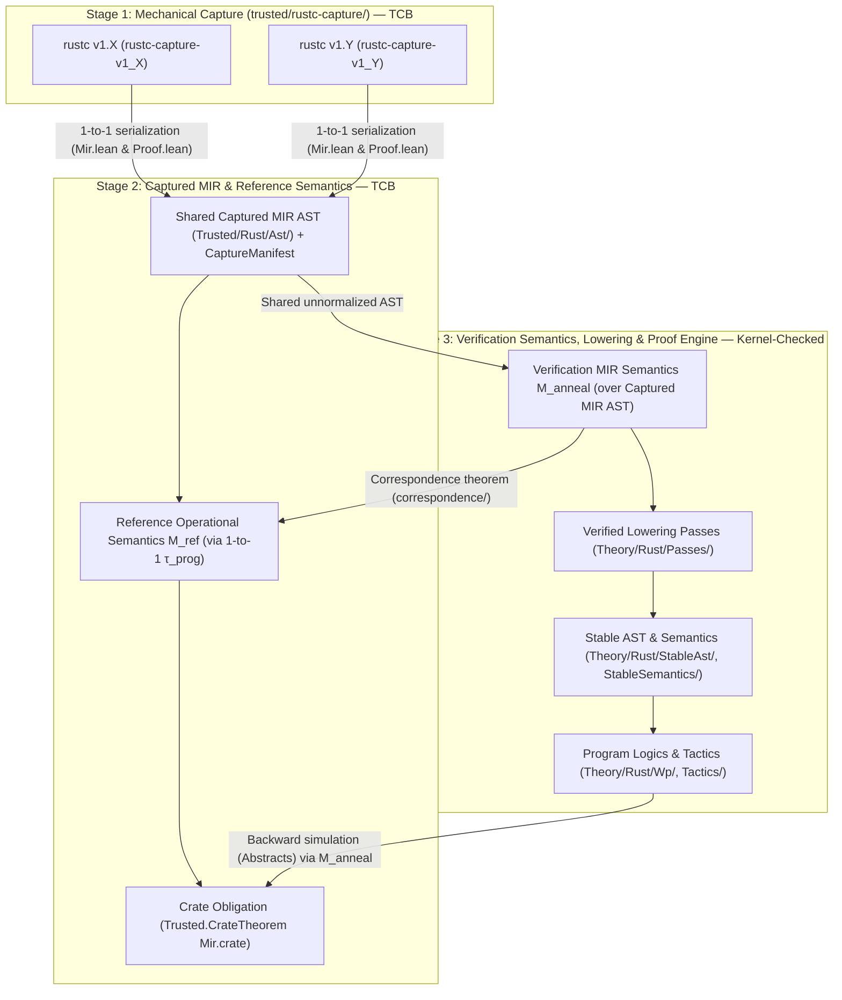

<!-- Copyright 2026 The Fuchsia Authors

Licensed under a BSD-style license <LICENSE-BSD>, Apache License, Version 2.0
<LICENSE-APACHE or https://www.apache.org/licenses/LICENSE-2.0>, or the MIT
license <LICENSE-MIT or https://opensource.org/licenses/MIT>, at your option.
This file may not be copied, modified, or distributed except according to
those terms. -->

# Multi-Step MIR and Toolchain Architecture

> **Note:** Anneal is under active development. Parts of the design and
> architecture described in this document are not yet implemented or may be
> implemented differently; this document may be aspirational or stale relative
> to the codebase.

Anneal verifies Rust crates by extracting their Mid-level Intermediate
Representation (MIR) from `rustc` and reasoning about that MIR inside the
Lean 4 theorem prover. Designing this pipeline requires resolving a core
tension between **auditability** and **proof stability**:

- **Auditability pulls toward raw `rustc` MIR:** Any transformation or
  simplification performed inside the Rust extractor happens outside the Lean
  kernel. If the extractor rewrites control flow or desugars operations in
  Rust, a bug in that Rust code can silently alter what the program means and
  compromise soundness. To keep the Trusted Computing Base (TCB) small and easy
  to audit, extraction from `rustc` must be as thin and mechanical as possible.
- **Proof stability and ergonomics pull toward a high-level stable IR:**
  `rustc`'s internal `rustc_middle::mir` structures are designed for compiler
  optimization and code generation, not theorem proving. Moreover, `rustc`'s
  internal APIs and MIR representations evolve across compiler releases. If
  weakest-precondition (WP) lemmas, tactics, and user specifications operated
  directly on raw `rustc` MIR, every minor compiler upgrade would break
  verification.

Anneal resolves this tension with a **three-stage MIR pipeline** split across
the repository's `trusted/` and `theory/` boundary:

1. **Stage 1 — Mechanical Capture (`trusted/rustc-capture/`):** A thin,
   version-specific `rustc_driver` wrapper transcribes `rustc`'s
   `Runtime(PostCleanup)` MIR and inline Rust specification attributes 1-to-1
   into Lean data definitions (`Mir.lean`) and a pure proof script
   (`Proof.lean`), with zero semantic normalization in Rust.
2. **Stage 2 — Versioned Captured MIR, Unversioned Ground Semantics & Reference Anchor
   (`trusted/lean/`, `trusted/correspondence/`, `vendor/`):** Versioned Lean AST
   modules represent captured `rustc` MIR per compiler dialect
   (`Trusted/Rustc/<Dialect>/MirAst.lean`), mapped by total tactic-free
   interpreters into the compiler-independent ground MIR syntax
   (`Trusted/MirModel.lean`), and Anneal's verification operational semantics
   ($M_{\text{anneal}}$ in `Trusted/MirSemantics.lean`) states the top-level
   crate and proof-unit obligations (`Trusted.MirSemantics.<Dialect>.{CrateTheorem,UnitTheorem}`)
   and weakest-precondition soundness claims without pulling the reference
   interpreter into per-crate `cargo anneal verify` runs.
   To keep $M_{\text{anneal}}$'s evolving step rules (`initState` and
   `evalStep`) outside the human-audited semantic surface, an offline
   correspondence audit pass (`anneal-audit --require-correspondence`) anchors
   $M_{\text{anneal}}$ against an audited reference operational semantics
   ($M_{\text{ref}}$, such as `vendor/lean-miri/`, bridged via a minimal,
   one-to-one structural adapter $\tau_{\text{prog}}$ in
   `trusted/correspondence/Trusted/Correspondence.lean`). Minor semantic
   variations across compiler versions or targets are controlled by a
   declarative `CaptureProfile` parameter rather than duplicating the
   interpreter.
3. **Stage 3 — Correspondence Proof, Verified Lowering & Proof Engine
   (`theory/`, `correspondence/`):** In `correspondence/` (staged and audited as
   an untrusted `.theory` root by `anneal-audit --require-correspondence`),
   Anneal proves the kernel-checked `CorrespondenceTheorem`
   ([`docs/mir-correspondence-strategy.md`](mir-correspondence-strategy.md))
   showing that $M_{\text{anneal}}$ refines $M_{\text{ref}}$ via
   $\tau_{\text{prog}}$. Untrusted lowering passes and program logics in
   `theory/` (staged and audited as `.theory` by default `anneal-audit`) then
   translate the captured MIR AST into an ergonomic, version-independent stable
   AST (`Theory/Rust/StableAst/`) and prove a kernel-checked backward simulation
   (`Abstracts`) and weakest-precondition soundness (`Anneal/MirWp.lean`)
   against $M_{\text{anneal}}$, composing with `CorrespondenceTheorem` to
   discharge `Trusted.CrateTheorem`.

Because both `theory/` (in Pass 1 `anneal-audit`) and `correspondence/` (in Pass
2 `anneal-audit --require-correspondence`) are staged, source-preflighted, and
replayed in the standalone Lean kernel as pure, axiom-free `.theory` modules
while `vendor/lean-miri/` is verified against `UPSTREAM_PIN.json`, only the
outer theorem-stating boundary (`Query`, `TerminalOut`, `WellFormed`,
`ReachesResult`, `SatisfiesPost`, `Behavior`, `WpSoundnessClaim`,
`WpFaultSoundnessClaim`), $M_{\text{ref}}$, and $\tau_{\text{prog}}$ require
human semantic audit; the evolving execution rules of $M_{\text{anneal}}$, the
stable IR, the lowering passes, and all downstream proof tactics remain
**outside the human-audited semantic TCB**.

For the broader context around this architecture, see:

- [`META_PRINCIPLES.md`](../META_PRINCIPLES.md),
  [`PRINCIPLES.md`](../PRINCIPLES.md), and
  [`THREAT_MODEL.md`](../THREAT_MODEL.md) for Anneal's controlling
  meta-principles, correctness promise, and threat model.
- [`docs/design.md`](design.md) for Anneal's end-to-end user workflow,
  library-centric verification model, and incremental adoption.
- [`docs/mir-correspondence-strategy.md`](mir-correspondence-strategy.md) for
  how $M_{\text{anneal}}$ is developed against $M_{\text{ref}}$ under a locked
  CI correspondence theorem.
- [`docs/trust-model.md`](trust-model.md) for how Anneal's CI enforces the
  boundary between `trusted/` and `theory/`.

## The three-stage MIR pipeline



### Stage 1: Thin, mechanical `rustc` capture (`trusted/rustc-capture/`)

`trusted/rustc-capture/` links against `rustc_driver` and `rustc_middle` to
extract the compiled crate's MIR and inline specifications into pure Lean
source files (`Mir.lean` and `Proof.lean`).

To minimize the unverified Rust surface in `trusted/`, Stage 1 obeys a strict
**no-semantic-normalization rule**:

- It does **not** rewrite control-flow graphs, eliminate temporary locals,
  simplify casts, or desugar complex MIR statements into simpler primitives.
- Instead, each `rustc_middle::mir` construct (`BasicBlockData`,
  `StatementKind`, `TerminatorKind`, `Rvalue`, `Operand`, `Place`,
  `ProjectionElem`) is mapped directly to its corresponding constructor in
  Lean.
- Alongside the MIR bodies, Stage 1 emits a `CaptureManifest` recording the
  compiler version, target layout environment (pointer width, endianness, type
  sizes, alignments, and field offsets), and active semantic profile, plus a
  pure proof script (`Proof.lean`) that states `theorem Proof.verify_crate :
  Trusted.CrateTheorem Mir.crate` and invokes `theory/` to discharge it.

Because Stage 1 is a straightforward structural serializer and proof-script
generator, a human auditor can verify it by comparing each Rust serialization
arm directly against the cited `rustc` data definition.

### Stage 2: Shared captured MIR and reference semantics (`trusted/`)

The Lean files emitted by Stage 1 instantiate data structures defined in
`trusted/lean/` (`Trusted/Rustc/<Dialect>/MirAst.lean`, `Trusted/MirModel.lean`,
and `Trusted/MirSemantics.lean`), anchored offline by
`trusted/correspondence/` and `vendor/lean-miri/` under `anneal-audit
--require-correspondence`:

- **Captured MIR AST & Ground Model (`Trusted/Rustc/<Dialect>/MirAst.lean` and `Trusted/MirModel.lean`):**
  `Trusted/Rustc/<Dialect>/MirAst.lean` defines the compiler-versioned Lean
  inductive types for captured MIR programs, which `Trusted/MirSemantics.lean`
  interprets into the compiler-independent ground model `Trusted/MirModel.lean`
  (types, places, rvalues, statements, terminators, and layout metadata).
- **Verification operational semantics ($M_{\text{anneal}}$ in
  `Trusted/Rust/Semantics/` / `Trusted/MirSemantics.lean`):** Defines the
  outer theorem-stating boundary (`Query`, `TerminalOut`, `WellFormed`,
  `ReachesResult`, `SatisfiesPost`, `Behavior`, `WpSoundnessClaim`, and
  `WpFaultSoundnessClaim`) along with the small-step operational evaluator
  (`initState` and `evalStep`) over the captured MIR AST so per-crate
  `cargo anneal verify` runs (`anneal-audit --crate-root`) do not need to load
  the reference interpreter.
- **Reference operational semantics ($M_{\text{ref}}$ in `vendor/lean-miri/` and
  `trusted/correspondence/`):** Defines the ground-truth small-step operational
  semantics and memory model for captured MIR (bridged from the captured MIR AST
  via a minimal, one-to-one structural adapter $\tau_{\text{prog}}$ in
  `trusted/correspondence/Trusted/Correspondence.lean` and pinned by
  `vendor/lean-miri/UPSTREAM_PIN.json`), explicitly distinguishing normal
  progress from undefined behavior (`UB`) and unmodeled constructs
  (`unsupported`).
- **Top-level theorem statements (`Trusted.CrateTheorem` and
  `Trusted.Correspondence.CorrespondenceClaim`):** `Trusted.CrateTheorem` states
  that for the captured `Mir.crate : Trusted.Crate`, every verified function is
  sound (free of `UB` and `unsupported`) and satisfies any stated
  specifications, while `CorrespondenceClaim` (enforced by `anneal-audit
  --require-correspondence`) certifies that $M_{\text{anneal}}$ refines
  $M_{\text{ref}}$ via $\tau_{\text{prog}}$.

Stage 2's theorem-stating boundary, $\tau_{\text{prog}}$, and $M_{\text{ref}}$
are optimized for **clarity and direct correspondence to the Rust Reference and
`rustc`**, not for proof ergonomics. Where `rustc` MIR has verbose or low-level
representations, Stage 2 models them faithfully so there is no semantic gap
between what `rustc` hands to code generation and what `Trusted.CrateTheorem`
constrains.

### Stage 3: Correspondence proof and verified lowering (`theory/`, `correspondence/`)

Direct proof automation over an imported reference interpreter such as
`lean-miri` or raw captured MIR would be brittle and repetitive. Stage 3
(`theory/` audited in Pass 1 `anneal-audit` and `correspondence/` audited as an
untrusted `.theory` root in Pass 2 `anneal-audit --require-correspondence`)
connects the verification layers to Stage 2 by kernel-checked refinement proofs:

- **Correspondence proof (`correspondence/`):** Proves the locked,
  kernel-checked `CorrespondenceTheorem`
  ([`docs/mir-correspondence-strategy.md`](mir-correspondence-strategy.md))
  certifying that $M_{\text{anneal}}$ (`Trusted/MirSemantics.lean`) refines
  $M_{\text{ref}}$ (`vendor/lean-miri/`) via $\tau_{\text{prog}}$
  (`trusted/correspondence/Trusted/Correspondence.lean`), so $M_{\text{anneal}}$'s
  operational step rules (`initState` and `evalStep`) are kernel-certified
  rather than trusted by human inspection.
- **Stable AST and semantics (`Theory/Rust/StableAst/` and
  `Theory/Rust/StableSemantics/`):** A clean, normalized intermediate
  representation that coalesces redundant MIR forms and remains stable across
  `rustc` releases.
- **Verified lowering passes (`Theory/Rust/Passes/`):** Pure Lean functions
  that transform a Stage 2 captured MIR body into a Stage 3 `StableAst` body
  (or a chain of progressively higher-level representations), accompanied by a
  kernel-checked backward simulation (`Abstracts`) from `StableAst` to
  $M_{\text{anneal}}$.
- **Program logics and tactics (`Theory/Rust/Wp/` / `theory/Anneal/MirWp.lean`
  and `Theory/Rust/Tactics/`):** Weakest-precondition calculi, separation-logic
  frame rules, and proof automation built against $M_{\text{anneal}}$ and
  `StableAst` / `StableSemantics`.

#### Why $M_{\text{anneal}}$ and lowering in `theory/` do not expand the TCB

In a verified compiler (such as CompCert), a lowering pass translates a source
program $S$ into a target program $T$ that will actually run on hardware; the
compiler must prove that every behavior of $T$ is allowed by $S$.

In a verification framework, the roles are reversed:

- The captured MIR program $C$ (in `Trusted/Rust/Ast/`), evaluated under the
  reference semantics $M_{\text{ref}}$ via $\tau_{\text{prog}}(C)$, is the
  ground-truth program whose safety `Trusted.CrateTheorem` requires.
- Anneal's verification MIR semantics $M_{\text{anneal}}$ (executing the same
  unnormalized captured MIR program $C$) and the lowered stable program $A$ (in
  `Theory/Rust/StableAst/`) are verification abstractions used to simplify
  reasoning.
- To discharge a claim about the concrete captured program $C$ in
  $M_{\text{ref}}$ by proving that claim on $A$, the lowering pass establishes a
  **backward simulation** (`Abstracts A C` from `StableAst` to
  $M_{\text{anneal}}$) and composes it with the **correspondence theorem**
  (linking $M_{\text{anneal}}$ on $C$ to $M_{\text{ref}}$ on
  $\tau_{\text{prog}}(C)$): every execution trace of $M_{\text{ref}}$ on
  $\tau_{\text{prog}}(C)$ is matched by $M_{\text{anneal}}$ on $C$ and in turn
  by `StableSemantics` on $A$, and freedom from `UB` and `unsupported` in $A$
  implies freedom from `UB` and `unsupported` in $M_{\text{ref}}$.

Because the Lean 4 kernel checks (1) the proof that the specification holds for
the lowered program $A$, (2) the proof of `Abstracts A C` linking $A$ to
$M_{\text{anneal}}$, and (3) the correspondence theorem linking
$M_{\text{anneal}}$ to $M_{\text{ref}}$, both $M_{\text{anneal}}$'s execution
rules and the lowering passes are self-certifying. If a contributor introduces a
bug in $M_{\text{anneal}}$, `Theory/Rust/Passes/`, or `Theory/Rust/Wp/`, the
correspondence proof, simulation proof, or weakest-precondition proof will fail
to typecheck in Lean; it can never produce a valid kernel proof of
`Trusted.CrateTheorem` for an unsafe program. See
[`docs/trust-model.md`](trust-model.md) for how Anneal's CI auditor
(`anneal-audit`) ensures that `theory/` and `correspondence/` are pure and
axiom-free so they cannot bypass the Lean kernel.

## Repository layout

Anneal's directory structure reflects both the **trust boundary** (`trusted/`
vs. `theory/`) and the separation between **language-agnostic verification
machinery** (`Framework/`) and **Rust-specific semantics** (`Rust/`).
[`trusted/`](../trusted) houses the CI boundary auditor (`trusted/audit/`), CLI
orchestrator (`trusted/cargo-anneal/`), capture entrypoint
(`trusted/rustc-capture/`), and foundational Lean prelude (`trusted/lean/`);
the `Framework/`, `Rust/`, per-version capture subcrates, and `theory/`
subdirectories below show the target layout as the pipeline is populated:

```text
anneal/
├── trusted/                        # Human-audited Trusted Computing Base (TCB)
│   ├── root-manifest.sha256        # SHA-256 pins for workspace & Nix manifests
│   ├── rustc-capture/              # Stage 1: rustc_driver MIR & spec extractor
│   │   ├── Cargo.toml
│   │   ├── src/                    # Version-independent CLI & dispatch logic
│   │   └── crates/
│   │       ├── rustc-capture-common/   # Shared Lean emission formatting
│   │       ├── rustc-capture-v1_85/    # Thin backend for rustc 1.85
│   │       └── rustc-capture-v1_86/    # Thin backend for rustc 1.86
│   ├── lean/                       # Stage 2: Trusted Lean foundation
│   │   ├── foundation-lock.json    # SHA-256 pins for lean binary & Init.*
│   │   ├── Trusted.lean            # Root TCB prelude import
│   │   └── Trusted/
│   │       ├── Framework/          # Language-agnostic transition systems,
│   │       │                       # Abstracts/Compiles, & VerificationResult
│   │       └── Rust/               # Captured MIR AST, CaptureProfile, memory
│   │           ├── Ast/            # models, reference semantics, & CrateTheorem
│   │           └── Semantics/
│   ├── audit/                      # CI-only .olean replay & boundary auditor
│   │   ├── src/                    # anneal-audit Rust binary & manifest checks
│   │   └── TrustedBoundary.lean    # Two-phase preflight & kernel DAG inspector
│   └── cargo-anneal/               # CLI orchestrator (cargo anneal)
└── theory/                         # Stage 3: Untrusted, kernel-checked proofs
    ├── Framework/                  # Generic simulation & composition lemmas
    └── Rust/
        ├── StableAst/              # Version-independent normalized Rust IR
        ├── StableSemantics/        # Operational semantics for StableAst
        ├── Passes/                 # Verified lowering (Trusted.Rust -> StableAst)
        ├── Wp/                     # Weakest-precondition & separation logic
        └── Tactics/                # Proof automation & decision procedures
```

### Separating `Framework/` from `Rust/`

Both `trusted/lean/Trusted/` and `theory/` separate `Framework/` from `Rust/`:

- **`Trusted/Framework/`** defines language-independent verification concepts:
  labeled transition systems with explicit fault (`UB`) states, the refinement
  relations (`Abstracts` for verification lowering and `Compiles` for
  compilation lowering), and the top-level `VerificationResult` record that
  tracks trusted definitions and assumptions.
- **`Trusted/Rust/`** instantiates `Trusted/Framework/` for Rust MIR. Keeping
  `Trusted/Framework/` free of Rust-specific syntax makes the core refinement
  algebra small enough to audit on a single page and reusable across multiple
  languages or lower-level intermediate representations (such as assembly or
  LLVM IR).

## Compiler integration and extraction lifecycle

Because Anneal's correctness promise applies to the Rust crate as compiled by
`rustc`, `trusted/rustc-capture/` must extract MIR at the right point in the
compiler pipeline and reject any crate that `rustc` itself would reject.

### Why Anneal captures `Runtime(PostCleanup)` MIR

`rustc` lowers source code through several internal stages: Abstract Syntax
Tree (AST) $\rightarrow$ High-level IR (HIR) $\rightarrow$ Thir $\rightarrow$
built MIR $\rightarrow$ borrow-checked `Analysis` MIR $\rightarrow$
`Runtime(PostCleanup)` MIR $\rightarrow$ monomorphization and LLVM/Cranelift
code generation.

Anneal extracts **`Runtime(PostCleanup)` MIR**, which is the final MIR dialect
produced right before code generation:

- **Explicit drops and control flow:** Implicit destructor calls (`Drop`),
  unwind edges, and coroutine/async state machines have already been elaborated
  into explicit basic blocks and terminators. Anneal does not need to re-
  implement Rust's drop elaboration or borrow-checker rules in `trusted/`.
- **Preserved Rust types and provenance:** Unlike LLVM IR or machine code,
  `Runtime(PostCleanup)` MIR still retains full Rust type definitions, ADTs,
  place projections, and pointer mutability/aliasing metadata required to check
  Rust-level undefined behavior.

### Build-graph and compiler-flag fidelity

A Rust crate's semantics depend on the exact compiler flags passed by Cargo:
`--cfg` predicates, enabled Cargo features, `--target` triple and data layout,
edition settings, and resolved dependency crate hashes.

Rather than parsing `.rs` files standalone, `cargo anneal` drives extraction
through Cargo (setting `RUSTC_WORKSPACE_WRAPPER`) so that `rustc-capture`
receives the exact command-line invocation and environment variables that a
standard `cargo build` or `cargo check` passes to `rustc`.

### Guarding against post-monomorphization and late compiler errors

Capturing `Runtime(PostCleanup)` MIR via `rustc_driver` introduces a subtle
soundness hazard if compilation stops too early. In `rustc`, `Runtime` MIR is
constructed per generic function *before* monomorphization and final code
generation complete. However, several classes of fatal Rust compilation errors
are only detected *after* `Runtime(PostCleanup)` MIR is constructed:

- **Post-monomorphization errors (PMEs):** Evaluation failures in `const`
  blocks or associated constants (`panic!` inside `const { ... }`) that depend
  on generic type parameters.
- **Type-size and layout overflows:** Instantiating a generic struct or array
  whose concrete monomorphized size exceeds `isize::MAX`.
- **Inline assembly validation errors:** Register constraint mismatches or
  target-feature errors inside `core::arch::asm!` that are validated during
  codegen preparation.

If `rustc-capture` extracted the `Runtime(PostCleanup)` MIR and exited
immediately inside `after_analysis`, it could emit a seemingly valid `Mir.lean`
for a crate that `rustc` actually refuses to compile. To close this gap,
`rustc-capture` requires the compiler session to complete late validation
passes (including monomorphization/collector checks where applicable) and
queries `tcx.dcx().has_errors()` before finalizing capture. If `rustc` reports
any compilation error at any stage, capture fails closed and emits no
verification artifact.

### Deterministic inline specification capture

Users write specifications and proof guidance directly in Rust source code
using Anneal attributes (for example, attaching preconditions, postconditions,
or loop/type invariants to items). During compilation, `rustc-capture` resolves
those attributes inside the compiler's own name-resolution and typechecking
context—ensuring that identifiers and types in specifications refer to the
exact same `DefId`s as the function body—and serializes them in a canonical,
deterministic order into `Mir.lean` and `Proof.lean`.

## Multi-version toolchain and evolution policy

`rustc`'s internal `rustc_private` APIs carry no stability guarantees: internal
enum variants, query names, and MIR desugarings change regularly from one
compiler release to the next. Anneal is designed to support multiple `rustc`
versions concurrently while keeping both the TCB (`trusted/lean/`) and
downstream verification (`theory/` and user specifications) stable.

### Three independent version axes

Every `CaptureManifest` emitted by `rustc-capture` records three distinct
version identifiers rather than conflating them into a single version number:

| Axis | Field in `CaptureManifest` | What it governs | When it changes |
| :--- | :--- | :--- | :--- |
| **1. Artifact schema** | `schema_version` | Syntactic wire/file layout of emitted `.lean` capture files and `CaptureManifest`. | Only when Anneal changes the serialization format between `rustc-capture` and `trusted/lean/`. |
| **2. Compiler toolchain** | `rustc_version` (and commit hash) | Which `rustc-capture-v1_<minor>` backend produced the capture and which `rustc` release was run. | Every supported `rustc` release. |
| **3. Semantic profile** | `SemProfile` (`CaptureProfile`) | Feature switches shared across $M_{\text{anneal}}$ (`Trusted/Rust/Semantics/`), $\tau_{\text{prog}}$ (`trusted/correspondence/`), and $M_{\text{ref}}$ (`vendor/lean-miri/`)—such as pointer aliasing model, target layout rules, or version-specific intrinsic semantics. | Only when Rust's runtime behavior or MIR execution semantics genuinely differ across versions or configurations. |

### How compiler upgrades are absorbed across the three stages

Separating these three axes allows Anneal to handle `rustc` upgrades at the
cheapest possible layer:

1. **Internal `rustc` API refactoring (absorbed in Stage 1):** Most changes
   between `rustc 1.X` and `rustc 1.Y` are internal compiler refactorings (such
   as renaming a `TyCtxt` query or restructuring an internal arena) that do not
   change the meaning or shape of emitted MIR. These changes are isolated inside
   a new `trusted/rustc-capture/crates/rustc-capture-v1_Y/` crate, which still
   emits the exact same Stage 2 `Trusted/Rust/Ast/` structures. Neither
   `trusted/lean/` nor `theory/` changes at all.
2. **New MIR syntactic forms or desugarings (absorbed in Stage 2 $\rightarrow$
   Stage 3 lowering):** Sometimes a new `rustc` version introduces a new
   `Rvalue` or `StatementKind` variant, or changes how a surface Rust construct
   desugars into MIR. When that happens:
   - A new `Trusted/Rustc/<Dialect>/MirAst.lean` captures the compiler's MIR
     syntax, `Trusted/MirModel.lean` receives an additive ground constructor if
     needed (preserving all existing constructors for older captures),
     $\tau_{\text{prog}}$ and $M_{\text{ref}}$'s staged support gate
     (`trusted/correspondence/` and `vendor/lean-miri/`) map and admit the
     construct, and $M_{\text{anneal}}$ (`Trusted/MirSemantics.lean`) receives
     the corresponding interpreter arm and step rule.
   - `correspondence/` extends `CorrespondenceTheorem` to cover the new
     construct against $M_{\text{ref}}$, while `Theory/Rust/Passes/` and
     `Theory/Rust/Wp/` (`theory/`) translate the new `Trusted/Rust/Ast/`
     constructor into the existing normalized `Theory/Rust/StableAst/`
     representation and update the `Abstracts` / weakest-precondition proofs.
3. **Downstream proof stability:** Because `Theory/Rust/StableAst/`,
   `Theory/Rust/Wp/`, `Theory/Rust/Tactics/`, and user Rust annotations sit
   downstream of `Theory/Rust/Passes/`, absorbing MIR churn in the lowering
   pass keeps existing crate specifications and automated proofs working across
   compiler upgrades without manual rewrites.
