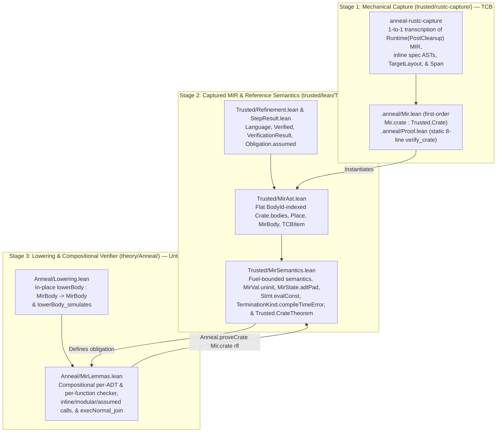

<!-- Copyright 2026 The Fuchsia Authors

Licensed under a BSD-style license <LICENSE-BSD>, Apache License, Version 2.0
<LICENSE-APACHE or https://www.apache.org/licenses/LICENSE-2.0>, or the MIT
license <LICENSE-MIT or https://opensource.org/licenses/MIT>, at your option.
This file may not be copied, modified, or distributed except according to
those terms. -->

# Multi-Step MIR and Toolchain Architecture

> **Note:** Anneal is under active development. Parts of the design and
> architecture described in this document are not yet implemented or may be
> implemented differently; this document may be aspirational or stale relative
> to the codebase.

Anneal verifies Rust crates by extracting their Mid-level Intermediate
Representation (MIR) from `rustc` and proving verification obligations over
that MIR in the Lean 4 theorem prover. Designing this pipeline requires
balancing **Trusted Computing Base (TCB) auditability** against **proof
ergonomics and stability**:

- **Auditability pulls toward raw `rustc` MIR and simple, first-order code:**
  Any transformation performed inside the Rust extractor happens outside the
  Lean kernel. If the extractor rewrites control flow, desugars projections, or
  synthesizes Lean `Prop` formulas in Rust, a bug in that Rust code can silently
  alter what is being proved. Likewise, if the Lean semantics inside `trusted/`
  rely on tactic blocks, well-founded recursion proofs, or mutual inductive
  types, Lean's elaborator generates complex auxiliary definitions in the
  compiled `.olean` environment. Keeping the TCB small and auditable requires a
  thin, purely syntactic Rust extractor and a transparent, tactic-free Lean
  semantic model.
- **Verification ergonomics and stability pull toward normalized MIR:**
  `rustc`'s `Runtime(PostCleanup)` MIR contains low-level control-flow chains,
  storage markers, and `nop` statements that are tedious to step through
  directly and can shift across compiler releases.

Anneal resolves this tension with a **three-stage MIR pipeline** split across
the repository's `trusted/` and `theory/` boundary:

1. **Stage 1 — Mechanical, First-Order Capture (`trusted/rustc-capture/`):** A
   thin `rustc_driver` wrapper transcribes each compiled crate's
   `Runtime(PostCleanup)` MIR and inline specification attributes 1-to-1 into
   purely first-order Lean data definitions (`Mir.crate : Trusted.Crate`,
   currently emitted in `.anneal/Mir.lean`) and a fixed, crate-independent
   8-line proof entrypoint (`.anneal/Proof.lean`), performing zero semantic
   normalization in Rust. (In multi-crate workspaces, Stage 1 runs per crate in
   the Cargo build graph, and downstream crates compose upstream verified
   contracts and TCB ledgers as described in
   [`docs/design.md`](design.md#library-centric-verification).)
2. **Stage 2 — Flat Captured MIR & Reference Semantics
   (`trusted/lean/Trusted/`):** A tactic-free, fuel-bounded Lean AST and
   small-step operational semantics evaluate captured MIR over a flat,
   `BodyId`-indexed table (`Crate.bodies`) and a value-tree memory model with
   explicit uninitialized leaves (`MirVal.uninit`). `Trusted/MirAst.lean`
   represents the full `Runtime(PostCleanup)` MIR statement, rvalue, terminator,
   operand, and projection syntax without `.unsupported` AST placeholders;
   unmodeled operations fail closed at the semantic layer in
   `Trusted/MirSemantics.lean` only when a verified obligation reaches them.
3. **Stage 3 — In-Place Verified Lowering & Compositional Proof Engine
   (`theory/Anneal/`):** Untrusted, kernel-checked passes in `theory/` normalize
   `MirBody` in place (`lowerBody : MirBody → MirBody`), prove a backward
   simulation (`lowerBody_simulates`) back to the Stage 2 semantics, and
   discharge `Trusted.CrateTheorem` compositionally per ADT and per function.

Because Stage 3 lives in `theory/`, is verified by `anneal-audit` in CI to be
pure and axiom-free, and proves its own soundness inside the Lean 4 kernel, all
control-flow normalization, compositional checkers, and symbolic execution
lemmas remain **outside the human-audited TCB**.

For related context, see:

- [`docs/design.md`](design.md) for Anneal's end-to-end user workflow,
  library-centric verification model, and incremental adoption.
- [`docs/trust-model.md`](trust-model.md) for how Anneal's CI enforces the
  boundary between `trusted/` and `theory/`.

## Architectural goals

Anneal's MIR pipeline is organized around six concrete goals:

1. **No semantic desugaring or formula synthesis in Rust:** Stage 1 maps
   `rustc` data structures directly to first-order Lean constructors. It never
   rewrites places or control flow, never filters out unverified items via
   duplicate semantic analyses in Rust, and never formats Lean propositions or
   per-function tactic scripts.
2. **Static, crate-independent `Proof.lean`:** Every crate receives the exact
   same 8-line `.anneal/Proof.lean` file stating `theorem verify_crate :
   Trusted.CrateTheorem Mir.crate := Anneal.proveCrate Mir.crate rfl`. No crate
   name, function name, or user annotation is ever interpolated into
   `Proof.lean`.
3. **Tactic-free, flat, and `opaque`-free `trusted/lean/`:** Stage 2 uses a
   flat `BodyId` table instead of mutual inductive types, uses structural
   recursion on explicit `Nat` fuel instead of `partial` or `WellFounded.fix`,
   contains zero `by` tactic blocks (`SourceRole.trusted`), and contains zero
   dummy `opaque` constants.
4. **Unconditional MIR syntax capture with semantic-layer fail-closed
   evaluation:** `Trusted/MirAst.lean` represents the complete
   `Runtime(PostCleanup)` MIR statement, expression, projection, and control-flow
   grammar (`PlaceElem`, `Operand`, `BinOp`, `UnOp`, `CastKind`, `BorrowKind`,
   `RawPtrKind`, `Rvalue`, `Stmt`, `Terminator`) without `.unsupported` syntax
   placeholders, keeping only a bounded `.unmodeled` leaf fallback on `MirTy`
   for exotic compiler-internal types (`Dynamic`, `Alias`, `Coroutine`, `Pat`,
   `UnsafeBinder`). Stage 1 translates MIR syntax unconditionally, while Stage 2
   (`Trusted/MirSemantics.lean`) is the sole place that defines which operations
   evaluate to a value versus stepping to `.failed` (undefined behavior).
5. **In-place Stage 3 normalization without AST duplication:** Rather than
   duplicating `MirBody`, `Stmt`, `Rvalue`, and `MirVal` into a parallel AST
   hierarchy, Stage 3 normalizes `Trusted.MirBody` in place (`lowerBody`) and
   verifies functions compositionally.
6. **Source-span diagnostics:** Captured declarations, statements, and
   terminators carry Rust source `Span` metadata (`file`, `line`, `col`) so
   verification failures identify the exact Rust statement or assertion that
   could not be discharged.

## The three-stage MIR pipeline



### Stage 1: Mechanical, first-order `rustc` capture (`trusted/rustc-capture/`)

`trusted/rustc-capture/` links against `rustc_driver` and `rustc_middle` to
extract the compiled crate's `Runtime(PostCleanup)` MIR, layout facts, and
inline specification attributes into `.anneal/Mir.lean` and
`.anneal/Proof.lean`.

#### 1-to-1 transcription without Rust-side desugaring

Stage 1 translates each `rustc_middle::mir` construct directly into its
corresponding constructor in `Trusted/MirAst.lean`:

- **Places and projections (`Place`, `PlaceElem`):** A MIR `Place` is emitted
  directly as `(LocalId, List PlaceElem)` with `.deref` and `.field idx`
  projection elements. Stage 1 never pattern-matches projection chains in Rust
  to synthesize special-case rvalues.
- **Operands and rvalues (`Operand`, `Rvalue`):** `Operand::Copy(p)`,
  `Operand::Move(p)`, and `Operand::Constant(...)` map 1-to-1 to
  `Operand.copy`, `Operand.move`, and `Operand.constVal` / `Operand.constParam`.
  `Rvalue::Use`, `Rvalue::Ref`, `Rvalue::RawPtr`, `Rvalue::BinaryOp`,
  `Rvalue::Aggregate`, and `Rvalue::Cast(Transmute)` map directly to `Rvalue`
  constructors.
- **Statements and terminators (`Stmt`, `Terminator`):** `Assign`, `EvalConst`
  (unevaluated `()` constant evaluation from `Operand::Constant` and
  `Body::required_consts`), `StorageLive`, `StorageDead`, `PlaceMention`, and
  `Nop` map 1-to-1 to `Stmt`; `Return`, `Goto`, `SwitchInt`, `Call` (including
  `SizeOf`, `AlignOf`, and `TransmuteCopy`), and `Assert` (with `AssertFailKind`
  distinguishing `.unwind`, `.abort`, and `.ub`) map 1-to-1 to `Terminator`.

Because Stage 1 performs no control-flow restructuring or expression
simplification, a human reviewer can audit each arm in
`trusted/rustc-capture/src/extract.rs` directly against the cited `rustc`
definition.

#### First-order `.anneal/Mir.lean` and static `.anneal/Proof.lean`

Stage 1 separates the crate-specific data payload from the proof entrypoint:

- **`.anneal/Mir.lean` is 100% first-order algebraic data:** `Mir.lean` defines
  `def crate : Trusted.Crate := ...` using only constructors, natural numbers,
  booleans, strings, and lists. Inline Rust specifications
  (`#[anneal::requires]`, `#[anneal::ensures]`, `#[anneal::invariant]`,
  `#[anneal::trusted]`) are parsed into first-order specification AST
  constructors (`RequiresSpec`, `PostSpec`, `InvariantSpec`) inside `Mir.crate`
  and denoted into `Prop` by pure functions in `Trusted/MirSemantics.lean`.
  `rustc-capture` never emits raw Lean `Prop` syntax, quantifiers, or tactic
  blocks. Because every captured body and declaration is pure first-order data
  indexed by `BodyId`, large crates can partition `Mir.crate`'s declarations
  across per-body submodules for parallel Lean elaboration without changing the
  trust model or the proof entrypoint.
- **`.anneal/Proof.lean` is fixed and crate-independent:** Regardless of what
  the Rust crate contains, `rustc-capture` writes the exact same 8-line file:

  ```lean
  prelude
  import Trusted
  import Mir
  import Anneal.MirLemmas

  namespace Proof
  theorem verify_crate : Trusted.CrateTheorem Mir.crate :=
    Anneal.proveCrate Mir.crate rfl
  end Proof
  ```

  Because `Proof.lean` contains no crate-derived strings or identifiers, an
  untrusted crate annotation cannot alter the theorem statement or inject Lean
  commands into the proof script.

#### Unconditional MIR syntax capture and semantic-layer gating

Anneal intentionally avoids `.unsupported` placeholder constructors on MIR
syntax AST nodes and instead pushes unsupported-feature handling into the
semantic layer (`Trusted/MirSemantics.lean`):

- **Why unsupported constructs are handled in semantics, not syntax:**
  `rustc`'s `Runtime(PostCleanup)` MIR operational grammar (`PlaceElem`,
  `Operand`, `BinOp`, `UnOp`, `CastKind`, `BorrowKind`, `RawPtrKind`,
  `NonDivergingIntrinsic`, `Rvalue`, `Stmt`, and `Terminator`) is small and
  finite. Collapsing unmodeled MIR constructs into `.unsupported` inside
  `trusted/rustc-capture/` would force the Rust extractor to encode semantic
  feature-subsetting policy, discard structural detail from `.anneal/Mir.lean`,
  and require coordinated edits across both `trusted/rustc-capture/` and
  `trusted/lean/` whenever Stage 2 adds rules for another MIR construct. By
  capturing the MIR operational syntax unconditionally in `Trusted/MirAst.lean`
  and defining feature support solely in `Trusted/MirSemantics.lean`, Stage 1
  remains a purely syntactic 1-to-1 transcriber and `Trusted/MirSemantics.lean`
  is the single source of truth for what is semantically modeled.
- **Which AST nodes may be `.unmodeled`:**
  - **Operational MIR syntax (`PlaceElem`, `Operand`, `BinOp`, `UnOp`,
    `CastKind`, `BorrowKind`, `RawPtrKind`, `NonDivergingIntrinsic`, `Rvalue`,
    `Stmt`, `Terminator`):** Represented unconditionally in
    `Trusted/MirAst.lean` with **no** `.unsupported` or `.unmodeled`
    constructors.
  - **Compiler type internals (`MirTy`):** Only `MirTy` retains a single
    bounded `.unmodeled` leaf constructor for non-MIR compiler type-system
    internals (`Dynamic` trait-object existential binders, unnormalized `Alias`
    projections/opaques, `Coroutine`/`CoroutineWitness`, pattern types `Pat`,
    and `UnsafeBinder`) whose representation would otherwise pull `rustc`'s
    trait-solver and binder machinery into `Trusted/MirAst.lean`. Standard Rust
    types (scalars, tuples, arrays, slices, references, raw pointers, ADTs,
    function pointers/items, closures, `Never`, `Foreign`, and `Param`) are
    represented explicitly in `MirTy`.

All semantic gating happens fail-closed in `Trusted/MirSemantics.lean`:

- If a verified function's specification, layout calculation (`evalTyByteSize`),
  generic substitution (`MirTy.subst`, `Terminator.subst`), or reachable
  execution path (`evalMirStmt`, `evalMirTerminator`) encounters an unmodeled
  MIR construct or `MirTy.unmodeled`, evaluation in `Trusted/MirSemantics.lean`
  returns `none` or steps to `.failed` (undefined behavior), making
  `Trusted.CrateTheorem` unprovable.
- If a verified function calls a cross-crate transparent dependency body
  (`BodyDecl.isTransparentDep = true`), `CapturedFn.obligations` emits an
  explicit `Obligation.assumed (TCBItem.transparentDepBody fnName calleeId)`
  entry that must be present in the crate's audited `c.tcb` ledger.
- Unverified functions in the same crate that are never called by verified code
  do not block verification of the functions in scope.

### Stage 2: Captured MIR and reference semantics (`trusted/lean/Trusted/`)

Stage 2 defines the verification framework and the Rust MIR reference semantics
in four tactic-free Lean modules under `trusted/lean/Trusted/`:

1. **`Trusted/Refinement.lean`:** Defines the refinement preorder (`Preorder`,
   `Partial`, `Behavior`), program-indexed languages (`Language`), complete
   behavioral verification (`Language.Verified`), `Obligation`, `TrustPolicy`,
   and `VerificationResult`. Unproved assumptions (such as `rustc`'s compilation
   of MIR to machine code, assumed external contracts, or waived unverified
   functions) are represented uniformly via
   `abbrev Obligation.assumed (id : Id) : Obligation Id := ⟨id, False⟩`, which
   can only be discharged in `VerificationResult` when `id` appears explicitly
   in the crate's audited `c.tcb` waiver list. This eliminates the need for
   dummy `opaque` target-language constants in the TCB.
2. **`Trusted/StepResult.lean`:** Defines small-step operational machines
   (`SmallStepMachine`), bounded prefix reachability (`ReachesPrefix`,
   `PrefixOutcome`), and step-decoupled eventual behaviors (`EventualOut` and
   `EventualBehaviorOf`) with explicit `.running`, `.terminated`, `.stuck`, and
   `.failed` (undefined behavior) outcomes.
3. **`Trusted/MirAst.lean`:** Defines the first-order captured MIR data
   structures: `LocalId`, `BlockId`, `BodyId`, `MirTy`, `Place`
   (`LocalId × List PlaceElem`), `Operand`, `Rvalue`, `Stmt`, `Terminator`,
   `MirBody`, `BodyDecl`, `InvariantSpec`, `RequiresSpec`, `PostSpec`,
   `TCBItem`, `CapturedFn`, and `Crate`.
4. **`Trusted/MirSemantics.lean`:** Defines the small-step operational
   semantics, value-tree memory model (`MirVal`), place projection lenses,
   target layout and representation predicates (`ValidTargetLayout`,
   `evalTyByteSize`, `evalTyAlign`, `MirState.adtPad`), inline constant
   evaluation (`Stmt.evalConst`, `TerminationKind.compileTimeError`), ADT
   invariant admissibility (`AdmissibleAdtInv`), per-function verification
   (`CapturedFn.obligations`), and the top-level crate obligation
   (`Trusted.CrateTheorem`).

#### Flat `BodyId`-indexed `Crate.bodies` table (no `mutual` inductive types)

In `Trusted/MirAst.lean`, every captured function or constant body is stored
once as a `BodyDecl` in the flat `Crate.bodies` table and referenced elsewhere
by `BodyId`:

- `Terminator.call` and `Stmt.evalConst` reference callees and unevaluated
  constant bodies by `BodyId` rather than recursively embedding a `MirBody`
  inside `Terminator` or `Stmt`.
- `TCBItem` (`rustcLowering`, `fnVerified`, `compileTimeGuard`,
  `documentedIntent`, `pinnedCompilerCoupled`) identifies functions by
  `(fnName : String)` and `(bodyId : BodyId)` rather than embedding `MirBody`.

Keeping `MirBody` out of `Terminator` and `TCBItem` eliminates `mutual`
inductive types in `Trusted/MirAst.lean`, avoids duplicating shared callee ASTs
across the call graph, and allows `theory/` to decide structural equality on
`MirBody` without fuel bounds or manual mutual recursors.

#### Value-tree memory model, `Place` lenses, and partial-move soundness

`Trusted/MirSemantics.lean` represents values as functional trees (`MirVal`):

- Scalar and aggregate nodes (`unit`, `bool`, `usize`, `adt`),
- Opaque generic-parameter byte payloads (`bytes`),
- Logical references (`ref`), and
- Leaf-granular uninitialized field/local markers (`MirVal.uninit`).

Composite places `(loc, projection)` are read and updated through lens helpers
over `List PlaceElem` (`.deref` and `.field idx`):

- **`evalProj` and `MirVal.isFullyInit`:** Reading (`Operand.copy` or
  `Operand.move`) or borrowing (`Rvalue.ref`) a place traverses its projection
  path, verifies that every intermediate dereference targets a live, valid
  place, and requires `MirVal.isFullyInit` on the resulting `MirVal`—stepping to
  `.failed` (UB) if any leaf of the read or borrowed value is `MirVal.uninit`.
- **`updateProj` on moves and assignments:** Assigning to a projected place
  writes the new subvalue back into the root local's `MirVal` tree. Crucially,
  evaluating `Operand.move p` both returns the value at `p` and updates `p` to
  `MirVal.uninit` via `updateProj` (`deinitPlace`). If a function moves a field
  `_1.0` out of a non-`Copy` struct and subsequently reads or moves `_1` or
  `_1.0` again before reinitializing it, `MirVal.isFullyInit` detects the
  `MirVal.uninit` leaf and steps to `.failed`.
- **Distinguishing uninitialized fields from non-deterministic padding bytes
  (`AdtRepr` and `MirState.adtPad`):** `MirVal.adt` stores typed field values
  rather than raw padding bytes, so constructing an initialized struct whose
  layout contains inter-field or trailing padding produces a fully initialized
  `MirVal.adt` tree that can be borrowed or copied normally. Meanwhile,
  `evalTyByteSize` models representation-specific byte sizes via `AdtDecl.repr`
  (`AdtRepr.transparent`, `AdtRepr.c`, and `AdtRepr.rust`) and an execution-
  state padding environment `MirState.adtPad : AdtId → Nat`:
  - `#[repr(transparent)]` structs have exact single-non-ZST-field size and
    alignment with zero added padding;
  - `#[repr(C)]` structs compute deterministic C ABI field offsets and trailing
    alignment rounding; and
  - `#[repr(Rust)]` structs add `s.adtPad adtId` unconstrained padding bytes,
    universally quantified in `initMirState`.
  If code attempts to reinterpret a `#[repr(Rust)]` struct via `transmute` or
  `transmute_copy` without a representation guarantee, `s.adtPad adtId > 0`
  makes the struct contain uninitialized padding bytes that `extractTransmuteBits`
  rejects as `.failed` (or mismatches the destination byte size). Likewise,
  opaque generic parameter values (`MirVal.bytes`, which may contain padding or
  uninitialized bytes at runtime) are valid to copy or move at their parameter
  type, whereas `extractTransmuteBits` rejects reinterpreting `MirVal.bytes` or
  `MirVal.uninit` as a concrete integer.

#### UB faults vs. runtime panics vs. compile-time errors

Rust distinguishes undefined behavior, runtime panics/aborts, and compile-time
`const` evaluation failures. `Trusted/MirSemantics.lean` models each outcome
distinctly via `StepResult` and `TerminationKind`:

- **Undefined behavior (`.failed`):** Reaching `Terminator.unreachable`,
  reading an uninitialized or moved-out place (`MirVal.uninit`), dereferencing
  a dead local generation, failing an alignment or pointer UB assertion
  (`Terminator.assert` with `AssertFailKind.ub`, checked across both
  `s.ubChecks = true` and `s.ubChecks = false`), or violating `transmute` /
  `transmute_copy` size or bit-validity steps to `.failed`.
- **Clean runtime unwinding or abort (`.terminated .unwind` /
  `.terminated .abort`):** `rustc` lowers checked arithmetic overflow (`+`,
  `-`, `*`), division or remainder by zero, and slice bounds checks to
  `TerminatorKind::Assert` (`AssertFailKind.unwind` or `AssertFailKind.abort`),
  and lowers explicit `panic!` or `assert!` failures to
  `core::panicking::panic*` (`Terminator.panic`). Under Anneal's baseline safety
  semantics (`PrefixOutcome.isSafe`), clean unwinding and aborting are safe,
  while total-correctness execution lemmas (`ExecNormal`) require normal return
  (`.terminated (.normal ...)`).
- **Compile-time constant rejection (`.terminated .compileTimeError`):**
  Inline `const { ... }` blocks and associated-constant guards lower to
  `Stmt.evalConst dst constId args`. When `evalMirStmt` executes
  `Stmt.evalConst`, it evaluates the referenced constant body:
  - If the constant body returns normally, execution continues to the next
    statement.
  - If the constant body terminates cleanly with `.unwind`, `.abort`, or
    `.compileTimeError`, the enclosing function steps to
    `.terminated .compileTimeError`—mirroring `rustc`'s post-monomorphization
    rejection of that instantiation before codegen.
  - If the constant body triggers undefined behavior (`.failed`) or exhausts
    fuel without terminating, the enclosing function steps to `.failed`, so a
    constant evaluation can never mask compile-time UB.
  Under `PrefixOutcome.isSafe`, `.terminated .compileTimeError` is safe (`True`),
  while `NonVacuousOn` requires that for every admitted entry state (and at
  least one monomorphization, or under zero `#[repr(Rust)]` padding when
  `allowCompileTimeGuard` is set), execution reaches a normal return rather than
  vacuously rejecting all instantiations.

### Stage 3: In-place lowering and compositional verification (`theory/Anneal/`)

Stage 3 (`theory/Anneal/`) provides the normalization passes, compositional
checkers, and symbolic execution lemmas that prove
`Trusted.CrateTheorem Mir.crate`:

- **In-place CFG lowering (`theory/Anneal/Lowering.lean`):** Rather than
  translating `Trusted.MirBody` into a separate AST type, `lowerBody :
  MirBody → MirBody` simplifies a captured body in place. It strips `Stmt.nop`
  and collapses forwarding `goto` chains across terminator targets while
  preserving `b.blocks.length`, `BlockId` numbering, and
  `storageLive`/`storageDead` statements (so use-after-`StorageDead` checks on
  dangling borrows remain sound). The theorem `lowerBody_simulates` proves a
  backward simulation: proving `ExecNormal c (lowerBody b) s P` suffices to
  establish `ExecNormal c b s P` on the unlowered body.
- **Compositional per-ADT and per-function verification
  (`theory/Anneal/MirLemmas.lean`):** `Anneal.proveCrate` decomposes
  `Trusted.CrateTheorem` across the crate's tables:
  1. `NoDupIds` for `c.bodies` and `c.functions`;
  2. Per-ADT invariant admissibility (`AdmissibleAdtInv c.adts c.adtInv`); and
  3. Per-function verification (`VerificationResult defaultTrustPolicy c.tcb
     (fn.obligations c.adts c.bodies c.adtInv c.tcb)` for each `CapturedFn` in
     `c.functions`).
- **Intra-crate and transparent cross-crate call verification:** At
  `Terminator.call1` targeting `calleeId` with `typeArgs`, Stage 2 and Stage 3
  resolve the `BodyDecl` entry in `c.bodies`, instantiate `MirBody.subst
  typeArgs`, push a `StackFrame` onto `MirState.stack`, and require a
  `TCBItem.transparentDepBody` waiver in `c.tcb` whenever
  `BodyDecl.isTransparentDep = true`.
- **Diamond CFG joins and state canonicalization (`execNormal_join`):** When
  two branches of a `Terminator.switchInt` reconverge at a join block, path
  states may differ in dead branch-local temporaries. Because Stage 2 maps
  `Stmt.storageDead l` to writing `MirVal.uninit` into local `l`, dead
  temporaries on both branches canonicalize to `MirVal.uninit`, allowing
  `execNormal_join` to merge the branches and verify the suffix from the join
  block once.

## Repository layout

Anneal's directory structure mirrors the trust boundary (`trusted/` vs.
`theory/`):

```text
anneal/
├── trusted/                        # Human-audited Trusted Computing Base (TCB)
│   ├── root-manifest.sha256        # SHA-256 pins for Cargo & Nix root manifests
│   ├── rustc-capture/              # Stage 1: rustc_driver MIR & spec extractor
│   │   ├── Cargo.toml
│   │   └── src/
│   │       ├── main.rs             # GuardedFileLoader & rustc_driver entrypoint
│   │       ├── hook.rs             # Multi-config driver & MIR query hooks
│   │       ├── items.rs            # Crate item, ADT, const, & layout extraction
│   │       ├── extract.rs          # 1-to-1 MIR body & spec AST extraction
│   │       ├── ir.rs               # First-order intermediate capture structs
│   │       └── lean.rs             # Deterministic Mir.lean & Proof.lean emitter
│   ├── lean/                       # Stage 2: Trusted Lean foundation (tactic-free)
│   │   ├── foundation-lock.json    # SHA-256 pins for lean binary & Init.*
│   │   ├── Trusted.lean            # Root TCB prelude import
│   │   └── Trusted/
│   │       ├── Refinement.lean     # Behavior, Language, Verified, VerificationResult
│   │       ├── StepResult.lean     # StepResult, Outcome, & bounded ExecSteps
│   │       ├── MirAst.lean         # Flat BodyId-indexed MIR AST & TCBItem
│   │       └── MirSemantics.lean   # Small-step MIR semantics & CrateTheorem
│   ├── audit/                      # CI-only .olean replay & boundary auditor
│   │   ├── src/                    # anneal-audit Rust binary & manifest checks
│   │   └── TrustedBoundary.lean    # Syntax allowlist & kernel DAG inspector
│   └── cargo-anneal/               # CLI orchestrator (cargo anneal)
└── theory/                         # Stage 3: Untrusted, kernel-checked proofs
    └── Anneal/
        ├── Refinement.lean         # Simulation & Obligation composition lemmas
        ├── StepResult.lean         # Fuel monotonicity & step composition lemmas
        ├── Lowering.lean           # In-place lowerBody & lowerBody_simulates
        └── MirLemmas.lean          # Compositional checker & symbolic execution
```

## Compiler integration and extraction lifecycle

Because Anneal's correctness promise applies to the Rust crate as compiled by
`rustc`, `trusted/rustc-capture/` hooks directly into `rustc`'s query and
codegen pipeline so that captured MIR reflects the exact semantics `rustc`
compiles.

### Why Anneal captures `Runtime(PostCleanup)` MIR with `-Z mir-preserve-ub`

`rustc` lowers source code through HIR, THIR, built MIR, borrow-checked
`Analysis` MIR, and finally **`Runtime(PostCleanup)` MIR** immediately before
monomorphization and code generation:

- **Explicit drops and control flow:** Implicit destructor calls (`Drop`),
  unwind edges, and state machines have already been elaborated into explicit
  basic blocks and terminators, so `trusted/lean/` does not need to re-implement
  drop elaboration or borrow checking.
- **Preserved Rust types and projections:** Unlike LLVM IR,
  `Runtime(PostCleanup)` MIR retains full Rust type definitions, ADTs, place
  projections, and pointer mutability metadata needed to detect Rust-level
  undefined behavior.
- **Preserving UB checks via `-Z mir-preserve-ub`:** In default builds,
  `rustc`'s `RemovePlaceMention` pass erases `StatementKind::PlaceMention`
  statements (such as `let _ = *ptr;`) before `Runtime(PostCleanup)`.
  `rustc-capture` injects `-Z mir-preserve-ub` into the compiler invocation so
  `PlaceMention` and other UB-bearing checks survive into `Runtime(PostCleanup)`
  and are checked by `Stmt.placeMention` in `Trusted/MirSemantics.lean`.

### Intercepting MIR before `Steal<Body>` consumption

During compilation, `rustc` stores intermediate MIR in `Steal<Body>` cells that
are consumed ("stolen") when transitioning from analysis to runtime MIR passes.
In `trusted/rustc-capture/src/hook.rs`, `rustc-capture` overrides the
`mir_drops_elaborated_and_const_checked` query provider—whose final step
(`run_analysis_to_runtime_passes`) produces `MirPhase::Runtime(RuntimePhase::PostCleanup)`
before `DeadBlocks` runs—to clone each local body (preserving its full
`Body::required_consts` list) into thread-local storage before downstream
queries (`mir_for_ctfe`, `optimized_mir`) steal the `Steal<Body>` cell, and
reads that `Runtime(PostCleanup)` snapshot inside `after_analysis`.

### Dual-configuration debug-assertion consistency (`CONFIGS`)

Code that is only safe when `debug_assert!` is active is unsound in release
builds. Conversely, ordinary Rust arithmetic (`+`, `-`, `*`) emits overflow
`TerminatorKind::Assert` checks when overflow checks are enabled. To verify
that functions do not rely on `debug_assert!` while modeling overflow checks
consistently, `rustc-capture` runs the compiler pipeline across two
configurations (`-C debug-assertions=on -C overflow-checks=on` vs.
`-C debug-assertions=off -C overflow-checks=off`) and checks that every
captured function's rendered `Mir.lean` is identical across both passes.

### Guarding against post-monomorphization errors (PMEs) and layout-coupled assumptions

In `rustc`, `Runtime(PostCleanup)` MIR is constructed per generic function
before monomorphization completes, and `#[repr(Rust)]` struct layout is left
unspecified across compiler versions and flags (such as `-Z randomize-layout`).
Anneal models both post-monomorphization constant evaluation and layout
assumptions directly inside the small-step semantics and `TCBItem` ledger:

1. **Inline `Stmt.evalConst` and pre-pruning `Body::required_consts`:**
   Even a dead branch such as `if false { const { panic!() } }` can trigger a
   post-monomorphization error in `rustc` before dead-block pruning runs.
   Stage 1 captures both reachable `Operand::Constant(Const::Unevaluated)`
   statements and any remaining entries in `Body::required_consts` (from the
   `mir_drops_elaborated_and_const_checked` snapshot before `DeadBlocks`
   executes) as explicit `Stmt.evalConst` statements. Evaluating a failing
   constant steps cleanly to `.terminated .compileTimeError` (excluding that
   monomorphization or padding assignment from runtime execution), while a
   constant that triggers UB or diverges steps to `.failed`.
2. **Four-tier forward-compatibility and soundness taxonomy (`S0`–`S3`):**
   - **`S0` (Unconditionally forward-compatible):** Functions proved across all
     valid monomorphizations (`ValidTySizes`) and all `#[repr(Rust)]` padding
     assignments (`s.adtPad : AdtId → Nat`), such as code using
     `#[repr(transparent)]` or `#[repr(C)]`, emit only the standard
     `TCBItem.rustcLowering` and `TCBItem.fnVerified` items.
   - **`S1` (`TCBItem.compileTimeGuard` / `#[anneal::allow_compile_time_guard]`):**
     Functions that guard a `#[repr(Rust)]` layout assumption with a
     compile-time `const { assert!(size_of::<S>() == ...) }` check never execute
     UB at runtime under any layout (they step to `.compileTimeError` when
     `s.adtPad > 0`), and record `TCBItem.compileTimeGuard` to disclose that a
     future compiler layout change could cause compilation to fail cleanly.
   - **`S2` (`TCBItem.documentedIntent` / `#[anneal::documented_intent("...")]`):**
     Functions that rely on a documented library or toolchain guarantee not yet
     modeled in Lean record an auditable `TCBItem.documentedIntent` citation.
   - **`S3` (`TCBItem.pinnedCompilerCoupled` /
     `#[anneal::pinned_compiler_coupled("...")]`):** Functions with an unguarded
     assumption about the pinned compiler's accidental `#[repr(Rust)]` layout
     cannot be proved under unconstrained `s.adtPad`; they verify only under the
     explicit waiver `s.adtPad = 0` and record `TCBItem.pinnedCompilerCoupled`
     in `c.tcb`.

## Toolchain pinning and compiler upgrades

`rustc`'s internal `rustc_private` APIs change across compiler releases. Anneal
pins a single deterministic `rustc` and `lean` toolchain in `flake.nix` and
`flake.lock` (authenticated via `trusted/root-manifest.sha256`,
`trusted/lean/foundation-lock.json`, and
`trusted/cargo-anneal/src/toolchain-lock.sha256`) and absorbs toolchain
upgrades across the three stages according to what changed:

1. **Internal `rustc_private` API changes (absorbed in Stage 1):** Compiler
   refactorings that rename internal queries or types without changing emitted
   MIR are handled entirely inside `trusted/rustc-capture/`, leaving
   `trusted/lean/` and `theory/` untouched.
2. **Minor MIR shape variations (absorbed in Stage 3 `lowerBody`):** Changes in
   how `rustc` emits `nop` statements or splits straight-line basic blocks are
   normalized away in place by `theory/Anneal/Lowering.lean` (`lowerBody` and
   `lowerBody_simulates`), keeping downstream verification lemmas stable without
   expanding `trusted/lean/`.
3. **New MIR constructs (staged in Stage 2 via `candidate:<feature>`):** When
   Anneal adds support for a new MIR construct, `Trusted/MirAst.lean` and
   `Trusted/MirSemantics.lean` receive an additive constructor and step rule
   under a `-- anneal-trust-tier: candidate:<feature>` directive until human
   auditing against the pinned Rust Reference and `rustc` source completes.
