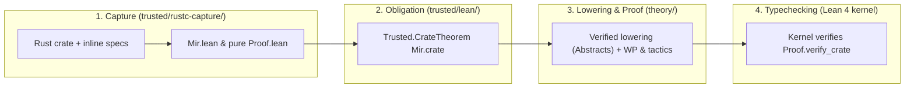

<!-- Copyright 2026 The Fuchsia Authors

Licensed under a BSD-style license <LICENSE-BSD>, Apache License, Version 2.0
<LICENSE-APACHE or https://www.apache.org/licenses/LICENSE-2.0>, or the MIT
license <LICENSE-MIT or https://opensource.org/licenses/MIT>, at your option.
This file may not be copied, modified, or distributed except according to
those terms. -->

# Anneal Design Overview

> **Note:** Anneal is under active development. Parts of the design and
> architecture described in this document are not yet implemented or may be
> implemented differently; this document may be aspirational or stale relative
> to the codebase.

Anneal is a formal verification framework for Rust. It allows engineers to
prove that Rust crates—including crates that rely on `unsafe` pointers, custom
memory layouts, interior mutability, and inline assembly—cannot trigger
undefined behavior (UB) and satisfy their functional specifications.

Anneal is designed around three commitments that implement
[`PRINCIPLES.md`](../PRINCIPLES.md):

1. **Verify the code `rustc` actually compiles.** Anneal does not ask users to
   rewrite Rust in a custom verification language. Instead, it hooks into Cargo
   and `rustc` to extract the crate's typed Mid-level Intermediate
   Representation (MIR) after borrow checking and drop elaboration, and states
   verification theorems directly over that extracted representation in the
   Lean 4 theorem prover.
2. **Keep the Trusted Computing Base (TCB) small and mechanically fenced.**
   Every component whose correctness must be trusted without a machine-checked
   proof lives under [`trusted/`](../trusted). Proof automation,
   weakest-precondition (WP) calculi, separation logic, and intermediate
   representation (IR) lowering passes live outside the TCB under `theory/`. In
   Anneal's CI, `anneal-audit` (`trusted/audit/`) verifies that `theory/` is
   pure, side-effect-free, and axiom-free so it cannot use OS APIs,
   metaprogramming side effects, or custom axioms to undermine `trusted/`. On a
   user's machine, the Lean 4 kernel checks every proof constructed by
   `theory/` against the theorem statement generated by `trusted/`, so a bug in
   `theory/` can cause verification to fail, but cannot cause a false claim to
   pass.
3. **Support libraries first and scale incrementally.** Systems Rust lives in
   libraries (`zerocopy`, allocators, synchronization primitives, kernel and
   cryptographic routines) that have no `fn main()` entrypoint and expose
   generic APIs to unknown callers. Anneal verifies individual functions and
   safe abstraction boundaries modularly, and supports incremental adoption so
   teams can start by proving baseline memory safety on a single `unsafe`
   function before expanding to crate-wide functional correctness.

For deeper coverage of specific subsystems, see:

- [`PRINCIPLES.md`](../PRINCIPLES.md) for Anneal's mission, correctness
  promise, and decision-making priority order.
- [`docs/architecture.md`](architecture.md) for the three-stage MIR pipeline,
  `rustc` extraction lifecycle, repository layout, and multi-version toolchain
  strategy.
- [`docs/trust-model.md`](trust-model.md) for the `trusted/` vs. `theory/`
  boundary and repository CI auditing.

## End-to-end verification workflow

When a user runs `cargo anneal` on a Rust crate, verification on the user's
machine proceeds through four stages:

1. **Capture and proof-script generation (`trusted/rustc-capture/`):**
   `cargo anneal` invokes `rustc` within the normal Cargo build graph. After
   `rustc` finishes typechecking, borrow checking, and MIR cleanup—and confirms
   that the crate compiles without late errors—`anneal-rustc-capture`
   serializes two deterministic Lean files from the crate's
   `Runtime(PostCleanup)` MIR and inline specification attributes:
   - `Mir.lean`, a pure data module defining `Mir.crate : Trusted.Crate`.
   - `Proof.lean`, a pure proof script stating `theorem Proof.verify_crate :
     Trusted.CrateTheorem Mir.crate` and invoking `theory/` tactics to
     discharge it.
2. **Statement generation (`trusted/lean/`):** `Trusted.CrateTheorem Mir.crate`
   combines the captured `Mir.crate` definition with Anneal's reference
   operational semantics for Rust MIR. It asserts that every targeted function
   satisfies its specification and that all trusted definitions and assumptions
   used in the verification satisfy the crate's trust policy.
3. **Lowering and proof discharge (`theory/`):** Raw `rustc` MIR contains
   compiler-version-specific details and low-level control-flow edges that are
   awkward to reason about directly. When Lean elaborates `Proof.lean`,
   untrusted passes in `theory/` lower the captured MIR into a clean,
   version-independent stable representation, prove a backward simulation
   (`Abstracts`) showing that the lowering preserves all behaviors needed for
   verification, and discharge each function's obligation using
   weakest-precondition rules, separation logic, and domain tactics.
4. **Lean 4 kernel verification (`lean`):** The Lean 4 kernel typechecks the
   proof term produced for `Proof.verify_crate` against the proposition
   `Trusted.CrateTheorem Mir.crate`.

### Why repository auditing runs in Anneal's CI, not on user machines

Because Lean 4 is a general-purpose programming and metaprogramming language,
an unrestricted `.lean` file in `theory/` could otherwise execute arbitrary OS
commands during compilation (`#eval`, `run_cmd`, `initialize`), attach compiler
overrides (`@[implemented_by]`, `@[extern]`), or declare custom `axiom`s to
bypass the Lean kernel.

Anneal prevents this without running an auditor on the user's machine by
combining two invariants:

- **In Anneal's repository CI (`trusted/audit/`):** Before any change to Anneal
  can merge or ship in the toolchain archive, `anneal-audit` inspects all
  repository `.lean` sources and replays their compiled `.olean` artifacts in
  the standalone Lean kernel. This guarantees that the `theory/` library
  shipped with Anneal is strictly pure, side-effect-free, and axiom-free.
- **On the user's machine (`trusted/rustc-capture/`):** Users write
  specifications and proof guidance as Rust annotations rather than arbitrary
  Lean files. Because `trusted/rustc-capture/` (part of the human-audited TCB)
  generates `Mir.lean` and `Proof.lean` directly, `Proof.lean` is guaranteed to
  state the exact `Trusted.CrateTheorem Mir.crate` obligation and invoke only
  pure definitions from `trusted/lean/` and the CI-audited `theory/` library.

See [`docs/trust-model.md`](trust-model.md) for the full trust model and CI
boundary audit mechanics.

## Library-centric verification

Many verification tools assume a closed, whole-program model: they start from a
concrete `fn main()`, monomorphize every generic function at its known call
sites, and analyze only the states reachable in that single binary.

Whole-program verification does not fit foundational Rust libraries. A library
crate like `zerocopy` or a kernel synchronization library has no `main`
entrypoint, defines generic functions parameterized over caller-supplied types
and lifetimes, and uses internal `unsafe` blocks to implement a safe public
API. Verifying one concrete test harness says nothing about whether a
downstream caller can trigger UB by instantiating a generic parameter with an
unusual layout or calling public methods in a different order.

Anneal is library-centric by default:

- **Modular per-function verification:** Each function is verified against its
  contract for *all* caller states and arguments that satisfy its preconditions.
  When function `f` calls function `g`, the proof of `f` relies on `g`'s
  specification rather than re-inlining `g`'s body across the entire crate,
  keeping proof complexity proportional to individual function size.
- **Safe vs. `unsafe` function contracts:** In Rust, a safe function must be
  sound for *every* input that satisfies Rust's type and lifetime
  well-formedness invariants, whereas an `unsafe fn` may impose additional
  preconditions (its documented `# Safety` contract) that callers are
  responsible for upholding. Anneal reflects this distinction directly:
  - A safe function's default precondition is simply that its arguments and
    receiver satisfy their Rust type invariants.
  - An `unsafe fn` carries explicit specification preconditions that formalize
    its `# Safety` requirements; callers inside verified code must prove those
    preconditions at each call site.
- **Encapsulating `unsafe` behind safe abstractions:** A library often
  maintains a private data-structure invariant (for example, that an internal
  pointer is non-null and aligned, or that a length field never exceeds
  capacity) across multiple methods. Anneal lets a module define a type
  invariant linking the Rust struct's raw fields to a logical condition. Safe
  public constructors establish the invariant, safe methods assume it on entry
  and re-establish it on exit, and internal `unsafe` operations use the
  invariant to discharge their pointer and aliasing obligations.
- **Compositional cross-crate reuse:** When crate `B` depends on verified
  crate `A`, `B` can consume `A`'s machine-checked specifications directly as
  lemmas during `B`'s own proofs, while carrying `A`'s TCB and trust-policy
  ledger forward into the combined verification result. For small, unannotated
  upstream helper functions, Anneal can also capture and inline their MIR
  transparently so downstream proofs do not stall when an upstream dependency
  lacks a manual specification.

## Multi-modal specifications

Different Rust functions call for different kinds of guarantees. A low-level
byte parser primarily needs a proof that it never reads out of bounds or
produces an invalid enum discriminant; a cryptographic primitive or optimized
data structure may need a proof that it computes the exact same result as a
reference specification.

Anneal supports four complementary specification modes within a single
framework:

### 1. Baseline safety (absence of undefined behavior)

Every verified function in Anneal must at minimum be free of undefined behavior
for all inputs satisfying its preconditions. In Anneal's reference semantics,
undefined behavior is represented as an explicit fault state (`UB`). Proving a
function safe requires proving that no execution starting from a valid input
state can reach `UB`—ruling out out-of-bounds or unaligned memory accesses,
dangling pointer dereferences, aliasing violations, division by zero, invalid
scalar bit patterns (such as a `bool` byte other than `0` or `1`), and
unsynchronized data races.

### 2. Preconditions, postconditions, and invariants

Functions can attach relational pre- and postconditions (`requires` and
`ensures`) along with type invariants. These clauses constrain the relationship
between entry arguments, initial memory, return values, and final memory—for
example, stating that a slice-splitting routine returns two subslices whose
lengths sum to the original length and whose pointers remain within the same
allocated object.

### 3. Pure mathematical models

Reasoning directly about heap pointers, slice headers, and mutable borrows in
every caller proof quickly becomes verbose. Anneal allows a Rust type to be
linked via an abstraction relation to a pure mathematical model in Lean (such
as a mathematical list, finite map, integer, or protocol state machine).

Once a library function's postcondition is stated in terms of its mathematical
model—for example, that `Vec::push` appends an element to the list representing
the vector—callers can reason about higher-level algorithms using standard pure
mathematics in Lean while the underlying pointer and layout obligations stay
encapsulated inside the library's own proof.

### 4. Relational and behavioral equivalence

Sometimes the clearest specification for a complex, performance-critical
function (such as an `unsafe` SIMD or bit-twiddling routine) is a simpler,
obviously correct Rust function. Anneal supports relational equivalence
specifications: proving that for all valid inputs, an optimized implementation
produces the exact same return value and observable state updates as a
reference implementation.

## Incremental adoption

Adopting formal verification on an existing production crate is impractical if
the tool requires specifying and proving the entire crate before producing its
first useful guarantee. Anneal is designed for incremental adoption along two
axes: **breadth of coverage** across the codebase and **depth of specification**
on each function.

### Incremental breadth: from one `unsafe` leaf to a full crate

A maintainer can begin by targeting a single high-risk `unsafe` function in an
existing crate without annotating its callers or callees:

1. **Verify a single function in isolation:** Add a specification to one target
   function and prove its body.
2. **Make external assumptions explicit:** If the target function calls an
   unverified helper or relies on an unproved target property, the user can
   introduce an explicit assumption. Anneal records every assumption in the
   crate's machine-checked TCB report (`VerificationResult`), so reviewers see
   exactly what was proved and what was assumed.
3. **Retire assumptions incrementally:** Over subsequent commits, maintainers
   verify the helper functions and replace temporary assumptions with kernel-
   checked proofs, shrinking the assumption ledger until the module's public
   safe API relies only on standard trusted foundations.

### Incremental depth: from UB-freedom to full functional correctness

On any given function, verification depth can grow over time without throwing
away prior work:

1. **Level 1 — Baseline UB-freedom:** Prove that an `unsafe` function never
   triggers undefined behavior under its `# Safety` preconditions. This
   immediately turns informal `// Safety:` comments into machine-checked
   obligations.
2. **Level 2 — Structural postconditions and invariants:** Add postconditions
   and data-structure invariants needed by callers within the same module.
3. **Level 3 — Full functional or relational specification:** Connect the
   function to a pure mathematical model or prove equivalence against a
   reference implementation.

Because all three levels compile to obligations within the same
`Trusted.CrateTheorem` architecture, a single crate can freely mix functions at
different specification levels while maintaining a unified, auditable record of
what has been proved.
