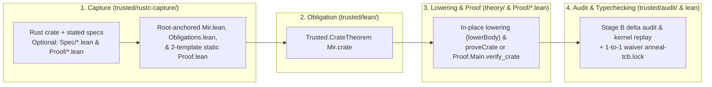

<!-- Copyright 2026 The Fuchsia Authors

Licensed under a BSD-style license <LICENSE-BSD>, Apache License, Version 2.0
<LICENSE-APACHE or https://www.apache.org/licenses/LICENSE-2.0>, or the MIT
license <LICENSE-MIT or https://opensource.org/licenses/MIT>, at your option.
This file may not be copied, modified, or distributed except according to
those terms. -->

# Anneal Design Overview

> **Note:** Anneal is under active development. Parts of the design and
> architecture described in this document are not yet implemented or may be
> implemented differently; this document may be aspirational or stale relative
> to the codebase.

Anneal is a formal verification framework for Rust. It allows engineers to
prove that Rust crates—including crates that rely on `unsafe` pointers, custom
memory layouts, interior mutability, and inline assembly—are sound (cannot
trigger undefined behavior (UB)) and satisfy any stated specifications.

Anneal is designed around three commitments that implement
[`META_PRINCIPLES.md`](../META_PRINCIPLES.md),
[`PRINCIPLES.md`](../PRINCIPLES.md), and
[`THREAT_MODEL.md`](../THREAT_MODEL.md):

1. **Verify the code `rustc` actually compiles.** Anneal does not ask users to
   rewrite Rust in a custom verification language. Instead, it hooks into Cargo
   and `rustc` to extract the crate's typed Mid-level Intermediate
   Representation (MIR) after borrow checking and drop elaboration, and states
   verification theorems directly over that extracted representation in the
   Lean 4 theorem prover.
2. **Keep the Trusted Computing Base (TCB) small and separate specifications
   from assumptions.** Every component whose correctness must be trusted without
   a machine-checked proof lives under [`trusted/`](../trusted), and human
   reviewers only need to inspect two bounded surfaces
   ([`THREAT_MODEL.md`](../THREAT_MODEL.md)): **stated specifications**
   (`#[anneal::*]` contracts, `#[anneal::spec]` definitions, and `Spec/*.lean`
   models, which define *what* Anneal proves) and **the TCB audit log**
   (`anneal-tcb.lock`, which records *what is assumed without proof*). Proof
   automation, weakest-precondition (WP) calculi, separation logic, and
   intermediate representation (IR) lowering passes live outside the TCB in
   `theory/` (and crate `Proof/*.lean`). Because the standalone Lean 4 kernel
   checks every proof against `Trusted.CrateTheorem Mir.crate`, neither proofs
   nor verified Rust implementation bodies ever need human review.
3. **Support libraries first and scale incrementally.** Systems Rust lives in
   libraries (`zerocopy`, allocators, synchronization primitives, kernel and
   cryptographic routines) that have no `fn main()` entrypoint and expose
   generic APIs to unknown callers. Anneal verifies individual functions,
   trait implementations, and safe abstraction boundaries modularly, and
   supports incremental adoption so teams can start by proving baseline memory
   safety on a single `unsafe` function while logging any remaining waivers in
   `anneal-tcb.lock`.

For deeper coverage of specific subsystems, read the companion documents in
this order:

- [`META_PRINCIPLES.md`](../META_PRINCIPLES.md),
  [`PRINCIPLES.md`](../PRINCIPLES.md), and
  [`THREAT_MODEL.md`](../THREAT_MODEL.md) for Anneal's governing goals,
  correctness promise, bounded human-review surfaces, and threat model.
- [`docs/architecture.md`](architecture.md) for the three-stage MIR pipeline,
  `rustc` extraction lifecycle, repository layout, and toolchain upgrade
  strategy.
- [`docs/trust-model.md`](trust-model.md) for how `trusted/` and
  `trusted/audit/` enforce the boundary between stated specifications, the TCB
  audit log, untrusted proofs, and verified Rust implementation bodies.

## End-to-end verification workflow

When a user runs `cargo anneal verify` on a Rust crate, verification proceeds in
an isolated build directory (`<target>/anneal/<crate-id>/lean/`) through four
stages:

1. **Capture, specification-closure check, and entrypoint generation
   (`trusted/rustc-capture/`):** `cargo anneal` resolves the Cargo workspace and
   invokes `rustc` across `release` (`debug-assertions=off,
   overflow-checks=off`) and `debug` (`debug-assertions=on,
   overflow-checks=on`) configurations with `-Z mir-preserve-ub` (holding
   `overflow-checks=on` constant on stated specifications so contract arithmetic
   is profile-independent and checked against overflow). After `rustc` finishes
   macro expansion, typechecking, borrow checking, and MIR cleanup,
   `anneal-rustc-capture` checks that every local definition referenced by a
   stated specification carries `#[anneal::spec]`, writes deterministic Lean
   files into `<target>/anneal/<crate-id>/lean/`, and emits the crate's TCB
   audit log (`anneal-tcb.lock`):
   - `Mir.lean`, a tactic-free, root-anchored (`_root_.`) first-order data
     module defining `Mir.crate : Trusted.Crate` (capturing the crate's ADTs,
     constants, statics, called and uncalled functions and closures across
     deduplicated `release` and `debug` MIR bodies, foreign `extern`
     declarations, trait implementations, stated contracts, and
     `Mir.crate.tcbWaivedIds`), plus `Obligations.lean` (stating shared
     per-item `<fn>_contract_wf` well-formedness obligations).
   - `Proof.lean`, one of two static, crate-independent proof entrypoints
     stating `theorem Proof.verify_crate : Trusted.CrateTheorem Mir.crate`—using
     **Template A** (`Anneal.proveCrate Mir.crate rfl`) when the crate has no
     `Proof/Main.lean`, or **Template B** (`Proof.Main.verify_crate`) when the
     crate supplies custom proofs in `Proof/*.lean`.
2. **Statement generation (`trusted/lean/`):** `Trusted.CrateTheorem Mir.crate`
   combines the captured `Mir.crate` definition with Anneal's reference
   operational semantics for Rust MIR. It enforces unwaivable contract and
   monomorphization well-formedness (`ContractWellFormed`) across all functions,
   foreign `extern` declarations, and trait implementations, and asserts that
   every behavioral obligation in the crate—across type invariants, constants,
   statics, functions, foreign `extern` declarations, and trait
   implementations—either holds by kernel proof or matches an explicit waiver in
   `Mir.crate.tcbWaivedIds` (which stands in 1-to-1 bijection with `[[waivers]]`
   in `anneal-tcb.lock`).
3. **Lowering and proof discharge (`theory/` and optional `Proof/*.lean`):** Raw
   `rustc` MIR contains low-level control-flow edges and `nop` statements that
   are awkward to step through directly. Untrusted passes in `theory/` normalize
   captured MIR bodies in place (`lowerBody`), prove a backward simulation
   (`lowerBody_simulates`) showing that normalization preserves all behaviors
   needed for verification, and discharge each obligation compositionally
   (`Anneal.proveCrate`, or custom proofs in `Proof/*.lean` built on `theory/`
   lemmas).
4. **Incremental boundary audit and Lean 4 kernel verification (`trusted/audit/`
   and `lean`):** `cargo anneal` loads Anneal's pre-audited `Init.*`,
   `Trusted.*`, and `Anneal.*` `.olean` modules from the toolchain archive,
   audits the crate's staged Lean delta (`Mir.lean`, `Obligations.lean`,
   `Proof.lean`, and any `Spec/*.lean` or `Proof/*.lean` modules), and replays
   the delta inside the standalone Lean 4 kernel (`trustLevel := 0`,
   `loadExts := false`) to verify
   `Proof.verify_crate : Trusted.CrateTheorem Mir.crate`.

### Two-stage boundary auditing: Anneal's CI and downstream CI

In Lean 4, surface tactics, macros, and compiler-override attributes
(`@[implemented_by]`, `@[extern]`, `@[csimp]`) elaborate down to `.olean` files,
while an unrestricted `.lean` file in `theory/` or `Proof/*.lean` could declare
custom `axiom`s, `sorry`, `native_decide` (`Lean.ofReduceBool`), or `partial`/
`unsafe` definitions, or prove a modified theorem statement to bypass the Lean
kernel.

Anneal prevents this at the compiled `.olean` kernel boundary (`loadExts :=
false`, `trustLevel := 0`) without re-auditing or re-compiling its own shipped
code on every user run by splitting boundary auditing across two composable
stages:

- **Stage A — In Anneal's repository CI (`anneal-audit --mode audit`):** Before
  any change to Anneal can merge or ship in the toolchain archive,
  `anneal-audit` (`trusted/audit/`) compiles and runs standalone `.olean`
  kernel replay across all of Anneal's `trusted/lean/` (`localSpec`) and
  `theory/` (`localProof`) modules against the pinned `Init.*` foundation,
  enforces `vetted` vs. `candidate:<feature>` tier separation, and packages the
  pre-compiled `.olean` modules and tier/footprint metadata
  (`toolchain-manifest.json`) into the release archive.
- **Stage B — When verifying a target crate (`cargo anneal verify`):**
  `cargo-anneal` loads the pre-audited Anneal `.olean`s as an immutable base
  environment and runs incremental `.olean` boundary auditing and standalone
  kernel replay (`--mode audit-delta`) only on the crate's own delta
  (`Mir.lean`, `Obligations.lean`, `Proof.lean`, and any crate-supplied
  `Spec/*.lean` or `Proof/*.lean` modules). User `Spec/*.lean` models are part
  of the crate's **stated specifications**: `trusted/audit/` verifies at the
  `.olean` boundary that `Spec/*.lean` never depends on `Proof.*`
  (Statement-Origin Separation) and introduces no axioms or `unsafe`,
  `partial`, or `opaque` declarations, without recording `Spec/*.lean` hashes
  in `anneal-tcb.lock`. Explicit waivers for
  [incremental adoption](#incremental-adoption) (such as `#[anneal::trusted]`
  items or `extern` declarations) are matched by `Mir.crate.tcbWaivedIds` and
  recorded in 1-to-1 bijection in `anneal-tcb.lock`, while untrusted proof
  modules (`Proof/*.lean`) and verified Rust implementation bodies require zero
  human review.

See [`THREAT_MODEL.md`](../THREAT_MODEL.md) for the controlling threat model and
[`docs/trust-model.md`](trust-model.md) for the auditor specification in
`trusted/audit/`.

## Library-centric verification

Many verification tools assume a closed, whole-program model: they start from a
concrete `fn main()`, monomorphize every generic function at its known call
sites, and analyze only the states reachable in that single binary.

Whole-program verification does not fit foundational Rust libraries. A library
crate like `zerocopy` or a kernel synchronization library has no `main`
entrypoint, defines generic functions parameterized over caller-supplied types
and lifetimes, and uses internal `unsafe` blocks to implement a safe public
API. Verifying one concrete test harness says nothing about whether a
downstream caller can trigger UB by instantiating a generic parameter with an
unusual layout or calling public methods in a different order.

Anneal is library-centric by default:

- **Modular per-function verification:** Each function is verified against its
  contract for *all* caller states and arguments that satisfy its preconditions.
  When function `f` calls function `g` (including a contracted `extern` or
  `#[anneal::trusted]` callee), the proof of `f` relies on `g`'s contract rather
  than re-inlining `g`'s body across the entire crate, keeping proof complexity
  proportional to individual function size.
- **Safe vs. `unsafe` function contracts (`SafetyPre` vs. `EffectivePost`):**
  In Rust, a safe function must be free of undefined behavior for *every*
  input permitted by the compiler and applicable library invariants, whereas an
  `unsafe fn` may impose additional unchecked preconditions (its documented
  `# Safety` contract) that callers are responsible for upholding. At the same
  time, a safe function may still attach `#[anneal::requires]` preconditions to
  qualify stronger functional guarantees (`#[anneal::ensures]` and
  `#[anneal::no_panic]`): for example, a safe `binary_search` function may
  require a sorted slice (`#[anneal::requires(is_sorted(s))]`) to guarantee a
  correct membership index without surrendering its baseline guarantee that
  calling `binary_search` on an unsorted slice is free of undefined behavior.
  Anneal models both guarantees in a single `Language.Verified` judgment over
  `(SafetyPre, EffectivePost)`:
  - **Baseline safety precondition (`SafetyPre`):** Assumes compiler-enforced
    entry conditions—valid runtime argument values and monomorphized local
    layouts (`initRuntimeState`) plus normal evaluation of the body's
    compiler-enforced `const { ... }` blocks and associated constants
    (`RequiredConstsAdmitted` over `body.requiredConsts`)—and assumes
    `#[anneal::requires]` (`RequiresAdmits`) **if and only if** `f.isUnsafe =
    true`.
  - **Unified postcondition (`EffectivePost`):** Requires baseline UB-freedom
    and ADT invariant preservation (`SafetyPost`) unconditionally across all
    `SafetyPre` executions, and requires functional postconditions and
    non-panicking termination (`ContractPost`) whenever `RequiresAdmits` holds
    at entry (`SafetyPost ∧ (RequiresAdmits → ContractPost)`).
  - **Modular call sites (`ModularCallStep`):** Calling a function requires
    `SafetyPre` (so calling a safe function requires no `#[anneal::requires]`
    proof to avoid UB, whereas calling an `unsafe fn` requires proving its
    `#[anneal::requires]` precondition) and yields `EffectivePost` (providing
    `SafetyPost` unconditionally and `ContractPost` whenever the caller
    establishes `RequiresAdmits`).
- **Safe and `unsafe` trait implementations:** When a trait declares stated
  specifications on its methods or associated constants, or is declared `unsafe`
  with a safety contract, every `impl` of that trait in the crate generates a
  verification obligation in `Trusted.CrateTheorem`: method implementations
  (including inherited default methods instantiated at `Self`) and associated
  constants must refine the trait's contracts (`mkTraitFnView`), and `unsafe
  impl` blocks must satisfy the trait's substituted safety contract (or carry an
  explicit `#[anneal::trusted]` waiver in `anneal-tcb.lock`).
- **Encapsulating `unsafe` behind safe abstractions ($\mathcal{V}_T$):** A
  library often maintains a private data-structure invariant (for example, that
  an internal pointer is non-null and aligned, or that a length field never
  exceeds capacity) across multiple methods. Anneal lets a module attach
  `#[anneal::invariant]` to an ADT $T$ whose invariant-referenced fields are
  non-`pub`. Functions inside the visibility scope $\mathcal{V}_T$ may
  temporarily break $T$'s invariant across intra-procedural statements (and
  inlined private helper or closure calls annotated with
  `#[anneal::broken_invariant(T)]`), but must establish or restore `AdtInv` for
  all $T \notin f.\text{brokenInvariants}$ at modular call boundaries and on
  both normal return and panic unwind—including across all simultaneously
  escaping `&mut` subfield borrows (`EscapingSubfieldBorrowsSafe`).
- **Compositional cross-crate reuse:** When crate `B` depends on verified
  crate `A`, `B` can consume `A`'s machine-checked specifications directly as
  lemmas during `B`'s own proofs, while propagating only `A`'s unproved waivers
  (`[[upstream_waivers]]`) into `B`'s `anneal-tcb.lock` so edits to `A`'s
  verified implementation bodies, specifications, or proofs never churn `B`'s
  lockfile.

## Multi-modal specifications

Different Rust functions call for different kinds of guarantees. A low-level
byte parser primarily needs a proof that it never reads out of bounds or
produces an invalid enum discriminant; a cryptographic primitive or optimized
data structure may need a proof that it computes the exact same result as a
reference specification.

Anneal supports four complementary specification modes. Because stated
specifications define *what* Anneal proves rather than what is assumed without
proof, none of the four modes adds entries to `anneal-tcb.lock`:

### 1. Baseline safety (absence of undefined behavior and PMEs)

Every executable item in a verified crate (called or uncalled functions,
methods, closures, constants, and statics) must at minimum satisfy
`ContractWellFormed` and be free of undefined behavior across `SafetyPre` (and
terminate normally without panicking under `ContractPre` when annotated with
`#[anneal::no_panic]` or `#[anneal::spec]`). In Anneal's reference semantics,
undefined behavior is represented as an explicit fault state (`.failed`).
Proving an item safe requires proving that no execution starting from a
`SafetyPre` state can reach `.failed`—ruling out out-of-bounds or unaligned
memory accesses, dangling pointer dereferences, reads of uninitialized memory
(`MirVal.uninit`), aliasing violations, division by zero, and invalid scalar bit
patterns—and that every normal return or panic unwind preserves all applicable
ADT invariants (`SafetyPost`).

Because `rustc` evaluates `body.requiredConsts` (`const { ... }` blocks,
associated constants, and promoted constants) and checks monomorphized local
layouts ($\le \text{isize::MAX}$) during monomorphization before emitting
executable code, a safe generic function that guards an internal `unsafe`
operation with `const { assert!(size_of::<Src>() == size_of::<Dst>()) }` can
rely on `RequiredConstsAdmitted` in `SafetyPre` to prove baseline UB-freedom at
Level 1 with zero attributes, whereas a safe function that omits the `const {
assert!(...) }` block from its body and writes only `#[anneal::requires(...)]`
is rejected because `SafetyPre` never assumes `RequiresAdmits` on safe
functions. Simultaneously, `ContractWellFormed` (`StaticFnWf` and
`MonoConstsWf`) checks concrete layout bounds at `zeroTySizes` and
`unitTySizes`, requires transitive static-callee `#[anneal::requires]` clauses
(`CalleeTypePreAdmitted`) to hold across all admitted layouts, and requires
`RequiredConstsAdmitted` across all admitted layouts whenever an item carries
`#[anneal::spec]` or a stated contract (`requires`, `ensures`, `no_panic`, or
`#[anneal::no_pme]`) or has an uninhabited parameter, while requiring
existential layout satisfiability (`∃ tySizes, AdmittedLayoutForFn ∧
RequiredConstsAdmitted`, which reduces to `tySizes = []` when `numTyParams =
0`) for uncontracted Level-1 functions with inhabited parameters so monomorphic
and unconditional `const { panic!() }` blocks are rejected without forcing
redundant attributes on guarded generic functions. Skipping behavioral
verification on any item requires an explicit `#[anneal::trusted(reason =
"...")]` waiver recorded in `anneal-tcb.lock`, while `ContractWellFormed`
remains unwaivable across all items.

To ensure baseline safety proofs remain sound across compiler versions and
layout flags (such as `-Z randomize-layout`), Anneal models target layouts
(`TargetLayout`), multi-field ADT representations (`AdtRepr.rust`,
`AdtRepr.transparent`, `AdtRepr.c`), layout queries (`Terminator.callLayout` for
`size_of` and `align_of`), assertion failure classifications (`AssertFailKind`),
and two-stage transmutation (`evalTransmuteVal`) directly in the reference
semantics. `#[repr(Rust)]` structs carry universally quantified padding
(`MirState.adtPad`), while inline `const { ... }` guards (`Stmt.evalConst`) step
failing instantiations cleanly to `TerminationKind.compileTimeError` and
classify layout assumptions along the `S0`–`S3` forward-compatibility tiers (see
[`docs/architecture.md`](architecture.md)).

### 2. Preconditions, postconditions, and invariants

Functions and types can attach relational pre- and postconditions
(`#[anneal::requires]` and `#[anneal::ensures]`) along with type invariants
(`#[anneal::invariant]`). These clauses constrain the relationship between entry
arguments, initial memory, return values, and final memory—for example, stating
that a slice-splitting routine returns two subslices whose lengths sum to the
original length. To prevent unreviewed implementation code from altering what a
stated contract means, `rustc-capture` requires every local helper function,
constant, closure, trait implementation, overloaded operator, or inspected type
referenced by a contract to carry `#[anneal::spec]`
([`docs/trust-model.md`](trust-model.md#3-capture-and-orchestrator-enforcement-cargo-anneal-and-rustc-capture)).

### 3. Pure mathematical models (`Spec/*.lean`)

Reasoning directly about heap pointers, slice headers, and mutable borrows in
every caller proof quickly becomes verbose. Anneal allows a crate to define
pure mathematical models, inductive types, and typeclass instances on those
models in `Spec/*.lean` (such as a protocol state machine, sequence model, or
permission lattice) and link Rust types and functions to `Spec.*` definitions in
`Mir.lean`.

Once a library function's contract is stated in terms of its `Spec.*`
mathematical model—for example, that `Vec::push` appends an element to the
model list representing the vector—callers can reason about higher-level
algorithms using pure mathematics in Lean while the underlying pointer and
layout obligations stay encapsulated inside the library's own `Proof/*.lean`
modules. Human reviewers inspect `Spec/*.lean` directly as part of the crate's
stated specifications (without recording `Spec/*.lean` hashes in
`anneal-tcb.lock`), and `trusted/audit/` verifies at the `.olean` kernel
boundary that `Spec/*.lean` never depends on `Proof.*` and introduces no axioms
or `unsafe`, `partial`, or `opaque` declarations.

### 4. Relational and behavioral equivalence (`#[anneal::spec]`)

Sometimes the clearest specification for a complex, performance-critical
function (such as an `unsafe` SIMD or bit-twiddling routine) is a simpler,
obviously correct Rust reference function marked `#[anneal::spec]`. Anneal
supports relational equivalence specifications: proving that for all valid
inputs, an optimized implementation produces the exact same return value and
observable state updates as a `#[anneal::spec]` reference function. To prevent
an unreviewed implementation edit from silently altering a dependency of a
`#[anneal::spec]` function, `rustc-capture` requires every transitive local
callee, constant, closure, trait or operator implementation, and inspected type
used by a `#[anneal::spec]` item to carry `#[anneal::spec]`, and requires every
executable `#[anneal::spec]` item to be proved UB-free and terminating
(`ExecNormal`).

## Incremental adoption

Adopting formal verification on an existing production crate is impractical if
the tool requires proving the entire crate before producing its first useful
guarantee. Anneal is designed for incremental adoption along two axes: **breadth
of coverage** across the codebase and **depth of specification** on each
function.

### Incremental breadth: from one `unsafe` leaf to a full crate

A maintainer can begin by proving a single high-risk `unsafe` function in an
existing crate while explicitly waiving the remaining items:

1. **Verify target functions and waive unverified items explicitly:** Prove the
   target function's body and mark any not-yet-verified functions, `extern`
   declarations, or `unsafe impl` blocks with `#[anneal::trusted(reason =
   "...")]`.
2. **Audit waivers in `anneal-tcb.lock`:** Anneal records every waived item
   (along with its assumed contract, transitive `body_sha256` across
   uncontracted local callees, and `assumed_callee_contracts`) in
   `Mir.crate.tcbWaivedIds` and in 1-to-1 bijection in `anneal-tcb.lock`, so
   reviewers see every unproved assumption in one place and any edit to
   unverified code invalidates the lockfile until reviewed.
3. **Retire waivers incrementally:** Over subsequent commits, maintainers verify
   the remaining functions and remove `#[anneal::trusted]` attributes, shrinking
   `anneal-tcb.lock` until `waivers = []` and the crate relies only on Anneal's
   trusted foundation.

### Incremental depth: from UB-freedom to full functional correctness

On any given function, verification depth can grow over time without throwing
away prior work:

1. **Level 1 — Baseline UB-freedom:** Prove that an `unsafe` function never
   triggers undefined behavior under its `# Safety` preconditions. This
   immediately turns informal `// Safety:` comments into machine-checked
   obligations.
2. **Level 2 — Structural postconditions and invariants:** Add postconditions
   and data-structure invariants needed by callers within the same module.
3. **Level 3 — Full functional or relational specification:** Connect the
   function to a pure mathematical model in `Spec/*.lean` or prove equivalence
   against a `#[anneal::spec]` reference implementation.

Because all three levels compile to obligations within the same
`Trusted.CrateTheorem` architecture, a single crate can freely mix functions at
different specification levels while maintaining a unified, auditable record of
what has been proved.
