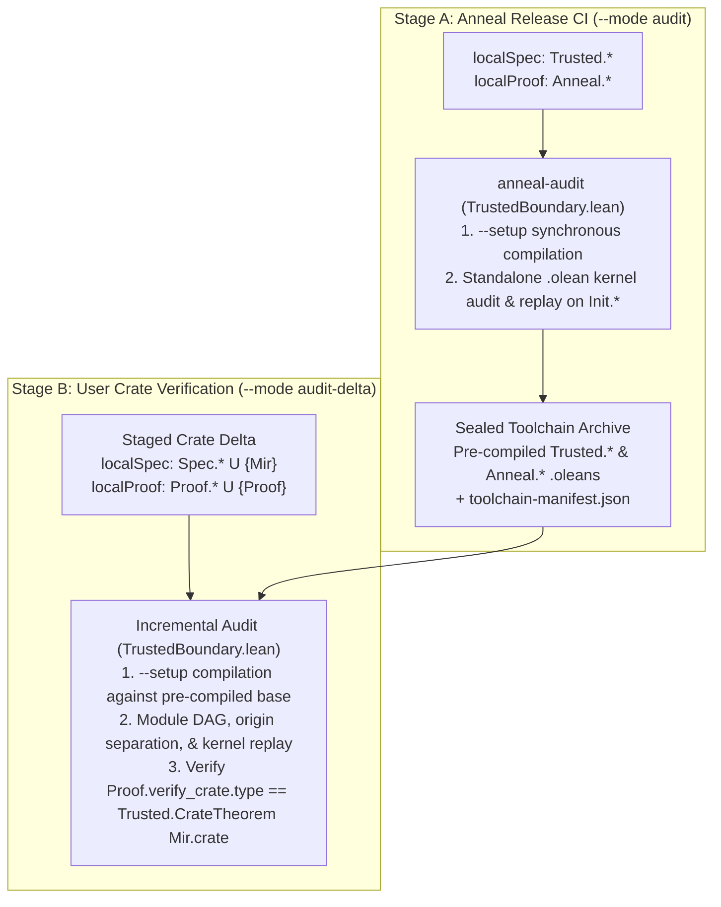

<!-- Copyright 2026 The Fuchsia Authors

Licensed under a BSD-style license <LICENSE-BSD>, Apache License, Version 2.0
<LICENSE-APACHE or https://www.apache.org/licenses/LICENSE-2.0>, or the MIT
license <LICENSE-MIT or https://opensource.org/licenses/MIT>, at your option.
This file may not be copied, modified, or distributed except according to
those terms. -->

# Trust Boundary and Audit Enforcement

> **Note:** Anneal is under active development. Parts of the design and
> architecture described in this document are not yet implemented or may be
> implemented differently; this document may be aspirational or stale relative
> to the codebase.

[`PRINCIPLES.md`](../PRINCIPLES.md) and [`THREAT_MODEL.md`](../THREAT_MODEL.md)
are the controlling documents for Anneal's correctness promise, threat model,
uncompromised execution-environment assumption, in-scope repository threats, and
downstream TCB audit log (`anneal-tcb.lock`).

This document specifies how Anneal's internal codebase
([`trusted/`](../trusted) vs. `theory/`) implements and enforces
[`PRINCIPLES.md`](../PRINCIPLES.md) and [`THREAT_MODEL.md`](../THREAT_MODEL.md):

- **Section 1** defines the three-layer trust partition across
  [`trusted/`](../trusted), `theory/`, and downstream user crates, enforces
  Cargo workspace containment, and binds external build, foundation, and
  pre-compiled toolchain artifacts into `trusted/` via cryptographic manifests.
- **Section 2** specifies the stage-agnostic `.olean` boundary auditor in
  [`trusted/audit/`](../trusted/audit) (`anneal-audit` and
  [`TrustedBoundary.lean`](../trusted/audit/TrustedBoundary.lean)), including
  its unified `(baseSpec, baseProof, localSpec, localProof)` model across Stage
  A (`--mode audit`) and Stage B (`--mode audit-delta`), standalone kernel
  replay (`loadExts := false`, `trustLevel := 0`), and unambiguous `Mir.lean`
  codegen.
- **Section 3** specifies how [`trusted/cargo-anneal/`](../trusted/cargo-anneal)
  and [`trusted/rustc-capture/`](../trusted/rustc-capture) enforce the Stage 1
  and orchestrator defenses of
  [`THREAT_MODEL.md`](../THREAT_MODEL.md#3-in-scope-threats-from-untrusted-repository-contents)
  and which legacy checks are eliminated or relocated to `cargo anneal setup`.
- **Section 4** describes how `trusted/lean/` keeps compiled `.olean` constants
  transparent for human auditing and stages work-in-progress semantic rules via
  `vetted` vs. `candidate:<feature>` module tiers.
- **Section 5** states the dependency and provenance-citation requirements for
  code inside [`trusted/`](../trusted).

For related architectural details, see:

- [`docs/design.md`](design.md) for an overview of Anneal's verification
  workflow, library-centric verification model, and four specification modes.
- [`docs/architecture.md`](architecture.md) for the three-stage MIR pipeline
  and how untrusted lowering passes in `theory/` connect to `trusted/lean/`.

## 1. Repository layout and hash-locked external files

Within the `joshlf/anneal` repository and across downstream crate verification,
artifacts are partitioned into three epistemic layers—**Layer 1 (Execution &
foundation TCB)** and **Layer 2 (Specification & assumption TCB)** inside
[`trusted/`](../trusted) (and user `Spec/*.lean` / `Mir.lean`), and **Layer 3
(Untrusted proof layer)** outside the TCB in `theory/` (and user
`Proof/*.lean`):

| Zone | Directory | Epistemic layer & components | Trust status |
| :--- | :--- | :--- | :--- |
| **Trusted foundation** | [`trusted/`](../trusted) | **Layer 1 (Execution TCB):** `trusted/rustc-capture/`, `trusted/audit/`, `trusted/cargo-anneal/`. **Layer 2 (Specification TCB):** `trusted/lean/` (`Trusted.*` MIR AST and reference semantics). | **In the TCB.** Audited by humans (alongside external files pinned by hash manifests inside `trusted/`). |
| **Proof theory** | `theory/` | **Layer 3 (Untrusted proof layer):** `Anneal.*` (`lowerBody`, `lowerBody_simulates`, `proveCrate`, WP & separation-logic lemmas, and proof automation). | **Outside the TCB.** Audited mechanically by `trusted/audit/` in Anneal's CI and checked by the Lean 4 kernel. |

### Cargo workspace containment

In Anneal's own repository (`anneal-audit --mode audit`), before inspecting Lean
modules, `anneal-audit` verifies that every Cargo workspace member and `path`
dependency resides under `trusted/`. Because Rust code (including `build.rs`
scripts and procedural macros) is effectful and not checked by the Lean kernel,
no Rust crate in Anneal's repository is permitted outside `trusted/`.

### Binding external and pre-compiled artifacts via manifests

An auditor inspecting the Anneal repository only needs to review `trusted/` to
verify that Anneal upholds [`PRINCIPLES.md`](../PRINCIPLES.md) and
[`THREAT_MODEL.md`](../THREAT_MODEL.md). Because Cargo, Nix, and upstream
toolchain artifacts live at the repository root or in the packaged toolchain
archive, `trusted/` binds them via three manifests:

- **[`trusted/root-manifest.sha256`](../trusted/root-manifest.sha256)**
  *(checked into Git)*: Pins the SHA-256 digests of the repository's root build
  files (`Cargo.toml`, `Cargo.lock`, `flake.nix`, and `flake.lock`), verified
  by CI and `anneal-audit --mode audit`.
- **[`foundation-lock.json`](../trusted/lean/foundation-lock.json)**
  (`trusted/lean/foundation-lock.json`, *checked into Git*): Pins the SHA-256
  digests of the `lean` executable, all `Init.*` prelude source and
  `.olean`/`.ir` companion files, and the foundation axiom allowlist
  (`{Classical.choice, Quot.sound, propext}`), verified by the Nix toolchain
  build (`flake.nix`), `anneal-audit`, and `cargo anneal setup`.
- **`toolchain-manifest.json`** *(emitted by Stage A `anneal-audit --mode audit`
  into the sealed toolchain archive)*: Binds the Stage A audit results to the
  packaged `.olean` artifacts so Stage B does not re-audit or re-compile
  `Init.*`, `Trusted.*`, or `Anneal.*` on user machines. It records:
  1. `foundationLockSha256`: the SHA-256 digest of `foundation-lock.json`;
  2. `componentTiers` and `trustedModuleTiers`: the validated trust tiers
     (`"vetted"` or `"candidate:<feature>"`) of Layer 1 components (such as
     `rustc_capture`) and Layer 2 `Trusted.*` modules;
  3. `taintedBaseConsts`: the set of `Init.*` constants whose transitive
     dependency cone in `Init.*` reaches any `.axiomInfo` outside
     `{Classical.choice, Quot.sound, propext}` (such as `sorryAx`,
     `ofReduceBool`, or `ofReduceNat`), any constant with `isUnsafe ||
     isPartial`, or any `.opaqueInfo` `o ∈ Init.*` paired with a partial
     compiler companion `o._unsafe_rec`;
  4. `candidateFootprints`: for each constant `c` in `Trusted.* ∪ Anneal.*`
     with a non-empty candidate reachability set, the sorted list of
     `candidate:<feature>` strings transitively reachable from `c` across
     `Trusted.* ∪ Anneal.*`; and
  5. `moduleArtifacts`: the SHA-256 digests of all pre-compiled `Trusted.*` and
     `Anneal.*` `.olean`/`.ir` companion files (verified once at installation
     time by `cargo anneal setup`).

## 2. Stage-agnostic `.olean` boundary auditor (`trusted/audit/`)

[`trusted/audit/`](../trusted/audit) implements the two-stage boundary audit
that separates Anneal's own release CI from downstream crate verification
([`docs/design.md`](design.md#two-stage-boundary-auditing-anneals-ci-and-downstream-ci))
using a single `.olean` kernel auditor parameterized by a 4-tuple of disjoint
module sets `(baseSpec, baseProof, localSpec, localProof)` and an optional
theorem pin `targetTheorem?`:

| Stage & CLI mode | `baseSpec` (Pre-audited Layer 1/2) | `baseProof` (Pre-audited Layer 3) | `localSpec` (Staged Layer 2) | `localProof` (Staged Layer 3) | `targetTheorem?` |
| :--- | :--- | :--- | :--- | :--- | :--- |
| **Stage A: Anneal CI (`--mode audit`)** | `Init.*` | $\emptyset$ | `Trusted.*` (`trusted/lean/`) | `Anneal.*` (`theory/`) | `none` |
| **Stage B: Crate delta (`--mode audit-delta`)** | `Init.*` $\cup$ `Trusted.*` $\cup$ upstream `Spec.<CrateId>.*` | `Anneal.*` | `Spec.*` $\cup$ $\{\text{`Mir`}\}$ | `Proof.*` $\cup$ $\{\text{`Proof`}\}$ | `some (`Proof, ``Proof.verify_crate, ``Mir.crate)` |

### Standalone `.olean` kernel replay and DAG audit (`TrustedBoundary.lean`)

Why audit at the compiled `.olean` kernel boundary rather than maintaining a
syntactic parser allowlist over Lean surface syntax? In Lean 4, all surface
macros, tactics (`simp`, `omega`, `grind`), custom notations, and attributes
(`@[implemented_by]`, `@[extern]`, `@[csimp]`) elaborate down to `.olean` module
files. When the auditor loads those `.olean` files in a separate process with
**`trustLevel := 0`, `plugins := #[]`, and `loadExts := false`**, no `[init]`
initializers or compiler-override environment extensions are deserialized or
consulted by the kernel: the standalone C++ Lean 4 kernel sees only pure kernel
`ConstantInfo` declarations and re-typechecks every proof term from scratch.
Auditing at the `.olean` kernel boundary is therefore mathematically total for
proof soundness while allowing proof and specification authors in `theory/`,
`Proof/*.lean`, and `Spec/*.lean` to use standard Lean 4 syntax, tactics, and
typeclasses without artificial parser restrictions.

Before compiling `localSpec ∪ localProof`, `anneal-audit` verifies that no
pre-existing `.olean`, `.ilean`, or `.ir` files exist in the source directories,
stages the `.lean` sources into a clean temporary directory, and compiles
`localSpec ∪ localProof` synchronously in topological order via `lean --setup
<module>.setup.json -Ddebug.skipKernelTC=false`. `TrustedBoundary.lean` then
loads the environment over `baseSpec ∪ baseProof ∪ localSpec ∪ localProof` with
`trustLevel := 0`, `plugins := #[]`, and `loadExts := false` and enforces five
kernel-level checks in time $O(|\text{localSpec} \cup \text{localProof}|)$:

1. **Module DAG, layer separation, and provenance verification (`validateGraph`
   and `verifyAndCollectLocals`):** Verifies that only modules in `baseSpec ∪
   baseProof ∪ localSpec ∪ localProof` are present in the `.olean` import graph;
   that no module in `localSpec` transitively imports any module in `baseProof ∪
   localProof` (and in Stage A no `.vetted` `Trusted.*` module imports a
   `candidate:<feature>` module); and that every constant in `m ∈ localSpec ∪
   localProof` has `origin env c == m` and matches its stored entry in
   `env.checked`.
2. **Full module-prefix ownership and declaration purity
   (`validateLocalConstant`):** For every constant `ci` defined in `m ∈
   localSpec ∪ localProof`, let `u := privateToUserName ci.name`:
   - If `m ∈ {`Trusted, `Anneal, `Mir, `Proof}`, `u.getRoot` must equal `m`
     (permitting `Mir.crate`, `Mir.Fn.*`, and `Mir.Const.*` in module `Mir`).
     For every submodule `m` (`Spec.*`, `Proof.*`, `Trusted.*`, `Anneal.*`),
     **`m.isPrefixOf u`** must hold (so `Spec.Foo` can only declare constants
     under `Spec.Foo.*` and `Proof.Bar` under `Proof.Bar.*`), and in multi-crate
     workspaces no local `Spec//**` module may use an upstream dependency's
     canonical Cargo `<CrateId>` as ``.
   - If `u == ``Proof.verify_crate`, then `m` must be ``Proof`; if `u ==
     ``Mir.crate`, then `m` must be ``Mir`.
   - `ci` must not be `.axiomInfo`, `.opaqueInfo`, `.quotInfo`, `isUnsafe`, or
     `isPartial` (excluding verified `_unsafe_rec` structural-recursion compiler
     helpers paired with a safe, non-partial `.defnInfo` in `m`, which are
     omitted from `locals` before kernel replay).
3. **Statement-Origin Separation, axiom purity, and tier monotonicity
   (`checkEdges`):** Traverses `declarationEdges ci` for every `ci` in
   `localSpec ∪ localProof` (stopping at the pre-audited `baseSpec ∪ baseProof`
   boundary):
   - **Axiom and taint purity:** No edge may target a constant in
     `taintedBaseConsts` (ensuring the transitive closure reaches only
     `{Classical.choice, Quot.sound, propext}` and blocking `sorryAx`,
     `Lean.ofReduceBool` from `native_decide`, `Lean.ofReduceNat`, and
     partial/unsafe `Init.*` helpers).
   - **Statement-Origin Separation:** Every constant in `localSpec` may
     reference only constants in `baseSpec ∪ localSpec`, never `baseProof ∪
     localProof`.
   - **Vetted tier rule (Stage A):** A constant in a `.vetted` `Trusted.*`
     module may reference only `Init.*` and `.vetted` `Trusted.*` constants,
     never `candidate:<feature>`.
   - **Candidate footprint propagation (Stage B):** For every edge from
     `localSpec` or the transitive local cone of `Proof.verify_crate` to a base
     constant `d ∈ Trusted.* ∪ Anneal.*`, Stage B unions
     `candidateFootprints[d]` (together with any active Layer 1 `componentTiers`
     candidate feature) from `toolchain-manifest.json` into the crate's active
     `candidate_features` set for `anneal-tcb.lock`.
4. **Exact syntactic theorem-type and universe-parameter pinning (Stage B):**
   When `targetTheorem?` is present, verifies that `Proof.verify_crate` is a
   `.thmInfo` in module `Proof` with **`ci.levelParams.isEmpty`** whose kernel
   `ci.type` is structurally equal (`==`, not `isDefEq`) to `Expr.app (.const
   ``Trusted.CrateTheorem []) (.const ``Mir.crate [])`, and that `Mir.crate` is
   a `.defnInfo` in module `Mir` with **`ci_mir.levelParams.isEmpty`** and
   `ci_mir.type == .const ``Trusted.Crate []`.
5. **Standalone kernel replay (`replay`):** Imports `baseEnv` over `baseSpec ∪
   baseProof` (`loadExts := false`, `trustLevel := 0`) and runs
   `baseEnv.toKernelEnv.replay locals`, re-typechecking every declaration in
   `localSpec ∪ localProof` inside the standalone Lean 4 kernel.

### Unambiguous `Mir.lean` codegen (`trusted/rustc-capture/src/lean.rs`)

In Mode 3 ([`docs/design.md`](design.md#3-pure-mathematical-models-speclean)),
`Mir.lean` imports user `Spec.<Mod>` modules when Rust specifications reference
user-defined mathematical models in `Spec/*.lean`. To ensure that declarations
or typeclass instances in `Spec/*.lean` can never shadow identifiers or hijack
typeclass resolution inside generated `Mir.lean` definitions:

- `Mir.lean` begins with `prelude`, imports only `Trusted` (plus `Spec.<Mod>`
  when Mode 3 references are present), and contains no `open` or `export`
  commands, tactic blocks, anonymous constructors `⟨...⟩`, or overloaded
  operators or numeric literals.
- Because Full Module-Prefix Ownership (`m.isPrefixOf u`) confines every
  constant declared in `Spec.<Mod>` to the `Spec.<Mod>.*` namespace, `Mir.lean`
  emits all AST constructors, primitive values, and integer literals using
  explicit root-qualified constructors and raw kernel literals
  (`Trusted.Crate.mk`, `Trusted.Stmt.assign`, `Bool.true`, `Option.some`,
  `List.cons`, `nat_lit n`, `Int.ofNat (nat_lit n)`, `Int.negSucc (nat_lit n)`,
  `Spec.<Mod>.<item>`). Because `nat_lit` and explicit constructor applications
  do not invoke `OfNat`, `Neg`, or `Coe` typeclass synthesis, `Mir.lean`
  elaborates identically regardless of what typeclasses or instances user
  `Spec/*.lean` modules define.

## 3. Stage 1 and orchestrator enforcement (`cargo-anneal` and `rustc-capture`)

[`trusted/cargo-anneal/`](../trusted/cargo-anneal) and
[`trusted/rustc-capture/`](../trusted/rustc-capture) implement the artifact
capture and TCB audit-log guarantees required by
[`THREAT_MODEL.md`](../THREAT_MODEL.md#3-in-scope-threats-from-untrusted-repository-contents)
through a four-step verification pipeline (`cargo anneal verify [--locked]`):

1. **Private staging and dependency graph resolution (`cargo metadata
   --locked`):**
   `cargo-anneal` rejects pre-existing `.olean`, `.ilean`, or `.ir` files in
   `Spec/` or `Proof/` and user files at the reserved generated root paths
   (`Mir.lean`, `Mir/**`, `Proof.lean`), copies the workspace into a private
   staging directory (`<staging>/workspace`, permissions `0700`) outside the
   checkout so `Mir.lean` and `Proof.lean` are generated in isolation, and
   resolves the workspace dependency graph via `cargo metadata --format-version
   1 --locked`.
2. **Multi-configuration `Runtime(PostCleanup)` MIR and specification capture
   (`rustc-capture`):**
   `cargo-anneal` invokes Cargo in topological workspace order using its pinned
   toolchain (`RUSTC_WORKSPACE_WRAPPER = <toolchain>/bin/anneal-rustc-capture`,
   `--target-dir <staging>/target`, `--locked`, `--offline`). Host `build.rs`
   and `proc-macro` targets compile with the pinned `rustc`, and for each
   verified target crate $C$, `anneal-rustc-capture` captures
   `Runtime(PostCleanup)` MIR **after** `build.rs` code generation (`OUT_DIR`)
   and procedural-macro expansion have completed:
   - Traverses nested `DefKind::Mod` submodules across `src/**/*.rs` (emitting
     crate-relative module-qualified `Mir.Fn.<mod>__<item>` names) and runs the
     compiler pipeline across `CONFIGS` (`debug-assertions=on,
     overflow-checks=on` and `debug-assertions=off, overflow-checks=off` with
     `-Z mir-preserve-ub`), cloning `Runtime(PostCleanup)` MIR (and pre-pruning
     `Body::required_consts`) inside `mir_drops_elaborated_and_const_checked`
     before `DeadBlocks` runs, and requiring byte-for-byte identical rendered
     `Mir.lean` bodies across both configurations.
   - Emits `Mir.lean` and the static two-template `Proof.lean` into
     `<staging>/lean/`, and extracts all user-brought specification and
     assumption surfaces for the crate's TCB audit log (`anneal-tcb.lock`; see
     [`THREAT_MODEL.md`](../THREAT_MODEL.md#3-in-scope-threats-from-untrusted-repository-contents)):
     1. **Two-template `Proof.lean` generation:** Emits
        `<staging>/lean/Proof.lean` using **Template A** (`theorem
        Proof.verify_crate : Trusted.CrateTheorem Mir.crate := Anneal.proveCrate
        Mir.crate rfl`, when `Proof/Main.lean` is absent) or **Template B**
        (`theorem Proof.verify_crate : Trusted.CrateTheorem Mir.crate :=
        Proof.Main.verify_crate`, when `Proof/Main.lean` is present).
     2. **Inline contracts, `Spec/*.lean` models, and Mode 4 `spec_fn` /
        `required_consts` closures:** Extracts `requires`, `ensures`,
        `invariant` (from `#[anneal::...]` attributes and `/// anneal:...` doc
        comments), non-empty `required_consts`, `Spec/*.lean` digests, any
        compile-time environment variables read via `env!` or `option_env!`
        (`tcx.sess.psess.env_depinfo`), and the full transitive callee,
        trait-impl, closure, and constant MIR and source closure of every Mode 4
        `spec_fn` (failing closed if a `spec_fn` reaches dynamic dispatch `dyn
        Trait`, an `extern` call, or an uncaptured function).
     3. **Explicit waivers (`#[anneal::trusted]`), `unverified_functions`, and
        private-invariant visibility scopes ($\mathcal{V}_T$):** Records all
        `unverified_functions` (tagging `[unsafe_fn]` and
        `[contains_unsafe_block]` items) in `anneal-tcb.lock`. For every ADT $T$
        with `allFieldsPubSafe = false`, computes $\mathcal{V}_T$ as the union
        of full Rust HIR visibility regions (`ty::Visibility`: the defining
        module **and all of its descendant submodules** for private fields, the
        target module subtree for `pub(in path)`, or the crate for `pub(crate)`)
        of $T$'s non-`pubSafe` fields, and records every unverified function in
        $\mathcal{V}_T$ as a `TCBItem.unverifiedFn` waiver in `Mir.crate.tcb`
        and `anneal-tcb.lock`.
     4. **Compositional cross-crate `UnitId` verification:** Binds each verified
        workspace crate to a recursive Merkle `UnitId` over its compilation
        inputs (`tcx.sess.psess.file_depinfo`) and upstream `UnitId`s. When an
        upstream crate `<CrateId>` exports `Spec/<Mod>.lean` models (or authors
        them at `Spec/<CrateId>/<Mod>.lean`), `cargo-anneal` deterministically
        stages them at `<staging>/lean/Spec/<CrateId>/<Mod>.lean` with
        `Spec.<CrateId>.<Mod>` module and namespace prefixes, and propagates
        upstream waivers, `Spec.<CrateId>.*` digests, and `candidateFootprints`
        into downstream Stage B audits and `anneal-tcb.lock` files.
3. **Stage B incremental boundary audit (`--mode audit-delta`):**
   `cargo-anneal` stages user `Spec/*.lean` and `Proof/*.lean` files alongside
   `Mir.lean` and `Proof.lean` in `<staging>/lean/`, compiles `localSpec ∪
   localProof` via `lean --setup` against the pre-compiled toolchain `.olean`s,
   and runs `TrustedBoundary.lean` (`--mode audit-delta`).
4. **Zero-churn `anneal-tcb.lock` emission and verification:**
   `cargo-anneal` serializes `anneal-tcb.lock` keyed by canonical Rust item
   paths (omitting volatile `src/**/*.rs` implementation hashes, sequential
   `BodyId` integers, and `Span` line/column coordinates) and under `--locked`
   verifies exact equality with the committed `anneal-tcb.lock`.

### Eliminated and relocated legacy checks

Under
[`THREAT_MODEL.md`](../THREAT_MODEL.md#2-compromised-execution-environments-and-the-dev-vs-ci-boundary)'s
uncompromised execution-environment assumption and two-stage `.olean` boundary
audit, six legacy checks in `cargo-anneal` and `rustc-capture` are eliminated or
relocated out of the per-run verification path:

1. **Per-file `lstat`/`fstat` `(dev, ino)` TOCTOU checks (`read_regular`):**
   Eliminated and replaced by copying into the private `0700` staging directory.
2. **Per-run SHA-256 re-hashing of the installed toolchain tree
   (`authenticate_toolchain` and `toolchain-lock.sha256`):** Relocated to
   one-time installation verification in `cargo anneal setup` against
   `foundation-lock.json` and `toolchain-manifest.json`; `toolchain-lock.sha256`
   is retired.
3. **Per-run SHA-256 hashing of Anneal's repository source tree
   (`authenticate_anneal_root` and `anneal-sources.sha256`):** Eliminated; Stage
   B runs against the sealed toolchain archive rather than Anneal's source
   checkout.
4. **Per-run recompilation of `anneal-rustc-capture` from source
   (`ensure_rustc_capture_bin`):** Eliminated; `anneal-rustc-capture` is
   pre-compiled in Stage A and shipped in the toolchain archive.
5. **Per-run recompilation of `Trusted.*` and `Anneal.*` `.lean` files from
   source (`ensure_compiled_prefix`):** Eliminated; Stage A pre-compiles and
   audits `Trusted.*` and `Anneal.*` `.olean`s once into the toolchain archive.
6. **Single-file `CRATE_FILES = ["Cargo.toml", "Cargo.lock", "src/lib.rs", ...]`
   restriction:** Eliminated in favor of multi-file and multi-crate workspaces
   with `Mir.lean` and `Proof.lean` staged outside the repository checkout.

## 4. Staging TCB changes and `.olean` kernel transparency (`trusted/lean/`)

### Keeping `trusted/lean/` transparent at the `.olean` kernel level

Auditing `trusted/lean/` requires confidence not only in the surface `.lean`
source files, but also in the compiled `.olean` constants replayed by the Lean
4 kernel. Four design conventions in `trusted/lean/` keep its compiled kernel
environment simple and directly inspectable by human auditors:

- **Tactic-free definitions:** All definitions and foundational helper lemmas in
  `trusted/lean/` use explicit functional definitions and term-mode proofs
  rather than `by` tactic blocks that generate opaque auxiliary proof terms.
- **No `mutual` inductive types (`BodyId` table):** `Trusted/MirAst.lean`
  stores function bodies in a flat `Crate.bodies` list indexed by `BodyId`
  rather than nesting `MirBody` inside `Terminator` or `TCBItem`, avoiding the
  nested mutual recursors that Lean synthesizes for mutual inductive blocks.
- **Structural fuel-bounded recursion without `WellFounded.fix`:** Recursive
  semantic functions in `Trusted/StepResult.lean` and
  `Trusted/MirSemantics.lean` recurse structurally on an explicit `Nat` fuel
  argument (or on inductive syntax/value trees), avoiding well-founded recursion
  proof obligations in the kernel environment.
- **Explicit assumption obligations (`Obligation.assumed`) instead of `opaque`
  constants:** Trusted waivers (such as `TCBItem.rustcLowering`,
  `TCBItem.assumedContract`, and `TCBItem.unverifiedFn`) are stated via
  `Obligation.assumed (id : Id) : Obligation Id := ⟨id, False⟩` in
  `Trusted/Refinement.lean` rather than declaring dummy `opaque` constants in
  `Trusted/MirSemantics.lean`, allowing `TrustedBoundary.lean` to forbid
  `opaque` across all audited modules.

### Module-level trust tiers (`vetted` vs. `candidate:<feature>`)

Auditing a new semantic rule in `trusted/lean/` to full TCB standards—including
line-by-line Rust Reference citations and human review—takes deliberate effort.
To allow contributors and agents to build lowering passes and proofs in
`theory/` before a new semantic module in `trusted/lean/` has completed human
auditing, every module in `trusted/lean/` declares a module-level trust tier via
a leading header comment directive:

- **`-- anneal-trust-tier: vetted`:** Modules whose definitions have completed
  full Rust Reference auditing.
- **`-- anneal-trust-tier: candidate:<feature>`:** Work-in-progress TCB modules
  belonging to a named subsystem feature `<feature>` (such as `refinement`,
  `step_result`, `memory`, `mir_ast`, `mir_semantics`, or `rustc_capture`) that
  have not yet completed human auditing.

Assigning trust tiers at the module boundary rather than via per-declaration
attributes keeps `trusted/lean/` free of custom attribute macros or
metaprogramming: every constant compiled into a `Trusted` module's `.olean`
file—including constructors, recursors (`rec`, `casesOn`), pattern matchers
(`match_1`), equational lemmas (`eq_1`), and `where`/`private` helpers—
inherits its defining module's trust tier via `Environment.getModuleIdxFor?`.

During Stage A (`--mode audit`), `anneal-audit` reads each `Trusted.*` module's
header directive and records each `Trusted.* ∪ Anneal.*` constant's transitive
`candidate:<feature>` footprint in `toolchain-manifest.json` so Stage B can
surface any active `candidate:<feature>` dependencies in the crate's
`anneal-tcb.lock` in $O(1)$ without re-walking `Anneal.*`.

## 5. External dependencies and commenting in `trusted/`

Because every file in [`trusted/`](../trusted) must be auditable by humans,
Anneal optimizes `trusted/` for **human comprehension and review accuracy**, not
merely minimum dependency count:

- **Standard libraries over hand-rolled plumbing:** `trusted/` uses widely
  audited Rust ecosystem crates (such as `serde`, `clap`, and `sha2`, all
  pinned with SHA-256 checksums in `Cargo.lock`) for generic utilities like
  serialization, CLI parsing, and hashing. Hand-rolling bespoke parsers or
  cryptographic primitives inside `trusted/` would add hundreds of lines of
  security-critical code and increase audit burden.
- **Mandatory provenance citations:** Any code in `trusted/` that models Rust
  semantics or extracts `rustc` internal structures must explain the
  correspondence in its comments and both quote and cite the relevant Rust
  Reference section (`rust-lang/reference`) or compiler source file
  (`rust-lang/rust`) at a pinned commit hash.
