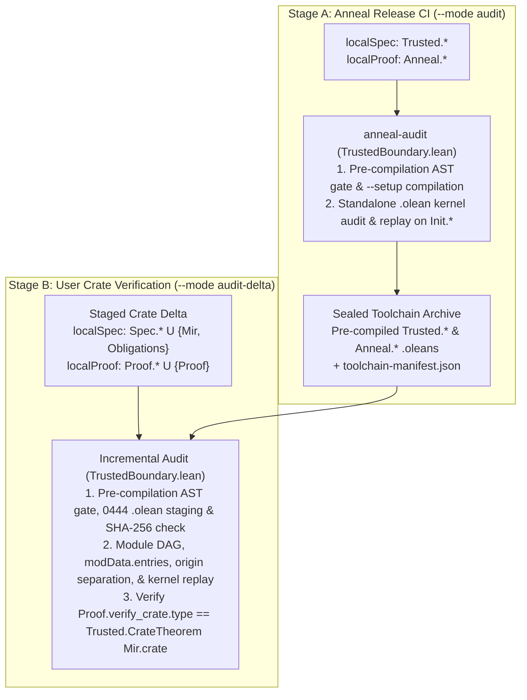

<!-- Copyright 2026 The Fuchsia Authors

Licensed under a BSD-style license <LICENSE-BSD>, Apache License, Version 2.0
<LICENSE-APACHE or https://www.apache.org/licenses/LICENSE-2.0>, or the MIT
license <LICENSE-MIT or https://opensource.org/licenses/MIT>, at your option.
This file may not be copied, modified, or distributed except according to
those terms. -->

# Trust Boundary and Audit Enforcement

> **Note:** Anneal is under active development. Parts of the design and
> architecture described in this document are not yet implemented or may be
> implemented differently; this document may be aspirational or stale relative
> to the codebase.

[`META_PRINCIPLES.md`](../META_PRINCIPLES.md),
[`PRINCIPLES.md`](../PRINCIPLES.md), and [`THREAT_MODEL.md`](../THREAT_MODEL.md)
are the controlling documents for Anneal's correctness promise, threat model,
bounded human-review surfaces (stated specifications and the TCB audit log,
`anneal-tcb.lock`), uncompromised execution-environment assumption, and in-scope
repository threats.

This document specifies how Anneal's internal codebase
([`trusted/`](../trusted) vs. `theory/`) implements and enforces
[`META_PRINCIPLES.md`](../META_PRINCIPLES.md),
[`PRINCIPLES.md`](../PRINCIPLES.md), and
[`THREAT_MODEL.md`](../THREAT_MODEL.md):

- **Section 1** defines the four-category epistemic partition across
  [`trusted/`](../trusted), `theory/`, and downstream user crates, enforces
  Cargo workspace containment, and binds external build, foundation, and
  pre-compiled toolchain artifacts into `trusted/` via cryptographic manifests.
- **Section 2** specifies the stage-agnostic `.olean` boundary auditor in
  [`trusted/audit/`](../trusted/audit) (`anneal-audit` and
  [`TrustedBoundary.lean`](../trusted/audit/TrustedBoundary.lean)), including
  its unified `(baseSpec, baseProof, localSpec, localProof)` model across Stage
  A (`--mode audit`) and Stage B (`--mode audit-delta`), standalone kernel
  replay (`loadExts := false`, `trustLevel := 0`), and unambiguous `Mir.lean`
  codegen.
- **Section 3** specifies how [`trusted/cargo-anneal/`](../trusted/cargo-anneal)
  and [`trusted/rustc-capture/`](../trusted/rustc-capture) enforce the
  repository-threat defenses of
  [`THREAT_MODEL.md`](../THREAT_MODEL.md#3-in-scope-threats-total-defenses-over-untrusted-repository-contents)—separating
  stated specifications from the TCB audit log (`anneal-tcb.lock`) and verified
  Rust implementation bodies.
- **Section 4** describes how `trusted/lean/` keeps compiled `.olean` constants
  transparent for human auditing and stages work-in-progress semantic rules via
  `vetted` vs. `candidate:<feature>` module tiers.
- **Section 5** states the dependency and provenance-citation requirements for
  code inside [`trusted/`](../trusted).

For related architectural details, see:

- [`docs/design.md`](design.md) for an overview of Anneal's verification
  workflow, library-centric verification model, and four specification modes.
- [`docs/architecture.md`](architecture.md) for the three-stage MIR pipeline
  and how untrusted lowering passes in `theory/` connect to `trusted/lean/`.

## 1. Epistemic partition and hash-locked external files

To uphold the human-review sufficiency guarantee of
[`META_PRINCIPLES.md`](../META_PRINCIPLES.md) and
[`THREAT_MODEL.md`](../THREAT_MODEL.md), Anneal partitions every file and
artifact across its own repository and downstream verified crates into four
mutually exclusive categories:

| Category | Epistemic role & review status | Constituent artifacts | Enforcement mechanism |
| :--- | :--- | :--- | :--- |
| **Stated specifications** | **Human-reviewed for intent; machine-proved by Anneal** (trusted to define *what the user intended to prove*). | Inline Rust contract attributes (`#[anneal::requires]`, `#[anneal::ensures]`, `#[anneal::invariant]`, `#[anneal::no_panic]`, `#[anneal::no_pme]`, trait safety contracts), `#[anneal::spec]` items (`fn`, `const`, `type`, `struct`, `enum`, `trait`, `impl`, `use`, `macro_rules!`), and user `Spec/*.lean` models. | Post-resolution semantic closure in `rustc-capture` (with `overflow-checks=on`); unwaivable `ContractWellFormed` and finite-fuel normal termination (`ContractPost`) for executable `#[anneal::spec]` items; `.olean` Statement-Origin Separation (`Spec.*` never depends on `Proof.*`), `modData.entries` extension check, and declaration purity in `TrustedBoundary.lean`. |
| **The TCB audit log & Anneal TCB** | **Human-reviewed & assumed without proof** (trusted to be *true without proof*). | Per-crate `anneal-tcb.lock` (toolchain pins, active `candidate:<feature>` TCB modules, Cargo features, `build_env_vars`, local `[[waivers]]` in 1-to-1 bijection with `Mir.crate.tcbWaivedIds`, `[[unverified_dependencies]]`, and `[[upstream_waivers]]`) plus Anneal's TCB in [`trusted/`](../trusted) (`trusted/rustc-capture/`, `trusted/lean/`, `trusted/audit/`, `trusted/cargo-anneal/`). | 1-to-1 bijection between `Mir.crate.tcbWaivedIds` and `[[waivers]]` in `anneal-tcb.lock`; transitive `body_sha256` and `assumed_callee_contracts` pinning on waived items; fail-closed `--locked` verification in `cargo-anneal`. |
| **Untrusted proofs** | **Never reviewed by humans** (100% machine-checked; zero lockfile footprint). | `theory/Anneal/*.lean` (`lowerBody`, `lowerBody_simulates`, `proveCrate`, WP & separation-logic lemmas), crate `Proof/*.lean`, and generated `<target>/anneal/Proof.lean`. | Pre-compilation full-AST command/attribute gate; `0444` read-only `.olean` staging with SHA-256 verification; standalone Lean 4 kernel replay (`loadExts := false`, `trustLevel := 0`) over `baseEnv.toKernelEnv.replay locals` in `TrustedBoundary.lean`, blocking `sorryAx`, `Lean.ofReduceBool` (`native_decide`), custom axioms, `opaque`, and `partial`/`unsafe`. |
| **Verified Rust implementation bodies** | **Never reviewed by humans** (proved sound and specification-compliant; zero lockfile footprint). | All non-`#[anneal::spec]`, non-waived Rust implementation items (`src/**/*.rs`) and compiler-extracted `<target>/anneal/Mir.lean` (`Mir.crate`) and `Obligations.lean`. | Complete crate item capture across `release` and `debug` profiles with `-Z mir-preserve-ub`; kernel proof of `Proof.verify_crate : Trusted.CrateTheorem Mir.crate`. |

### Cargo workspace containment

In Anneal's own repository (`anneal-audit --mode audit`), before inspecting Lean
modules, `anneal-audit` verifies that every Cargo workspace member and `path`
dependency resides under `trusted/`. Because Rust code (including `build.rs`
scripts and procedural macros) is effectful and not checked by the Lean kernel,
no Rust crate in Anneal's repository is permitted outside `trusted/`.

### Binding external and pre-compiled artifacts via manifests

An auditor inspecting the Anneal repository only needs to review `trusted/` to
verify that Anneal upholds [`META_PRINCIPLES.md`](../META_PRINCIPLES.md),
[`PRINCIPLES.md`](../PRINCIPLES.md), and
[`THREAT_MODEL.md`](../THREAT_MODEL.md). Because Cargo, Nix, and upstream
toolchain artifacts live at the repository root or in the packaged toolchain
archive, `trusted/` binds them via three manifests:

- **[`trusted/root-manifest.sha256`](../trusted/root-manifest.sha256)**
  *(checked into Git)*: Pins the SHA-256 digests of the repository's root build
  files (`Cargo.toml`, `Cargo.lock`, `flake.nix`, and `flake.lock`), verified
  by CI and `anneal-audit --mode audit`.
- **[`foundation-lock.json`](../trusted/lean/foundation-lock.json)**
  (`trusted/lean/foundation-lock.json`, *checked into Git*): Pins the SHA-256
  digests of the `lean` executable, all `Init.*` prelude source and
  `.olean`/`.ir` companion files, and the foundation axiom allowlist
  (`{Classical.choice, Quot.sound, propext}`), verified by the Nix toolchain
  build (`flake.nix`), `anneal-audit`, and `cargo anneal setup`.
- **`toolchain-manifest.json`** *(emitted by Stage A `anneal-audit --mode audit`
  into the sealed toolchain archive)*: Binds the Stage A audit results to the
  packaged `.olean` artifacts so Stage B does not re-audit or re-compile
  `Init.*`, `Trusted.*`, or `Anneal.*` on user machines. It records:
  1. `foundationLockSha256`: the SHA-256 digest of `foundation-lock.json`;
  2. `componentTiers` and `trustedModuleTiers`: the validated trust tiers
      (`"vetted"` or `"candidate:<feature>"`) of effectful TCB components (such
      as `rustc_capture`) and `Trusted.*` modules;
  3. `taintedBaseConsts`: the set of `Init.*` constants whose reverse-dependency
      cone across `ci.type` and `ci.value? (allowOpaque := true)` in `Init.*`
      reaches any `.axiomInfo` outside `{Classical.choice, Quot.sound, propext}`
      (such as `sorryAx`, `ofReduceBool`, or `ofReduceNat`), any constant with
      `isUnsafe || isPartial`, or any `.opaqueInfo` `o ∈ Init.*` for which
      `env.contains (o ++ `_unsafe_rec)` or `o ∈ {`Lean.ofReduceBool,
      `Lean.ofReduceNat}` (leaving safe `.opaqueInfo` definitions such as
      `String.Internal.append`, used by `omega`, untainted);
  4. `candidateFootprints`: for each constant `c` in `Trusted.* ∪ Anneal.*`
      with a non-empty candidate reachability set, the sorted list of
      `candidate:<feature>` strings transitively reachable from `c` across
      `Trusted.* ∪ Anneal.*`; and
  5. `moduleArtifacts`: the SHA-256 digests of all pre-compiled `Trusted.*` and
      `Anneal.*` `.olean`/`.ir` companion files (verified once at installation
      time by `cargo anneal setup`).

## 2. Stage-agnostic `.olean` boundary auditor (`trusted/audit/`)

[`trusted/audit/`](../trusted/audit) implements the two-stage boundary audit
that separates Anneal's own release CI from downstream crate verification
([`docs/design.md`](design.md#two-stage-boundary-auditing-anneals-ci-and-downstream-ci))
using a single `.olean` kernel auditor parameterized by a 4-tuple of pairwise
disjoint module sets `(baseSpec, baseProof, localSpec, localProof)` and an
optional theorem descriptor `targetTheorem?`:

| Stage & CLI mode | `baseSpec` (Pre-audited foundation & specs) | `baseProof` (Pre-audited proof theory) | `localSpec` (Staged specification delta) | `localProof` (Staged proof delta) | `targetTheorem?` |
| :--- | :--- | :--- | :--- | :--- | :--- |
| **Stage A: Anneal CI (`--mode audit`)** | `Init.*` | $\emptyset$ | `Trusted.*` (`trusted/lean/`) | `Anneal.*` (`theory/`) | `none` |
| **Stage B: Crate delta (`--mode audit-delta`)** | `Init.*` $\cup$ `Trusted.*` $\cup$ upstream `Spec.<CrateId>.*` | `Anneal.*` | `Spec.*` $\cup$ $\{\text{`Mir`}, \text{`Obligations`}\}$ | `Proof.*` $\cup$ $\{\text{`Proof`}\}$ | `some (`Proof, ``Proof.verify_crate, ``Mir.crate)` |

### Pre-compilation gate, `.olean` immutability, and kernel replay

In Lean 4, surface macros, tactics (`simp`, `omega`, `rw`, `split`), custom
notations, and attributes (`@[implemented_by]`, `@[extern]`, `@[csimp]`)
elaborate down to `.olean` module files. When the auditor loads those `.olean`
files in a separate process with **`trustLevel := 0`, `plugins := #[]`, and
`loadExts := false`**, no `[init]` initializers or compiler-override environment
extensions are consulted by the kernel: the standalone C++ Lean 4 kernel sees
only pure kernel `ConstantInfo` declarations and re-typechecks every proof term
from scratch.

To prevent untrusted `Spec/*.lean` or `Proof/*.lean` files from executing
arbitrary `IO` during compilation (`#eval`) or registering syntax/macro
extensions that alter how `Mir.lean` elaborates, `cargo-anneal` and
`anneal-audit` pair a narrow pre-compilation command/attribute gate with five
`.olean` kernel checks:

0. **Pre-compilation full-AST command/attribute gate and `0444` `.olean`
   staging:**
   - Before invoking `lean --setup` on any `Spec/*.lean` or `Proof/*.lean`
     module, `cargo-anneal` scans the module's full token and syntax tree
     (including inside `namespace`, `section`, `mutual`, and `by` blocks) and
     rejects metaprogramming or `IO` directives (`#eval`, `#eval!`, `#reduce`,
     `run_cmd`, `run_elab`, `by_elab`, `initialize`, `builtin_initialize`,
     `import Init.System.IO`, `import Lean`), parser or macro mutations
     (`syntax`, `macro`, `macro_rules`, `elab`, `elab_rules`, `notation`,
     `infix`, `infixl`, `infixr`, `prefix`, `postfix`), and elaborator- or
     compiler-hijacking attributes (`init`, `builtin_init`, `command_elab`,
     `term_elab`, `tactic`, `macro`, `app_unexpander`, `csimp`,
     `implemented_by`, `extern`, `export`, `never_extract`).
   - `cargo-anneal` compiles `Trusted/*.lean`, `Anneal/*.lean`, `Spec/*.lean`,
     `Mir.lean`, and `Obligations.lean` before `Proof/*.lean`, marks all staged
     `.olean` files `0444` (read-only), records their SHA-256 digests in memory
     before invoking `lean` on `Proof/*.lean`, and re-verifies those SHA-256
     digests before and during `anneal-audit`.
1. **Module DAG, `modData.entries` extension check, and provenance verification
   (`validateGraph` and `verifyAndCollectLocals`):** Verifies that `baseSpec`,
   `baseProof`, `localSpec`, and `localProof` are pairwise disjoint; that only
   modules in `baseSpec ∪ baseProof ∪ localSpec ∪ localProof` are present in
   the `.olean` import graph; that no module in `baseSpec ∪ localSpec`
   transitively imports any module in `baseProof ∪ localProof` (and in Stage A
   no `.vetted` `Trusted.*` module imports a `candidate:<feature>` module); and
   that for every `Spec.*` and `Proof.*` module, `modData.entries` carries no
   entries in `Lean.Parser.parserExtension`, `Lean.macroAttribute`,
   `Lean.Elab.Command.commandElabAttribute`, `Lean.Elab.Term.termElabAttribute`,
   `Lean.Elab.Tactic.tacticElabAttribute`, or `Lean.Compiler.CSimp.ext` (and for
   `Spec.*`, no `Lean.Meta.instanceExtension` or
   `Lean.Meta.defaultInstanceExtension` entries). If a constant name $u$
   appears in `modData.constNames` of more than one module, `TrustedBoundary`
   rejects the environment unless in every such module $u$ is a
   `ConstantInfo.thmInfo` with identical `(name, levelParams, type)` (matching
   `Lean/Replay.lean`) and traverses the `value` of all occurrences in Check 3.
2. **Namespace ownership, equational suffixes (`IsAllowedEqThm`), and
   declaration purity (`validateLocalConstant`):** Define `IsAllowedEqThm env u`
   to hold iff $u$ is a `ConstantInfo.thmInfo` whose name is
   `<base>.eq_1`..`<base>.eq_N`, `<base>.eq_def`, `<base>.eq_unfold`,
   `<base>._eq_1`..`<base>._eq_N`, `<base>.congr_simp`, `<base>.splitter`,
   `<base>._sunfold`, `<base>._arg_pusher`, `<base>.induct`, or
   `<base>.mutual_induct` for a constant `<base>` already declared in an
   imported `Init.*`, `Trusted.*`, `Anneal.*`, `Spec.*`, `Mir`, or `Obligations`
   module (and $u \notin \{\texttt{Proof.verify\_crate}, \texttt{Mir.crate}\}$).
   For every constant `ci` defined in `m ∈ localSpec ∪ localProof`, let `u :=
   privateToUserName ci.name`:
   - If $m \in \text{Trusted.}^*$: require `u.getRoot == `Trusted` (permitting
     `Trusted.MirSemantics.MirVal` inside `Trusted/MirSemantics.lean`).
   - If $m \in \text{Anneal.}^*$: require `u.getRoot == `Anneal` or
     `IsAllowedEqThm env u`.
   - If $m \in \text{Spec.}\langle\text{CrateId}\rangle.^*$: require
     `m.isPrefixOf u` or `IsAllowedEqThm env u` (and in multi-crate workspaces
     no local `Spec//**` module may use an upstream dependency's canonical
     Cargo `<CrateId>` as ``).
   - If $m = \texttt{Mir}$: require `u.getRoot == `Mir` or
     `IsAllowedEqThm env u`.
   - If $m = \texttt{Obligations}$: require `u.getRoot == `Obligations` or
     `IsAllowedEqThm env u`.
   - If $m \in \text{Proof.}^*$: require `(u.getRoot ∉ {`Init, `Trusted,
     `Anneal, `Spec, `Mir, `Obligations} ∧ u != ``Mir.crate)` or
     `IsAllowedEqThm env u` (allowing `simp` and `split` in `Proof.*` to realize
     equational and splitter lemmas for upstream definitions while preventing
     `Proof.*` from defining or spoofing non-equational constants in upstream
     namespaces).
   - `ci` must not be `.axiomInfo`, `.opaqueInfo`, `.quotInfo`, `isUnsafe`, or
     `isPartial` (while permitting safe `.defnInfo`, `.thmInfo`, and
     kernel-replayed `.inductInfo`, `.ctorInfo`, and `.recInfo` for `inductive`
     and `structure` declarations in `Trusted.*`, `Anneal.*`, `Spec.*`, and
     `Proof.*`, except that in Stage B `Mir` may emit only `.defnInfo`).
     Structural-recursion compiler companions `foo._unsafe_rec` are permitted
     and stripped from `locals` before kernel replay if and only if the same
     module `m` defines a safe, non-partial `.defnInfo` named `foo`.
3. **Statement-Origin Separation, axiom purity, and tier monotonicity
   (`checkEdges`):** Traverses `ci.type` and `ci.value? (allowOpaque := true)`
   starting from `localSpec ∪ localProof` (and in Stage B, continuing through
   local and upstream `Spec.<CrateId>.*` and `Anneal.*` modules, stopping only
   at `Init.* \ taintedBaseConsts` and `Trusted.*`):
   - **Axiom and taint purity:** No edge may target a `._unsafe_rec` companion
     or a constant in `taintedBaseConsts` (ensuring the transitive closure
     reaches only `{Classical.choice, Quot.sound, propext}` and blocking
     `sorryAx`, `Lean.ofReduceBool` from `native_decide`, `Lean.ofReduceNat`,
     and partial/unsafe `Init.*` helpers).
   - **Statement-Origin Separation:** Every constant in `localSpec` may
     reference only constants in `baseSpec ∪ localSpec`, never `baseProof ∪
     localProof`.
   - **Vetted tier rule (Stage A):** A constant in a `.vetted` `Trusted.*`
     module may reference only `Init.*` and `.vetted` `Trusted.*` constants,
     never `candidate:<feature>`.
   - **Candidate footprint propagation (Stage B):** For every edge reaching a
     base constant `d ∈ Trusted.* ∪ Anneal.*` (including indirectly through an
     upstream `Spec.<CrateId>.*` module), Stage B unions
     `candidateFootprints[d]` (together with any active `componentTiers`
     candidate feature) from `toolchain-manifest.json` into the crate's active
     `[[anneal_candidates]]` set for `anneal-tcb.lock`.
4. **Exact syntactic theorem-type and universe-parameter pinning (Stage B):**
   When `targetTheorem?` is present, verifies that `Proof.verify_crate` is a
   `.thmInfo` in module `Proof` with **`ci.levelParams.isEmpty`** whose kernel
   `ci.type` is structurally equal (`==`, not `isDefEq`) to `Expr.app (.const
   ``Trusted.CrateTheorem []) (.const ``Mir.crate [])`, and that `Mir.crate` is
   a `.defnInfo` in module `Mir` with **`ci_mir.levelParams.isEmpty`** and
   `ci_mir.type == .const ``Trusted.Crate []`.
5. **Standalone kernel replay (`replay`):** Imports `baseEnv` over `baseSpec ∪
   baseProof` (`loadExts := false`, `trustLevel := 0`) and runs
   `baseEnv.toKernelEnv.replay locals`, re-typechecking every declaration in
   `localSpec ∪ localProof` inside the standalone Lean 4 kernel.

### Unambiguous `Mir.lean` and `Obligations.lean` codegen

In Mode 3 ([`docs/design.md`](design.md#3-pure-mathematical-models-speclean)),
`Mir.lean` imports user `Spec.<Mod>` modules when Rust specifications reference
user-defined mathematical models in `Spec/*.lean`. To ensure that declarations
or typeclass instances in `Spec/*.lean` can never shadow identifiers or hijack
typeclass resolution inside generated `Mir.lean` or `Obligations.lean`
definitions:

- `Mir.lean` begins with `prelude`, imports only `Trusted` (plus `Spec.<Mod>`
  when Mode 3 references are present), and contains no `open` or `export`
  commands, tactic blocks, anonymous constructors `⟨...⟩`, or overloaded
  operators or numeric literals.
- `Mir.lean` and `Obligations.lean` prefix every global type, AST constructor,
  primitive value, and function reference with `_root_.` and emit raw kernel
  literals (`_root_.Trusted.Crate.mk`, `_root_.Trusted.Stmt.assign`,
  `_root_.Bool.true`, `_root_.Option.some`, `_root_.List.cons`, `nat_lit n`,
  `_root_.Int.ofNat (nat_lit n)`, `_root_.Int.negSucc (nat_lit n)`,
  `_root_.Spec.<Mod>.<item>`). Because `_root_.` anchors resolution at the
  root namespace and `nat_lit` and explicit constructor applications do not
  invoke `OfNat`, `Neg`, or `Coe` typeclass synthesis, `Mir.lean` and
  `Obligations.lean` elaborate identically regardless of what imported
  `Spec/*.lean` modules define.

## 3. Capture and orchestrator enforcement (`cargo-anneal` and `rustc-capture`)

[`trusted/cargo-anneal/`](../trusted/cargo-anneal) and
[`trusted/rustc-capture/`](../trusted/rustc-capture) enforce the separation
between stated specifications, the TCB audit log (`anneal-tcb.lock`), and
verified Rust implementation bodies required by
[`THREAT_MODEL.md`](../THREAT_MODEL.md#3-in-scope-threats-total-defenses-over-untrusted-repository-contents).
When `cargo anneal verify [--locked]` runs, it executes four steps:

1. **Out-of-tree artifact staging and dependency graph resolution (`cargo
   metadata --locked`):**
   `cargo-anneal` rejects pre-existing `.olean`, `.ilean`, or `.ir` files in
   `Spec/` or `Proof/` and user files at the reserved generated root paths
   (`Mir.lean`, `Mir/**`, `Obligations.lean`, `Proof.lean`), resolves the
   workspace dependency graph via `cargo metadata --format-version 1 --locked`,
   and stages generated `Mir.lean`, `Obligations.lean`, `Proof.lean`, and
   `.olean` outputs in an isolated build directory
   (`<target>/anneal/<crate-id>/lean/`) outside the source checkout.
2. **Dual-profile `Runtime(PostCleanup)` MIR capture and boundary checks
   (`rustc-capture`):**
   `cargo-anneal` invokes Cargo in topological workspace order using its pinned
   toolchain (`RUSTC_WORKSPACE_WRAPPER = <toolchain>/bin/anneal-rustc-capture`,
   `--target-dir <target>/anneal/cargo`, `--locked`, `--offline`). Host
   `build.rs` and `proc-macro` targets compile with the pinned `rustc`, and for
   each verified target crate $C$, `anneal-rustc-capture` captures
   `Runtime(PostCleanup)` MIR **after** `build.rs` code generation (`OUT_DIR`)
   and procedural-macro expansion have completed, enforcing the capture and
   boundary checks detailed below.
3. **Stage B incremental boundary audit (`--mode audit-delta`):**
   `cargo-anneal` stages user `Spec/*.lean` and `Proof/*.lean` files alongside
   `Mir.lean`, `Obligations.lean`, and `Proof.lean` in
   `<target>/anneal/<crate-id>/lean/`, runs the pre-compilation AST gate,
   compiles `localSpec` first (`0444` read-only with SHA-256 verification) and
   then `localProof` via `lean --setup` against the pre-compiled toolchain
   `.olean`s, and runs `TrustedBoundary.lean` (`--mode audit-delta`).
4. **Zero-churn `anneal-tcb.lock` emission and verification:**
   `cargo-anneal` serializes `anneal-tcb.lock` keyed by canonical Rust item
   paths (containing only `[toolchain]` metadata, `[[anneal_candidates]]`,
   `[[waivers]]` in 1-to-1 bijection with `Mir.crate.tcbWaivedIds`,
   `[[unverified_dependencies]]`, and `[[upstream_waivers]]`) and under
   `--locked` verifies exact equality with the committed `anneal-tcb.lock`.

### Dual-profile MIR capture and `Proof.lean` generation

For each verified target crate, `anneal-rustc-capture`:

- Traverses `tcx.hir_crate_items(())` across `src/**/*.rs` and runs the compiler
  pipeline across two profiles with `-C opt-level=0 -Z mir-opt-level=0` and `-Z
  mir-preserve-ub` (`release`: `-C debug-assertions=off -C overflow-checks=off
  -Z mir-preserve-ub`; `debug`: `-C debug-assertions=on -C overflow-checks=on -Z
  mir-preserve-ub`), while holding `overflow-checks=on` constant on all Surface
  1 contract clauses and `#[anneal::spec]` bodies so contract arithmetic is
  profile-independent and checked against overflow. Inside
  `mir_drops_elaborated_and_const_checked` before `DeadBlocks` runs,
  `rustc-capture` clones `Runtime(PostCleanup)` MIR and computes the transitive
  pre-`DeadBlocks` closure of `requiredConsts`, `requiredLayouts`, and
  `requiredTypePre` across static `TerminatorKind::Call` targets,
  `TerminatorKind::Drop` glue (`Instance::resolve_drop_in_place`), constructed
  closures, `tcx.promoted_mir`, and attached contract clauses.
- Requires stated specifications, waivers (`c.tcbWaivedIds`), and `c.adts` to be
  identical across `release` and `debug`. Each `CapturedFn` records
  `releaseBodyId : BodyId` and `debugBodyId : Option BodyId` (`none` when the
  span-stripped `debug` `MirBody` equals `release`, or `some dbgId` when they
  differ).
- Emits `Proof.lean` into the crate's staged Lean directory using **Template A**
  (`theorem Proof.verify_crate : Trusted.CrateTheorem Mir.crate :=
  Anneal.proveCrate Mir.crate rfl`, when `Proof/Main.lean` is absent) or
  **Template B** (`theorem Proof.verify_crate : Trusted.CrateTheorem Mir.crate
  := Proof.Main.verify_crate`, when `Proof/Main.lean` is present).

### Stated-specification closure (`#[anneal::spec]` and `Spec/*.lean`)

To ensure that unreviewed implementation code can never alter the meaning of a
stated specification
([`THREAT_MODEL.md`](../THREAT_MODEL.md#2-hidden-specification-dependencies-or-unlogged-tcb-assumptions)),
`rustc-capture` validates semantic closure over the compiler's resolved
HIR/THIR/MIR dependency graph (with zero `anneal-tcb.lock` footprint):

- **Callable, constant, closure, and `Drop` closure:** The Surface 1 worklist is
  seeded with every `#[anneal::spec]` item, every contract clause (`requires`,
  `ensures`, `invariant`, trait safety contracts), and the type signatures,
  generic predicates, const-generic defaults, enum discriminants, and embedded
  `DefKind::AnonConst` / `ty::ConstKind::Unevaluated` bodies of all verified or
  specified items. While walking any Surface 1 MIR body (before `DeadBlocks`),
  `rustc-capture` enqueues all static `TerminatorKind::Call` targets,
  `Rvalue::Aggregate(AggregateKind::Closure)` bodies, `tcx.promoted_mir`
  bodies, and `Instance::resolve_drop_in_place(tcx, ty)` for every
  `TerminatorKind::Drop` whose type needs drop (`ty.needs_drop(tcx,
  typing_env)`). Every local item reached in this cone must carry
  `#[anneal::spec]`.
- **Recursive trait, blanket-`impl`, and `#[derive]` closure:** Whenever a
  Surface 1 item or contract resolves a trait reference via
  `tcx.codegen_select_candidate` to `ImplSource::UserDefined(data)`,
  `data.impl_def_id` must carry `#[anneal::spec]` if local, and—regardless of
  whether `data.impl_def_id` is local or foreign (such as `core`'s blanket
  `impl<T: PartialEq> PartialEq for Option<T>`)—`rustc-capture` instantiates
  `tcx.predicates_of(data.impl_def_id).instantiate(tcx, data.args)` and
  recursively resolves every `ClauseKind::Trait` and `ClauseKind::Projection`
  obligation until fixed point. When an ADT carries `#[anneal::spec]`,
  `rustc-capture` automatically propagates `#[anneal::spec]` to
  `#[automatically_derived]` implementations of standard `core` value traits
  (`Clone`, `Copy`, `PartialEq`, `Eq`, `PartialOrd`, `Ord`, `Hash`, `Default`,
  `Debug`) on that ADT.
- **Structural field closure and subterm pass-through inhabitedness:** Every
  local type occurring in any field or variant payload of a `#[anneal::spec]`
  ADT must carry `#[anneal::spec]` (`union` types are forbidden in stated
  specifications). For every parameter or return type `ty` of a specified item,
  `rustc-capture` walks all nested type subterms (`ty.walk()`); every local ADT
  subterm not marked `#[anneal::spec]` must be modeled and satisfy
  `sub_ty.is_inhabited_from(tcx, root_module, typing_env)` (rejecting wrapper
  types such as `Option<UninhabitedLocal>` unless `UninhabitedLocal` carries
  `#[anneal::spec]`).
- **Lexical import (`use`), macro, and `include*!` hygiene:** Any local `use`
  declaration (`ItemKind::Use`, including `use ... as ...` and glob imports) or
  `macro_rules!`/proc-macro definition that binds an identifier or expands
  tokens inside a specification attribute or `#[anneal::spec]` item must carry
  `#[anneal::spec]` (unless the specification uses a crate-qualified path). Any
  `include!`, `include_str!`, or `include_bytes!` macro expansion inside a
  Surface 1 item or attribute is rejected unless its target file path is hashed
  and recorded in `anneal-tcb.lock`.
- **Totality, purity, and no-waiver invariant:** Combining `#[anneal::spec]`
  with `#[anneal::trusted]` is a hard capture error. Executable
  `#[anneal::spec]` items forbid `unsafe` blocks, raw pointer dereferences,
  escaping `&mut` borrows, and `extern` calls, and require `ContractWellFormed`
  and finite-fuel normal return (`ContractPost` with `isSpec = true`).

### Complete obligation inventory and `anneal-tcb.lock` waiver bijection

`rustc-capture` generates obligations in `crateObligations c` across all six
crate item categories, while `Trusted.CrateTheorem` enforces
`ContractWellFormed` unconditionally on all functions, `extern` declarations,
and trait implementations outside the `c.tcbWaivedIds` bypass:

- **ADT invariants (`ObligationId.adtInv`):** Requires non-`pub` invariant
  fields (`hasPubInvariantField = false`), enforces `AdtInv` for all $T \notin
  f.\text{brokenInvariants}$ at modular call boundaries and normal/unwind exits,
  and enforces simultaneous multi-projection `EscapingSubfieldBorrowsSafe` for
  escaping `&mut` field borrows.
- **Constants (`constBody`) and statics (`staticBody`):** Captures top-level
  `const`, associated `const`, inline `const { ... }`, promoted constants, and
  `static` initializers in `Crate.bodies`. Standalone `constBody` and
  `staticBody` obligations verify top-level `const` and `static` items, trait
  associated constants are verified via `AssocConstBindingVerified` in
  `TraitImplVerified`, and transitive `requiredConsts` are verified via
  `MonoConstsWf` and provided in `SafetyPre`.
- **Functions, methods, and closures (`fnBody`):** Captures both called and
  uncalled functions, methods, and closures across `release` and `debug`,
  verifying `FnBodyVerified` over `(SafetyPre, EffectivePost)`.
- **Foreign `extern` declarations (`externFn`):** Enforces `ContractWellFormed`
  (including `EnsuresWellFormed` postcondition satisfiability) on `externFnView
  ef` and requires an explicit waiver in `anneal-tcb.lock` for every declared
  or called foreign symbol.
- **Trait implementations (`traitImpl`):** Enforces
  `TraitImplContractWellFormed` and proves Liskov behavioral refinement
  (`TraitMethodRefines` via `mkTraitFnView`, which Stage 1 also populates onto
  `implFn.contract` in `c.functions` for direct callers), associated-constant
  refinement (`AssocConstBindingVerified`), and `resolveTraitSafetyEntry` on
  `unsafe impl` blocks.

Every behavioral obligation in `crateObligations c` must either hold by kernel
proof or match an explicit waiver in `Mir.crate.tcbWaivedIds`, which stands in
exact 1-to-1 bijection with `[[waivers]]` in `anneal-tcb.lock` (`[]` when a
crate has zero waivers). For each waived item, `anneal-tcb.lock` pins its
signature, assumed contract, `in_visibility_cone`, `assumed_callee_contracts`,
and its transitive canonical MIR digest (`body_sha256`, folding in both
`release` and `debug` `MirBody`s, all transitive `requiredConsts`,
`TerminatorKind::Drop` glue bodies, constructed closure bodies, `promoted_mir`,
referenced `Static` initializers, and candidate local `impl` bodies of
uncontracted generic trait calls). Linker and assembly directives
(`global_asm!`, `#[no_mangle]`, `#[export_name]`, `#[link_section]`, `#[used]`,
`#[naked]`, `#[panic_handler]`, `#[global_allocator]`) and calls to
`[[unverified_dependencies]]` are rejected unless covered by an explicit waiver
in `anneal-tcb.lock`.

### Compositional cross-crate verification

`cargo-anneal` binds each verified workspace crate to a Merkle `UnitId` under
`<target>/anneal/` for build caching and stages upstream exported
`Spec/<Mod>.lean` models under `Spec/<CrateId>/<Mod>.lean` (namespace
`Spec.<CrateId>.<Mod>`). To prevent upstream implementation, proof, or
specification edits from churning downstream lockfiles, a downstream crate's
`anneal-tcb.lock` never records upstream `UnitId`s or `Spec.<CrateId>.*`
digests; it records only unverified external Cargo dependencies
(`[[unverified_dependencies]]`) and upstream verified crates' TCB assumptions
(`[[upstream_waivers]]`, `candidate_features`, `cargo_features`, and
`build_env_vars`).

## 4. Staging TCB changes and `.olean` kernel transparency (`trusted/lean/`)

### Keeping `trusted/lean/` transparent at the `.olean` kernel level

Auditing `trusted/lean/` requires confidence not only in the surface `.lean`
source files, but also in the compiled `.olean` constants replayed by the Lean
4 kernel. Four design conventions in `trusted/lean/` keep its compiled kernel
environment simple and directly inspectable by human auditors:

- **Tactic-free definitions:** All definitions and foundational helper lemmas in
  `trusted/lean/` use explicit functional definitions and term-mode proofs
  rather than `by` tactic blocks that generate opaque auxiliary proof terms.
- **No `mutual` inductive types (`BodyId` table):** `Trusted/MirAst.lean`
  stores function and constant bodies in a flat `Crate.bodies` list indexed by
  `BodyId` rather than nesting `MirBody` inside `Terminator` or `ObligationId`,
  avoiding the nested mutual recursors that Lean synthesizes for mutual
  inductive blocks.
- **Structural fuel-bounded recursion without `WellFounded.fix`:** Recursive
  semantic functions in `Trusted/StepResult.lean` and
  `Trusted/MirSemantics.lean` recurse structurally on an explicit `Nat` fuel
  argument (or on inductive syntax/value trees), avoiding well-founded recursion
  proof obligations in the kernel environment.
- **First-order waiver records (`tcbWaivedIds`) instead of `opaque` constants:**
  Unproved behavioral waivers (`ObligationId.fnBody`, `externFn`, `traitImpl`,
  `constBody`, `staticBody`, and `adtInv`) are represented as first-order data
  (`ob.prop ∨ ob.id ∈ c.tcbWaivedIds` in `Trusted.CrateTheorem`) rather than
  using `opaque` declarations, allowing `TrustedBoundary.lean` to forbid
  `opaque` across all audited modules.

### Module-level trust tiers (`vetted` vs. `candidate:<feature>`)

Auditing a new semantic rule in `trusted/lean/` to full TCB standards—including
line-by-line Rust Reference citations and human review—takes deliberate effort.
To allow contributors and agents to build lowering passes and proofs in
`theory/` before a new semantic module in `trusted/lean/` has completed human
auditing, every module in `trusted/lean/` declares a module-level trust tier via
a leading header comment directive:

- **`-- anneal-trust-tier: vetted`:** Modules whose definitions have completed
  full Rust Reference auditing.
- **`-- anneal-trust-tier: candidate:<feature>`:** Work-in-progress TCB modules
  belonging to a named subsystem feature `<feature>` (such as `refinement`,
  `step_result`, `memory`, `mir_ast`, `mir_semantics`, or `rustc_capture`) that
  have not yet completed human auditing.

Assigning trust tiers at the module boundary rather than via per-declaration
attributes keeps `trusted/lean/` free of custom attribute macros or
metaprogramming: every constant compiled into a `Trusted` module's `.olean`
file—including constructors, recursors (`rec`, `casesOn`), pattern matchers
(`match_1`), equational lemmas (`eq_1`), and `where`/`private` helpers—
inherits its defining module's trust tier via `Environment.getModuleIdxFor?`.

During Stage A (`--mode audit`), `anneal-audit` reads each `Trusted.*` module's
header directive and records each `Trusted.* ∪ Anneal.*` constant's transitive
`candidate:<feature>` footprint in `toolchain-manifest.json` so Stage B can
surface any active `candidate:<feature>` dependencies in the crate's
`anneal-tcb.lock` in $O(1)$ without re-walking `Anneal.*`.

## 5. External dependencies and commenting in `trusted/`

Because every file in [`trusted/`](../trusted) must be auditable by humans,
Anneal optimizes `trusted/` for **human comprehension and review accuracy**, not
merely minimum dependency count:

- **Standard libraries over hand-rolled plumbing:** `trusted/` uses widely
  audited Rust ecosystem crates (such as `serde`, `clap`, and `sha2`, all
  pinned with SHA-256 checksums in `Cargo.lock`) for generic utilities like
  serialization, CLI parsing, and hashing. Hand-rolling bespoke parsers or
  cryptographic primitives inside `trusted/` would add hundreds of lines of
  security-critical code and increase audit burden.
- **Mandatory provenance citations:** Any code in `trusted/` that models Rust
  semantics or extracts `rustc` internal structures must explain the
  correspondence in its comments and both quote and cite the relevant Rust
  Reference section (`rust-lang/reference`) or compiler source file
  (`rust-lang/rust`) at a pinned commit hash.
