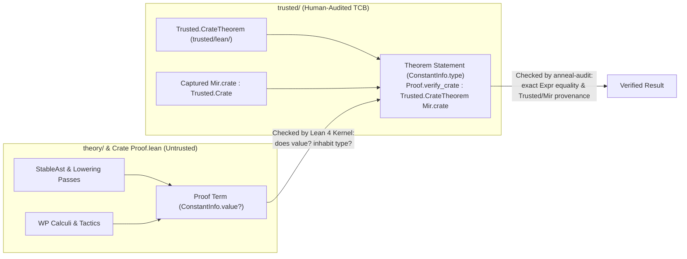
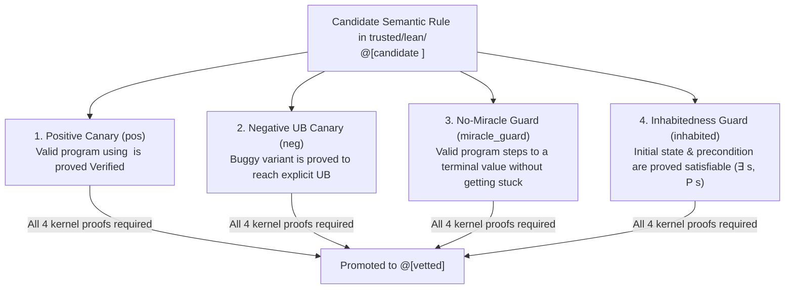

<!-- Copyright 2026 The Fuchsia Authors

Licensed under a BSD-style license <LICENSE-BSD>, Apache License, Version 2.0
<LICENSE-APACHE or https://www.apache.org/licenses/LICENSE-2.0>, or the MIT
license <LICENSE-MIT or https://opensource.org/licenses/MIT>, at your option.
This file may not be copied, modified, or distributed except according to
those terms. -->

# Trust Model, Boundary Enforcement, and TCB Confidence

> **Note:** Anneal is under active development. Parts of the design and
> architecture described in this document are not yet implemented or may be
> implemented differently; this document may be aspirational or stale relative
> to the codebase.

[`PRINCIPLES.md`](../PRINCIPLES.md) states Anneal's central correctness promise:
if the code in a verification result's Trusted Computing Base (TCB) audit log
is correct, its assumptions are valid, and Anneal emits no errors, then the
verified code is correct.

Upholding this promise requires solving two complementary problems:

1. **Keeping the TCB small and impermeable (Sections 1–3):** A modern
   verification tool needs tens of thousands of lines of intermediate
   representation (IR) lowering passes, weakest-precondition (WP) rules,
   separation-logic lemmas, and proof automation—plus proof scripts often
   generated by untrusted AI agents. Anneal isolates all first-party trusted
   code inside [`trusted/`](../trusted) and uses a standalone boundary auditor
   ([`trusted/audit/`](../trusted/audit)) to guarantee that nothing outside
   `trusted/` can weaken a theorem statement, introduce an unrecorded
   assumption, or bypass the Lean 4 kernel.
2. **Gaining confidence in the TCB itself (Section 4):** Minimizing `trusted/`
   does not automatically make `trusted/` bug-free. A bug inside the MIR
   extractor (`trusted/rustc-capture/`) or the reference operational semantics
   (`trusted/lean/`) could still mismodel Rust or make a theorem hold
   vacuously. Anneal addresses TCB bugs through rigorous line-by-line
   citations of the Rust Reference and `rustc`, structural anti-vacuity guards,
   a **four-way adequacy canary squeeze** on every semantic rule, and
   differential testing against `rustc` and Miri.

For related architectural details, see:

- [`docs/design.md`](design.md) for an overview of Anneal's verification
  workflow and specification modes.
- [`docs/architecture.md`](architecture.md) for the three-stage MIR pipeline
  and how untrusted lowering passes in `theory/` connect to `trusted/lean/`.

## 1. The `trusted/` boundary and Statement-Origin Separation

Anneal divides the repository into two zones with strictly separated roles:

| Zone | Directory | Role | Trust status |
| :--- | :--- | :--- | :--- |
| **Trusted foundation** | [`trusted/`](../trusted) | Extracts MIR (`rustc-capture`), defines captured MIR syntax and reference semantics (`trusted/lean/`), states `Trusted.CrateTheorem`, and audits compiled proofs (`trusted/audit/`, `trusted/cargo-anneal/`). | **In the TCB.** Audited by humans and pinned by cryptographic manifests. |
| **Proof theory & crate proofs** | `theory/` and crate `Proof.lean` modules | Defines the normalized `StableAst`, proves lowering passes (`Abstracts`), builds WP and separation-logic calculi, and supplies crate-specific proof scripts and tactics. | **Outside the TCB.** Treated as potentially adversarial; verified by the Lean 4 kernel and `anneal-audit`. |

### Why the Lean kernel alone is not enough

The Lean 4 kernel is a small, battle-tested typechecker: given a proposition
$T$ and a proof term $p$, the kernel verifies that $p$ is a valid proof of $T$.
However, invoking `lake build` on an unvetted Lean project does not by itself
guarantee that a Rust crate is safe, because unrestricted Lean files can:

- Prove a theorem whose statement $T$ is trivially true (such as `True`) or
  refers to a modified copy of the program rather than the crate's actual
  captured MIR.
- Introduce custom `axiom` declarations, `sorry` placeholders (`sorryAx`), or
  unsound compiler overrides (`@[implemented_by]`, `@[extern]`, `@[csimp]`).
- Execute arbitrary Lean metaprograms (`run_cmd`, custom elaborators, or
  attribute hooks) that mutate the environment during compilation.

### Statement-Origin Separation (`ConstantInfo.type` vs. `ConstantInfo.value?`)

To let untrusted code in `theory/` and crate proof modules construct complex
proofs without ever compromising what is proved, Anneal enforces
**Statement-Origin Separation**.

In the Lean 4 kernel environment, every compiled theorem
(`ConstantInfo.thmInfo`) has two distinct components:

- **The theorem statement (`ConstantInfo.type`):** The proposition claiming
  *what* holds.
- **The proof term (`ConstantInfo.value?`):** The lambda term explaining *why*
  that proposition holds.

Anneal enforces a strict asymmetry between these two fields:

1. **Statements must originate entirely in `trusted/` and `Mir`:** The crate's
   proof module (`Proof`) must export `theorem Proof.verify_crate` with no
   universe parameters and the exact kernel type
   `Trusted.CrateTheorem Mir.crate`, where `Trusted.Crate` and
   `Trusted.CrateTheorem` originate in `Trusted.*` and `Mir.crate :
   Trusted.Crate` is an axiom-free, universe-monomorphic definition in `Mir`
   importing only `Trusted.*` and the allowlisted Lean `Init.*` foundation. No
   definition from `theory/` or from user proof files may appear in the theorem
   statement.
2. **Proof terms may freely use `theory/`:** The *proof term*
   (`ConstantInfo.value?`) of `Proof.verify_crate` may depend on arbitrary
   definitions, lowering passes, and lemmas from `theory/`. Because the Lean
   kernel verifies that `ConstantInfo.value?` has type `ConstantInfo.type`—and
   `anneal-audit` verifies that no unauthorized axioms or kernel escapes occur
   anywhere in the transitive dependency graph of `ConstantInfo.value?`—
   untrusted code in `theory/` can help construct the proof without being able
   to weaken the claim.

## 2. Mechanical boundary enforcement (`anneal-audit`)

[`trusted/audit/`](../trusted/audit) implements the mechanical gatekeeper
(`anneal-audit` and
[`TrustedBoundary.lean`](../trusted/audit/TrustedBoundary.lean)) that enforces
Statement-Origin Separation and environment integrity. It runs in two phases
over an isolated staging directory.

### Phase 1: Syntactic source preflight (`--mode preflight`)

Before Lean elaborates any untrusted proof file or loads any cached artifact,
`anneal-audit` copies all audited `.lean` source files into a private staging
directory and scans their concrete syntax trees using Lean's parser:

- **Bans unsafe and effectful escapes:** Rejects `unsafe`, `partial`,
  `noncomputable` (where prohibited), `axiom`, `opaque`, `sorry`,
  `@[implemented_by]`, `@[extern]`, `@[csimp]`, and `initialize` /
  `builtin_initialize` hooks, as well as unauthorized metaprogramming or tactic
  declarations.
- **Enforces namespace and import hygiene:** Verifies that `Trusted.*` and
  `Mir` modules import only allowed foundation and `Trusted.*` modules, and
  prevents untrusted modules (`theory/` and `Proof`) from opening or declaring
  constants inside the `Trusted` namespace.
- **Records trust-tier declarations:** Validates that every declaration and
  inductive constructor in `Trusted.*` carries an explicit `@[vetted]` or
  `@[candidate <feature>]` annotation and records the resulting declaration
  table before `Trusted.expandTrustDeclaration`
  ([`Trusted/Attributes.lean`](../trusted/lean/Trusted/Attributes.lean)) strips
  those attributes for `prelude`-only compilation.

### Phase 2: Standalone kernel replay and DAG audit (`--mode audit`)

After compilation produces `.olean` files, `anneal-audit` does not trust the
serialized `.olean` constant table on its own. Instead, it loads the `.olean`
environment, audits the declaration graph, and replays the declarations from
scratch in the Lean 4 kernel:

1. **Module, origin, and statement verification (`verifyAndCollectLocals`):**
   Verifies that only allowlisted modules are loaded; that no non-foundation
   declaration is `unsafe`, `partial`, an `axiom`, or a quotient primitive
   (`.quotInfo`); that `Mir.crate` is completely axiom-free; and that
   `Proof.verify_crate` has the exact kernel expression type
   `Trusted.CrateTheorem Mir.crate` using only the locked foundation axiom
   allowlist (`{Classical.choice, Quot.sound, propext}`).
2. **Feature-lattice tracking (`@[vetted]` vs. `@[candidate <feat>]`):** As
   Anneal's Rust semantics grows, newly implemented semantic rules or inductive
   constructors in `trusted/lean/` start with `@[candidate <feat>]` rather than
   `@[vetted]`. Inside `@[vetted]` functions that pattern-match on extensible
   inductives, candidate constructor arms must be wrapped in
   `Trusted.candidate "<feat>" (...)`. `TrustedBoundary.lean` derives
   per-parameter eliminator trust statuses (`deriveEliminatorParamStatuses`) and
   performs demand-driven reachability (`collectActiveCandidateFeatures`) so
   that:
   - `@[vetted]` declarations can never silently depend on `@[candidate <feat>]`
     definitions outside a verified `Trusted.candidate "<feat>"` minor-premise
     guard; and
   - Any candidate feature actually reached by `Mir` or `Proof` is reported in
     `candidateFeatures`, ensuring a crate cannot pass under a strictly
     `@[vetted]` trust policy if its verification relies on an unvetted rule.
3. **Fresh kernel replay (`base.toKernelEnv.replay locals`):** Finally,
   `TrustedBoundary.lean` constructs a clean kernel environment containing only
   the pinned `Init.*` foundation (`base`) and replays every non-foundation
   constant (`Trusted.*`, `theory/`, `Mir`, and `Proof`) through the standalone
   Lean 4 kernel typechecker from scratch.

### Cryptographic manifest and toolchain pinning

To ensure that `anneal-audit` cannot be subverted by altered build manifests or
stale precompiled caches, [`trusted/`](../trusted) pins its environment
cryptographically:

- **[`trusted/root-manifest.sha256`](../trusted/root-manifest.sha256):** Pins
  the SHA-256 digests of the repository's root build files (`Cargo.toml`,
  `Cargo.lock`, `flake.nix`, and `flake.lock`). Both CI and `anneal-audit`
  verify this manifest before running checks and verify that every Cargo
  workspace member and `path` dependency resides inside `trusted/`.
- **[`foundation-lock.json`](../trusted/lean/foundation-lock.json)**
  (`trusted/lean/foundation-lock.json`): Pins the exact SHA-256 digests of the
  `lean` executable and all `Init.*` standard prelude source and `.olean`
  companion files. Before spawning `lean`, `anneal-audit` verifies these digests
  on disk and replaces the child process environment with a closed allowlist of
  environment variables.

## 3. External dependencies and commenting in `trusted/`

Because every file in [`trusted/`](../trusted) must be auditable by humans,
Anneal optimizes `trusted/` for **human comprehension and review accuracy**, not
merely minimum dependency count:

- **Standard libraries over hand-rolled plumbing:** `trusted/` uses widely
  audited Rust ecosystem crates (such as `serde`, `clap`, and `sha2`, all
  pinned with SHA-256 checksums in `Cargo.lock`) for generic utilities like
  serialization, CLI parsing, and hashing. Hand-rolling bespoke parsers or
  cryptographic primitives inside `trusted/` would add hundreds of lines of
  security-critical code and increase audit burden.
- **Mandatory provenance citations:** Any code in `trusted/` that models Rust
  semantics or extracts `rustc` internal structures must explain the
  correspondence in its comments and both quote and cite the relevant Rust
  Reference section (`rust-lang/reference`) or compiler source file
  (`rust-lang/rust`) at a pinned commit hash.

## 4. Gaining confidence in the TCB

Mechanical boundary enforcement guarantees that `theory/` cannot cheat
`trusted/`. However, a verification result is still only as sound as `trusted/`
itself. If `trusted/rustc-capture/` mis-serializes a MIR statement or
`trusted/lean/` defines a flawed operational semantics rule, the Lean kernel
could faithfully verify a theorem that does not match actual Rust execution.

Anneal defends against bugs inside `trusted/` by targeting the four specific
ways a formal semantics or extractor can fail.

### The four classes of TCB soundness hazards

1. **Under-approximation ("miracle" traps):** Suppose an operational semantics
   rule for pointer arithmetic accidentally omits a transition case or has a
   typo that makes its step guard unsatisfiable on certain inputs. When
   execution reaches that instruction, the abstract machine neither steps to a
   next state nor transitions to `UB`—it silently halts (a "miracle"). Under a
   standard safety definition ("no reachable state is `UB`"), a silent halt is
   catastrophic: every behavior after the stuck instruction is unreachable, so
   any postcondition holds vacuously.
2. **Vacuous obligations (uninhabited preconditions):** If a function's
   generated precondition, layout environment, or well-formedness predicate
   contains a subtle contradiction (for example, requiring both `size == 0` and
   `size > 0`), the premise of the theorem is `False`. In classical and
   constructive logic alike, `False -> Safe` holds for *every* program,
   regardless of whether the function body triggers UB.
3. **Over-permissive semantics (missed UB):** A semantic rule in
   `Trusted/Rust/Semantics/` steps normally on an operation that `rustc` and
   the Rust Abstract Machine consider undefined behavior (for example, failing
   to check pointer alignment on a place dereference or overlooking a provenance
   violation).
4. **Extraction mismatch:** `trusted/rustc-capture/` mis-translates a
   `rustc_middle::mir` construct into Lean or fails to reject a crate that hits
   a post-monomorphization compiler error.

### Structural anti-vacuity: constructor-gated obligations

To prevent vacuous theorems at the type level, core obligations in
`Trusted/Framework/` (`VerificationResult`, `Compiler.Verified`, `Abstracts`,
and `Compiles`) are designed as **constructor-gated structures** rather than
bare logical implications (`P -> Q`).

To construct a `Compiler.Verified` witness for a function, the proof must
supply not only the safety proof over execution traces, but also structural
non-vacuity fields—such as witnesses that the initial configuration space is
inhabited and that the operational semantics does not silently get stuck in
non-terminal states.

### The four-way adequacy canary squeeze

Before any semantic rule or MIR construct in `trusted/lean/` can be promoted
from `@[candidate <feat>]` to `@[vetted]`, it must be accompanied by a
**four-way adequacy canary suite**: four small, concrete Rust/MIR test programs
whose behaviors are proved inside the Lean kernel.

Each canary closes one specific class of TCB bug:

| Canary | What must be proved in Lean | What TCB bug it rules out |
| :--- | :--- | :--- |
| **1. Positive (`pos`)** | A minimal, valid program exercising the feature satisfies `Verified` (cannot reach `UB`). | Rules out an overly strict semantics that flags valid Rust idioms as `UB`. |
| **2. Negative (`neg`)** | A minimal buggy mutation of that program (such as an off-by-one index or unaligned pointer) transitions to `UB`. | Rules out **over-permissive semantics (missed UB)**: proves the `UB` check is actually wired up and reachable. |
| **3. No-miracle (`miracle_guard`)** | Starting from the positive canary's initial state, execution steps to a concrete terminal return value. | Rules out **under-approximation (miracle traps)**: if the rule silently halted instead of stepping, `miracle_guard` could not reach a terminal value. |
| **4. Inhabitedness (`inhabited`)** | There exists at least one concrete state $s$ satisfying the entry precondition ($\exists s,\; P(s)$). | Rules out **vacuous obligations**: proves the precondition and layout invariants are mutually satisfiable. |

Together, these four theorems "squeeze" every semantic rule from above and
below: the rule must be permissive enough to execute valid code to completion
(`pos` + `miracle_guard`) from a realizable initial state (`inhabited`), yet
strict enough to trap invalid operations as `UB` (`neg`).

### Empirical differential testing against `rustc` and Miri

Formal canary proofs verify that `trusted/lean/` has no internal vacuity or
miracle traps and matches the author's intended boundary cases, but they cannot
by themselves prove that the author's understanding of Rust matches `rustc`.

To anchor Anneal's TCB to empirical reality, Anneal pairs its formal canaries
with **differential conformance testing**:

- Concrete Rust test programs (including the positive and negative canary
  programs and edge-case suites covering layout, pointer projections, casts,
  wrapping/checked arithmetic, and aliasing) are compiled with `rustc`,
  executed under **Miri** (Rust's reference UB-checking interpreter), and
  extracted via `trusted/rustc-capture/`.
- The extracted `Mir.lean` programs are evaluated against Anneal's reference
  semantics in `trusted/lean/`.
- CI checks that Miri and Anneal agree on both observable outputs for defined
  programs and `UB` rejection for undefined programs. Any discrepancy between
  `rustc`/Miri and Anneal's reference semantics surfaces immediately as a TCB
  regression test failure.
