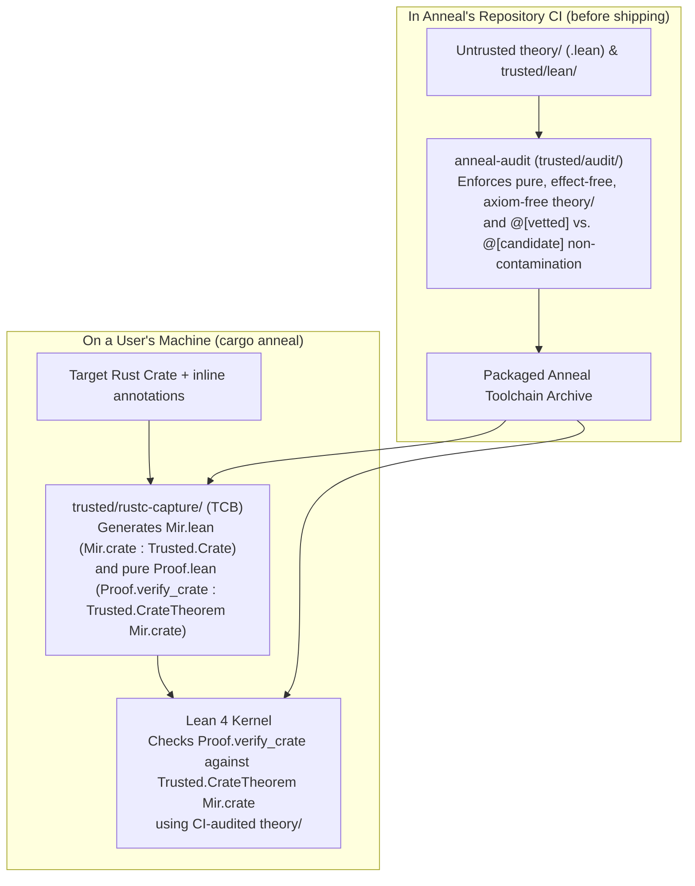
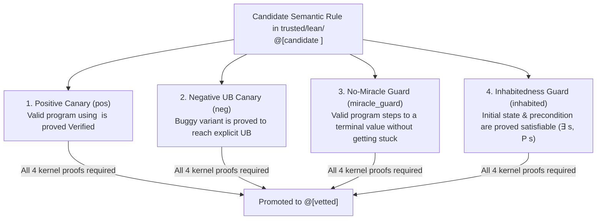

<!-- Copyright 2026 The Fuchsia Authors

Licensed under a BSD-style license <LICENSE-BSD>, Apache License, Version 2.0
<LICENSE-APACHE or https://www.apache.org/licenses/LICENSE-2.0>, or the MIT
license <LICENSE-MIT or https://opensource.org/licenses/MIT>, at your option.
This file may not be copied, modified, or distributed except according to
those terms. -->

# Trust Model, Boundary Enforcement, and TCB Confidence

> **Note:** Anneal is under active development. Parts of the design and
> architecture described in this document are not yet implemented or may be
> implemented differently; this document may be aspirational or stale relative
> to the codebase.

[`PRINCIPLES.md`](../PRINCIPLES.md) states Anneal's central correctness promise:
if the code in a verification result's Trusted Computing Base (TCB) audit log
is correct, its assumptions are valid, and Anneal emits no errors, then the
verified code is correct.

Upholding this promise requires solving two complementary problems:

1. **Keeping the TCB small and impermeable (Sections 1–3):** A modern
   verification tool needs tens of thousands of lines of intermediate
   representation (IR) lowering passes, weakest-precondition (WP) rules,
   separation-logic lemmas, and proof automation—much of it written by
   untrusted AI agents. Anneal isolates all first-party trusted code inside
   [`trusted/`](../trusted) and places all lowering passes, program logics, and
   tactics outside the TCB in `theory/`. To ensure that adversarial or buggy
   code in `theory/` cannot use side effects, OS APIs, or custom axioms to
   undermine the guarantees established by `trusted/`, Anneal runs a standalone
   boundary auditor ([`trusted/audit/`](../trusted/audit)) **in Anneal's own
   repository CI**.
2. **Gaining confidence in the TCB itself (Section 4):** Minimizing `trusted/`
   does not automatically make `trusted/` bug-free. A bug inside the MIR
   extractor (`trusted/rustc-capture/`) or the reference operational semantics
   (`trusted/lean/`) could still mismodel Rust or make a theorem hold
   vacuously. Anneal addresses TCB bugs through rigorous line-by-line
   citations of the Rust Reference and `rustc`, structural anti-vacuity guards,
   a **four-way adequacy canary squeeze** on every semantic rule, and
   differential testing against `rustc` and Miri.

For related architectural details, see:

- [`docs/design.md`](design.md) for an overview of Anneal's verification
  workflow and specification modes.
- [`docs/architecture.md`](architecture.md) for the three-stage MIR pipeline
  and how untrusted lowering passes in `theory/` connect to `trusted/lean/`.

## 1. The `trusted/` boundary and how verification stays sound

Anneal divides its repository into two zones with strictly separated roles:

| Zone | Directory | Role | Trust status |
| :--- | :--- | :--- | :--- |
| **Trusted foundation** | [`trusted/`](../trusted) | Extracts MIR and emits pure proof scripts (`trusted/rustc-capture/`), defines captured MIR syntax and reference semantics (`trusted/lean/`), orchestrates CLI invocation (`trusted/cargo-anneal/`), and audits the Anneal repository in CI (`trusted/audit/`). | **In the TCB.** Audited by humans and pinned by cryptographic manifests. |
| **Proof theory** | `theory/` | Defines the normalized `StableAst`, proves lowering passes (`Abstracts`), and provides WP calculi, separation logic, and proof tactics invoked by generated proof scripts. | **Outside the TCB.** Treated as potentially adversarial; audited mechanically in Anneal's CI and checked by the Lean 4 kernel. |

### How CI auditing and user-machine verification fit together

A key design question is how Anneal guarantees soundness without requiring a
human to audit `theory/` and without running a heavy repository auditor on
every user's machine.

Anneal splits the enforcement across **Anneal's repository CI** and **the
user's machine**:

1. **On the user's machine (`trusted/rustc-capture/` + Lean 4 kernel):**
   - Users do not write raw Lean files that could spoof the theorem statement or
     introduce `sorry`. Instead, users annotate their Rust source code, and
     `trusted/rustc-capture/` (which is part of the human-audited TCB)
     deterministically generates both `Mir.lean` (defining
     `Mir.crate : Trusted.Crate`) and `Proof.lean` (a pure proof script that
     states `theorem Proof.verify_crate : Trusted.CrateTheorem Mir.crate` and
     calls into `theory/` to prove it).
   - Because `trusted/rustc-capture/` generates `Mir.lean` and `Proof.lean`
     directly, the theorem *statement* (`ConstantInfo.type`) is guaranteed to
     be `Trusted.CrateTheorem Mir.crate` over the extracted crate, and
     `Proof.lean` is guaranteed to contain no axioms or effectful code.
   - The Lean 4 kernel on the user's machine then typechecks `Proof.lean`,
     verifying that the proof term (`ConstantInfo.value?`) constructed by
     `theory/` is a valid proof of `Trusted.CrateTheorem Mir.crate`.
2. **In Anneal's repository CI (`trusted/audit/`):**
   - For the Lean 4 kernel check on the user's machine to be sufficient, the
     `theory/` library shipped with Anneal must not be able to cheat the kernel
     or subvert the host process when `lean` imports and elaborates `theory/`.
   - In raw Lean 4, an unrestricted `.lean` file in `theory/` could execute
     arbitrary OS and filesystem operations during elaboration (`#eval`,
     `run_cmd`, `initialize`), attach compiler overrides (`@[implemented_by]`,
     `@[extern]`, `@[csimp]`), introduce custom `axiom`s or `sorryAx`, or
     inject spoofed definitions into the `Trusted` namespace. Similarly, a Rust
     crate outside `trusted/` could run arbitrary code via `build.rs` or
     procedural macros.
   - Therefore, **Anneal's CI runs `anneal-audit` (`trusted/audit/`)** on the
     Anneal repository before any commit can merge or be packaged into the
     toolchain archive. `anneal-audit` does **not** run on a user's machine; its
     job is to verify in CI that nothing outside `trusted/` in the Anneal
     repository is effectful or axiom-bearing.

### Statement-Origin Separation (`ConstantInfo.type` vs. `ConstantInfo.value?`)

Within the Lean 4 kernel environment, every compiled theorem
(`ConstantInfo.thmInfo`) has two distinct components:

- **The theorem statement (`ConstantInfo.type`):** The proposition claiming
  *what* holds.
- **The proof term (`ConstantInfo.value?`):** The lambda term explaining *why*
  that proposition holds.

Anneal's architecture enforces **Statement-Origin Separation** between the two:

- Every constant referenced in the *statement* (`ConstantInfo.type`) of
  `Trusted.CrateTheorem Mir.crate` originates in `Trusted.*` (or the allowlisted
  Lean `Init.*` foundation) and the generated `Mir.crate`. No definition from
  `theory/` ever appears in the theorem statement.
- Declarations from `theory/` appear only inside the *proof term*
  (`ConstantInfo.value?`). Because `anneal-audit` verifies in CI that `theory/`
  is pure, effect-free, and free of custom axioms, and the Lean 4 kernel checks
  that `ConstantInfo.value?` inhabits `ConstantInfo.type`, `theory/` can supply
   arbitrarily rich lowering passes and tactics without being able to weaken the
  theorem statement.

## 2. Repository CI boundary enforcement (`anneal-audit`)

[`trusted/audit/`](../trusted/audit) implements the CI gatekeeper
(`anneal-audit` and
[`TrustedBoundary.lean`](../trusted/audit/TrustedBoundary.lean)) that audits
the Anneal repository (and runs synthetic crate-verification integration tests
in CI). It enforces five invariants across two phases over an isolated staging
directory.

### Cargo workspace containment

Before inspecting Lean files, `anneal-audit` verifies the repository's root
manifests against [`root-manifest.sha256`](../trusted/root-manifest.sha256)
(`trusted/root-manifest.sha256`) and checks that every Cargo workspace member
and `path` dependency resides under `trusted/`. Because Rust code (including
`build.rs` scripts and proc-macros) is effectful and not checked by the Lean
kernel, no Rust crate is permitted outside `trusted/`.

### Phase 1: Syntactic source preflight (`--mode preflight`)

Before compiling any `.lean` file in `trusted/lean/` or `theory/`,
`anneal-audit` stages the source files into a private temporary directory,
verifies that no pre-existing `.olean` or `.ir` files exist in the source tree,
and scans the concrete syntax trees using Lean's parser:

- **Bans unsafe, effectful, and metaprogramming escapes:** Rejects `unsafe`,
  `partial`, `noncomputable` (where prohibited), `meta`, `axiom`, `opaque`,
  `sorry`, `native_decide`, `by_elab`, `#eval`, `run_cmd`, `include_str`,
  `set_option`, `@[implemented_by]`, `@[extern]`, `@[csimp]`, and `initialize` /
  `builtin_initialize` hooks, preventing `theory/` from performing I/O or OS
  calls during compilation.
- **Enforces namespace and import hygiene:** Verifies that `Trusted.*` modules
  import only allowed foundation (`Init.*`) and `Trusted.*` modules, and
  prevents `theory/` modules from opening or declaring constants inside the
  `Trusted` namespace.
- **Records trust-tier declarations:** Validates that every declaration and
  inductive constructor in `Trusted.*` carries an explicit `@[vetted]` or
  `@[candidate <feature>]` annotation and records the resulting declaration
  table before `Trusted.expandTrustDeclaration`
  ([`Trusted/Attributes.lean`](../trusted/lean/Trusted/Attributes.lean)) strips
  those attributes for `prelude`-only compilation.

### Phase 2: Standalone kernel replay and DAG audit (`--mode audit`)

After compiling the staged `.lean` modules synchronously with kernel checking
enabled (`-t0 -DElab.async=false -Ddebug.skipKernelTC=false`), `anneal-audit`
loads the resulting `.olean` environment and performs a full kernel-level audit:

1. **Module, origin, and axiom verification (`verifyAndCollectLocals`):**
   Verifies that only allowlisted modules are loaded; that no non-foundation
   declaration in `Trusted.*` or `theory/` is `unsafe`, `partial`, an `axiom`,
   or a quotient primitive (`.quotInfo`); and that the transitive dependency
   closure reaches only the locked foundation axiom allowlist
   (`{Classical.choice, Quot.sound, propext}`).
2. **Feature-lattice tracking (`@[vetted]` vs. `@[candidate <feat>]`):** As
   Anneal's Rust semantics grows, newly implemented semantic rules or inductive
   constructors in `trusted/lean/` start with `@[candidate <feat>]` rather than
   `@[vetted]`. Inside `@[vetted]` functions that pattern-match on extensible
   inductives, candidate constructor arms must be wrapped in
   `Trusted.candidate "<feat>" (...)`. `TrustedBoundary.lean` derives
   per-parameter eliminator trust statuses (`deriveEliminatorParamStatuses`) and
   performs demand-driven reachability (`collectActiveCandidateFeatures`) so
   that `@[vetted]` declarations can never silently depend on
   `@[candidate <feat>]` definitions outside a verified guard.
3. **Fresh kernel replay (`base.toKernelEnv.replay locals`):** Finally,
   `TrustedBoundary.lean` constructs a clean kernel environment containing only
   the pinned `Init.*` foundation (`base`) and replays every non-foundation
   constant (`Trusted.*` and `theory/`) through the standalone Lean 4 kernel
   typechecker from scratch.

*(In CI integration tests, `anneal-audit` also exercises a `--verify-crate`
mode over test fixtures containing `Mir.lean` and `Proof.lean` to verify
end-to-end that `Proof.verify_crate : Trusted.CrateTheorem Mir.crate` and
candidate-feature reachability behave as expected across the `trusted/lean/`
and `theory/` boundary.)*

### Cryptographic manifest and toolchain pinning

To ensure that neither CI nor the packaged toolchain can be subverted by
altered build manifests or mismatched binaries, [`trusted/`](../trusted) pins
its environment cryptographically:

- **[`trusted/root-manifest.sha256`](../trusted/root-manifest.sha256):** Pins
  the SHA-256 digests of the repository's root build files (`Cargo.toml`,
  `Cargo.lock`, `flake.nix`, and `flake.lock`).
- **[`foundation-lock.json`](../trusted/lean/foundation-lock.json)**
  (`trusted/lean/foundation-lock.json`): Pins the exact SHA-256 digests of the
  `lean` executable and all `Init.*` standard prelude source and `.olean`
  companion files. Both the Nix toolchain build (`flake.nix`) and `anneal-audit`
  verify these digests on disk.

## 3. External dependencies and commenting in `trusted/`

Because every file in [`trusted/`](../trusted) must be auditable by humans,
Anneal optimizes `trusted/` for **human comprehension and review accuracy**, not
merely minimum dependency count:

- **Standard libraries over hand-rolled plumbing:** `trusted/` uses widely
  audited Rust ecosystem crates (such as `serde`, `clap`, and `sha2`, all
  pinned with SHA-256 checksums in `Cargo.lock`) for generic utilities like
  serialization, CLI parsing, and hashing. Hand-rolling bespoke parsers or
  cryptographic primitives inside `trusted/` would add hundreds of lines of
  security-critical code and increase audit burden.
- **Mandatory provenance citations:** Any code in `trusted/` that models Rust
  semantics or extracts `rustc` internal structures must explain the
  correspondence in its comments and both quote and cite the relevant Rust
  Reference section (`rust-lang/reference`) or compiler source file
  (`rust-lang/rust`) at a pinned commit hash.

## 4. Gaining confidence in the TCB

Mechanical CI boundary enforcement guarantees that `theory/` is pure and cannot
subvert `trusted/`. However, a verification result is still only as sound as
`trusted/` itself. If `trusted/rustc-capture/` mis-serializes a MIR statement or
`trusted/lean/` defines a flawed operational semantics rule, the Lean kernel
could faithfully verify a theorem that does not match actual Rust execution.

Anneal defends against bugs inside `trusted/` by targeting the four specific
ways a formal semantics or extractor can fail.

### The four classes of TCB soundness hazards

1. **Under-approximation ("miracle" traps):** Suppose an operational semantics
   rule for pointer arithmetic accidentally omits a transition case or has a
   typo that makes its step guard unsatisfiable on certain inputs. When
   execution reaches that instruction, the abstract machine neither steps to a
   next state nor transitions to `UB`—it silently halts (a "miracle"). Under a
   standard safety definition ("no reachable state is `UB`"), a silent halt is
   catastrophic: every behavior after the stuck instruction is unreachable, so
   any postcondition holds vacuously.
2. **Vacuous obligations (uninhabited preconditions):** If a function's
   generated precondition, layout environment, or well-formedness predicate
   contains a subtle contradiction (for example, requiring both `size == 0` and
   `size > 0`), the premise of the theorem is `False`. In classical and
   constructive logic alike, `False -> Safe` holds for *every* program,
   regardless of whether the function body triggers UB.
3. **Over-permissive semantics (missed UB):** A semantic rule in
   `Trusted/Rust/Semantics/` steps normally on an operation that `rustc` and
   the Rust Abstract Machine consider undefined behavior (for example, failing
   to check pointer alignment on a place dereference or overlooking a provenance
   violation).
4. **Extraction mismatch:** `trusted/rustc-capture/` mis-translates a
   `rustc_middle::mir` construct into Lean or fails to reject a crate that hits
   a post-monomorphization compiler error.

### Structural anti-vacuity: constructor-gated obligations

To prevent vacuous theorems at the type level, core obligations in
`Trusted/Framework/` (`VerificationResult`, `Compiler.Verified`, `Abstracts`,
and `Compiles`) are designed as **constructor-gated structures** rather than
bare logical implications (`P -> Q`).

To construct a `Compiler.Verified` witness for a function, the proof must
supply not only the safety proof over execution traces, but also structural
non-vacuity fields—such as witnesses that the initial configuration space is
inhabited and that the operational semantics does not silently get stuck in
non-terminal states.

### The four-way adequacy canary squeeze

Before any semantic rule or MIR construct in `trusted/lean/` can be promoted
from `@[candidate <feat>]` to `@[vetted]`, it must be accompanied by a
**four-way adequacy canary suite**: four small, concrete Rust/MIR test programs
whose behaviors are proved inside the Lean kernel.

Each canary closes one specific class of TCB bug:

| Canary | What must be proved in Lean | What TCB bug it rules out |
| :--- | :--- | :--- |
| **1. Positive (`pos`)** | A minimal, valid program exercising the feature satisfies `Verified` (cannot reach `UB`). | Rules out an overly strict semantics that flags valid Rust idioms as `UB`. |
| **2. Negative (`neg`)** | A minimal buggy mutation of that program (such as an off-by-one index or unaligned pointer) transitions to `UB`. | Rules out **over-permissive semantics (missed UB)**: proves the `UB` check is actually wired up and reachable. |
| **3. No-miracle (`miracle_guard`)** | Starting from the positive canary's initial state, execution steps to a concrete terminal return value. | Rules out **under-approximation (miracle traps)**: if the rule silently halted instead of stepping, `miracle_guard` could not reach a terminal value. |
| **4. Inhabitedness (`inhabited`)** | There exists at least one concrete state $s$ satisfying the entry precondition ($\exists s,\; P(s)$). | Rules out **vacuous obligations**: proves the precondition and layout invariants are mutually satisfiable. |

Together, these four theorems "squeeze" every semantic rule from above and
below: the rule must be permissive enough to execute valid code to completion
(`pos` + `miracle_guard`) from a realizable initial state (`inhabited`), yet
strict enough to trap invalid operations as `UB` (`neg`).

### Empirical differential testing against `rustc` and Miri

Formal canary proofs verify that `trusted/lean/` has no internal vacuity or
miracle traps and matches the author's intended boundary cases, but they cannot
by themselves prove that the author's understanding of Rust matches `rustc`.

To anchor Anneal's TCB to empirical reality, Anneal pairs its formal canaries
with **differential conformance testing**:

- Concrete Rust test programs (including the positive and negative canary
  programs and edge-case suites covering layout, pointer projections, casts,
  wrapping/checked arithmetic, and aliasing) are compiled with `rustc`,
  executed under **Miri** (Rust's reference UB-checking interpreter), and
  extracted via `trusted/rustc-capture/`.
- The extracted `Mir.lean` programs are evaluated against Anneal's reference
  semantics in `trusted/lean/`.
- CI checks that Miri and Anneal agree on both observable outputs for defined
  programs and `UB` rejection for undefined programs. Any discrepancy between
  `rustc`/Miri and Anneal's reference semantics surfaces immediately as a TCB
  regression test failure.
