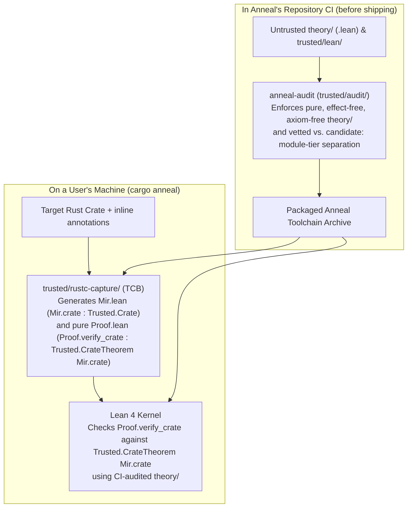

<!-- Copyright 2026 The Fuchsia Authors

Licensed under a BSD-style license <LICENSE-BSD>, Apache License, Version 2.0
<LICENSE-APACHE or https://www.apache.org/licenses/LICENSE-2.0>, or the MIT
license <LICENSE-MIT or https://opensource.org/licenses/MIT>, at your option.
This file may not be copied, modified, or distributed except according to
those terms. -->

# Trust Model and Boundary Enforcement

> **Note:** Anneal is under active development. Parts of the design and
> architecture described in this document are not yet implemented or may be
> implemented differently; this document may be aspirational or stale relative
> to the codebase.

[`META_PRINCIPLES.md`](../META_PRINCIPLES.md),
[`PRINCIPLES.md`](../PRINCIPLES.md), and [`THREAT_MODEL.md`](../THREAT_MODEL.md)
are the controlling documents for Anneal's correctness promise and threat
model: if the code in a verification result's Trusted Computing Base (TCB)
audit log is correct, its assumptions are valid, and Anneal emits no errors in
an uncompromised execution environment, then the verified code is sound and
satisfies any stated specifications.

A modern verification tool needs tens of thousands of lines of intermediate
representation (IR) lowering passes, weakest-precondition (WP) rules,
correspondence proofs, separation-logic lemmas, and proof automation—much of
it written by untrusted AI agents. To keep the human audit surface small,
Anneal isolates all first-party trusted code inside [`trusted/`](../trusted)
and places all lowering passes, program logics, tactics, and correspondence
proofs outside the TCB in `theory/` and `correspondence/`. To ensure that
adversarial or buggy code in `theory/` or `correspondence/` cannot use side
effects, OS APIs, or custom axioms to undermine the guarantees established by
`trusted/`, Anneal runs a standalone boundary auditor
([`trusted/audit/`](../trusted/audit)) **in Anneal's own repository CI**.

For related architectural details, see:

- [`docs/design.md`](design.md) for an overview of Anneal's verification
  workflow and specification modes.
- [`docs/architecture.md`](architecture.md) for the three-stage MIR pipeline
  and how untrusted lowering passes in `theory/` connect to `trusted/lean/`.
- [`docs/mir-correspondence-design.md`](mir-correspondence-design.md) for how
  Pass 2 anchors `Trusted.MirSemantics` against `vendor/lean-miri/`.

## 1. The `trusted/` boundary and how verification stays sound

Anneal divides its repository into three zones with strictly separated roles:

| Zone | Directory | Role | Trust status |
| :--- | :--- | :--- | :--- |
| **Trusted foundation** | [`trusted/`](../trusted) | Extracts MIR and emits pure proof scripts (`trusted/rustc-capture/`), defines captured MIR syntax and verification operational semantics (`trusted/lean/`), states MIR correspondence claims and reference-adapter specifications (`trusted/correspondence/`), orchestrates CLI invocation (`trusted/cargo-anneal/`), and audits the Anneal repository in CI (`trusted/audit/`). | **In the TCB.** Audited by humans (alongside external files pinned by hash manifests inside `trusted/`). |
| **Proof theory & correspondence** | `theory/`, `correspondence/` | Defines the normalized `StableAst`, proves lowering passes (`Abstracts`), provides WP calculi (`theory/Anneal/MirWp.lean`), separation logic, and proof tactics (`theory/`), and proves the MIR correspondence theorems and canaries (`correspondence/`). | **Outside the TCB.** Treated as potentially adversarial; audited mechanically in Anneal's CI and checked by the Lean 4 kernel (`correspondence/` is checked in CI only and is not shipped in the user toolchain archive). |
| **Vendored reference model** | `vendor/lean-miri/` | Pinned snapshot of `proofs-rs/lean-miri` with a human-audited 10-file opt-in `deinitMovedPlace` delta ([`docs/mir-correspondence-design.md`](mir-correspondence-design.md)). Never shipped in the user toolchain archive. | **In the correspondence TCB.** Pinned byte-for-byte in `vendor/lean-miri/UPSTREAM_PIN.json` (locked by `LOCKED_UPSTREAM_PIN_SHA256` and `LOCKED_PATCHED_MIRI_FILES` in `trusted/audit/`). Only the 160-module `Miri.Interpreter.ExecutionMachine` slice (excluding `Miri.Input.NativeMathHost`) is compiled (or restored from a digest-gated cache outside the checkout) and verified by `.olean` SHA-256; every non-`isPartial` vendored declaration (38,718 declarations) is replayed from scratch through the standalone Lean 4 kernel (`toKernelEnv.replay`) onto the authenticated sysroot base on every run, followed directly by replaying `Trusted.Correspondence`, `Anneal.MirCorrespondenceBase`, and `Anneal.MirCorrespondenceProof` on top of that replayed base and checking cone purity. |

### How CI auditing and user-machine verification fit together

A key design question is how Anneal guarantees soundness without requiring a
human to audit `theory/` and without running a heavy repository auditor on
every user's machine.

Anneal splits the enforcement across **Anneal's repository CI** and **the
user's machine**:

1. **On the user's machine (`trusted/rustc-capture/` + Lean 4 kernel):**
   - Users do not write raw Lean files that could spoof the theorem statement or
     introduce `sorry`. Instead, users annotate their Rust source code, and
     `trusted/rustc-capture/` (which is part of the human-audited TCB)
     deterministically generates both `Mir.lean` (defining
     `Mir.crate : Trusted.Crate`) and `Proof.lean` (a pure proof script that
     states `theorem Proof.verify_crate : Trusted.CrateTheorem Mir.crate` and
     calls into `theory/` to prove it).
   - Because `trusted/rustc-capture/` generates `Mir.lean` and `Proof.lean`
     directly, the theorem *statement* (`ConstantInfo.type`) is guaranteed to
     be `Trusted.CrateTheorem Mir.crate` over the extracted crate, and
     `Proof.lean` is guaranteed to contain no axioms or effectful code.
   - The Lean 4 kernel on the user's machine then typechecks `Proof.lean`,
     verifying that the proof term (`ConstantInfo.value?`) constructed by
     `theory/` is a valid proof of `Trusted.CrateTheorem Mir.crate`.
2. **In Anneal's repository CI (`trusted/audit/`):**
   - For the Lean 4 kernel check on the user's machine to be sufficient, the
     `theory/` library shipped with Anneal must not be able to cheat the kernel
     or subvert the host process when `lean` imports and elaborates `theory/`.
   - In raw Lean 4, an unrestricted `.lean` file in `theory/` could execute
     arbitrary OS and filesystem operations during elaboration (`#eval`,
     `run_cmd`, `initialize`), attach compiler overrides (`@[implemented_by]`,
     `@[extern]`, `@[csimp]`), introduce custom `axiom`s or `sorryAx`, or
     inject spoofed definitions into the `Trusted` namespace. Similarly, a Rust
     crate outside `trusted/` could run arbitrary code via `build.rs` or
     procedural macros.
   - Therefore, **Anneal's CI runs `anneal-audit` (`trusted/audit/`)** on the
     Anneal repository before any commit can merge or be packaged into the
     toolchain archive. `anneal-audit` does **not** run on a user's machine; its
     job is to verify in CI that all first-party Lean code outside `trusted/`
     (`theory/` and `correspondence/`) is pure, effect-free, and within the
     locked foundation axiom allowlist (and that no Rust crate resides outside
     `trusted/`). Vendored reference-model sources under `vendor/lean-miri/` are
     never packaged into the user toolchain archive and are admitted by
     content-addressed SHA-256 pin under Pass 2 rather than syntactic preflight,
     while `ci/` and `.github/` are human-audited CI configuration.

### Statement-Origin Separation (`ConstantInfo.type` vs. `ConstantInfo.value?`)

Within the Lean 4 kernel environment, every compiled theorem
(`ConstantInfo.thmInfo`) has two distinct components:

- **The theorem statement (`ConstantInfo.type`):** The proposition claiming
  *what* holds.
- **The proof term (`ConstantInfo.value?`):** The lambda term explaining *why*
  that proposition holds.

Anneal's architecture enforces **Statement-Origin Separation** between the two:

- Every constant referenced in the *statement* (`ConstantInfo.type`) of
  `Trusted.CrateTheorem Mir.crate` originates in `Trusted.*` (or the allowlisted
  Lean `Init.*` foundation) and the generated `Mir.crate`. No definition from
  `theory/` ever appears in the theorem statement.
- Declarations from `theory/` appear only inside the *proof term*
  (`ConstantInfo.value?`). Because `anneal-audit` verifies in CI that `theory/`
  is pure, effect-free, and free of custom axioms, and the Lean 4 kernel checks
  that `ConstantInfo.value?` inhabits `ConstantInfo.type`, `theory/` can supply
  arbitrarily rich lowering passes and tactics without being able to weaken the
  theorem statement.

### Staging TCB changes (`vetted` vs. `candidate:<feature>` modules)

Auditing a new semantic rule in `trusted/lean/` to full TCB standards—including
line-by-line Rust Reference citations and human review—takes deliberate effort.
If `trusted/lean/` treated all merged code as equally trusted, contributors
would face an unproductive tradeoff when adding support for a new Rust feature:

- **Block downstream work:** Hold back the `trusted/lean/` definitions until
  full human auditing is complete, blocking contributors and agents from
  building the corresponding lowering passes and WP lemmas in `theory/` or
  testing the feature on real crates; or
- **Dilute the TCB guarantee:** Merge unreviewed definitions into
  `trusted/lean/` immediately, making it impossible to tell whether a
  verification result depends only on audited rules or also on work-in-progress
  semantics.

Anneal resolves this by assigning every module in `trusted/lean/` an explicit
module-level trust tier via a leading header comment directive:

- **`-- anneal-trust-tier: vetted`:** Modules whose definitions have completed
  full Rust Reference auditing.
- **`-- anneal-trust-tier: candidate:<feature>`:** Work-in-progress TCB modules
  belonging to a named subsystem feature `<feature>` (such as `refinement`,
  `step_result`, `memory`, `mir_ast`, `mir_semantics`, or `rustc_capture`) that
  have not yet completed human auditing.

Assigning trust tiers at the module boundary rather than via per-declaration
attributes keeps `trusted/lean/` completely free of custom attribute macros or
metaprogramming: every constant compiled into a `Trusted` module's `.olean`
file—including constructors, recursors (`rec`, `casesOn`), pattern matchers
(`match_1`), equational lemmas (`eq_1`), and `where`/`private` helpers—
automatically inherits its defining module's trust tier via
`Environment.getModuleIdxFor?`.

To prevent unreviewed candidate modules from contaminating audited definitions,
`TrustedBoundary.lean` enforces a strict one-way dependency rule across both
Pass 1 (`RepoOrigin.edgeViolation?`) and Pass 2 (`CorrOrigin.edgeViolation?`):
constants in a `vetted` module may reference only the locked `Init.*`
foundation and other `vetted` modules, never a `candidate:<feature>`,
`vendorMiri`, or `sysrootFoundation` module.

## 2. Repository CI boundary enforcement (`anneal-audit`)

[`trusted/audit/`](../trusted/audit) implements the CI gatekeeper
(`anneal-audit` and
[`TrustedBoundary.lean`](../trusted/audit/TrustedBoundary.lean)) that audits
the Anneal repository over an isolated `0o700` staging directory. It enforces
the boundary controls detailed below across Pass 1 (core repository
`trusted/lean/` and `theory/`) and Pass 2 (vendored `lean-miri`,
`trusted/correspondence/`, and `correspondence/`).

### Cargo workspace containment

Before inspecting Lean files, `anneal-audit` verifies the repository's root
manifests against [`root-manifest.sha256`](../trusted/root-manifest.sha256)
(`trusted/root-manifest.sha256`) and checks that every Cargo workspace member
and `path` dependency resides under `trusted/`. Because Rust code (including
`build.rs` scripts and proc-macros) is effectful and not checked by the Lean
kernel, no Rust crate is permitted outside `trusted/`.

### Syntactic source preflight (`"preflight"` & `"correspondence-preflight"`)

Before compiling any repository `.lean` file in Pass 1 or Pass 2,
`anneal-audit` stages regular source files into a private temporary directory,
verifies that no symlinks or pre-existing `.olean`/`.ilean`/`.ir` artifacts
exist in the source tree, and parses every file using `Parser.parseHeader` and
`Parser.parseCommand` against the locked `Init.*` foundation parser environment
(`"preflight"`, without invoking Lean's Turing-complete elaborator). For Pass 2
(`trusted/correspondence/` and `correspondence/`), `anneal-audit` additionally
runs `"correspondence-preflight"` after staging the authenticated `Miri.*`
closure and before compiling any Pass 2 source: it re-parses every Pass 2
source file under the Pass 2 union compile parser environment (importing
authenticated `Init.*`/`Std.*`/`Lean.*`, Pass 1 `Trusted.*`, compiled untrusted
Pass 1 `theory/`, and pinned `Miri.*` modules with `loadExts := true`,
`level := .private`, and `enableInitializersExecution`). Because
`level := .private` enables runtime `[init]` phases and `loadExts := true`
executes `finalizePersistentExtensions` -> `runInitAttrs` and
`KeyedDeclsAttribute.ofOLeanEntry` (`evalConstCheck`), importing this
environment inside the inspector process runs pinned vendored `[init]`
initializers (for example `Miri.Input.DecoderValues`'s `initialize
runtimeSummaryKeys`, which can also register user-defined environment
extensions), evaluates pinned vendored tactic `elab`s (such as
`DedupRangeMap.lean` and `TreeState.lean`), and deserializes compiled Pass 1
`theory/` extension data. Human review of the pinned vendored and patched
compile-time code is the safeguard against vendored compile-time and preflight
side effects, while Pass 1's closed attribute allowlist restricts compiled
`theory/` `.olean`s to plain-data extension entries. Both `"preflight"` and
`"correspondence-preflight"` track lexical `namespace`/`section`/`end`/`open`
scopes in `parseAndInspectCommands` and fail closed if any `namespace` or
multi-component declaration enters—or any `open`, `open ... in`, or `mutual`
preamble `open` has *any* candidate resolution (across every prefix of
`currNamespace` including root and every conservatively tracked open namespace,
regardless of whether an unimported decoy namespace exists in the union parser
environment) matching—a namespace that registers scoped entries in any
`ScopedEnvExtension` (including scoped syntax, notations, macros, elaborators,
instances, and attributes). Unscoped syntax registered by `Lean`/`Std` or
vendored `Miri.*` modules (such as `throwError "x"` -> `Lean.termThrowError__`,
`m! "x"` -> `Lean.termM!_`, or custom Miri tactic `elab`s) is parsed into its
true `SyntaxNodeKind` and rejected before elaboration, while scoped extensions
cannot be activated across `open`/`namespace` boundaries. Rather than relying on
an open-ended blocklist of dangerous Lean features, `TrustedBoundary.lean`
classifies each source file into a `SourceRole` (`trusted (tier : TrustTier)`
vs. `theory`) and validates the module header and every top-level command in a
single top-down traversal (`inspectSyntax` and `inspectNodeKind`) against a
closed, role-aware `SyntaxNodeKind` allowlist in every applicable preflight
environment:

- **`SourceRole.trusted` (`trusted/lean/` and `trusted/correspondence/`):**
  Restricted to `allowedTrustedSyntaxKinds`—pure declarations, types, and
  term-mode proofs only, excluding `byTactic` and all tactic syntax so TCB
  specifications remain direct, tactic-free definitions—and required to carry
  exactly one valid `-- anneal-trust-tier: vetted` or
  `-- anneal-trust-tier: candidate:<feature>` directive.
- **`SourceRole.theory` (`theory/` and `correspondence/`):** Restricted to
  `allowedTheorySyntaxKinds`, which extends `allowedTrustedSyntaxKinds` with a
  closed allowlist of pure proof tactics (`allowedTheoryTacticKinds`) while
  rejecting trust-tier directives and any unallowlisted syntax node, command,
  modifier, attribute, or tactic configuration (excluding `unsafe`, `partial`,
  `noncomputable section`, `meta`, `axiom`, `macro`, `syntax`, `elab`, `sorry`,
  `native_decide`, `decide!`, `bv_decide`, `rfl'`, `grind`, tactic `configItem`
  flags such as `+native` and `+kernel`, `by_elab`, `run_tac`, `#eval`,
  `include_str`, `set_option`, `@[implemented_by]`, `@[extern]`, `@[csimp]`,
  and `initialize` hooks; `noncomputable` declaration modifiers are admitted
  mechanically across all roles and both passes by `allowedCommandSyntaxKinds`
  (which `trusted/lean/` and Pass 2 modules rely on), while `noncomputable
  section` is forbidden mechanically and repository policy keeps `theory/` free
  of `noncomputable` definitions; unlike `theory/`, `correspondence/` modules
  may use `noncomputable def`).

### Pass 1: Core repository kernel replay (`"audit"` JSON IPC mode)

After compiling the staged `trusted/lean/` and `theory/` modules synchronously
with kernel checking enabled (`-t0 -DElab.async=false
-Ddebug.skipKernelTC=false`), `anneal-audit` loads the resulting `.olean` files
with `trustLevel := 0`, `plugins := #[]`, and `loadExts := false` (so no
`[init]` initializers or persistent environment extensions from audited modules
are deserialized or executed), partitions every loaded module into `RepoOrigin`
(`.foundation` or `.repo (.trusted tier | .theory)`), and performs a full
kernel-level audit:

1. **Inventory, imports, namespace, and constant safety
   (`verifyAndCollectLocals`):** Verifies that only allowlisted modules are
   loaded; rejects compiled `.olean` header imports violating
   `RepoOrigin.importViolation?` (for example, a `Trusted` module importing a
   `theory/` module); verifies that every constant's recorded module origin
   (`env.getModuleIdxFor?`) matches its module's `RepoOrigin`; forbids
   non-`Trusted` modules from declaring constants in the `Trusted` root
   namespace (`(privateToUserName ci.name).getRoot == `Trusted`) or `opaque`
   definitions; rejects any `unsafe`, `partial`, `axiom`, or quotient primitive
   (`.quotInfo`) across repository declarations; and checks that the transitive
   dependency closure reaches only the locked foundation axiom allowlist
   (`{Classical.choice, Quot.sound, propext}`).
2. **Origin and trust-tier separation (`checkDeclarationEdges`):** Traverses
   every kernel dependency edge (`declarationEdges`) across repository
   constants and enforces `RepoOrigin.edgeViolation?`:
   - **Origin rule:** A `.trusted _` constant may reference only `.foundation`
     or `.trusted _` constants (never `.theory`).
   - **Vetted rule:** A `.trusted .vetted` constant may reference only
     `.foundation` or `.trusted .vetted` constants (never
     `.trusted (.candidate _)`).
3. **MIR WP non-backsliding (`verifyMirWpCoreTheorems`):** Enabled by default
   (`require_mir_wp = true`); requires `Trusted.MirAst`,
   `Trusted.MirSemantics`, and `Anneal.MirWp` to be present and verifies that
   `wpProg` soundness, `wpFaultProg` soundness, and all 15 Pass 1 canaries
   prove their exact `Trusted.MirSemantics` `*Claim` propositions.
4. **Fresh kernel replay (`replayOntoBase`):** Constructs a clean kernel
   environment containing only the pinned `Init.*` foundation (`base`),
   replays every non-foundation constant (`Trusted.*` and `theory/`) through
   the standalone Lean 4 kernel typechecker (`base.toKernelEnv.replay`) from
   scratch, and checks any alternate foundation theorem proofs under fresh
   names.

### Pass 2: MIR correspondence and `lean-miri` cone audit

When `--require-correspondence` is passed in CI (or correspondence directories
or `vendor/lean-miri/` are present), `anneal-audit` executes Pass 2
(`"correspondence-preflight"` and `"correspondence-audit"` JSON IPC modes):

1. **Pin and sysroot authentication (`verify_upstream_pin`,
   `ensure_sysroot_foundation`):** `trusted/audit` hashes
   `vendor/lean-miri/UPSTREAM_PIN.json` against `LOCKED_UPSTREAM_PIN_SHA256`,
   verifies its `commit` against `LOCKED_MIRI_COMMIT`, `build_lean_toolchain`
   against Anneal's locked `leanprover/lean4:v4.34.1`, and `patched_files`
   against `LOCKED_PATCHED_MIRI_FILES`. It verifies every vendored `.lean` and
   auxiliary file against its SHA-256 digest (rejecting symlinks, missing or
   unlisted files, and pre-existing `.olean`/`.ir` artifacts, and excluding
   `Miri.Input.NativeMathHost` from the 160-module `execution_machine_closure`),
   and authenticates every `{Init,Std,Lean}*` `.olean`, `.olean.server`, and
   `.olean.private` file in the pinned toolchain's `lib/lean/` against
   `LOCKED_SYSROOT_FOUNDATION_MANIFEST_SHA256` before compiling any vendor
   module. Note that upstream `proofs-rs/lean-miri` targets
   `leanprover/lean4:v4.35.0` (`upstream_lean_toolchain`), whereas Anneal
   compiles and pins `.olean` digests under its locked
   `leanprover/lean4:v4.34.1` (`build_lean_toolchain`): upstream's `v4.35.0`
   test results do not automatically carry over to Anneal's `v4.34.1` build,
   and correspondence proofs validate reference-model behavior under `v4.34.1`.
2. **Digest-gated cache restore or synchronous compilation:** Every closure
   source file is staged and re-hashed against its pinned SHA-256 digest before
   use. For each of the 160 modules in `execution_machine_closure`,
   `anneal-audit` either restores `.olean` companions from `--miri-cache-dir`
   (or `ANNEAL_MIRI_CACHE_DIR`) after verifying their SHA-256 digests against
   `UPSTREAM_PIN.json` (and rejecting symlinks) or compiles the staged source
   synchronously with `-t0 -DElab.async=false -Ddebug.skipKernelTC=false`.
   `--miri-cache-dir` (and `ANNEAL_MIRI_CACHE_DIR`) **must reside outside the
   repository checkout**; `anneal-audit` rejects any path inside the checkout
   (lexically or after resolving symlinks) as a policy error so a PR cannot
   commit pre-built `.olean` files to satisfy cache hits. Every staged `.olean`,
   `.olean.server`, and `.olean.private` artifact is hashed against the pin
   *before* being written back to the cache (write-after-verify). A
   digest-matching cache hit skips only re-elaborating the pinned `.lean`
   source; it does **not** skip kernel typechecking, because step 4 below
   unconditionally runs full standalone kernel replay over all 160 vendored
   closure modules on every run (cold build and warm cache hit alike). In CI,
   the cache lives in `${{ runner.temp }}/anneal-miri-olean-cache` keyed on
   `trusted/lean/lean-toolchain` and `vendor/lean-miri/UPSTREAM_PIN.json`, and
   both merge-queue (`merge_group`) and manual `workflow_dispatch` runs skip
   the cache action and omit `--miri-cache-dir` so every landed or manually
   dispatched revision performs a cold, from-source build as well as standalone
   kernel replay.
3. **Dual Pass 2 preflight and `LEAN_PATH` isolation:** Pass 2 first runs
   foundation `"preflight"` to validate imports, cycles, trust tiers, and
   syntax—admitting imports in `trusted/correspondence/` only from
   `foundation-lock.json`, Pass 1 `Trusted.*` modules, other
   `trusted/correspondence/` modules, and the pinned `Miri.*` closure, while
   rejecting imports of `theory/` and `correspondence/` modules. Once the 160
   `Miri.*` modules are staged, Pass 2 runs `"correspondence-preflight"` to
   re-parse every `trusted/correspondence/` and `correspondence/` file under
   the Pass 2 union compile parser environment (including `Miri.*` and
   `Lean`/`Std` parser extensions) against `allowedTrustedSyntaxKinds` and
   `allowedTheorySyntaxKinds`—tracking lexical scopes and failing closed if any
   `namespace`/namespaced declaration enters or any `open` candidate resolution
   (resisting decoy namespaces in unimported modules) matches a namespace with
   scoped `ScopedEnvExtension` entries—before any Pass 2 module compiles.
   `anneal-audit` also omits compiled `theory/` and `correspondence/` artifacts
   from the `LEAN_PATH` used to compile `trusted/correspondence/`.
4. **Four-origin `CorrOrigin` classification, standalone vendor + correspondence
   kernel replay, cone purity, and claims (`auditCorrespondence`):** Unlike
   `trusted/` and `correspondence/`, vendored `Miri.*` sources are not passed
   through syntactic preflight because upstream `Miri.Input.*` and proof helpers
   contain compile-time metaprograms (`run_cmd`, `initialize`), custom tactic
   `elab`s, and 24 `partial def`s that execute during cold Pass 2 builds and
   (for `[init]` initializers and tactic `elab`s) during
   `"correspondence-preflight"`. The SHA-256 `UPSTREAM_PIN.json` pin and
   `patched_files` allowlist in `trusted/audit/` authenticate the exact source
   bytes, while human review of the pinned vendored and patched compile-time
   code is the security control against compile-time and preflight side effects
   (consistent with [`THREAT_MODEL.md`](../THREAT_MODEL.md) Section 2.1). To
   eliminate both
   any `.olean` cache-hit kernel trust assumption and any scoped `set_option
   debug.skipKernelTC true` bypass inside a vendored or patched `.lean` file,
   `TrustedBoundary.lean` loads the verified `.olean` environment with
   `trustLevel := 0`, `plugins := #[]`, and `loadExts := false`, partitions
   modules into `CorrOrigin` (`.foundation`, `.sysrootFoundation`,
   `.vendorMiri`, `.repo (.trusted tier | .theory)`), checks header imports
   (`CorrOrigin.importViolation?`), declaration edges
   (`CorrOrigin.edgeViolation?`), and `.vendorMiri` global inventory and purity
   (forbidding same-module duplicates, non-identical cross-module duplicates,
   external declarations in `Trusted` or `Anneal`, and any `axiom`, `unsafe`,
   `.quotInfo`, missing body, direct `sorryAx`, or compiler-reflection
   primitive `Lean.ofReduceBool`/`Lean.ofReduceNat`/`Lean.trustCompiler`/
   `Lean.reduceBool`/`Lean.reduceNat` across all 160 `.vendorMiri` modules). It
   then resets the Lean search path strictly to the authenticated sysroot,
   builds a clean `baseEnv` containing only the authenticated `.foundation` and
   `.sysrootFoundation` modules, and replays **every** non-`isPartial`
   `.vendorMiri` declaration (38,718 declarations across the 160 closure
   modules, omitting compiler-generated `isPartial` `*._unsafe_rec` helpers so
   any reference to them fails replay with `unknown constant`) from scratch
   through the standalone Lean 4 kernel (`baseEnv.toKernelEnv.replay`) on every
   run—cold build and warm cache hit alike—followed directly by replaying all
   repository declarations (Pass 1 plus Pass 2 `Trusted.Correspondence`,
   `Anneal.MirCorrespondenceBase`, and `Anneal.MirCorrespondenceProof`) onto
   that replayed vendor kernel environment. Before that repository replay, it
   rejects any repository constant whose name already exists in the replayed
   vendor or sysroot environment, so replay never skips a repository
   declaration as a duplicate theorem. The report counts the correspondence
   declarations present in the resulting kernel environment
   (`correspondenceReplayedDeclarations`), and `anneal-audit` fails closed
   unless `correspondenceReplay` is `true` and that count equals
   `correspondenceDeclarations`. Finally, it verifies the 21-root
   `Miri.Interpreter.ExecutionMachine` cone (`verifyMiriExecutionMachineCone`)
   and correspondence dependency cone (`closureCorr`) for purity (rejecting any
   reachable `unsafe`, `isPartial`, `.vendorMiri` `opaque`, or unapproved
   axiom), verifies all 27 Day-1 correspondence, wiring, and canary (`D6`–`D10`)
   claims (`verifyCorrespondenceClaims`, enforcing universe monomorphism on
   every claim and proof and a mechanically checked non-empty
   required-constants list on every claim), and runs
   `verifyRefEvaluatorIndependence` (19 required `Miri.*` primitives and
   rejection of 21 named `Trusted.MirSemantics` evaluator entry points, with
   human review of `trusted/correspondence/` remaining the semantic boundary).

### Including external files in the `trusted/` boundary via hashes

The invariant of [`trusted/`](../trusted) is that an auditor only needs to
inspect `trusted/` to verify that Anneal upholds
[`META_PRINCIPLES.md`](../META_PRINCIPLES.md),
[`PRINCIPLES.md`](../PRINCIPLES.md), and
[`THREAT_MODEL.md`](../THREAT_MODEL.md). However, some files that belong to the
effective TCB cannot practically reside inside the `trusted/` subdirectory:

- Standard tooling expects workspace and environment manifests (`Cargo.toml`,
  `Cargo.lock`, `flake.nix`, and `flake.lock`) to sit at the repository root;
  moving them into `trusted/` would require symlinks or custom wrapper flags
  for every Cargo and Nix command.
- Pre-built upstream toolchain artifacts (the `lean` binary and its `Init.*`,
  `Std.*`, and `Lean.*` libraries) live outside the repository altogether.

To include these files in `trusted/`'s effective TCB without relocating them,
`trusted/` stores their SHA-256 digests in checked-in lock manifests:

- **[`trusted/root-manifest.sha256`](../trusted/root-manifest.sha256):** Pins
  the SHA-256 digests of the repository's root build files (`Cargo.toml`,
  `Cargo.lock`, `flake.nix`, and `flake.lock`), verified by CI and
  `anneal-audit`.
- **[`foundation-lock.json`](../trusted/lean/foundation-lock.json)**
  (`trusted/lean/foundation-lock.json`): Pins the SHA-256 digests of the `lean`
  executable and all `Init.*` prelude source and `.olean` companion files,
  verified by both the Nix toolchain build (`flake.nix`) and `anneal-audit`.
- **`LOCKED_SYSROOT_FOUNDATION_MANIFEST_SHA256`**
  (`trusted/audit/src/lib.rs`): Pins one SHA-256 digest over the sorted
  `"{rel_path}:{sha256}"` lines of every `{Init,Std,Lean}*` `.olean`,
  `.olean.server`, and `.olean.private` file in the pinned toolchain's
  `lib/lean/`, verified by Pass 2 before compiling or loading `.vendorMiri`
  and `.sysrootFoundation` modules.
- **[`UPSTREAM_PIN.json`](../vendor/lean-miri/UPSTREAM_PIN.json)**
  (`vendor/lean-miri/UPSTREAM_PIN.json`):
  Pins the upstream commit and SHA-256 digest of every file in
  `vendor/lean-miri/`, the human-audited 10-file `deinitMovedPlace` patch
  records (`upstream_sha256`/`patched_sha256` in `patched_files`, closed by
  `LOCKED_PATCHED_MIRI_FILES` in `trusted/audit/src/lib.rs`), and the
  160-module `Miri.Interpreter.ExecutionMachine` `.olean` digests, verified
  against `LOCKED_UPSTREAM_PIN_SHA256` inside `trusted/audit/src/lib.rs`.

Because CI and `anneal-audit` reject any mismatch against these files, changing
a root manifest or toolchain artifact requires a corresponding diff inside
`trusted/`, ensuring an auditor inspecting `trusted/` sees every change to the
effective TCB.

## 3. External dependencies and commenting in `trusted/`

Because every file in [`trusted/`](../trusted) must be auditable by humans,
Anneal optimizes `trusted/` for **human comprehension and review accuracy**, not
merely minimum dependency count:

- **Standard libraries over hand-rolled plumbing:** `trusted/` uses widely
  audited Rust ecosystem crates (such as `serde`, `clap`, and `sha2`, all
  pinned with SHA-256 checksums in `Cargo.lock`) for generic utilities like
  serialization, CLI parsing, and hashing. Hand-rolling bespoke parsers or
  cryptographic primitives inside `trusted/` would add hundreds of lines of
  security-critical code and increase audit burden.
- **Mandatory provenance citations:** Any code in `trusted/` that models Rust
  semantics or extracts `rustc` internal structures must explain the
  correspondence in its comments and both quote and cite the relevant Rust
  Reference section (`rust-lang/reference`) or compiler source file
  (`rust-lang/rust`) at a pinned commit hash.
