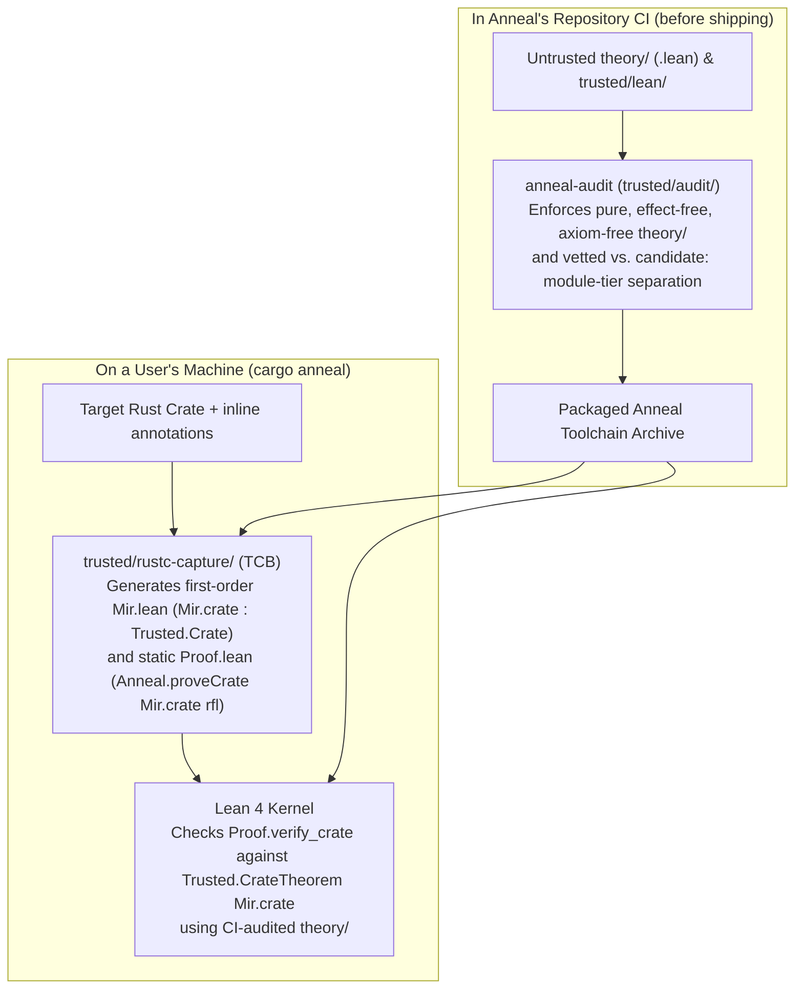

<!-- Copyright 2026 The Fuchsia Authors

Licensed under a BSD-style license <LICENSE-BSD>, Apache License, Version 2.0
<LICENSE-APACHE or https://www.apache.org/licenses/LICENSE-2.0>, or the MIT
license <LICENSE-MIT or https://opensource.org/licenses/MIT>, at your option.
This file may not be copied, modified, or distributed except according to
those terms. -->

# Trust Model and Boundary Enforcement

> **Note:** Anneal is under active development. Parts of the design and
> architecture described in this document are not yet implemented or may be
> implemented differently; this document may be aspirational or stale relative
> to the codebase.

[`PRINCIPLES.md`](../PRINCIPLES.md) states Anneal's central correctness promise:
if the code in a verification result's Trusted Computing Base (TCB) audit log
is correct, its assumptions are valid, and Anneal emits no errors, then the
verified code is correct.

A modern verification tool needs tens of thousands of lines of intermediate
representation (IR) lowering passes, weakest-precondition (WP) rules,
separation-logic lemmas, and proof automation—much of it written by untrusted
AI agents. To keep the human audit surface small, Anneal isolates all
first-party trusted code inside [`trusted/`](../trusted) and places all
lowering passes, program logics, and tactics outside the TCB in `theory/`. To
ensure that adversarial or buggy code in `theory/` cannot use side effects, OS
APIs, or custom axioms to undermine the guarantees established by `trusted/`,
Anneal runs a standalone boundary auditor ([`trusted/audit/`](../trusted/audit))
**in Anneal's own repository CI**.

For related architectural details, see:

- [`docs/design.md`](design.md) for an overview of Anneal's verification
  workflow and specification modes.
- [`docs/architecture.md`](architecture.md) for the three-stage MIR pipeline
  and how untrusted lowering passes in `theory/` connect to `trusted/lean/`.

## 1. The `trusted/` boundary and how verification stays sound

Anneal divides its repository into two zones with strictly separated roles:

| Zone | Directory | Role | Trust status |
| :--- | :--- | :--- | :--- |
| **Trusted foundation** | [`trusted/`](../trusted) | Extracts first-order MIR and emits a static proof entrypoint (`trusted/rustc-capture/`), defines captured MIR syntax and reference semantics (`trusted/lean/`), orchestrates CLI invocation (`trusted/cargo-anneal/`), and audits the Anneal repository in CI (`trusted/audit/`). | **In the TCB.** Audited by humans (alongside external files pinned by hash manifests inside `trusted/`). |
| **Proof theory** | `theory/` | Defines in-place MIR lowering (`lowerBody`), proves lowering simulations (`lowerBody_simulates`), and provides compositional verification checkers (`proveCrate`) and symbolic execution lemmas. | **Outside the TCB.** Treated as potentially adversarial; audited mechanically in Anneal's CI and checked by the Lean 4 kernel. |

### How CI auditing and user-machine verification fit together

A key design question is how Anneal guarantees soundness without requiring a
human to audit `theory/` and without running a heavy repository auditor on
every user's machine.

Anneal splits the enforcement across **Anneal's repository CI** and **the
user's machine**:

1. **On the user's machine (`trusted/rustc-capture/` + Lean 4 kernel):**
   - Users do not write raw Lean files that could spoof the theorem statement or
     introduce `sorry`. Instead, users annotate their Rust source code, and
     `trusted/rustc-capture/` (which is part of the human-audited TCB)
     deterministically generates two files:
     - `Mir.lean`, which defines `Mir.crate : Trusted.Crate` using purely
       first-order constructor applications (including first-order AST values
       for inline specifications `RequiresSpec`, `PostSpec`, and
       `InvariantSpec`).
     - `Proof.lean`, a fixed, crate-independent 8-line file that states
       `theorem Proof.verify_crate : Trusted.CrateTheorem Mir.crate :=
       Anneal.proveCrate Mir.crate rfl`.
   - Because `Proof.lean` is static and `Mir.lean` contains only first-order
     data constructors, crate names and user annotations cannot inject Lean
     commands, tactics, or axioms, and the theorem *statement*
     (`ConstantInfo.type`) is guaranteed to be `Trusted.CrateTheorem Mir.crate`
     over the extracted crate.
   - The Lean 4 kernel on the user's machine then typechecks `Proof.lean`,
     verifying that the proof term (`ConstantInfo.value?`) constructed by
     `theory/` is a valid proof of `Trusted.CrateTheorem Mir.crate`.
2. **In Anneal's repository CI (`trusted/audit/`):**
   - For the Lean 4 kernel check on the user's machine to be sufficient, the
     `theory/` library shipped with Anneal must not be able to cheat the kernel
     or subvert the host process when `lean` imports and elaborates `theory/`.
   - In raw Lean 4, an unrestricted `.lean` file in `theory/` could execute
     arbitrary OS and filesystem operations during elaboration (`#eval`,
     `run_cmd`, `initialize`), attach compiler overrides (`@[implemented_by]`,
     `@[extern]`, `@[csimp]`), introduce custom `axiom`s or `sorryAx`, or
     inject spoofed definitions into the `Trusted` namespace. Similarly, a Rust
     crate outside `trusted/` could run arbitrary code via `build.rs` or
     procedural macros.
   - Therefore, **Anneal's CI runs `anneal-audit` (`trusted/audit/`)** on the
     Anneal repository before any commit can merge or be packaged into the
     toolchain archive. `anneal-audit` does **not** run on a user's machine; its
     job is to verify in CI that nothing outside `trusted/` in the Anneal
     repository is effectful or axiom-bearing.

### Keeping `trusted/lean/` transparent at the `.olean` kernel level

Auditing `trusted/lean/` requires confidence not only in the surface `.lean`
source files, but also in the compiled `.olean` constants replayed by the Lean
4 kernel. Four design choices in `trusted/lean/` keep its compiled kernel
environment simple and directly inspectable:

- **Tactic-free definitions (`SourceRole.trusted`):** `TrustedBoundary.lean`
  forbids `by` tactic blocks across `trusted/lean/`. All trusted definitions and
  any foundational helper lemmas use explicit functional definitions and term-
  mode proofs rather than opaque tactic-generated terms.
- **No `mutual` inductive types (`BodyId` table):** `Trusted/MirAst.lean`
  stores function bodies in a flat `Crate.bodies` list indexed by `BodyId`
  rather than nesting `MirBody` inside `Terminator` or `TCBItem`, avoiding the
  nested mutual recursors that Lean synthesizes for mutual inductive blocks.
- **Fuel-bounded recursion without `._unsafe_rec` or `WellFounded.fix`:**
  Recursive semantic functions in `Trusted/MirSemantics.lean` take an explicit
  `Nat` fuel argument and are marked `noncomputable`, ensuring Lean's compiler
  never emits `._unsafe_rec` definitions or well-founded recursion proof
  obligations in `trusted/lean/`.
- **Explicit assumption obligations (`Obligation.assumed`) instead of `opaque`
  constants:** Trusted waivers (such as `TCBItem.rustcLowering`,
  `TCBItem.assumedContract`, and `TCBItem.unverifiedFn`) are stated via
  `Obligation.assumed (id : Id) : Obligation Id := ⟨id, False⟩` in
  `Trusted/Refinement.lean` rather than declaring dummy `opaque` constants in
  `Trusted/MirSemantics.lean`.

### Statement-Origin Separation (`ConstantInfo.type` vs. `ConstantInfo.value?`)

Within the Lean 4 kernel environment, every compiled theorem
(`ConstantInfo.thmInfo`) has two distinct components:

- **The theorem statement (`ConstantInfo.type`):** The proposition claiming
  *what* holds.
- **The proof term (`ConstantInfo.value?`):** The lambda term explaining *why*
  that proposition holds.

Anneal's architecture enforces **Statement-Origin Separation** between the two:

- Every constant referenced in the *statement* (`ConstantInfo.type`) of
  `Trusted.CrateTheorem Mir.crate` originates in `Trusted.*` (or the allowlisted
  Lean `Init.*` foundation) and the generated `Mir.crate`. No definition from
  `theory/` ever appears in the theorem statement.
- Declarations from `theory/` appear only inside the *proof term*
  (`ConstantInfo.value?`). Because `anneal-audit` verifies in CI that `theory/`
  is pure, effect-free, and free of custom axioms, and the Lean 4 kernel checks
  that `ConstantInfo.value?` inhabits `ConstantInfo.type`, `theory/` can supply
  arbitrarily rich lowering passes and tactics without being able to weaken the
  theorem statement.

### Staging TCB changes (`vetted` vs. `candidate:<feature>` modules)

Auditing a new semantic rule in `trusted/lean/` to full TCB standards—including
line-by-line Rust Reference citations and human review—takes deliberate effort.
If `trusted/lean/` treated all merged code as equally trusted, contributors
would face an unproductive tradeoff when adding support for a new Rust feature:

- **Block downstream work:** Hold back the `trusted/lean/` definitions until
  full human auditing is complete, blocking contributors and agents from
  building the corresponding lowering passes and WP lemmas in `theory/` or
  testing the feature on real crates; or
- **Dilute the TCB guarantee:** Merge unreviewed definitions into
  `trusted/lean/` immediately, making it impossible to tell whether a
  verification result depends only on audited rules or also on work-in-progress
  semantics.

Anneal resolves this by assigning every module in `trusted/lean/` an explicit
module-level trust tier via a leading header comment directive:

- **`-- anneal-trust-tier: vetted`:** Modules whose definitions have completed
  full Rust Reference auditing.
- **`-- anneal-trust-tier: candidate:<feature>`:** Work-in-progress TCB modules
  belonging to a named subsystem feature `<feature>` (such as `refinement`,
  `step_result`, `memory`, `mir_ast`, `mir_semantics`, or `rustc_capture`) that
  have not yet completed human auditing.

Assigning trust tiers at the module boundary rather than via per-declaration
attributes keeps `trusted/lean/` completely free of custom attribute macros or
metaprogramming: every constant compiled into a `Trusted` module's `.olean`
file—including constructors, recursors (`rec`, `casesOn`), pattern matchers
(`match_1`), equational lemmas (`eq_1`), and `where`/`private` helpers—
automatically inherits its defining module's trust tier via
`Environment.getModuleIdxFor?`.

To prevent unreviewed candidate modules from contaminating audited definitions,
`TrustedBoundary.lean` enforces a strict one-way dependency rule across all
compiled constants: constants in a `vetted` module may reference only the
locked `Init.*` foundation and other `vetted` modules, never a
`candidate:<feature>` module.

## 2. Repository CI boundary enforcement (`anneal-audit`)

[`trusted/audit/`](../trusted/audit) implements the CI gatekeeper
(`anneal-audit` and
[`TrustedBoundary.lean`](../trusted/audit/TrustedBoundary.lean)) that audits
the Anneal repository. It classifies every module into a single `ModuleRole`
(`.foundation`, `.trusted .vetted`, `.trusted (.candidate f)`, or `.theory`)
and enforces five invariants across two phases over an isolated staging
directory.

### Cargo workspace containment

Before inspecting Lean files, `anneal-audit` verifies the repository's root
manifests against [`root-manifest.sha256`](../trusted/root-manifest.sha256)
(`trusted/root-manifest.sha256`) and checks that every Cargo workspace member
and `path` dependency resides under `trusted/`. Because Rust code (including
`build.rs` scripts and proc-macros) is effectful and not checked by the Lean
kernel, no Rust crate is permitted outside `trusted/`.

### Phase 1: Syntactic source preflight (`--mode preflight`)

Before compiling any `.lean` file in `trusted/lean/` or `theory/`,
`anneal-audit` stages the source files into a private temporary directory,
verifies that no pre-existing `.olean` or `.ir` files exist in the source tree,
and parses every file using `Parser.parseHeader` and `Parser.parseCommand`
against the locked `Init.*` foundation parser environment (without invoking
Lean's Turing-complete elaborator). Rather than relying on an open-ended
blocklist of dangerous Lean features, `TrustedBoundary.lean` classifies each
source file into a `SourceRole` (`trusted (tier : TrustTier)` vs. `theory`) and
validates the module header and every top-level command in a single top-down
traversal (`inspectSyntax` and `inspectNodeKind`) against a closed, role-aware
`SyntaxNodeKind` allowlist:

- **`SourceRole.trusted` (`trusted/lean/`):** Restricted to
  `allowedTrustedSyntaxKinds`—pure declarations, types, and term-mode proofs
  only, excluding `byTactic` and all tactic syntax so TCB specifications remain
  direct, tactic-free definitions—and required to carry exactly one valid
  `-- anneal-trust-tier: vetted` or `-- anneal-trust-tier: candidate:<feature>`
  directive.
- **`SourceRole.theory` (`theory/`):** Restricted to
  `allowedTheorySyntaxKinds`, which extends `allowedTrustedSyntaxKinds` with a
  closed allowlist of pure proof tactics (`allowedTheoryTacticKinds`) while
  rejecting trust-tier directives and any unallowlisted syntax node, command,
  modifier, attribute, or tactic configuration (excluding `unsafe`, `partial`,
  `noncomputable`, `meta`, `axiom`, `macro`, `syntax`, `elab`, `sorry`,
  `native_decide`, `decide!`, `bv_decide`, `rfl'`, `grind`, tactic `configItem`
  flags such as `+native` and `+kernel`, `by_elab`, `run_tac`, `#eval`,
  `include_str`, `set_option`, `@[implemented_by]`, `@[extern]`, `@[csimp]`,
  and `initialize` hooks).

### Phase 2: Standalone kernel replay and DAG audit (`--mode audit`)

After compiling the staged `.lean` modules synchronously with kernel checking
enabled (`-t0 -DElab.async=false -Ddebug.skipKernelTC=false`), `anneal-audit`
loads the resulting `.olean` files with `trustLevel := 0`, `plugins := #[]`,
and `loadExts := false` (so no `[init]` initializers or persistent environment
extensions from audited modules are deserialized or executed) and performs a
full kernel-level audit:

1. **Module, namespace, and axiom verification (`verifyAndCollectLocals`):**
   Verifies that only allowlisted modules are loaded; that every constant's
   recorded module origin (`env.getModuleIdxFor?`) matches its module's
   `ModuleRole`; that non-`Trusted` modules declare no constants in the
   `Trusted` root namespace (`(privateToUserName ci.name).getRoot == `Trusted`)
   and no `opaque` definitions; that no non-foundation declaration in
   `Trusted.*` or `theory/` is `unsafe`, `partial`, an `axiom`, or a quotient
   primitive (`.quotInfo`); and that the transitive dependency closure reaches
   only the locked foundation axiom allowlist
   (`{Classical.choice, Quot.sound, propext}`).
2. **Origin and trust-tier separation (`checkTierReferences`):** Traverses
   every kernel dependency edge `c → dep` (`declarationEdges`) across all
   `Trusted.*` constants and enforces two rules:
   - **Origin rule:** A `.trusted _` constant may reference only `.foundation`
     or `.trusted _` constants (never `.theory`).
   - **Vetted rule:** A `.trusted .vetted` constant may reference only
     `.foundation` or `.trusted .vetted` constants (never
     `.trusted (.candidate _)`).
3. **Fresh kernel replay (`base.toKernelEnv.replay locals`):** Finally,
   `TrustedBoundary.lean` constructs a clean kernel environment containing only
   the pinned `Init.*` foundation (`base`) and replays every non-foundation
   constant (`Trusted.*` and `theory/`) through the standalone Lean 4 kernel
   typechecker from scratch.

### Including external files in the `trusted/` boundary via hashes

The invariant of [`trusted/`](../trusted) is that an auditor only needs to
inspect `trusted/` to verify that Anneal upholds
[`PRINCIPLES.md`](../PRINCIPLES.md). However, some files that belong to the
effective TCB cannot practically reside inside the `trusted/` subdirectory:

- Standard tooling expects workspace and environment manifests (`Cargo.toml`,
  `Cargo.lock`, `flake.nix`, and `flake.lock`) to sit at the repository root;
  moving them into `trusted/` would require symlinks or custom wrapper flags
  for every Cargo and Nix command.
- Pre-built upstream toolchain artifacts (the `lean` binary and its `Init.*`
  standard prelude) live outside the repository altogether.

To include these files in `trusted/`'s effective TCB without relocating them,
`trusted/` stores their SHA-256 digests in two checked-in lock files:

- **[`trusted/root-manifest.sha256`](../trusted/root-manifest.sha256):** Pins
  the SHA-256 digests of the repository's root build files (`Cargo.toml`,
  `Cargo.lock`, `flake.nix`, and `flake.lock`), verified by CI and
  `anneal-audit`.
- **[`foundation-lock.json`](../trusted/lean/foundation-lock.json)**
  (`trusted/lean/foundation-lock.json`): Pins the SHA-256 digests of the `lean`
  executable and all `Init.*` prelude source and `.olean` companion files,
  verified by both the Nix toolchain build (`flake.nix`) and `anneal-audit`.

Because CI and `anneal-audit` reject any mismatch against these files, changing
a root manifest or toolchain artifact requires a corresponding diff inside
`trusted/`, ensuring an auditor inspecting `trusted/` sees every change to the
effective TCB.

## 3. External dependencies and commenting in `trusted/`

Because every file in [`trusted/`](../trusted) must be auditable by humans,
Anneal optimizes `trusted/` for **human comprehension and review accuracy**, not
merely minimum dependency count:

- **Standard libraries over hand-rolled plumbing:** `trusted/` uses widely
  audited Rust ecosystem crates (such as `serde`, `clap`, and `sha2`, all
  pinned with SHA-256 checksums in `Cargo.lock`) for generic utilities like
  serialization, CLI parsing, and hashing. Hand-rolling bespoke parsers or
  cryptographic primitives inside `trusted/` would add hundreds of lines of
  security-critical code and increase audit burden.
- **Mandatory provenance citations:** Any code in `trusted/` that models Rust
  semantics or extracts `rustc` internal structures must explain the
  correspondence in its comments and both quote and cite the relevant Rust
  Reference section (`rust-lang/reference`) or compiler source file
  (`rust-lang/rust`) at a pinned commit hash.
