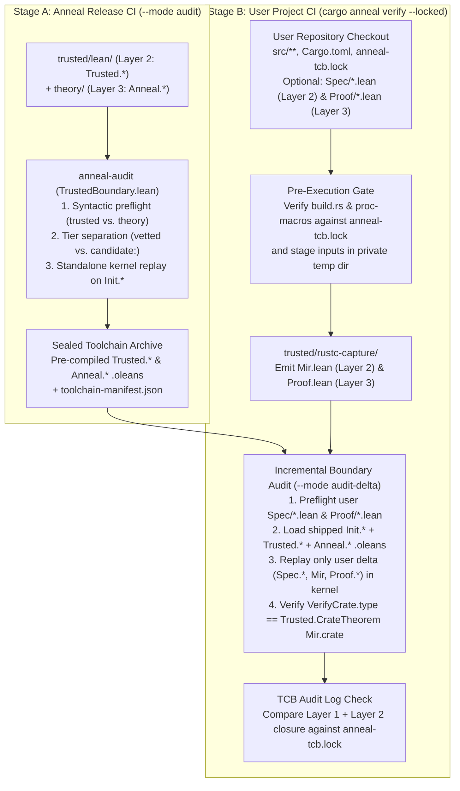

<!-- Copyright 2026 The Fuchsia Authors

Licensed under a BSD-style license <LICENSE-BSD>, Apache License, Version 2.0
<LICENSE-APACHE or https://www.apache.org/licenses/LICENSE-2.0>, or the MIT
license <LICENSE-MIT or https://opensource.org/licenses/MIT>, at your option.
This file may not be copied, modified, or distributed except according to
those terms. -->

# Threat Model, Trust Boundary, and Audit Enforcement

> **Note:** Anneal is under active development. Parts of the design and
> architecture described in this document are not yet implemented or may be
> implemented differently; this document may be aspirational or stale relative
> to the codebase.

[`PRINCIPLES.md`](../PRINCIPLES.md) states Anneal's central correctness promise:
if the code in a verification result's Trusted Computing Base (TCB) audit log
is correct, its assumptions are valid, and Anneal emits no errors, then the
verified code is correct.

A modern verification workflow relies on tens of thousands of lines of
intermediate representation (IR) lowering passes, weakest-precondition (WP)
rules, separation-logic lemmas, and crate-specific proof scripts—much of it
written by untrusted AI coding agents. An agent optimizing for a passing command
exit code may attempt to reward-hack verification: introducing `sorry` or
custom `axiom`s, executing side effects during Lean elaboration (`#eval`,
`run_cmd`, `initialize`), attaching compiler overrides (`@[implemented_by]`,
`@[extern]`), weakening specifications, or modifying build hooks.

This document defines Anneal's threat model and how Anneal enforces its trust
boundary across both **Anneal's own repository CI** and **downstream user
verification**:

- **Section 1** defines the threat actors, the execution-isolation precondition
  required for [`PRINCIPLES.md`](../PRINCIPLES.md)'s promise to hold, and what a
  well-configured CI pipeline requires.
- **Section 2** defines the three-layer epistemic model that separates the
  execution TCB, the specification TCB, and untrusted proofs across both
  Anneal and downstream crates.
- **Section 3** explains the two-stage boundary audit: why artifacts shipped by
  Anneal and audited in Anneal's CI do not need re-auditing on user machines,
  and how `cargo anneal` audits extra code and specifications that a user crate
  brings along.
- **Section 4** details the parser, kernel-replay, and module-tier mechanics
  implemented by [`trusted/audit/`](../trusted/audit).

For related architectural details, see:

- [`docs/design.md`](design.md) for an overview of Anneal's verification
  workflow and specification modes.
- [`docs/architecture.md`](architecture.md) for the three-stage MIR pipeline
  and how untrusted lowering passes in `theory/` connect to `trusted/lean/`.

## 1. Threat model and the execution-isolation boundary

### Threat actors and reward-hacking vectors

Anneal's threat model assumes that untrusted actors—including AI coding agents
and external contributors—author changes in two places:

1. **In the Anneal repository (`joshlf/anneal`):** Authoring lowering passes,
   program logics, and tactics in `theory/`, or proposing changes to
   [`trusted/`](../trusted).
2. **In a downstream user repository:** Authoring Rust source code (`src/**`),
   inline specifications, pure mathematical models (`Spec/*.lean`), interactive
   or automated proof scripts (`Proof/*.lean`), and Cargo or TCB policy files.

In both settings, human reviewers want to inspect only a small, well-defined
set of trusted specifications and code while treating proof scripts and proof
automation as untrusted.

### The outside-the-write-boundary rule

No user-space verifier can defend against a process running concurrently with
the same operating-system privileges. If an un-sandboxed AI agent runs under the
developer's own OS user account on a workstation, it does not need to sneak an
axiom past the Lean kernel or exploit a file-descriptor race: it can overwrite
`~/.cargo/bin/cargo-anneal`, shadow `cargo` on `PATH`, inject `LD_PRELOAD`, or
print fabricated success output directly to the terminal. Trying to defend
against same-UID host tampering inside `cargo-anneal`—for example, via
per-file `lstat`/`fstat` inode checks or re-hashing the installed toolchain
tree on every invocation—adds complexity without closing the attack.

Anneal therefore draws an explicit boundary around the execution environment:

> **Outside-the-Write-Boundary Rule:** A verification result and its emitted TCB
> audit log are authoritative against an untrusted actor if and only if
> `cargo-anneal` (or `anneal-audit`), the installed Anneal toolchain archive,
> the verification staging directory, and the channel delivering the TCB audit
> log execute **outside that actor's OS write, environment-injection, and
> process-control boundary**.

This rule classifies execution environments into two categories:

| Environment | Actor isolation | Status under `PRINCIPLES.md` |
| :--- | :--- | :--- |
| **1. Anneal release CI** | Ephemeral CI runner evaluating a pull request to `joshlf/anneal`. | **Authoritative** for auditing and packaging Anneal releases. |
| **2. Downstream project CI** | Ephemeral CI runner evaluating a pull request to a user crate with `cargo anneal verify --locked`. | **Authoritative** for verifying the user crate and gating merges to `main`. |
| **3. Host-sandboxed local agent** | Workstation where the agent runs inside an unprivileged container, VM, or separate UID, and the host runs `cargo anneal verify` outside that sandbox. | **Authoritative** against the sandboxed agent. |
| **4. Un-sandboxed same-UID workstation** | Developer machine where an agent shares write access to the user's home directory, binaries, or shell environment. | **Advisory fast-feedback loop only.** Catches accidental errors and naive agent shortcuts (`sorry`, `axiom`), but must be confirmed by CI (or a host sandbox) before trusting the result. |

### Requirements for a well-configured CI pipeline

Because authoritative verification relies on the isolation of the CI runner (or
host sandbox), a well-configured CI environment must uphold four conditions:

1. **Immutable verifier and pinned toolchain:** `cargo-anneal` and the Anneal
   toolchain archive are installed from a pinned release digest (verified once
   at installation time by `cargo anneal setup`) onto a filesystem path not
   writable by untrusted code during verification.
2. **Pre-execution gating of `build.rs` and procedural macros:** During MIR
   capture, Cargo compiles and executes `build.rs` scripts and procedural macros
   under the CI runner's own user account. If a pull request introduces or
   modifies a `build.rs` script or procedural macro that runs before the TCB
   audit check, that script could tamper with the CI runner. Under
   `cargo anneal verify --locked`, `cargo-anneal` hashes all `build.rs` scripts
   and non-TCB procedural macros in the resolved build graph and verifies them
   against the committed `anneal-tcb.lock` **before** compiling or executing
   them—failing closed prior to execution when any unapproved build hook is
   present—and stages verification inputs in a private directory outside the
   repository checkout.
3. **Scrubbed child-process environment:** `cargo-anneal` clears ambient
   environment variables when invoking `rustc`, `anneal-rustc-capture`, and
   `lean`, stripping `LD_PRELOAD`, `DYLD_INSERT_LIBRARIES`, `RUSTC_WRAPPER`,
   `RUSTFLAGS`, `CARGO_ENCODED_RUSTFLAGS`, `LEAN_PATH`, and unpinned environment
   variables.
4. **Locked TCB audit log and protected workflows:** CI runs
   `cargo anneal verify --locked` so any unreviewed change to the crate's TCB
   or assumptions fails the build, and repository branch protection requires
   human review on changes to `.github/workflows/**`, toolchain version pins,
   `anneal-tcb.lock`, and specifications.

### Repository-input checks vs. out-of-scope host checks

Within a clean CI runner, **the checked-out Git repository tree is the
untrusted input**. Anneal therefore enforces strict checks on everything read
from the repository tree while avoiding redundant host-tampering checks:

- **Enforced on the untrusted repository checkout:**
  - Rejecting symlinks or `..` path traversal inside the target crate;
  - Ignoring or rejecting any pre-compiled `.olean`/`.ir` files or pre-existing
    `.anneal/` outputs checked into the repository;
  - Rejecting repo-local `rust-toolchain*` overrides and compiler wrappers or
    flags across `.cargo/config*` tables (`[build]`, `[target.*]`, `[env]`,
    `[alias]`);
  - Verifying via `rustc`'s session dependency tracking (`source_map` and
    `env_depinfo`) that the crate does not read out-of-tree files (`include!`,
    `#[path]`) or unpinned environment variables (`env!`, `option_env!`), and
    that `debug` and `release` configurations produce identical MIR.
- **Not repeated on every verification run:**
  - Full-tree SHA-256 re-hashing of the installed `lean/**` and `rust/**`
    toolchain directories (performed once during `cargo anneal setup`);
  - Re-auditing or re-compiling Anneal's shipped `trusted/lean/` and `theory/`
    modules from source on the user's machine.

## 2. The three-layer epistemic model

Both Anneal's own repository and every downstream user crate are governed by a
single **three-layer epistemic partition**. Each layer is defined by how its
artifacts relate to the compiled theorem in the Lean 4 kernel:

| Layer | Role in verification | In Anneal (`joshlf/anneal`) | In a downstream user crate | TCB audit log (`anneal-tcb.lock`) & human review |
| :--- | :--- | :--- | :--- | :--- |
| **Layer 1: Execution & foundation TCB** | Executes extraction, elaboration, and kernel checking. | Pinned `lean` + `Init.*` (`foundation-lock.json`), `rustc`, `trusted/rustc-capture/`, `trusted/audit/`, `trusted/cargo-anneal/`, `root-manifest.sha256`. | Target triple, Cargo features/cfgs, `[profile]` settings, and any approved `build.rs` or proc-macro hooks (`build_hooks`). | **In the TCB audit log.** Pinned by version/digest; `build_hooks` gated before execution. |
| **Layer 2: Statement & specification TCB** (`ConstantInfo.type`) | Defines *what* program is verified, *what* proposition is claimed, and *what* assumptions are waived. | `trusted/lean/` (`Trusted.*`, module-tiered as `vetted` or `candidate:<feature>`). | Captured `Mir.lean` (`src/**`, inline `requires`/`ensures`/`invariant` specs, Mode 4 `spec_fn` closures, waivers, unverified functions in private-invariant scopes, ambient items) and user mathematical models (`Spec/*.lean`). | **In the TCB audit log.** Tactic-free, `opaque`-free, `instance`-free; reviewed by humans. |
| **Layer 3: Untrusted proof layer** (`ConstantInfo.value?`) | Constructs proof terms discharging Layer 2's theorem statement. | `theory/` (`Anneal.*`: `lowerBody`, `lowerBody_simulates`, `proveCrate`, WP & separation-logic lemmas). | Crate-specific Lean proof modules (`Proof/*.lean`) and the generated root `Proof.lean` entrypoint. | **Outside the TCB audit log.** Mechanically audited and kernel-checked; **zero human review**. |

### Statement-Origin Separation (`ConstantInfo.type` vs. `ConstantInfo.value?`)

Within the Lean 4 kernel environment, every compiled theorem
(`ConstantInfo.thmInfo`) has two components:

- **The theorem statement (`ConstantInfo.type`):** The proposition claiming
  *what* holds (Layer 2).
- **The proof term (`ConstantInfo.value?`):** The lambda term explaining *why*
  that proposition holds (Layer 3).

Anneal enforces **Statement-Origin Separation** across both its own repository
and downstream crates:

1. **Downward-only dependency DAG (`Layer 1` $\leftarrow$ `Layer 2` $\leftarrow$
   `Layer 3`):** Every constant referenced in the theorem statement
   (`ConstantInfo.type`) of `Proof.verify_crate`—and every constant referenced
   by any Layer 2 specification module—must originate in Layer 1 (`Init.*`) or
   Layer 2 (`Trusted.*`, user `Spec.*`, and captured `Mir`). No constant from
   Layer 3 (`theory/` or user `Proof.*`) may appear anywhere in Layer 2 or in
   `ConstantInfo.type`.
2. **Import ordering for user mathematical models (`Trusted.*` $\to$ `Spec.*`
   $\to$ `Mir` $\to$ `Proof.*`):** When a crate uses pure mathematical models
   (Mode 3 in [`docs/design.md`](design.md)), inline Rust specifications in
   `Mir.lean` reference model predicates defined in `Spec/*.lean`. Ordering the
   DAG as `Trusted.*` $\to$ `Spec.*` $\to$ `Mir` $\to$ `Proof.*` allows inline
   Rust contracts to refer to `Spec.*` definitions while keeping all Layer 3
   proof modules strictly downstream of `Mir`.
3. **Proof irrelevance for trust:** Because Layer 3 modules are mechanically
   verified to be free of elaboration side effects, custom axioms, `sorryAx`,
   `opaque`, `partial`, and `unsafe` constants, and cannot appear in the theorem
   statement, a bug or backdoor attempt in `theory/` or `Proof/*.lean` can cause
   verification to fail, but can never cause a false theorem statement to pass.

## 3. Two-stage boundary auditing: Anneal CI vs. user CI

A central design question is how Anneal avoids re-auditing its own shipped
code on every user run while still catching backdoors in extra code and proof
files brought along by the user's crate.

Anneal solves this by running the same boundary auditor
([`trusted/audit/`](../trusted/audit)) in **two composable stages**:

### Stage A: What runs in Anneal's repository CI (`--mode audit`)

In Anneal's own CI, `anneal-audit` audits `trusted/lean/` (Layer 2) and
`theory/` (Layer 3) from scratch against the locked `Init.*` foundation:

- It verifies that no Rust crate exists outside `trusted/`, runs syntactic
  preflight on every `.lean` source file in `trusted/lean/` and `theory/`,
  enforces `vetted` vs. `candidate:<feature>` module-tier separation across
  `Trusted.*`, and replays every compiled constant in `Trusted.*` and `Anneal.*`
  through the standalone Lean 4 kernel (`trustLevel := 0`, `loadExts := false`).
- The resulting pre-compiled `.olean` files for `Trusted.*` and `Anneal.*`,
  together with a `toolchain-manifest.json` recording each `Trusted.*` module's
  trust tier and each `Anneal.*` constant's transitive `candidate:<feature>`
  footprint, are packaged into the Anneal toolchain archive.

Because Stage A has already verified and compiled `Trusted.*` and `Anneal.*`,
downstream user runs never need to re-parse, re-compile, or re-audit Anneal's
shipped `.lean` files.

### Stage B: What runs when verifying a user crate (`--mode audit-delta`)

When `cargo anneal verify` runs on a user crate, it trusts the pre-audited
`.olean` files from the installed Anneal toolchain archive as its base
environment (`baseSpec = Init.* ∪ Trusted.*`, `baseProof = Anneal.*`) and audits
**only the delta introduced by the user's crate** (`localSpec = Spec.* ∪ {Mir}`,
`localProof = Proof.* ∪ {Proof}`):

1. **Two-template `Proof.lean` generation:** `anneal-rustc-capture` emits
   `Mir.lean` (`Mir.crate : Trusted.Crate`) and one of two static `Proof.lean`
   templates (with `prelude` so Lean cannot inject implicit imports):
   - **Template A (default automated path, when `Proof/Main.lean` is absent):**
     Imports `Trusted`, `Anneal`, and `Mir`, and proves
     `theorem Proof.verify_crate : Trusted.CrateTheorem Mir.crate :=
     Anneal.proveCrate Mir.crate rfl`. When a crate has no `Spec/*.lean` or
     `Proof/*.lean` files, no user-written Lean code exists at all; checking the
     crate reduces to compiling `Mir.lean` and `Proof.lean` and running the
     incremental kernel check.
   - **Template B (custom proof path, when `Proof/Main.lean` is present):**
     Imports `Trusted`, `Mir`, and `Proof.Main`, and binds
     `theorem Proof.verify_crate : Trusted.CrateTheorem Mir.crate :=
     Proof.Main.verify_crate`. Because `anneal-rustc-capture` writes the root
     `Proof.lean` file in both cases, user files in `Proof/*.lean` cannot alter
     the theorem statement `Trusted.CrateTheorem Mir.crate`.
2. **Syntactic preflight on user `Spec/*.lean` and `Proof/*.lean`:** Before
   elaborating any user-supplied `.lean` file, `TrustedBoundary.lean` runs Phase
   1 syntactic preflight:
   - User `Proof/*.lean` files are checked against `allowedTheorySyntaxKinds`
     (allowing pure tactics while blocking `#eval`, `run_cmd`, `by_elab`,
     `initialize`, `@[extern]`, `@[implemented_by]`, `@[csimp]`,
     `native_decide`, `sorry`, and `axiom`).
   - User `Spec/*.lean` files are checked against a stricter specification
     allowlist (`SourceRole.spec`) that forbids tactics (`by`), `opaque`,
     `attribute`, and typeclass `instance` / `@[instance]` declarations (so a
     user `Spec` module cannot hijack typeclass resolution inside `Mir.lean`).
3. **Incremental standalone kernel replay (`baseEnv.toKernelEnv.replay
   deltaLocals`):** `TrustedBoundary.lean` loads the pre-audited base `.olean`s
   and the compiled user delta `.olean`s with `trustLevel := 0`,
   `plugins := #[]`, and `loadExts := false`, verifies Statement-Origin
   Separation (no `Proof.*` or `Anneal.*` constants in `Spec.*`, `Mir`, or
   `verify_crate.type`, and no user declarations in the `Trusted` or `Mir`
   namespaces), and replays **only the user delta constants (`localSpec ∪
   localProof`)** into `baseEnv.toKernelEnv`.

### Accounting for all user-brought artifacts in the TCB audit log

To prevent an agent from reward-hacking verification through the Rust crate or
its specifications without human visibility, Stage B accounts for five classes
of user-brought artifacts in the crate's committed TCB audit log
(`anneal-tcb.lock`):

| User-brought artifact | Threat / reward-hacking vector | How Anneal handles it |
| :--- | :--- | :--- |
| **1. User proof modules (`Proof/*.lean`)** | Agent sneaks in `sorry`, `axiom`, `#eval`, `@[implemented_by]`, or proves a weakened theorem. | **Mechanically audited in Stage B (`--mode audit-delta`).** Pinned to `Trusted.CrateTheorem Mir.crate` via Template B; **omitted from `anneal-tcb.lock`** so proof changes require zero human review. |
| **2. User specification models (`Spec/*.lean`) & inline contracts (`requires`, `ensures`, `invariant`, Mode 4 `spec_fn`)** | Agent weakens a postcondition to `True`, over-constrains a precondition or dead `const` assert to shrink the verified domain, hijacks a typeclass instance, or modifies a helper called by a Mode 4 `spec_fn`. | **Logged in `anneal-tcb.lock` (Layer 2).** `Spec/*.lean` is checked under `SourceRole.spec` (no tactics, no `opaque`, no `instance`) and logged by SHA-256; inline specs, non-empty `required_consts`, and the normalized bodies/hashes of Mode 4 `spec_fn`s **and their transitive callee/constant closures** are recorded in `anneal-tcb.lock`. |
| **3. Partially verified crates & private-invariant visibility scopes ($\mathcal{V}_T$)** | An unverified function in the same module mutates a private field of a struct $T$, breaking $T$'s `#[anneal::invariant]` assumed by verified methods. | **Scoped invariant check + TCB logging.** For any ADT $T$ with a private invariant (`allFieldsPubSafe = false`), let $\mathcal{V}_T$ be the union of visibility scopes of $T$'s non-`pubSafe` fields. Any unverified function inside $\mathcal{V}_T$ is recorded as an explicit `unverifiedFn` waiver in `anneal-tcb.lock`, and verified safe functions in $\mathcal{V}_T$ cannot return `&mut` references to non-`pubSafe` invariant fields unless the field invariant holds universally. |
| **4. Uncalled ambient & link-level items** | Agent places UB or state corruption in `#[no_mangle]`, `#[export_name]`, `#[link_section]`, `#[global_allocator]`, `#[panic_handler]`, `static mut`, or interior-mutable `static` items never called by verified functions. | **Inventoried in `anneal-tcb.lock` (`ambient_items`).** `anneal-rustc-capture` scans the crate HIR for link-level entrypoints and mutable statics outside the verified call graph and records them in `anneal-tcb.lock`. |
| **5. Cross-crate verified dependencies** | Downstream crate `B` consumes a spoofed or stale verification summary from upstream crate `A`, or `A` hides a `#[anneal::trusted]` waiver or `candidate:<feature>` dependency. | **Compositional `UnitId` verification & transitive TCB union.** Workspace dependencies are verified in topological order in private staging, bound by a recursive Merkle digest over compilation inputs (`UnitId`), and their Layer 1/Layer 2 waivers and `candidate:<feature>` closures propagate transitively into `B`'s `anneal-tcb.lock`. |

### Zero-churn `anneal-tcb.lock` for human PR review

If the git-committed `anneal-tcb.lock` recorded target-crate `src/**/*.rs` file
hashes, sequential `BodyId`s, or `file:line:col` spans, every internal code
refactoring, comment edit, or `cargo fmt` run would produce a lockfile diff—
training reviewers to rubber-stamp TCB changes.

Anneal therefore separates volatile compilation digests (kept in ephemeral
staging certificates during a run) from the committed `anneal-tcb.lock`:

- `anneal-tcb.lock` keys crate items by canonical module-qualified Rust paths
  (such as `my_crate::foo::bar`) and records only Layer 1 execution hooks/config
  and Layer 2 specifications, `Spec/*.lean` hashes, active `candidate:<feature>`
  modules, waivers, and unverified/ambient item inventories.
- **Editing a function's implementation body, reformatting Rust code, or
  rewriting `Proof/*.lean` produces zero diff in `anneal-tcb.lock`.** A diff in
  `anneal-tcb.lock` occurs if and only if the crate's Layer 1 execution TCB or
  Layer 2 specifications and assumptions changed.

## 4. Kernel and parser enforcement mechanics (`trusted/audit/`)

[`trusted/audit/`](../trusted/audit) implements the boundary auditor
(`anneal-audit` and
[`TrustedBoundary.lean`](../trusted/audit/TrustedBoundary.lean)) used in both
Stage A (`--mode audit`) and Stage B (`--mode audit-delta`).

### Keeping `trusted/lean/` transparent at the `.olean` kernel level

Auditing `trusted/lean/` requires confidence not only in the surface `.lean`
source files, but also in the compiled `.olean` constants replayed by the Lean
4 kernel. Four design choices in `trusted/lean/` keep its compiled kernel
environment simple and directly inspectable:

- **Tactic-free definitions (`SourceRole.trusted`):** `TrustedBoundary.lean`
  forbids `by` tactic blocks across `trusted/lean/`. All trusted definitions and
  any foundational helper lemmas use explicit functional definitions and term-
  mode proofs rather than opaque tactic-generated terms.
- **No `mutual` inductive types (`BodyId` table):** `Trusted/MirAst.lean`
  stores function bodies in a flat `Crate.bodies` list indexed by `BodyId`
  rather than nesting `MirBody` inside `Terminator` or `TCBItem`, avoiding the
  nested mutual recursors that Lean synthesizes for mutual inductive blocks.
- **Structural fuel-bounded recursion without `WellFounded.fix`:** Recursive
  semantic functions in `Trusted/StepResult.lean` and
  `Trusted/MirSemantics.lean` recurse structurally on an explicit `Nat` fuel
  argument (or on inductive syntax/value trees), avoiding well-founded recursion
  proof obligations in the kernel environment.
- **Explicit assumption obligations (`Obligation.assumed`) instead of `opaque`
  constants:** Trusted waivers (such as `TCBItem.rustcLowering`,
  `TCBItem.assumedContract`, and `TCBItem.unverifiedFn`) are stated via
  `Obligation.assumed (id : Id) : Obligation Id := ⟨id, False⟩` in
  `Trusted/Refinement.lean` rather than declaring dummy `opaque` constants in
  `Trusted/MirSemantics.lean`.

### Staging TCB changes (`vetted` vs. `candidate:<feature>` modules)

Auditing a new semantic rule in `trusted/lean/` to full TCB standards—including
line-by-line Rust Reference citations and human review—takes deliberate effort.
To allow contributors and agents to build lowering passes and proofs in
`theory/` before a new semantic module in `trusted/lean/` has completed human
auditing, every module in `trusted/lean/` declares a module-level trust tier via
a leading header comment directive:

- **`-- anneal-trust-tier: vetted`:** Modules whose definitions have completed
  full Rust Reference auditing.
- **`-- anneal-trust-tier: candidate:<feature>`:** Work-in-progress TCB modules
  belonging to a named subsystem feature `<feature>` (such as `refinement`,
  `step_result`, `mir_ast`, `mir_semantics`, or `rustc_capture`) that have not
  yet completed human auditing.

Assigning trust tiers at the module boundary rather than via per-declaration
attributes keeps `trusted/lean/` free of custom attribute macros or
metaprogramming: every constant compiled into a `Trusted` module's `.olean`
file—including constructors, recursors (`rec`, `casesOn`), pattern matchers
(`match_1`), equational lemmas (`eq_1`), and `where`/`private` helpers—
inherits its defining module's trust tier via `Environment.getModuleIdxFor?`.

To prevent unreviewed candidate modules from contaminating audited definitions,
`TrustedBoundary.lean` enforces a strict one-way dependency rule across all
compiled constants: constants in a `vetted` module may reference only the
locked `Init.*` foundation and other `vetted` modules, never a
`candidate:<feature>` module.

### Cargo workspace containment in the Anneal repository

In Anneal's own repository (`--mode audit`), before inspecting Lean files,
`anneal-audit` verifies the repository's root manifests against
[`root-manifest.sha256`](../trusted/root-manifest.sha256)
(`trusted/root-manifest.sha256`) and checks that every Cargo workspace member
and `path` dependency resides under `trusted/`. Because Rust code (including
`build.rs` scripts and procedural macros) is effectful and not checked by the
Lean kernel, no Rust crate is permitted outside `trusted/`.

### Phase 1: Syntactic source preflight (`--mode preflight`)

Before compiling any untrusted `.lean` file (whether `trusted/lean/` and
`theory/` in Stage A, or user `Spec/*.lean` and `Proof/*.lean` in Stage B),
the auditor stages the source files into a private temporary directory, verifies
that no pre-existing `.olean` or `.ir` files exist in the source tree, and
parses every file using `Parser.parseHeader` and `Parser.parseCommand` against
the locked `Init.*` foundation parser environment (without invoking Lean's
Turing-complete elaborator). `TrustedBoundary.lean` classifies each source file
by its role and validates the module header and every top-level command in a
single top-down traversal (`inspectSyntax` and `inspectNodeKind`) against a
closed, role-aware `SyntaxNodeKind` allowlist:

- **Layer 2 specification modules (`trusted/lean/` and user `Spec/*.lean`):**
  Restricted to `allowedTrustedSyntaxKinds`—pure declarations, types, and
  term-mode proofs only, excluding `byTactic` and all tactic syntax so TCB and
  specification definitions remain direct, tactic-free definitions. Modules in
  `trusted/lean/` must carry exactly one valid `-- anneal-trust-tier: vetted` or
  `-- anneal-trust-tier: candidate:<feature>` directive; user `Spec/*.lean`
  modules additionally forbid `opaque`, `attribute`, and `instance` /
  `@[instance]` declarations so they cannot alter typeclass resolution in
  `Mir.lean`.
- **Layer 3 proof modules (`theory/` and user `Proof/*.lean`):** Restricted to
  `allowedTheorySyntaxKinds`, which extends `allowedTrustedSyntaxKinds` with a
  closed allowlist of pure proof tactics (`allowedTheoryTacticKinds`) while
  rejecting trust-tier directives and any unallowlisted syntax node, command,
  modifier, attribute, or tactic configuration (excluding `unsafe`, `partial`,
  `noncomputable`, `meta`, `axiom`, `macro`, `syntax`, `elab`, `sorry`,
  `native_decide`, `decide!`, `bv_decide`, `rfl'`, `grind`, tactic `configItem`
  flags such as `+native` and `+kernel`, `by_elab`, `run_tac`, `#eval`,
  `include_str`, `set_option`, `@[implemented_by]`, `@[extern]`, `@[csimp]`,
  and `initialize` hooks).

### Phase 2: Standalone kernel replay and DAG audit (`--mode audit` and `--mode audit-delta`)

After compiling the staged `.lean` modules synchronously with kernel checking
enabled (`-t0 -DElab.async=false -Ddebug.skipKernelTC=false`), the auditor loads
the resulting `.olean` files with `trustLevel := 0`, `plugins := #[]`, and
`loadExts := false` (so no `[init]` initializers or persistent environment
extensions from audited modules are deserialized or executed) and performs a
kernel-level audit over the partition `(baseSpec, baseProof, localSpec,
localProof)`:

1. **Module, namespace, and axiom verification (`verifyAndCollectLocals`):**
   Verifies that only allowlisted modules are loaded; that every constant's
   recorded module origin (`env.getModuleIdxFor?`) matches its module's role;
   that non-`Trusted` modules declare no constants in the `Trusted` root
   namespace (and user proof modules declare no constants in `Mir` or `Spec`);
   that `localProof` modules declare no `opaque` definitions; that no
   declaration in `localSpec` or `localProof` is `unsafe`, `partial`, an
   `axiom`, or a quotient primitive (`.quotInfo`); and that the transitive
   dependency closure reaches only the locked foundation axiom allowlist
   (`{Classical.choice, Quot.sound, propext}`) while excluding reflection and
   trust-bypass primitives (`ofReduceBool`, `ofReduceNat`, `sorryAx`, `unsafe`,
   `partial`).
2. **Origin and trust-tier separation (`checkTierReferences`):** Traverses
   every kernel dependency edge `c → dep` (`declarationEdges`) and enforces:
   - **Statement-Origin rule:** A Layer 2 (`baseSpec ∪ localSpec`) constant—and
     the target `Proof.verify_crate` theorem statement (`ConstantInfo.type`)—may
     reference only Layer 1 (`Init.*`) and Layer 2 constants, never Layer 3
     (`baseProof ∪ localProof`).
   - **Vetted rule:** A `.trusted .vetted` constant may reference only
     `.foundation` or `.trusted .vetted` constants, never
     `.trusted (.candidate _)`.
3. **Fresh or incremental kernel replay (`replay`):** In Stage A (`--mode
   audit`), `TrustedBoundary.lean` constructs a clean kernel environment
   containing only the pinned `Init.*` foundation (`base`) and replays every
   constant in `Trusted.*` and `Anneal.*` through the standalone Lean 4 kernel
   typechecker. In Stage B (`--mode audit-delta`), `TrustedBoundary.lean` starts
   from the pre-audited `Init.* ∪ Trusted.* ∪ Anneal.*` kernel environment and
   replays every constant in the user crate's delta (`localSpec ∪ localProof`).

### Including external files in the `trusted/` boundary via hashes

The invariant of [`trusted/`](../trusted) is that an auditor inspecting the
Anneal repository only needs to review `trusted/` to verify that Anneal upholds
[`PRINCIPLES.md`](../PRINCIPLES.md). Because Cargo, Nix, and upstream toolchain
artifacts live at the repository root or outside the repository, `trusted/`
binds them into its effective TCB via two checked-in lock files:

- **[`trusted/root-manifest.sha256`](../trusted/root-manifest.sha256):** Pins
  the SHA-256 digests of the repository's root build files (`Cargo.toml`,
  `Cargo.lock`, `flake.nix`, and `flake.lock`), verified by CI and
  `anneal-audit`.
- **[`foundation-lock.json`](../trusted/lean/foundation-lock.json)**
  (`trusted/lean/foundation-lock.json`): Pins the SHA-256 digests of the `lean`
  executable and all `Init.*` prelude source and `.olean` companion files,
  verified by both the Nix toolchain build (`flake.nix`) and `anneal-audit`.

Changing a root manifest or toolchain artifact requires a corresponding diff
inside `trusted/`, ensuring an auditor inspecting `trusted/` sees every change
to Anneal's effective TCB.

## 5. External dependencies and commenting in `trusted/`

Because every file in [`trusted/`](../trusted) must be auditable by humans,
Anneal optimizes `trusted/` for **human comprehension and review accuracy**, not
merely minimum dependency count:

- **Standard libraries over hand-rolled plumbing:** `trusted/` uses widely
  audited Rust ecosystem crates (such as `serde`, `clap`, and `sha2`, all
  pinned with SHA-256 checksums in `Cargo.lock`) for generic utilities like
  serialization, CLI parsing, and hashing. Hand-rolling bespoke parsers or
  cryptographic primitives inside `trusted/` would add hundreds of lines of
  security-critical code and increase audit burden.
- **Mandatory provenance citations:** Any code in `trusted/` that models Rust
  semantics or extracts `rustc` internal structures must explain the
  correspondence in its comments and both quote and cite the relevant Rust
  Reference section (`rust-lang/reference`) or compiler source file
  (`rust-lang/rust`) at a pinned commit hash.
