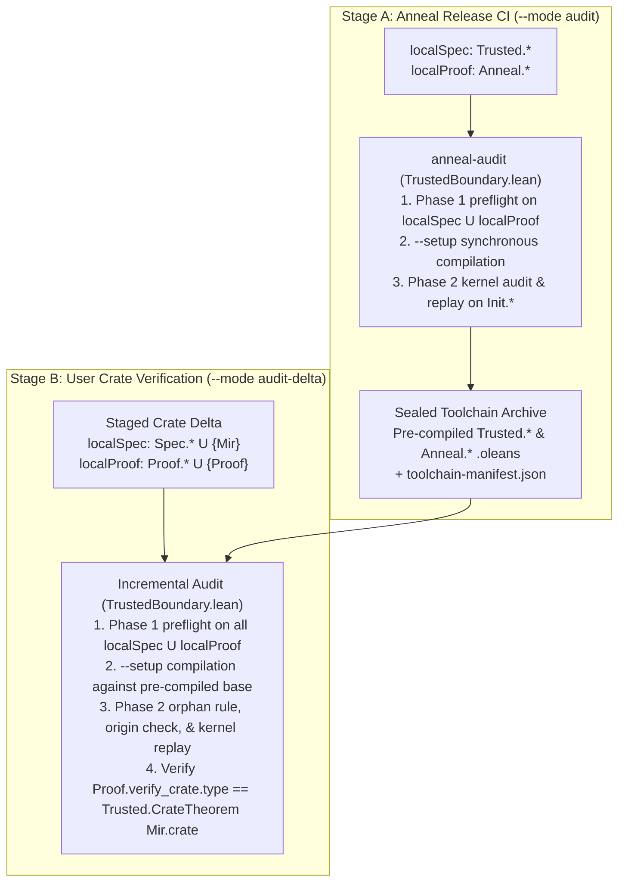

<!-- Copyright 2026 The Fuchsia Authors

Licensed under a BSD-style license <LICENSE-BSD>, Apache License, Version 2.0
<LICENSE-APACHE or https://www.apache.org/licenses/LICENSE-2.0>, or the MIT
license <LICENSE-MIT or https://opensource.org/licenses/MIT>, at your option.
This file may not be copied, modified, or distributed except according to
those terms. -->

# Trust Boundary and Audit Enforcement

> **Note:** Anneal is under active development. Parts of the design and
> architecture described in this document are not yet implemented or may be
> implemented differently; this document may be aspirational or stale relative
> to the codebase.

[`PRINCIPLES.md`](../PRINCIPLES.md) and [`THREAT_MODEL.md`](../THREAT_MODEL.md)
are the controlling documents for Anneal's correctness promise, threat model,
non-compromised execution-environment assumption, in-scope repository threats,
and downstream TCB audit log (`anneal-tcb.lock`).

This document specifies how Anneal's internal codebase
([`trusted/`](../trusted) vs. `theory/`) implements and enforces
[`PRINCIPLES.md`](../PRINCIPLES.md) and [`THREAT_MODEL.md`](../THREAT_MODEL.md):

- **Section 1** defines the three-layer trust partition across
  [`trusted/`](../trusted), `theory/`, and downstream user crates, enforces
  Cargo workspace containment, and binds external build, foundation, and
  pre-compiled toolchain artifacts into `trusted/` via cryptographic manifests.
- **Section 2** specifies the stage-agnostic boundary auditor in
  [`trusted/audit/`](../trusted/audit) (`anneal-audit` and
  [`TrustedBoundary.lean`](../trusted/audit/TrustedBoundary.lean)), including
  its unified `(baseSpec, baseProof, localSpec, localProof)` model across Stage
  A (`--mode audit`) and Stage B (`--mode audit-delta`), Phase 1 syntactic
  preflight, Phase 2 standalone kernel replay, and the kernel-WHNF typeclass
  orphan rule for user `Spec/*.lean` models.
- **Section 3** specifies how [`trusted/cargo-anneal/`](../trusted/cargo-anneal)
  and [`trusted/rustc-capture/`](../trusted/rustc-capture) enforce the Stage 1
  and orchestrator defenses of
  [`THREAT_MODEL.md`](../THREAT_MODEL.md#3-in-scope-threats-from-untrusted-repository-contents)
  and which legacy checks are eliminated or relocated to `cargo anneal setup`.
- **Section 4** describes how `trusted/lean/` keeps compiled `.olean` constants
  transparent and stages work-in-progress semantic rules via `vetted` vs.
  `candidate:<feature>` module tiers.
- **Section 5** states the dependency and provenance-citation requirements for
  code inside [`trusted/`](../trusted).

For related architectural details, see:

- [`docs/design.md`](design.md) for an overview of Anneal's verification
  workflow, library-centric verification model, and four specification modes.
- [`docs/architecture.md`](architecture.md) for the three-stage MIR pipeline
  and how untrusted lowering passes in `theory/` connect to `trusted/lean/`.

## 1. Repository layout and hash-locked external files

Within the `joshlf/anneal` repository and across downstream crate verification,
artifacts are partitioned into three epistemic layers—**Layer 1 (Execution &
foundation TCB)** and **Layer 2 (Specification & assumption TCB)** inside
[`trusted/`](../trusted) (and user `Spec/*.lean` / `Mir.lean`), and **Layer 3
(Untrusted proof layer)** outside the TCB in `theory/` (and user
`Proof/*.lean`):

| Zone | Directory | Epistemic layer & components | Trust status |
| :--- | :--- | :--- | :--- |
| **Trusted foundation** | [`trusted/`](../trusted) | **Layer 1 (Execution TCB):** `trusted/rustc-capture/`, `trusted/audit/`, `trusted/cargo-anneal/`. **Layer 2 (Specification TCB):** `trusted/lean/` (`Trusted.*` MIR AST and reference semantics). | **In the TCB.** Audited by humans (alongside external files pinned by hash manifests inside `trusted/`). |
| **Proof theory** | `theory/` | **Layer 3 (Untrusted proof layer):** `Anneal.*` (`lowerBody`, `lowerBody_simulates`, `proveCrate`, WP & separation-logic lemmas, and proof automation). | **Outside the TCB.** Audited mechanically by `trusted/audit/` in Anneal's CI and checked by the Lean 4 kernel. |

### Cargo workspace containment

In Anneal's own repository (`anneal-audit --mode audit`), before inspecting Lean
files, `anneal-audit` verifies that every Cargo workspace member and `path`
dependency resides under `trusted/`. Because Rust code (including `build.rs`
scripts and procedural macros) is effectful and not checked by the Lean kernel,
no Rust crate is permitted outside `trusted/`.

### Binding external and pre-compiled artifacts via manifests

An auditor inspecting the Anneal repository only needs to review `trusted/` to
verify that Anneal upholds [`PRINCIPLES.md`](../PRINCIPLES.md) and
[`THREAT_MODEL.md`](../THREAT_MODEL.md). Because Cargo, Nix, and upstream
toolchain artifacts live at the repository root or in the packaged toolchain
archive, `trusted/` binds them via three manifests:

- **[`trusted/root-manifest.sha256`](../trusted/root-manifest.sha256)**
  *(checked into Git)*: Pins the SHA-256 digests of the repository's root build
  files (`Cargo.toml`, `Cargo.lock`, `flake.nix`, and `flake.lock`), verified
  by CI and `anneal-audit --mode audit`.
- **[`foundation-lock.json`](../trusted/lean/foundation-lock.json)**
  (`trusted/lean/foundation-lock.json`, *checked into Git*): Pins the SHA-256
  digests of the `lean` executable, all `Init.*` prelude source and
  `.olean`/`.ir` companion files, and the foundation axiom allowlist
  (`{Classical.choice, Quot.sound, propext}`), verified by the Nix toolchain
  build (`flake.nix`), `anneal-audit`, and `cargo anneal setup`.
- **`toolchain-manifest.json`** *(emitted by Stage A `anneal-audit --mode audit`
  into the sealed toolchain archive)*: Binds the Stage A audit results to the
  packaged `.olean` artifacts so Stage B does not re-audit or re-compile
  `Init.*`, `Trusted.*`, or `Anneal.*` on user machines. It records:
  1. `foundationLockSha256`: the SHA-256 digest of `foundation-lock.json`;
  2. `componentTiers` and `trustedModuleTiers`: the validated trust tiers
     (`"vetted"` or `"candidate:<feature>"`) of Layer 1 components (such as
     `rustc_capture`) and Layer 2 `Trusted.*` modules;
  3. `taintedBaseConsts`: the set of `Init.*` constants whose transitive
     dependency cone in `Init.*` reaches any `.axiomInfo` outside
     `{Classical.choice, Quot.sound, propext}` (such as `sorryAx`,
     `ofReduceBool`, or `ofReduceNat`), any constant with `isUnsafe ||
     isPartial`, or any `.opaqueInfo` `o ∈ Init.*` paired with a partial
     compiler companion `o._unsafe_rec`;
  4. `candidateFootprints`: for each constant `c` in `Trusted.* ∪ Anneal.*`
     with a non-empty candidate reachability set, the sorted list of
     `candidate:<feature>` strings transitively reachable from `c` across
     `Trusted.* ∪ Anneal.*`;
  5. `knownClasses`: the complete set of typeclass names declared in `Init.* ∪
     Trusted.*`; and
  6. `moduleArtifacts`: the SHA-256 digests of all pre-compiled `Trusted.*` and
     `Anneal.*` `.olean`/`.ir` companion files (verified once at installation
     time by `cargo anneal setup`).

## 2. Stage-agnostic boundary auditor (`trusted/audit/`)

[`trusted/audit/`](../trusted/audit) implements the two-stage boundary audit
that separates Anneal's own release CI from downstream crate verification
([`docs/design.md`](design.md#two-stage-boundary-auditing-anneals-ci-and-downstream-ci))
using a single auditor parameterized by a 4-tuple of disjoint module sets
`(baseSpec, baseProof, localSpec, localProof)` and an optional theorem pin
`targetTheorem?`:

| Stage & CLI mode | `baseSpec` (Pre-audited Layer 1/2) | `baseProof` (Pre-audited Layer 3) | `localSpec` (Staged Layer 2) | `localProof` (Staged Layer 3) | `targetTheorem?` |
| :--- | :--- | :--- | :--- | :--- | :--- |
| **Stage A: Anneal CI (`--mode audit`)** | `Init.*` | $\emptyset$ | `Trusted.*` (`trusted/lean/`) | `Anneal.*` (`theory/`) | `none` |
| **Stage B: Crate delta (`--mode audit-delta`)** | `Init.*` $\cup$ `Trusted.*` $\cup$ upstream `Spec.<CrateId>.*` | `Anneal.*` | `Spec.*` $\cup$ $\{\text{`Mir`}\}$ | `Proof.*` $\cup$ $\{\text{`Proof`}\}$ | `some (`Proof, ``Proof.verify_crate, ``Mir.crate)` |

### Phase 1: Syntactic source preflight (`--mode preflight`)

Before compiling any module in `localSpec ∪ localProof` (including generated
`Mir.lean` and `Proof.lean` in Stage B so `validateGraph` checks the complete
delta import DAG without special cases), the auditor stages the `.lean` source
files into a private temporary directory, verifies that no pre-existing `.olean`
or `.ir` artifacts exist in the source tree, and parses every file using
`Parser.parseHeader` and `Parser.parseCommand` against the locked `Init.*`
foundation parser environment without invoking the Lean elaborator.
`TrustedBoundary.lean` validates each module header and top-level command in a
single top-down pass (`inspectSyntax` and `inspectNodeKind`) against a closed,
role-aware `SyntaxNodeKind` allowlist:

- **Shared syntax, module-name, and attribute invariants across `localSpec ∪
  localProof`:**
  - Every file must begin with an explicit `prelude` header and use plain
    `import <Mod>` edges with no `all`, `meta`, or `public` modifiers.
  - In Layer 2 (`Spec.*` and `Mir`), no module name segment after the root
    namespace segment (`Spec` or `Mir`) may match a reserved root namespace
    (`Init`, `Lean`, `Trusted`, `Anneal`, `Mir`, `Spec`, `Proof`, `Bool`,
    `Nat`, `Int`, `UInt8`, `UInt16`, `UInt32`, `UInt64`, `USize`, `List`,
    `Array`, `Option`, `Prod`, `Sum`, `Sigma`, `PSigma`, `Subtype`, `String`,
    `Char`, `Unit`, `PUnit`, `Empty`, `PEmpty`, `Eq`, `HEq`, `Decidable`), and
    in multi-crate workspaces no local `Spec//**` module may use an
    upstream dependency's canonical Cargo `<CrateId>` as ``.
  - Every identifier must satisfy `isValidSourceIdent` (non-empty string
    segments, zero macro scopes, and no `_root_` namespace escape).
  - `Parser.Command.opaque`, `Parser.Command.export` (which could inject
    zero-constant parser aliases into namespaces), standalone
    `Parser.Command.attribute` (`attribute [...] foo`),
    `Parser.Command.eraseAttr` (`attribute [-...] foo`), and
    `Parser.Command.optDefDeriving` (`deriving instance`) are excluded across
    all roles. Attributes in `allowedAttributeNames` (`[`simp, `instance]`,
    with `@[instance]` forbidden in `Spec.*` `declModifiers` so explicit
    instances in `Spec.*` must use `Parser.Command.instance`) may only be
    attached inline via `Parser.Command.declModifiers` on a new declaration,
    with empty `Parser.Term.attrKind` (forbidding `local` and `scoped`) and
    empty priority arguments (forbidding `(priority := ...)` and
    `@[default_instance]`). Transparency attributes (`reducible`,
    `semireducible`, `irreducible`, `instance_reducible`) are forbidden so only
    an explicit `abbrev` declaration can set `DefinitionVal.hints == .abbrev`.
- **Layer 2 specification modules (`localSpec`: `Trusted.*`, `Spec.*`, and
  `Mir`):** Restricted to `allowedTrustedSyntaxKinds`—pure declarations, types,
  and term-mode proofs only, excluding `byTactic` and all tactic syntax so Layer
  2 specifications remain direct, tactic-free definitions. Modules in
  `Trusted.*` must carry exactly one `-- anneal-trust-tier: vetted` or
  `-- anneal-trust-tier: candidate:<feature>` directive; `Spec.*` and `Mir`
  modules may not carry trust-tier directives. In `Spec.*` modules, `class`
  declarations (`Parser.Command.structure` with `classTk`) must have an empty
  `extends` clause (preventing parent-projection instances targeting external
  classes), `deriving` clauses (`Parser.Command.derivingClass` inside
  `optDeriving` with empty `optAttrKind`) are restricted to `DecidableEq`,
  `BEq`, `Repr`, `Inhabited`, `Ord`, `Hashable`, `Nonempty`, and `ToString`,
  and every `Parser.Command.instance` must have an explicit `: <type>`
  signature whose syntactic head after stripping `∀`/`→` arrows is a non-bound
  identifier. Phase 1 records the sets of `localClasses` and `localInstances`
  declared in `localSpec` for Phase 2.
- **Layer 3 proof modules (`localProof`: `Anneal.*`, `Proof.*`, and `Proof`):**
  Restricted to `allowedTheorySyntaxKinds`, which extends
  `allowedTrustedSyntaxKinds` with a closed allowlist of pure proof tactics
  (`allowedTheoryTacticKinds`) while excluding trust-tier directives and any
  effectful or trust-bypassing construct (`unsafe`, `partial`, `axiom`,
  `opaque`, `macro`, `syntax`, `elab`, `sorry`, `native_decide`, `decide!`,
  `bv_decide`, `rfl'`, `grind`, tactic `configItem` flags such as `+native` and
  `+kernel`, `by_elab`, `run_tac`, `#eval`, `include_str`, `set_option`,
  `@[implemented_by]`, `@[extern]`, `@[csimp]`, and `initialize`).

### Phase 2: Standalone kernel replay and DAG audit (`--mode audit-delta`)

After compiling `localSpec ∪ localProof` synchronously in topological order via
`lean --setup <module>.setup.json -t0 -DElab.async=false
-Ddebug.skipKernelTC=false`, the auditor loads the environment over `baseSpec ∪
baseProof ∪ localSpec ∪ localProof` with `trustLevel := 0`, `plugins := #[]`,
and `loadExts := false` (so no `[init]` initializers or persistent environment
extensions from audited modules are deserialized or executed) and enforces six
kernel-level checks in time $O(|\text{localSpec} \cup \text{localProof}|)$:

1. **Module DAG, layer separation, and provenance verification (`validateGraph`
   and `verifyAndCollectLocals`):** Verifies that the `.olean` import headers of
   `localSpec ∪ localProof` match the Phase 1 admitted DAG; that only modules in
   `baseSpec ∪ baseProof ∪ localSpec ∪ localProof` are loaded; that no module in
   `localSpec` imports any module in `baseProof ∪ localProof` (and in Stage A no
   `.vetted` `Trusted.*` module imports a `candidate:<feature>` module); and
   that every constant in `m ∈ localSpec ∪ localProof` has `origin env c == m`
   and matches its stored entry in `env.checked`.
2. **Full module-prefix ownership and declaration purity
   (`validateLocalConstant`):** For every constant `ci` defined in `m ∈
   localSpec ∪ localProof`, let `u := privateToUserName ci.name`:
   - If `m ∈ {`Trusted, `Anneal, `Mir, `Proof}`, `u.getRoot` must equal `m`
     (permitting `Mir.crate`, `Mir.Fn.*`, and `Mir.Const.*` in module `Mir`).
     For every submodule `m` (`Spec.*`, `Proof.*`, `Trusted.*`, `Anneal.*`),
     **`m.isPrefixOf u`** must hold (so `Spec.Foo` can only declare constants
     under `Spec.Foo.*`, never `Spec.Bool.true` or `Spec.Bar.*`), and in Layer 2
     (`Spec.*` and `Mir`) no segment of `m` or `u` after the root namespace
     segment (`Spec` or `Mir`) may match a reserved root namespace name.
   - If `u == ``Proof.verify_crate`, then `m` must be ``Proof`; if `u ==
     ``Mir.crate`, then `m` must be ``Mir`.
   - `ci` must not be `.axiomInfo`, `.opaqueInfo`, `.quotInfo`, `isUnsafe`, or
     `isPartial` (excluding verified `_unsafe_rec` structural-recursion compiler
     helpers paired with a safe, non-partial `.defnInfo` in `m`, which are
     omitted from `locals` before kernel replay).
3. **Kernel-WHNF typeclass orphan rule on `Spec.*` (see below):** Verifies that
   every constant in `Spec.*` whose return type constructs a typeclass in
   `knownClasses ∪ localClasses` is anchored to the current crate's `Spec.*`
   inductive types.
4. **Statement-Origin Separation, axiom purity, and tier monotonicity
   (`checkEdges`):** Traverses `declarationEdges ci` for every `ci` in
   `localSpec ∪ localProof` (stopping at the pre-audited `baseSpec ∪ baseProof`
   boundary):
   - **Axiom and taint purity:** No edge may target a constant in
     `taintedBaseConsts` (ensuring the transitive closure reaches only
     `{Classical.choice, Quot.sound, propext}`).
   - **Statement-Origin Separation:** Every constant in `localSpec` may
     reference only constants in `baseSpec ∪ localSpec`, never `baseProof ∪
     localProof`.
   - **Vetted tier rule (Stage A):** A constant in a `.vetted` `Trusted.*`
     module may reference only `Init.*` and `.vetted` `Trusted.*` constants,
     never `candidate:<feature>`.
   - **Candidate footprint propagation (Stage B):** For every edge from
     `localSpec` or the transitive local cone of `Proof.verify_crate` to a base
     constant `d ∈ Trusted.* ∪ Anneal.*`, Stage B unions
     `candidateFootprints[d]` (together with any active Layer 1 `componentTiers`
     candidate feature) from `toolchain-manifest.json` into the crate's active
     `candidate_features` set for `anneal-tcb.lock`.
5. **Exact syntactic theorem-type and universe-parameter pinning (Stage B):**
   When `targetTheorem?` is present, verifies that `Proof.verify_crate` is a
   `.thmInfo` in module `Proof` with **`ci.levelParams.isEmpty`** whose kernel
   `ci.type` is structurally equal (`==`, not `isDefEq`) to `Expr.app (.const
   ``Trusted.CrateTheorem []) (.const ``Mir.crate [])`, and that `Mir.crate` is
   a `.defnInfo` in module `Mir` with **`ci_mir.levelParams.isEmpty`** and
   `ci_mir.type == .const ``Trusted.Crate []`.
6. **Standalone kernel replay (`replay`):** Imports `baseEnv` over `baseSpec ∪
   baseProof` (`loadExts := false`, `trustLevel := 0`) and runs
   `baseEnv.toKernelEnv.replay locals`, re-typechecking every declaration in
   `localSpec ∪ localProof` inside the standalone Lean 4 kernel.

### Unambiguous `Mir.lean` codegen and the `Spec/*.lean` typeclass orphan rule

In Mode 3 ([`docs/design.md`](design.md#3-pure-mathematical-models-speclean)),
user specifications in `Mir.lean` can reference mathematical types and functions
defined in user `Spec/*.lean` modules (`import Spec.<Mod>`), and users writing
`Spec/*.lean` models frequently need `deriving DecidableEq, Repr, Inhabited,
BEq` or custom typeclass instances (`Add`, `LT`, `OfNat`, etc.) on their own
`Spec.*` types.

To prevent an untrusted `Spec/*.lean` module from hijacking typeclass resolution
in `Mir.lean` or altering the meaning of standard operators (`+`, `==`, `0`)
inside human-reviewed `Spec/*.lean` files, Anneal combines **unambiguous
`Mir.lean` codegen** with a **kernel-WHNF typeclass orphan rule** in
`TrustedBoundary.lean`:

1. **Unambiguous `Mir.lean` emission (`trusted/rustc-capture/src/lean.rs`):**
   - `Mir.lean` begins with `prelude`, imports only `Trusted` (plus `Spec.<Mod>`
     when Mode 3 references are present), and contains no `open` or `export`
     commands, tactic blocks, anonymous constructors `⟨...⟩`, or overloaded
     operators.
   - Because Full Module-Prefix Ownership and the Reserved Segment Ban prevent
     `Spec.*` and `Mir` from declaring constants in root namespaces `Trusted`,
     `Nat`, `Int`, `Bool`, `List`, `Option`, `Prod`, or `String` (or
     `Spec.Bool.*`, `Mir.Bool.*`, etc.), `Mir.lean` emits all AST and data
     constructors using explicit root-qualified names (`Trusted.Crate.mk`,
     `Trusted.Stmt.assign`, `Bool.true`, `Option.some`, `List.cons`,
     `Int.ofNat`, `Int.negSucc`, `Spec.<Mod>.<item>`), which resolve
     unambiguously without `_root_` escapes.
2. **Kernel-WHNF head-inductive orphan rule (`TrustedBoundary.lean`):**
   In Phase 2, for every constant `ci` defined in the current crate's
   `currentCrateSpec` modules (`Spec.*`):
   - **Unconditional Kernel-WHNF return normalization (`stripForallWhnf`):**
     For any constant `ci.name ∈ localInstances` (recorded from
     `Parser.Command.instance` in Phase 1), the unreduced return head after
     stripping `forallE`/`letE`/`mdata` must be `.const H _` with `H ∈
     knownClasses ∪ localClasses ∪ {``DecidableEq, ``DecidablePred,
     ``DecidableRel}` (rejecting return-type aliases, redexes, projections, or
     stuck matchers). Unconditionally on **every** `ci ∈ currentCrateSpec`,
     using the C++ standalone kernel's `Lean.Kernel.whnf env lctx` (`loadExts
     := false`), weak-head normalize `ci.type` and instantiate leading
     `forallE` binders in `lctx` until `ret ← Lean.Kernel.whnf env lctx e` is
     not a `forallE`. If `ci.name ∉ localInstances` and `ret.getAppFn` is not
     `.const C _` with `C ∈ knownClasses ∪ localClasses` (failing closed if a
     `localInstances` member's normalized return head is stuck), `ci` does not
     construct a typeclass and is permitted.
   - **Local typeclasses (`origin env C ∈ currentCrateSpec`):** Permitted.
     Because `C` is defined in the current crate's `Spec.*` and `class ...
     extends ...` is forbidden in `Spec.*`, no external module can query `C`.
   - **External typeclasses (`origin env C ∉ currentCrateSpec`, i.e., `C ∈
     knownClasses` from `Init.* ∪ Trusted.* ∪ Spec.<UpstreamCrateId>.*`):**
     1. **No coercion classes:** `C` must not belong to the 13 coercion classes
        in `Init.Coe` (`Coe`, `CoeTC`, `CoeHTC`, `CoeHTCT`, `CoeOTC`, `CoeT`,
        `CoeHead`, `CoeTail`, `CoeD`, `CoeOut`, `CoeDep`, `CoeFun`, `CoeSort`).
     2. **Input parameter classification:** On `C`'s kernel `.inductInfo`
        parameter telescope `(p₀ : P₀) → ... → (p_{n-1} : P_{n-1}) → Sort _`,
        for each `i ∈ {0 .. n-1}`, strip `mdata`, exclude `i` if `Pᵢ.getAppFn ==
        .const ``Init.Prelude.outParam _`, unwrap `Init.Prelude.semiOutParam` if
        present, strip leading `forallE`/`letE`/`mdata` from `Pᵢ`, and include
        `(i, u)` in `inputPositions` iff the body of `Pᵢ` is `Expr.sort u`
        (excluding non-type value indices such as `n : Nat` in `OfNat α n`).
        Require `inputPositions` to be non-empty.
     3. **All input positions must be anchored to local `.inductInfo`s or
        non-`abbrev` predicates:** For **every** `(i, u) ∈ inputPositions` with
        argument `aᵢ := ret.getAppArgs[i]`:
        - **Type input (`u ≠ .zero`):** Both the unreduced argument `aᵢ` **and**
          its weak-head normal form `Lean.Kernel.whnf env lctx aᵢ` must have
          `.getAppFn == .const T _` where `T` is a **`ConstantInfo.inductInfo`**
          (`inductive` or `structure`, never an `abbrev`/`defnInfo` or bound
          variable `.bvar`) with `origin env T ∈ currentCrateSpec`.
        - **Proposition input (`u == .zero`, i.e., `Decidable p`):** Normalize
          `p := aᵢ` at the head by repeatedly stripping `mdata`, unwrapping
          `Not` (`¬ q ↦ q`), and unfolding any `ConstantInfo.defnInfo v` with
          `v.hints == .abbrev` **except** `LT.lt` and `LE.le` (calling
          `Expr.headBeta` after each substitution so `Ne`, `GT.gt`, `GE.ge`, and
          user `abbrev`s beta-reduce cleanly). The resulting `p` must have
          `p.getAppFn == .const P _` where either (i) `origin env P ∈
          currentCrateSpec` and `P` is a `ConstantInfo.inductInfo` or a
          `ConstantInfo.defnInfo v` with `v.hints != .abbrev`, (ii) `P ==
          ``Eq` and its type argument `ty := p.getAppArgs[0]` satisfies the Type
          Input (`u ≠ .zero`) requirement above, or (iii) `P ∈ {``LT.lt,
          ``LE.le}`, its type argument `ty := p.getAppArgs[0]` satisfies the
          Type Input (`u ≠ .zero`) requirement above, **and** its instance
          argument `inst := p.getAppArgs[1]` has `inst.getAppFn == .const
          instName _` where `origin env instName ∈ currentCrateSpec` and
          `instName` is a `ConstantInfo.defnInfo v` with `v.hints != .abbrev`
          (preventing inline `LT.mk`/`LE.mk` constructor projection bypasses).

Because nominal inductive type constructors (`ConstantInfo.inductInfo`) in
`currentCrateSpec` are rigid under `Lean.Kernel.whnf` and in Lean's
discrimination trees while reducible aliases (`abbrev MyNat := Nat`, `abbrev
EvilNatEq`) and return-type aliases/redexes are exposed by `Kernel.whnf` or
rejected as `.defnInfo`s, this rule admits natural user instances (`deriving
DecidableEq, Repr, Inhabited, BEq`, `Add Spec.Foo.SeqNum`, `OfNat
Spec.Foo.SeqNum n`, `BEq (Spec.Foo.MyVec α)`) while rejecting standard-type
hijacking (`OfNat Nat 0`, `BEq Nat`), multi-parameter/`outParam` hijacking
(`HAdd Nat Nat Spec.Foo.MyNat`, `HAdd Nat Spec.Foo.MyNat Nat`), coercion
hijacking (`Coe Nat Spec.Foo.MyNat`), and alias/redex bypasses.

## 3. Stage 1 and orchestrator enforcement (`cargo-anneal` and `rustc-capture`)

[`trusted/cargo-anneal/`](../trusted/cargo-anneal) and
[`trusted/rustc-capture/`](../trusted/rustc-capture) implement the runtime
isolation and artifact-capture defenses required by
[`THREAT_MODEL.md`](../THREAT_MODEL.md#3-in-scope-threats-from-untrusted-repository-contents).

### Six-step verification pipeline (`cargo anneal verify [--locked]`)

1. **Repository-input and override hygiene (before Cargo runs):**
   `cargo-anneal` walks the target crate and workspace root using
   `symlink_metadata`, rejecting any symlink or `..` path traversal, rejecting
   repo-local toolchain or compiler overrides (`rust-toolchain`,
   `rust-toolchain.toml`, `.cargo/config`, `.cargo/config.toml`), rejecting
   pre-existing `.olean`/`.ilean`/`.ir` files in `Spec/` or `Proof/`, rejecting
   user files at the reserved generated root paths (`Mir.lean`, `Mir/**`,
   `Proof.lean`, `Spec.lean`), and ignoring any in-tree `.anneal/` directory,
   before copying the verified workspace inputs into a private staging directory
   (`<staging>/workspace`, permissions `0700`) outside the checkout.
2. **Pure dependency graph resolution (`cargo metadata --locked`):**
   `cargo-anneal` invokes `cargo metadata --format-version 1 --locked` on
   `<staging>/workspace` with a scrubbed environment (`Command::env_clear()`).
   Because `cargo metadata` does not compile or execute `build.rs` scripts or
   procedural macros, the dependency graph is resolved purely before any
   untrusted build hook can run.
3. **Pre-execution transitive `build_hooks` lockfile gate:**
   From the resolved `cargo metadata` graph, `cargo-anneal` identifies every
   `"custom-build"` (`build.rs`) and non-TCB `"proc-macro"` target, hashes its
   **entire transitive host-executed dependency closure** (including
   `[build-dependencies]` and proc-macro `"lib"` dependencies), and checks the
   digests against `build_hooks` in `anneal-tcb.lock`. Under `--locked`
   (mandatory in CI), any unlisted or modified build hook or host dependency
   aborts verification with exit code `1` **before** Cargo or `rustc` compiles
   or executes it.
4. **Private staging capture and five artifact surfaces (`rustc-capture`):**
   `cargo-anneal` invokes Cargo in topological workspace order with
   `RUSTC_WORKSPACE_WRAPPER = <toolchain>/bin/anneal-rustc-capture`,
   `--target-dir <staging>/target`, `--locked`, `--offline`, and a scrubbed
   environment (stripping `LD_PRELOAD`, `DYLD_INSERT_LIBRARIES`,
   `RUSTC_WRAPPER`, `RUSTFLAGS`, `CARGO_ENCODED_RUSTFLAGS`, `LEAN_PATH`, and
   unpinned environment variables). Host `build_script_build` and `proc-macro`
   invocations (authenticated in Step 3) delegate directly to pinned `rustc`.
   For each verified target crate $C$, `anneal-rustc-capture` emits standard
   `.rmeta`/`.rlib` artifacts for downstream workspace crates and:
   - Re-validates the `rustc` CLI flag allowlist after Cargo expands any
     `build.rs` `cargo:rustc-*` output directives, and verifies via
     `GuardedFileLoader` (`read_file` and `read_binary_file`) and
     `tcx.sess.psess` (`file_depinfo` / `source_map().files()` and
     `env_depinfo`) that every loaded source or included file (`include!`,
     `include_bytes!`, `include_str!`, `#[path]`) is a regular file strictly
     inside **crate $C$'s own staged crate root directory** (plus the pinned
     Rust sysroot and $C$'s own approved `build.rs` `OUT_DIR`), never a sibling
     workspace crate, and that every read environment variable (`env!`,
     `option_env!`) is pinned in Layer 1 of `anneal-tcb.lock`.
   - Traverses nested `DefKind::Mod` submodules across `src/**/*.rs` (emitting
     crate-relative module-qualified `Mir.Fn.<mod>__<item>` names) and runs the
     compiler pipeline across `CONFIGS` (`debug-assertions=on,
     overflow-checks=on` and `debug-assertions=off, overflow-checks=off` with
     `-Z mir-preserve-ub`), cloning `Runtime(PostCleanup)` MIR (and pre-pruning
     `Body::required_consts`) inside `mir_drops_elaborated_and_const_checked`
     before `DeadBlocks` runs, and requiring byte-for-byte identical rendered
     `Mir.lean` bodies across both configurations.
   - Extracts all five classes of user-brought artifacts for the crate's TCB
     audit log (`anneal-tcb.lock`; see
     [`THREAT_MODEL.md`](../THREAT_MODEL.md#3-in-scope-threats-from-untrusted-repository-contents)):
     1. **Two-template `Proof.lean` generation:** Emits
        `<staging>/lean/Proof.lean` using **Template A** (`theorem
        Proof.verify_crate : Trusted.CrateTheorem Mir.crate := Anneal.proveCrate
        Mir.crate rfl`, when `Proof/Main.lean` is absent) or **Template B**
        (`theorem Proof.verify_crate : Trusted.CrateTheorem Mir.crate :=
        Proof.Main.verify_crate`, when `Proof/Main.lean` is present).
     2. **Inline contracts, `Spec/*.lean`, and Mode 4 `spec_fn` closures:**
        Extracts `requires`, `ensures`, `invariant` (from `#[anneal::...]`
        attributes and `/// anneal:...` doc comments), non-empty
        `required_consts`, `Spec/*.lean` digests, and the full transitive
        callee, trait-impl, closure, and constant MIR and source closure of
        every Mode 4 `spec_fn` (failing closed if a `spec_fn` reaches dynamic
        dispatch `dyn Trait`, an `extern` call, or an uncaptured function).
     3. **Private-invariant visibility scopes ($\mathcal{V}_T$) and
        `unverified_functions`:** Records all `unverified_functions` (tagging
        `[unsafe_fn]` and `[contains_unsafe_block]` items) in `anneal-tcb.lock`.
        For every ADT $T$ with `allFieldsPubSafe = false`, computes
        $\mathcal{V}_T$ as the union of full Rust HIR visibility regions
        (`ty::Visibility`: the defining module **and all of its descendant
        submodules** for private fields, the target module subtree for
        `pub(in path)`, or the crate for `pub(crate)`) of $T$'s non-`pubSafe`
        fields, records every unverified function in $\mathcal{V}_T$ as a
        `TCBItem.unverifiedFn` waiver, and rejects verified safe functions in
        $\mathcal{V}_T$ that return `&mut` to a non-`pubSafe` field type unless
        that field's invariant is `True`.
     4. **Ambient and link-level items (`ambient_items`):** Scans crate HIR for
        `#[no_mangle]`, `#[export_name]`, `#[link_section]`, `#[used]`,
        `#[global_allocator]`, `#[panic_handler]`, `static mut`,
        interior-mutable `static`s, `extern` blocks, and module/global `asm!`.
     5. **Compositional cross-crate `UnitId` verification:** Binds each verified
        workspace crate to a recursive Merkle `UnitId` over its compilation
        inputs (including all `file_depinfo` files) and upstream `UnitId`s.
        When an upstream crate `<CrateId>` exports `Spec/<Mod>.lean` models (or
        authors them at `Spec/<CrateId>/<Mod>.lean`), `cargo-anneal`
        deterministically stages them at
        `<staging>/lean/Spec/<CrateId>/<Mod>.lean` with `Spec.<CrateId>.<Mod>`
        module and namespace prefixes before Phase 1 compilation, and propagates
        upstream waivers, `Spec.<CrateId>.*` digests, `knownClasses`, and
        `candidateFootprints` into downstream Stage B audits and
        `anneal-tcb.lock` files.
5. **Stage B incremental boundary audit (`--mode audit-delta`):**
   `cargo-anneal` stages user `Spec/*.lean` and `Proof/*.lean` files alongside
   `Mir.lean` and `Proof.lean` in `<staging>/lean/`, runs Phase 1 preflight on
   all `localSpec ∪ localProof` files, compiles them via `lean --setup` against
   the pre-compiled toolchain `.olean`s, and runs Phase 2 `"audit-delta"`.
6. **Zero-churn `anneal-tcb.lock` emission and verification:**
   `cargo-anneal` serializes `anneal-tcb.lock` keyed by canonical Rust item
   paths (omitting volatile `src/**/*.rs` implementation hashes, sequential
   `BodyId` integers, and `Span` line/column coordinates) and under `--locked`
   verifies exact equality with the committed `anneal-tcb.lock`.

### Eliminated and relocated legacy checks

Under
[`THREAT_MODEL.md`](../THREAT_MODEL.md#2-compromised-execution-environments-and-the-dev-vs-ci-boundary)'s
non-compromised execution-environment assumption and two-stage boundary audit,
six legacy checks in `cargo-anneal` and `rustc-capture` are eliminated or
relocated out of the per-run verification path:

1. **Per-file `lstat`/`fstat` `(dev, ino)` TOCTOU checks (`read_regular`):**
   Eliminated and replaced by `symlink_metadata` regular-file verification plus
   copying into the private `0700` staging directory.
2. **Per-run SHA-256 re-hashing of the installed toolchain tree
   (`authenticate_toolchain` and `toolchain-lock.sha256`):** Relocated to
   one-time installation verification in `cargo anneal setup` against
   `foundation-lock.json` and `toolchain-manifest.json`; `toolchain-lock.sha256`
   is retired.
3. **Per-run SHA-256 hashing of Anneal's repository source tree
   (`authenticate_anneal_root` and `anneal-sources.sha256`):** Eliminated; Stage
   B runs against the sealed toolchain archive rather than Anneal's source
   checkout.
4. **Per-run recompilation of `anneal-rustc-capture` from source
   (`ensure_rustc_capture_bin`):** Eliminated; `anneal-rustc-capture` is
   pre-compiled in Stage A and shipped in the toolchain archive.
5. **Per-run recompilation of `Trusted.*` and `Anneal.*` `.lean` files from
   source (`ensure_compiled_prefix`):** Eliminated; Stage A pre-compiles and
   audits `Trusted.*` and `Anneal.*` `.olean`s once into the toolchain archive.
6. **Single-file `CRATE_FILES = ["Cargo.toml", "Cargo.lock", "src/lib.rs", ...]`
   restriction:** Eliminated in favor of multi-file and multi-crate workspaces
   with `Mir.lean` and `Proof.lean` staged outside the repository checkout.

## 4. Staging TCB changes and `.olean` kernel transparency (`trusted/lean/`)

### Keeping `trusted/lean/` transparent at the `.olean` kernel level

Auditing `trusted/lean/` requires confidence not only in the surface `.lean`
source files, but also in the compiled `.olean` constants replayed by the Lean
4 kernel. Four design choices in `trusted/lean/` keep its compiled kernel
environment simple and directly inspectable:

- **Tactic-free definitions (`allowedTrustedSyntaxKinds`):**
  `TrustedBoundary.lean` forbids `by` tactic blocks across `trusted/lean/` (and
  user `Spec/*.lean`). All trusted definitions and foundational helper lemmas
  use explicit functional definitions and term-mode proofs rather than opaque
  tactic-generated terms.
- **No `mutual` inductive types (`BodyId` table):** `Trusted/MirAst.lean`
  stores function bodies in a flat `Crate.bodies` list indexed by `BodyId`
  rather than nesting `MirBody` inside `Terminator` or `TCBItem`, avoiding the
  nested mutual recursors that Lean synthesizes for mutual inductive blocks.
- **Structural fuel-bounded recursion without `WellFounded.fix`:** Recursive
  semantic functions in `Trusted/StepResult.lean` and
  `Trusted/MirSemantics.lean` recurse structurally on an explicit `Nat` fuel
  argument (or on inductive syntax/value trees), avoiding well-founded recursion
  proof obligations in the kernel environment.
- **Explicit assumption obligations (`Obligation.assumed`) instead of `opaque`
  constants:** Trusted waivers (such as `TCBItem.rustcLowering`,
  `TCBItem.assumedContract`, and `TCBItem.unverifiedFn`) are stated via
  `Obligation.assumed (id : Id) : Obligation Id := ⟨id, False⟩` in
  `Trusted/Refinement.lean` rather than declaring dummy `opaque` constants in
  `Trusted/MirSemantics.lean`, allowing `TrustedBoundary.lean` to forbid
  `opaque` across all audited modules.

### Module-level trust tiers (`vetted` vs. `candidate:<feature>`)

Auditing a new semantic rule in `trusted/lean/` to full TCB standards—including
line-by-line Rust Reference citations and human review—takes deliberate effort.
To allow contributors and agents to build lowering passes and proofs in
`theory/` before a new semantic module in `trusted/lean/` has completed human
auditing, every module in `trusted/lean/` declares a module-level trust tier via
a leading header comment directive:

- **`-- anneal-trust-tier: vetted`:** Modules whose definitions have completed
  full Rust Reference auditing.
- **`-- anneal-trust-tier: candidate:<feature>`:** Work-in-progress TCB modules
  belonging to a named subsystem feature `<feature>` (such as `refinement`,
  `step_result`, `memory`, `mir_ast`, `mir_semantics`, or `rustc_capture`) that
  have not yet completed human auditing.

Assigning trust tiers at the module boundary rather than via per-declaration
attributes keeps `trusted/lean/` free of custom attribute macros or
metaprogramming: every constant compiled into a `Trusted` module's `.olean`
file—including constructors, recursors (`rec`, `casesOn`), pattern matchers
(`match_1`), equational lemmas (`eq_1`), and `where`/`private` helpers—
inherits its defining module's trust tier via `Environment.getModuleIdxFor?`.

During Stage A (`--mode audit`), `anneal-audit` records each `Trusted.*`
module's trust tier and each `Trusted.* ∪ Anneal.*` constant's transitive
`candidate:<feature>` footprint in `toolchain-manifest.json` so Stage B can
surface any active `candidate:<feature>` dependencies in the crate's
`anneal-tcb.lock` in $O(1)$ without re-walking `Anneal.*`.

## 5. External dependencies and commenting in `trusted/`

Because every file in [`trusted/`](../trusted) must be auditable by humans,
Anneal optimizes `trusted/` for **human comprehension and review accuracy**, not
merely minimum dependency count:

- **Standard libraries over hand-rolled plumbing:** `trusted/` uses widely
  audited Rust ecosystem crates (such as `serde`, `clap`, and `sha2`, all
  pinned with SHA-256 checksums in `Cargo.lock`) for generic utilities like
  serialization, CLI parsing, and hashing. Hand-rolling bespoke parsers or
  cryptographic primitives inside `trusted/` would add hundreds of lines of
  security-critical code and increase audit burden.
- **Mandatory provenance citations:** Any code in `trusted/` that models Rust
  semantics or extracts `rustc` internal structures must explain the
  correspondence in its comments and both quote and cite the relevant Rust
  Reference section (`rust-lang/reference`) or compiler source file
  (`rust-lang/rust`) at a pinned commit hash.
