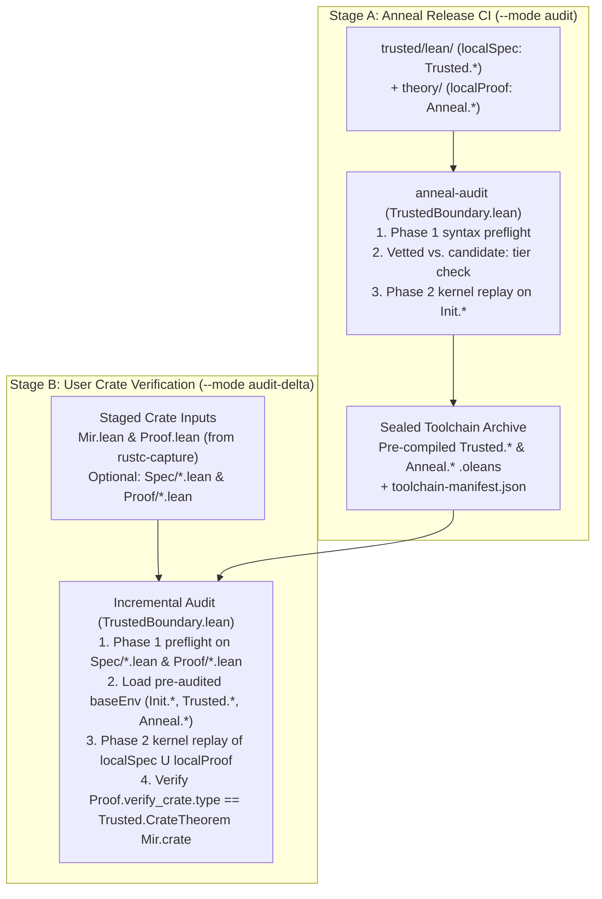

<!-- Copyright 2026 The Fuchsia Authors

Licensed under a BSD-style license <LICENSE-BSD>, Apache License, Version 2.0
<LICENSE-APACHE or https://www.apache.org/licenses/LICENSE-2.0>, or the MIT
license <LICENSE-MIT or https://opensource.org/licenses/MIT>, at your option.
This file may not be copied, modified, or distributed except according to
those terms. -->

# Trust Boundary and Audit Enforcement

> **Note:** Anneal is under active development. Parts of the design and
> architecture described in this document are not yet implemented or may be
> implemented differently; this document may be aspirational or stale relative
> to the codebase.

[`PRINCIPLES.md`](../PRINCIPLES.md) and [`THREAT_MODEL.md`](../THREAT_MODEL.md)
are the controlling documents for Anneal's correctness promise, threat model,
execution-isolation boundary, three-layer trust partition, and downstream TCB
audit log (`anneal-tcb.lock`).

This document describes how Anneal's internal repository layout
([`trusted/`](../trusted) vs. `theory/`) and boundary auditor
([`trusted/audit/`](../trusted/audit)) implement and enforce
[`PRINCIPLES.md`](../PRINCIPLES.md) and [`THREAT_MODEL.md`](../THREAT_MODEL.md):

- **Section 1** describes how the Anneal repository maps the three-layer trust
  partition of [`THREAT_MODEL.md`](../THREAT_MODEL.md#2-three-layer-trust-partition-and-two-stage-boundary-audit)
  onto [`trusted/`](../trusted) and `theory/`, enforces Cargo workspace
  containment, and binds external build and toolchain files into `trusted/` via
  cryptographic hash locks.
- **Section 2** describes how [`trusted/audit/`](../trusted/audit)
  (`anneal-audit` and
  [`TrustedBoundary.lean`](../trusted/audit/TrustedBoundary.lean)) implements
  Stage A (`--mode audit` in Anneal's CI) and Stage B (`--mode audit-delta` in
  `cargo-anneal` during downstream verification).
- **Section 3** describes how `trusted/lean/` stages work-in-progress semantic
  rules via `vetted` vs. `candidate:<feature>` module tiers.
- **Section 4** states the dependency and citation requirements for code inside
  [`trusted/`](../trusted).

For related architectural details, see:

- [`docs/design.md`](design.md) for an overview of Anneal's verification
  workflow and specification modes.
- [`docs/architecture.md`](architecture.md) for the three-stage MIR pipeline
  and how untrusted lowering passes in `theory/` connect to `trusted/lean/`.

## 1. Repository layout and hash-locked external files

Within the `joshlf/anneal` repository, first-party code is partitioned across
[`trusted/`](../trusted) (Layers 1 and 2 in
[`THREAT_MODEL.md`](../THREAT_MODEL.md#2-three-layer-trust-partition-and-two-stage-boundary-audit))
and `theory/` (Layer 3):

| Zone | Directory | Epistemic layer & components | Trust status |
| :--- | :--- | :--- | :--- |
| **Trusted foundation** | [`trusted/`](../trusted) | **Layer 1 (Execution TCB):** `trusted/rustc-capture/`, `trusted/audit/`, `trusted/cargo-anneal/`. **Layer 2 (Specification TCB):** `trusted/lean/` (`Trusted.*` MIR AST and reference semantics). | **In the TCB.** Audited by humans (alongside external files pinned by hash manifests inside `trusted/`). |
| **Proof theory** | `theory/` | **Layer 3 (Untrusted proof layer):** `Anneal.*` IR lowering passes, simulation theorems, weakest-precondition (WP) calculi, separation logic, and proof automation. | **Outside the TCB.** Audited mechanically by `trusted/audit/` in Anneal's CI and checked by the Lean 4 kernel. |

### Cargo workspace containment

In Anneal's own repository (`--mode audit`), before inspecting Lean files,
`anneal-audit` checks that every Cargo workspace member and `path` dependency
resides under `trusted/`. Because Rust code (including `build.rs` scripts and
procedural macros) is effectful and not checked by the Lean kernel, no Rust
crate is permitted outside `trusted/`.

### Including external files in the `trusted/` boundary via hashes

The invariant of [`trusted/`](../trusted) is that an auditor inspecting the
Anneal repository only needs to review `trusted/` to verify that Anneal upholds
[`PRINCIPLES.md`](../PRINCIPLES.md) and [`THREAT_MODEL.md`](../THREAT_MODEL.md).
Because Cargo, Nix, and upstream toolchain artifacts live at the repository root
or outside the repository, `trusted/` binds them into its effective TCB via two
checked-in lock files:

- **[`trusted/root-manifest.sha256`](../trusted/root-manifest.sha256):** Pins
  the SHA-256 digests of the repository's root build files (`Cargo.toml`,
  `Cargo.lock`, `flake.nix`, and `flake.lock`), verified by CI and
  `anneal-audit`.
- **[`foundation-lock.json`](../trusted/lean/foundation-lock.json)**
  (`trusted/lean/foundation-lock.json`): Pins the SHA-256 digests of the `lean`
  executable and all `Init.*` prelude source and `.olean` companion files,
  verified by both the Nix toolchain build (`flake.nix`) and `anneal-audit`.

Changing a root manifest or toolchain artifact requires a corresponding diff
inside `trusted/`, ensuring an auditor inspecting `trusted/` sees every change
to Anneal's effective TCB.

## 2. Two-stage `TrustedBoundary.lean` implementation (`trusted/audit/`)

[`trusted/audit/`](../trusted/audit) implements the two-stage boundary audit
defined in
[`THREAT_MODEL.md`](../THREAT_MODEL.md#two-stage-boundary-auditing-anneal-ci-vs-user-ci)
using a single auditor parameterized by a 4-tuple of module sets `(baseSpec,
baseProof, localSpec, localProof)`:

| Stage & CLI mode | `baseSpec` (Pre-audited Layer 2) | `baseProof` (Pre-audited Layer 3) | `localSpec` (Audited & replayed Layer 2) | `localProof` (Audited & replayed Layer 3) |
| :--- | :--- | :--- | :--- | :--- |
| **Stage A: Anneal CI (`--mode audit`)** | `Init.*` (`Foundation`) | $\emptyset$ | `Trusted.*` (`trusted/lean/`) | `Anneal.*` (`theory/`) |
| **Stage B: Crate delta (`--mode audit-delta`)** | `Init.*` $\cup$ `Trusted.*` $\cup$ upstream `Spec.<CrateId>.*` | `Anneal.*` | `Spec.*` $\cup$ $\{\text{Mir}\}$ | `Proof.*` $\cup$ $\{\text{Proof}\}$ |

### Two-template `.anneal/Proof.lean` generation

During Stage B, `anneal-rustc-capture` emits `Mir.lean` (`Mir.crate :
Trusted.Crate`) and one of two static `Proof.lean` templates (beginning with
`prelude` so Lean cannot inject implicit imports):

- **Template A (default automated path, when `Proof/Main.lean` is absent):**
  Imports `Trusted`, `Anneal`, and `Mir`, and discharges
  `theorem Proof.verify_crate : Trusted.CrateTheorem Mir.crate` using Anneal's
  automated crate verifier in `theory/`. When a crate has no `Spec/*.lean` or
  `Proof/*.lean` files, no user-written Lean code exists at all; checking the
  crate reduces to compiling `Mir.lean` and `Proof.lean` and running the
  incremental kernel check.
- **Template B (custom proof path, when `Proof/Main.lean` is present):**
  Imports `Trusted`, `Mir`, and `Proof.Main`, and binds
  `theorem Proof.verify_crate : Trusted.CrateTheorem Mir.crate :=
  Proof.Main.verify_crate`. Because `anneal-rustc-capture` writes the root
  `Proof.lean` file in both cases, user files in `Proof/*.lean` cannot alter the
  theorem statement `Trusted.CrateTheorem Mir.crate`.

### Phase 1: Syntactic source preflight (`--mode preflight`)

Before compiling any untrusted `.lean` file (`trusted/lean/` and `theory/` in
Stage A, or user `Spec/*.lean` and `Proof/*.lean` in Stage B), the auditor
stages the source files into a private temporary directory, verifies that no
pre-existing `.olean` or `.ir` files exist in the source tree, and parses every
file using `Parser.parseHeader` and `Parser.parseCommand` against the locked
`Init.*` foundation parser environment (without invoking Lean's Turing-complete
elaborator). `TrustedBoundary.lean` classifies each source file by its role and
validates the module header and every top-level command in a single top-down
traversal (`inspectSyntax` and `inspectNodeKind`) against a closed, role-aware
`SyntaxNodeKind` allowlist:

- **Layer 2 specification modules (`trusted/lean/` and user `Spec/*.lean`):**
  Restricted to `allowedTrustedSyntaxKinds`—pure declarations, types, and
  term-mode proofs only, excluding `byTactic` and all tactic syntax so TCB and
  specification definitions remain direct, tactic-free definitions. Modules in
  `trusted/lean/` must carry exactly one valid `-- anneal-trust-tier: vetted` or
  `-- anneal-trust-tier: candidate:<feature>` directive; user `Spec/*.lean`
  modules additionally forbid `opaque`, `attribute`, and `instance` /
  `@[instance]` declarations so they cannot alter typeclass resolution in
  `Mir.lean`.
- **Layer 3 proof modules (`theory/` and user `Proof/*.lean`):** Restricted to
  `allowedTheorySyntaxKinds`, which extends `allowedTrustedSyntaxKinds` with a
  closed allowlist of pure proof tactics (`allowedTheoryTacticKinds`) while
  rejecting trust-tier directives and any unallowlisted syntax node, command,
  modifier, attribute, or tactic configuration (excluding `unsafe`, `partial`,
  `noncomputable`, `meta`, `axiom`, `macro`, `syntax`, `elab`, `sorry`,
  `native_decide`, `decide!`, `bv_decide`, `rfl'`, `grind`, tactic `configItem`
  flags such as `+native` and `+kernel`, `by_elab`, `run_tac`, `#eval`,
  `include_str`, `set_option`, `@[implemented_by]`, `@[extern]`, `@[csimp]`,
  and `initialize` hooks).

### Phase 2: Standalone kernel replay and DAG audit

After compiling the staged `.lean` modules synchronously with kernel checking
enabled (`-t0 -DElab.async=false -Ddebug.skipKernelTC=false`), the auditor loads
the resulting `.olean` files with `trustLevel := 0`, `plugins := #[]`, and
`loadExts := false` (so no `[init]` initializers or persistent environment
extensions from audited modules are deserialized or executed) and performs a
kernel-level audit over `(baseSpec, baseProof, localSpec, localProof)`:

1. **Module, namespace, and axiom verification (`verifyAndCollectLocals`):**
   Verifies that only allowlisted modules are loaded; that every constant's
   recorded module origin (`env.getModuleIdxFor?`) matches its module's role;
   that non-`Trusted` modules declare no constants in the `Trusted` root
   namespace (and user proof modules declare no constants in `Mir` or `Spec`);
   that `localProof` modules declare no `opaque` definitions; that no
   declaration in `localSpec` or `localProof` is `unsafe`, `partial`, an
   `axiom`, or a quotient primitive (`.quotInfo`); and that the transitive
   dependency closure reaches only the locked foundation axiom allowlist
   (`{Classical.choice, Quot.sound, propext}`) while excluding reflection and
   trust-bypass primitives (`ofReduceBool`, `ofReduceNat`, `sorryAx`, `unsafe`,
   `partial`).
2. **Origin and trust-tier separation (`checkTierReferences`):** Traverses
   every kernel dependency edge `c → dep` (`declarationEdges`) and enforces:
   - **Statement-Origin rule:** A Layer 2 (`baseSpec ∪ localSpec`) constant—and
     the target `Proof.verify_crate` theorem statement (`ConstantInfo.type`)—may
     reference only Layer 1 (`Init.*`) and Layer 2 constants, never Layer 3
     (`baseProof ∪ localProof`).
   - **Vetted rule:** A `.trusted .vetted` constant may reference only
     `.foundation` or `.trusted .vetted` constants, never
     `.trusted (.candidate _)`.
3. **Fresh or incremental kernel replay (`replay`):** In Stage A (`--mode
   audit`), `TrustedBoundary.lean` constructs a clean kernel environment
   containing only the pinned `Init.*` foundation (`base`) and replays every
   constant in `Trusted.*` and `Anneal.*` through the standalone Lean 4 kernel
   typechecker. In Stage B (`--mode audit-delta`), `TrustedBoundary.lean` starts
   from the pre-audited `Init.* ∪ Trusted.* ∪ Anneal.*` kernel environment
   (`baseEnv.toKernelEnv`) and replays only the constants in the user crate's
   delta (`localSpec ∪ localProof`).

## 3. Staging TCB changes (`vetted` vs. `candidate:<feature>` modules)

Auditing a new semantic rule in `trusted/lean/` to full TCB standards—including
line-by-line Rust Reference citations and human review—takes deliberate effort.
To allow contributors and agents to build lowering passes and proofs in
`theory/` before a new semantic module in `trusted/lean/` has completed human
auditing, every module in `trusted/lean/` declares a module-level trust tier via
a leading header comment directive:

- **`-- anneal-trust-tier: vetted`:** Modules whose definitions have completed
  full Rust Reference auditing.
- **`-- anneal-trust-tier: candidate:<feature>`:** Work-in-progress TCB modules
  belonging to a named subsystem feature `<feature>` (such as `refinement`,
  `step_result`, `mir_ast`, `mir_semantics`, or `rustc_capture`) that have not
  yet completed human auditing.

Assigning trust tiers at the module boundary rather than via per-declaration
attributes keeps `trusted/lean/` free of custom attribute macros or
metaprogramming: every constant compiled into a `Trusted` module's `.olean`
file—including constructors, recursors (`rec`, `casesOn`), pattern matchers
(`match_1`), equational lemmas (`eq_1`), and `where`/`private` helpers—
inherits its defining module's trust tier via `Environment.getModuleIdxFor?`.

During Stage A (`--mode audit`), `anneal-audit` records each `Trusted.*`
module's trust tier and each `Anneal.*` constant's transitive
`candidate:<feature>` footprint in `toolchain-manifest.json` so Stage B can
surface any active `candidate:<feature>` dependencies in the crate's
`anneal-tcb.lock`.

## 4. External dependencies and commenting in `trusted/`

Because every file in [`trusted/`](../trusted) must be auditable by humans,
Anneal optimizes `trusted/` for **human comprehension and review accuracy**, not
merely minimum dependency count:

- **Standard libraries over hand-rolled plumbing:** `trusted/` uses widely
  audited Rust ecosystem crates (such as `serde`, `clap`, and `sha2`, all
  pinned with SHA-256 checksums in `Cargo.lock`) for generic utilities like
  serialization, CLI parsing, and hashing. Hand-rolling bespoke parsers or
  cryptographic primitives inside `trusted/` would add hundreds of lines of
  security-critical code and increase audit burden.
- **Mandatory provenance citations:** Any code in `trusted/` that models Rust
  semantics or extracts `rustc` internal structures must explain the
  correspondence in its comments and both quote and cite the relevant Rust
  Reference section (`rust-lang/reference`) or compiler source file
  (`rust-lang/rust`) at a pinned commit hash.
