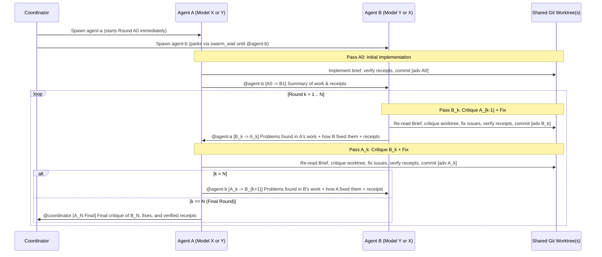

# N-Round Adversarial Model Work

Run a structured $N$-round adversarial build-critique-fix loop between
**Agent A** (`agent-a`) and **Agent B** (`agent-b`) over shared git worktree(s),
using Jetski's native `swarm` board for turn-by-turn handoffs and model pinning.

## 1. Validate or Assemble the Brief

Before creating worktrees or spawning agents, ensure the task **Brief**
explicitly defines all five load-bearing sections (if any section is missing or
ambiguous in the user's request, derive it from the codebase and confirm with
the user if needed):

1. **High-Level Goal**: What system, feature, or proof is being built and why it
  matters.
2. **Architectural Constraints & Non-Negotiables**: Invariants, interfaces,
  forbidden shortcuts (for example, no stubbed or faked data, no weakened types,
  specs, or proofs, and no `sorry`, `#[trusted]`, or disabled tests), and files
  or boundaries that must not be violated.
3. **Success Criteria**: Concrete functional, structural, and edge-case
  properties that must hold when the work is complete.
4. **Shape of "Receipts"**: Exact, reproducible commands (test suites, formal
  verification runs, benchmarks, differential tests, CLI outputs) and expected
  outputs that prove the code and tests work as intended.
5. **Round Count ($N$)**: Number of full B-then-A adversarial critique-and-fix
  rounds following Agent A's initial implementation (default to $N = 2$ if the
  user does not specify $N$).

Write the canonical Brief to an immutable file in the conversation's scratch
directory so neither agent can alter the requirements mid-run and both agents
can re-read it at the start of every round:

```text
<appDataDir>/brain/<conversation-id>/scratch/adversarial-brief.md
```

---

## 2. Randomly Assign Models & Prepare Shared Git Worktree(s)

### Step 2.1: True Random Model Assignment

Resolve the concrete model identifiers bound to **Model X** (`<MODEL_X>`) and
**Model Y** (`<MODEL_Y>`) from your environment's team rules or configuration
(unless the user explicitly requested a specific model pair). Do not mentally
pick which agent gets which model. Run a real RNG command via `run_command` to
randomly assign **Model X** and **Model Y**:

```bash
python3 -c 'import random; m = ["<MODEL_X>", "<MODEL_Y>"]; random.shuffle(m); print(f"AGENT_A_MODEL={m[0]}\nAGENT_B_MODEL={m[1]}")'
```

Check `swarm{action: "models", all: true}` to confirm both models have remaining
quota. Record the assignment (`agent-a` $\rightarrow$ `<AGENT_A_MODEL>`,
`agent-b` $\rightarrow$ `<AGENT_B_MODEL>`) and report it to the user when
launching the swarm.

### Step 2.2: Cross-Family Model Diversity & Quota Fallback Protocol

The adversarial loop relies on cross-family model diversity (**Model X** from
**Family X** and **Model Y** from **Family Y**). Enforce these model-pinning and
quota-monitoring rules throughout the run:

1. **Workers Never Self-Switch Models**: Neither `agent-a` nor `agent-b` may
  ever call `swarm{action: "model"}` on itself or any other worker—even if the
  host injects a `<SYSTEM_MESSAGE> [quota] ... switch models with
  swarm{action:"model"}` warning. Only the supervising Coordinator may switch a
  worker's model.
2. **No Downgrades to Flash or Low-Tier Models**: Never switch `agent-a` or
  `agent-b` to a `flash`, `lite`, or `low`-tier model.
3. **Coordinator Quota Monitoring & Model Switching**:
  - The supervising Coordinator that spawns `agent-a` and `agent-b` must monitor
    their state throughout the run (via `@coordinator` messages, `monitor`
    `[stall]` notifications, `swarm{action: "status"}`, and
    `swarm{action: "models", all: true}`) to check for out-of-quota or capacity
    issues.
  - **Same-Family Fallback First**: If a model hits a transient server capacity
    error (`503 UNAVAILABLE`) or single-variant limit while another frontier
    model **in the same model family** has remaining quota and capacity (for
    example, switching between **Model X** and `<MODEL_X_FALLBACK>`, or between
    **Model Y** and `<MODEL_Y_FALLBACK>`), switch the worker within the same
    frontier family first.
  - **Cross-Family Switch When Quota Is Exhausted (Flag Diversity Reduction)**:
    If a model family's quota bucket is exhausted, the supervising Coordinator
    **may** switch the affected worker (`swarm{action: "model", name: "<agent>",
    model: "<available_frontier_model>"}`) to an available frontier model to
    ensure continued progress. Because this decreases cross-model diversity, the
    Coordinator must:
    1. Record the **exact round and pass** (`A0`, `B1`, `A1`, ..., `B_N`, `A_N`)
       in which the model switch occurred, along with the old and new models.
    2. Explicitly flag in the final report **which round/pass the switch
       happened** and state the **need for a 3rd-party (different-model) audit**
       of the work due to model diversity reduction.

### Step 2.3: Create Shared Git Worktree(s)

For each repository involved in the task, create a dedicated git worktree and
branch so Agent A and Agent B operate on the **exact same working tree(s)**
without disturbing the user's primary checkout:

```bash
git -C <repo_path> worktree add -b adv/<task_slug> <worktree_path> <base_ref>
```

Record the baseline commit SHA (`BASE_SHA`) in each worktree so every round can
diff both incremental changes (`HEAD~1..HEAD`) and cumulative changes
(`<BASE_SHA>..HEAD`).

---

## 3. Protocol Timeline & Strict Turn-Taking

Because `agent-a` and `agent-b` share the same git worktree(s) on disk, **only
one agent may touch the worktree at any point in time**.



### Key Mechanics That Prevent Deadlocks, Races & Model-Diversity Drift

1. **Startup Park for `agent-b`**: `swarm{action: "add"}` wakes every newly
  added worker immediately on turn 1. `agent-b`'s brief must instruct it that
  on turn 1 (before `agent-a` posts `[A0 -> B1]`), it must **not** read or
  modify the worktree; it must immediately call
  `swarm_wait{since: <current_seq>, mentions_only: true}` to sleep until
  `@agent-b` is mentioned.
2. **Commit Checkpoints at Every Handoff**: Before posting to the board at the
  end of a turn, the active agent commits all intended changes in the shared
  worktree(s) (`git commit -m "[adv A0] ..."`, `[adv B1]`, `[adv A1]`, etc.) and
  verifies `git status --porcelain` is clean (no untracked build litter or
  temporary files). This gives the next agent an exact `git show HEAD` and
  `git diff` trail of what changed.
3. **Doorbell Discipline (`@mention` Only the Next Actor)**:
  - On `A0` and `A_1 .. A_{N-1}`, `agent-a` mentions **only** `@agent-b` (never
    `@coordinator` or `@all`).
  - On `B_1 .. B_N`, `agent-b` mentions **only** `@agent-a` (never
    `@coordinator` or `@all`).
  - On the final pass `A_N`, `agent-a` mentions **only** `@coordinator`
    (`@coordinator [A_N Final] ...`) so `agent-b` stays asleep and the
    Coordinator wakes to verify and close out the task.
  - If either agent hits quota exhaustion or an unrecoverable environment
    blocker, it tags `@coordinator [QUOTA] ...` or `@coordinator [BLOCKER] ...`.
4. **Coordinator-Managed Model Switching & Diversity Tracking**:
  - Neither `agent-a` nor `agent-b` may ever call `swarm{action: "model"}` on
    itself or any other worker, even if the host injects a `<SYSTEM_MESSAGE>
    [quota] ... switch models with swarm{action:"model"}` prompt.
  - The supervising Coordinator monitors worker state for out-of-quota issues
    (via `@coordinator [QUOTA]` posts, `monitor` `[stall]` alerts,
    `swarm{action: "status"}`, and `swarm{action: "models", all: true}`). If a
    worker is blocked by quota exhaustion, the Coordinator may switch that
    worker to an available frontier model (never a `flash`/low-tier model) via
    `swarm{action: "model"}` to ensure continued progress, recording the exact
    round/pass of the switch so it can flag the model diversity reduction and
    the need for a 3rd-party (different-model) audit.

---

## 4. Launch & Supervise the Swarm

In a single turn:

1. Title the swarm:
  ```json
  {"action": "title", "title": "Adversarial N-round: <short task name>"}
  ```
2. Add `agent-a` with `model: "<AGENT_A_MODEL>"`, `workspace: "inherit"`, and
  the **Agent A Brief Template** below.
3. Add `agent-b` with `model: "<AGENT_B_MODEL>"`, `workspace: "inherit"`, and
  the **Agent B Brief Template** below.
4. Add `narrator` (if `swarm_narrator` is in your skill list) and `monitor` (if
  `swarm_monitor` is in your skill list) per standard `swarm` rules, explicitly
  pinning each helper worker to `model: "<HELPER_MODEL>"` (the lightweight
  helper model configured in your environment) so it does not inherit `auto`,
  hit `503 UNAVAILABLE` capacity errors on `auto`, or consume frontier model
  quota.
5. Output the `[Open the Swarm UI](sidecar://swarm/swarm_board/)` link to the
  user and end your turn to wait for `@coordinator` notifications (`[QUOTA]`,
  `[stall]`, or `[A_N Final]`). Whenever woken by a `[QUOTA]` or `[stall]`
  alert, inspect worker state and quota (`swarm{action: "status"}` and
  `swarm{action: "models", all: true}`), switch the stalled worker's model if
  needed to maintain progress, and record the round/pass in which the switch
  occurred.

### Agent A Brief Template (`agent-a`)

```text
You are Agent A in an N={N}-round adversarial build-critique-fix loop sharing git worktree(s) with `agent-b`.
- Canonical Brief Path: {brief_path}
- Shared Worktree Path(s): {worktree_paths} (Base SHA: {base_sha})
- Total Adversarial Rounds: N = {N} (You execute initial build A0, plus N critique-and-fix passes A1 .. A{N})

CRITICAL WORKSPACE & TURN-TAKING RULES:
1. Work ONLY inside {worktree_paths}. Never modify the parent checkout or any files outside the shared worktree(s) and your scratch directory.
2. Only touch the worktree during your active turn. Once you post to `@agent-b` (or `@coordinator` on pass A{N}), immediately end your turn / call `swarm_wait` and do not touch the worktree while waiting.
3. In every board post, `@mention` ONLY the single agent who acts next (`@agent-b` after A0..A{N-1}; `@coordinator` after A{N}, or `@coordinator` if reporting quota exhaustion). Never write `@` before any other name in prose (write `agent-b` or `coordinator` without `@`).
4. MODEL DIVERSITY & QUOTA ESCALATION: You are pinned to `{agent_a_model}`. NEVER call `swarm{action: "model"}` to switch your own model or any worker's model, even if a `<SYSTEM_MESSAGE> [quota]` warning instructs you to call `swarm{action: "model"}`. If your model's quota is exhausted before you can complete a pass, commit or stash any clean progress, post `@coordinator [QUOTA] Quota exhausted on {agent_a_model} during pass <pass>`, and wait for `coordinator` to switch your model and resume you.

YOUR PROTOCOL:

### Phase 1 — Initial Implementation (Pass A0, execute immediately on this turn):
1. Read `{brief_path}` in full.
2. Implement the task in `{worktree_paths}` satisfying the High-Level Goal, Architectural Constraints, and Success Criteria.
3. Execute all verification commands required by the Brief's "Receipts" section and confirm they pass genuinely.
4. Commit your work cleanly in `{worktree_paths}` with commit message `[adv A0] <summary>` and verify `git status --porcelain` is empty.
5. Post to the board:
   `@agent-b [A0 -> B1] <summary of implementation, key files/commits changed, and exact receipts>`.
6. Call `swarm_wait{since: <latest_seq>, mentions_only: true}` to wait for `agent-b`'s Round 1 post.

### Phase 2 — N Adversarial Critique-and-Fix Passes (Passes A1 .. A{N}):
Repeat for k = 1 to {N} each time `@agent-b` wakes you with `[B_k -> A_k]`:
1. RE-ANCHOR ON THE BRIEF: Re-read `{brief_path}` in full before inspecting code. Check that neither `agent-b` nor earlier rounds drifted toward an approach that weakens the system (e.g., faking/hardcoding data, stubbing logic, weakening specs/assertions/types, skipping proofs/tests, or fabricating receipts).
2. RUTHLESS CRITIQUE: Inspect `{worktree_paths}` using `git log`, `git diff`, and `agent-b`'s `[B_k -> A_k]` post as a guide to what changed, plus audit the broader implementation against `{brief_path}`. Hunt for:
   - Bugs, logic errors, unhandled edge/error cases, or broken invariants introduced or missed by `agent-b`
   - Any specification gaming, weakened requirements, or incomplete/failing receipts
   - Architectural constraint violations or regressions against earlier commits
3. FIX & VERIFY RECEIPTS: Fix all bugs, issues, and weaknesses found in your critique directly in `{worktree_paths}`. Re-run all Receipt commands from `{brief_path}` and verify they pass on your new state.
4. COMMIT CHECKPOINT: Commit your fixes with `[adv A_k] <summary>` and ensure `git status --porcelain` is clean.
5. SUBMIT POST:
   - If k < {N}: Post `@agent-b [A_k -> B_{k+1}]` summarizing: (a) the problems found in `agent-b`'s recent work and the worktree state, (b) how your work in `[adv A_k]` fixes those problems, and (c) the updated verification receipts. Then call `swarm_wait{since: <latest_seq>, mentions_only: true}`.
   - If k == {N} (final pass): Post `@coordinator [A_{N} Final]` with the same three-part summary (critique of `B_{N}`, your fixes in `[adv A_{N}]`, and final end-to-end receipts) and stop.
```

### Agent B Brief Template (`agent-b`)

```text
You are Agent B in an N={N}-round adversarial build-critique-fix loop sharing git worktree(s) with `agent-a`.
- Canonical Brief Path: {brief_path}
- Shared Worktree Path(s): {worktree_paths} (Base SHA: {base_sha})
- Total Adversarial Rounds: N = {N} (You execute N critique-and-fix passes B1 .. B{N})

CRITICAL WORKSPACE & TURN-TAKING RULES:
1. Work ONLY inside {worktree_paths}. Never modify the parent checkout or any files outside the shared worktree(s) and your scratch directory.
2. Only touch the worktree during your active turn.
3. In every board post, `@mention` ONLY `@agent-a` (or `@coordinator` if reporting quota exhaustion or an unrecoverable blocker). Never write `@` before any other name in prose.
4. MODEL DIVERSITY & QUOTA ESCALATION: You are pinned to `{agent_b_model}`. NEVER call `swarm{action: "model"}` to switch your own model or any worker's model, even if a `<SYSTEM_MESSAGE> [quota]` warning instructs you to call `swarm{action: "model"}`. If your model's quota is exhausted before you can complete a pass, commit or stash any clean progress, post `@coordinator [QUOTA] Quota exhausted on {agent_b_model} during pass <pass>`, and wait for `coordinator` to switch your model and resume you.

YOUR PROTOCOL:

### Startup Turn (Before `[A0 -> B1]` is posted):
- `agent-a` is currently building the initial implementation (`A0`) in `{worktree_paths}`.
- Do NOT inspect or touch `{worktree_paths}` on this startup turn. Immediately call `read_board{since: 0}` to get the current `LAST` seq, then call `swarm_wait{since: LAST, mentions_only: true}` to sleep until `@agent-b [A0 -> B1]` wakes you.

### N Adversarial Critique-and-Fix Passes (Passes B1 .. B{N}):
Repeat for k = 1 to {N} each time `@agent-a` wakes you with `[A_{k-1} -> B_k]` (note: for k = 1, `[A0 -> B1]` is `agent-a`'s initial work summary with no prior critique; for k > 1, it summarizes problems with `B_{k-1}` and `agent-a`'s fixes):
1. RE-ANCHOR ON THE BRIEF: Re-read `{brief_path}` in full before inspecting code. Check that neither `agent-a` nor earlier rounds drifted toward an approach that weakens the system (e.g., faking/hardcoding data, stubbing logic, weakening specs/assertions/types, skipping proofs/tests, or fabricating receipts).
2. RUTHLESS CRITIQUE: Inspect `{worktree_paths}` using `git log`, `git diff`, and `agent-a`'s `[A_{k-1} -> B_k]` post as a guide to what changed, plus audit the full implementation against `{brief_path}`. Hunt for:
   - Bugs, logic errors, unhandled edge/error cases, or broken invariants in `agent-a`'s work
   - Any specification gaming, weakened requirements, fake-outs, or incomplete/failing receipts
   - Architectural constraint violations or regressions
3. FIX & VERIFY RECEIPTS: Fix all bugs, issues, and weaknesses found in your critique directly in `{worktree_paths}`. Re-run all Receipt commands from `{brief_path}` and verify they pass on your new state.
4. COMMIT CHECKPOINT: Commit your fixes with `[adv B_k] <summary>` and ensure `git status --porcelain` is clean.
5. SUBMIT POST:
   - Post `@agent-a [B_k -> A_k]` summarizing: (a) the problems found in `agent-a`'s recent work and the worktree state, (b) how your work in `[adv B_k]` fixes those problems, and (c) the updated verification receipts.
   - If k < {N}: Call `swarm_wait{since: <latest_seq>, mentions_only: true}` to wait for `[A_k -> B_{k+1}]`.
   - If k == {N}: Your N rounds are complete. Park via `swarm_wait{since: <latest_seq>, mentions_only: true}` and do not modify the worktree again unless explicitly assigned new work by `@coordinator`.
```

---

## 5. Coordinator Final Verification & Closeout

When `@coordinator [A_N Final]` wakes you:

1. **Audit the Commit History & Receipts**:
  - Inspect `git -C <worktree_path> log --oneline <base_sha>..HEAD` to confirm
    all $2N + 1$ checkpoints (`[adv A0]`, `[adv B1]`, `[adv A1]`, ...,
    `[adv B_N]`, `[adv A_N]`) completed cleanly.
  - Independently run (or verify the output of) the required Receipt commands in
    `<worktree_path>` against `<brief_path>` to ensure no final-round drift or
    uncommitted state remains.
2. **Stop the Swarm Cleanly**:
  - Post `[done] Completed N={N} adversarial rounds between agent-a and agent-b`
    (with no `@` mentions) so `monitor` goes dormant, and `kill` `agent-a` and
    `agent-b` (`workspace: "inherit"` preserves the shared git worktree(s) on
    disk).
3. **Report to the User**:
  - State which model was initially randomly assigned to Agent A vs. Agent B.
  - **Flag Any Quota-Induced Model Switches & 3rd-Party Audit Requirement**: If
    the Coordinator switched either agent's model during the run due to
    out-of-quota issues, prominently flag **which round and pass (`A0`, `B_k`,
    or `A_k`) the switch occurred**, which model change was made (`<old_model>`
    $\rightarrow$ `<new_model>`), and explicitly note the **need for a
    3rd-party (different-model) audit of the work due to model diversity
    reduction**.
  - Summarize the arc of the $N$ rounds (what `A0` built, what `B1..B_N` and
    `A1..A_N` caught and fixed).
  - Provide the worktree path(s), branch name(s), and verified Receipt outputs.
