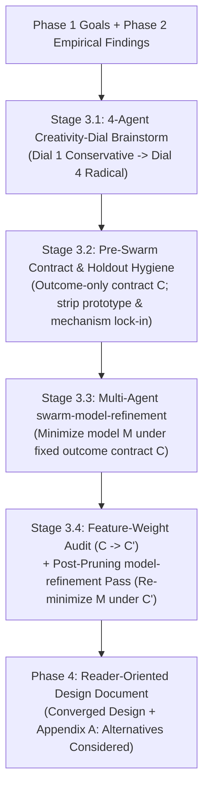

# End-to-End Architectural Design

Use this skill when designing or redesigning a software architecture,
verification model, semantic interface, protocol, or engineering framework
where the design space is open, empirical system behavior may need to be
verified, or multiple design dimensions interact.

Do not use this skill for routine implementation of a settled design (use
[`robust-code`](../robust-code/SKILL.md)), standalone conceptual model
minimization when goals and empirical facts are already settled (use
[`model-refinement`](../model-refinement/SKILL.md) or
[`swarm-model-refinement`](../swarm-model-refinement/SKILL.md) directly), or
pure empirical investigation without a target design deliverable (use
`reference-research`).

Combine this skill with:

- [`tech-lead`](../tech-lead/SKILL.md) for requirement discovery and technical
  direction;
- [`reference-research`](https://github.com/google/zerocopy/blob/reference/skills/reference-research/SKILL.md)
  (when available in the environment) for multi-round empirical research and
  experimentation;
- [`swarm-model-refinement`](../swarm-model-refinement/SKILL.md) and
  [`model-refinement`](../model-refinement/SKILL.md) for adversarial conceptual
  model minimization;
- [`robust-code`](../robust-code/SKILL.md) and
  [`trust-review`](../trust-review/SKILL.md) for invariant representation and
  trust-boundary preservation; and
- [`reader-oriented-explanation`](../reader-oriented-explanation/SKILL.md) and
  [`williams-style`](../williams-style/SKILL.md) when drafting calibration
  artifacts and the final design document.

## Core operating principles

Every stage of the workflow enforces five structural invariants:

1. **Calibrate *what* and *why* before exploring *how*:** Align with the human
   on governing goals, orthogonal stability or correctness axes, scope
   boundaries, non-goals, and empirical research questions at Checkpoint 1
   before running experiments or brainstorming solutions.
2. **Treat historical prototypes and prior iterations as problem foils, never
   as requirement sources:** Earlier versions of the codebase, older branches,
   and prior prototypes exist because of specific architectural assumptions that
   may no longer hold. Extract their *underlying failure modes and empirical
   lessons*, never their mechanisms or feature checklists.
3. **Never escalate unrefined brainstorm menus to the human, and never lock
   candidate mechanisms into the refinement contract:** Raw divergent
   brainstorming produces many dominated, redundant, or subtly unsound options.
   Keep the `swarm-model-refinement` Governing Contract restricted to
   *invariant outcomes and target workloads* so the swarm is free to delete
   heavy mechanisms, and filter the brainstormed space before asking the human
   for decisions.
4. **Re-minimize after pruning requirements:** Inside `swarm-model-refinement`,
   the Governing Contract $C$ is frozen so candidates cannot cheat by dropping
   requirements. Once the swarm reveals the true cost of each requirement and
   low-weight or vestigial features are pruned ($C \to C'$), always run a
   follow-up [`model-refinement`](../model-refinement/SKILL.md) pass so
   supporting scaffolding that existed only to serve $C \setminus C'$ also
   collapses.
5. **Present the converged design in the main body and rejected alternatives in
   an appendix:** A human reviewer needs a clean, self-contained specification
   of the final design, plus a concise appendix recording *why* plausible
   alternatives and pruned prototype features were rejected.

## Phase 1: Grounding, goal calibration, and research question discovery

Before proposing architectures or launching sub-agent swarms, ground the task
and align with the human at **Checkpoint 1**.

### 1.1 Separate Target Baseline from Historical/Prototype Foils

When surveying the workspace, explicitly partition sources into two categories:

| Category | Examples | Permitted Epistemic Role |
| :--- | :--- | :--- |
| **Authoritative Target Baseline** | The exact target branch or worktree where the design will live, its active code and tests, and governing documents (`PRINCIPLES.md`, `docs/design.md`, `docs/trust-model.md`). | Defines the live interfaces, invariants, and constraints the new design must satisfy. |
| **Historical / Prototype Foils** | Older branches (including `main` when designing against an active refactoring branch), prior pull requests, superseded prototypes, or sibling repositories (`anneal-private`, `zerocopy`). | Supplies **failure modes, edge cases, and empirical lessons only**—never default features, file formats, CLI flags, or contract requirements. |

Apply the **Assumption-Survival Test** to every mechanism, feature, or
workaround encountered in a historical prototype or earlier codebase version:

1. **Record the generating problem and the prototype's generating assumption:**
   For every historical mechanism, identify *what underlying problem or failure
   mode* it addressed and *what architectural assumption in that older system*
   made the mechanism necessary (for example, *"each crate had a hand-edited
   `Proof.lean` file"* or *"the pipeline emitted intermediate transpiled
   `.lean` snapshots"*).
2. **Test whether the generating assumption still holds in the Authoritative
   Target Baseline:**
   - If the target baseline eliminated that assumption (for example, by
     replacing per-crate proof scripts with a single static driver or moving a
     per-crate check to repository CI), classify the historical mechanism and
     every feature that existed only to test or configure it under **Retired
     Prototype Assumptions (Non-Goals)**.
   - If the underlying problem still exists in the target baseline, carry
     forward **only the problem or failure mode** (for example, *"verification
     errors must identify which function failed"* or *"parallel test runs must
     not dirty tracked lockfiles"*), leaving the solution mechanism open for
     fresh design against the target baseline.
3. **Propagate target-baseline boundaries to all sub-agents:** In every
   sub-agent prompt across Phases 1–3, state the exact path and branch of the
   Authoritative Target Baseline and include the **Retired Prototype
   Assumptions** list so sub-agents do not read stale branches or resurrect
   obsolete prototype features.

### 1.2 Formulate governing goals, orthogonal axes, and scope boundaries

Draft a crisp problem framing that separates invariant goals from implementation
mechanisms:

1. **Orthogonal guarantee axes:** When a problem mixes distinct failure modes,
   factor them into orthogonal axes with explicit consequences (for example,
   separating *Soundness Forward-Compatibility*—where a violation permits
   runtime undefined behavior—from *Compilation and Verification Stability*—
   where a violation causes a compile-time error or requires re-verification
   without ever permitting undefined behavior).
2. **Fixed scope boundaries:** State what is held fixed for a single design or
   verification instance (for example, a single configured compilation $C$ with
   fixed target C ABI layout and resolved `#[cfg]` predicates, or the boundary
   between target-crate pipeline tests and host CLI security tests).
3. **Explicit non-goals and retired prototype assumptions:** List capabilities
   from earlier iterations or adjacent systems that the target design will
   intentionally omit.

### 1.3 Discover empirical research and experimentation questions

Identify every non-obvious technical question where an unverified assumption
about an external system, compiler (`rustc` MIR passes, constant evaluation,
layout calculation), language specification (`rust-lang/reference`), kernel or
elaborator (Lean 4), or tool could invalidate the architecture or force
defensive over-engineering:

1. **Consult existing reference knowledge first:** When the `google/zerocopy`
   `reference` corpus branch (`CATALOG.json` and `reports/<package>/`) is
   available in the workspace, filter `CATALOG.json` programmatically and check
   applicable reports and their pinned revisions before proposing new
   experiments.
2. **Formulate falsifiable empirical questions:** State each remaining unknown
   as a concrete question that can be answered by source inspection and live
   minimal reproducers at the repository's pinned toolchain revision.

### 1.4 Pause at Checkpoint 1 (Goal, Scope, and Research Question Calibration)

Present a concise calibration summary (or artifact) to the human containing:

1. **Authoritative Target Baseline vs. Retired Prototype Assumptions:** Which
   branch/worktree is authoritative and which legacy features from prior
   iterations are being intentionally retired.
2. **Governing Goals, Orthogonal Axes, and Scope Boundaries:** What the design
   must guarantee and what is out of scope.
3. **Empirical Research Questions:** The exact questions to investigate in
   Phase 2 (and whether `reference-research` corpus publication is warranted).
4. **High-Leverage Clarifications:** Any genuine ambiguity in the human's goals
   or risk tolerance.

Wait for human confirmation at Checkpoint 1 before proceeding.

## Phase 2: Synchronous empirical research and auto-advance gate

If Phase 1 identified no unresolved empirical questions, proceed directly to
Phase 3. Otherwise, execute the empirical investigation synchronously before
divergent design brainstorming:

1. **Run `reference-research` synchronously:** Delegate multi-question
   compiler, specification, or kernel investigations to a research sub-agent
   following `reference-research` (including corpus report creation and
   verification when approved by the user). Running research synchronously as a
   sequential stage avoids cross-track coordination overhead and ensures Phase 3
   agents build on verified facts rather than guesses.
2. **Require 10-minute progress heartbeats for long-running research:** Whenever
   delegating a research phase expected to run for more than a few minutes,
   instruct the sub-agent upfront to arm a recurring ~10-minute timer
   (`schedule`) or send periodic progress updates summarizing completed
   experiments and remaining questions so the human is never left without
   visibility.
3. **Evaluate the Goal-Consistency Gate (Default: Auto-Advance):** When Phase 2
   completes, compare the empirical findings against the goals, scope
   boundaries, and soundness premises agreed at Checkpoint 1:
   - **Auto-advance (default):** If the empirical findings are compatible with
     the Checkpoint 1 goals—even if they rule out specific candidate
     mechanisms—immediately advance to Phase 3 without pausing for human input.
   - **Contradiction pause (exception):** Pause to consult the human *only* if
     an empirical finding directly contradicts or invalidates an agreed goal,
     scope boundary, or core premise from Checkpoint 1.

## Phase 3: Two-stage divergence-to-convergence funnel

Once goals and empirical facts are established, explore the design space broadly
and then ruthlessly compress it before presenting a design to the human.

### Stage 3.1: Divergent 4-agent creativity-dial brainstorm

Spawn four parallel sub-agents, providing each with the Authoritative Target
Baseline, the Checkpoint 1 goals and scope boundaries (including the list of
Retired Prototype Assumptions), and the Phase 2 empirical findings. Assign each
sub-agent a distinct creativity dial:

- **Dial 1 (Conservative / Textbook):** Proven, minimal-surprise mechanisms and
  standard idioms that satisfy the goals with zero novel abstractions.
- **Dial 2 (Moderately Conservative / Pragmatic Synthesis):** High-leverage
  structural unifications and clean boundary separations within the existing
  system architecture.
- **Dial 3 (Moderately Creative / Structural Redesign):** Rethinking internal
  representations, data flow, or stage boundaries to eliminate entire classes
  of plumbing, boilerplate, or failure modes.
- **Dial 4 (Extremely Creative / Radical Zero-Base Rethink):** Challenging
  every non-mandatory boundary to find radical theoretical or operational
  collapses, even if only individual component insights survive into the final
  model.

Coalesce the distinct component ideas, representations, and architectural
candidates into a scratch synthesis artifact. **Do not pause to ask the human
to choose from this raw brainstorm menu.**

### Stage 3.2: Pre-swarm contract and holdout hygiene

Before launching [`swarm-model-refinement`](../swarm-model-refinement/SKILL.md),
audit the proposed Governing Contract (`C1`–`Ck`) and Blind Holdouts
(`H1`–`Hm`) against two strict hygiene rules:

1. **Outcome-only Governing Contract (zero prototype or mechanism lock-in):**
   Because `model-refinement` forbids dropping any clause in the Governing
   Contract $C$, writing a historical prototype feature or a Stage 3.1
   brainstormed mechanism into `C1`–`Ck` locks that mechanism into every
   candidate model and prevents the swarm from deleting it. State `C1`–`Ck`
   strictly in terms of **required semantic/system outcomes, invariants, and
   concrete workloads of the Authoritative Target Baseline** (calibrated at
   Checkpoint 1 and Phase 2). Place candidate mechanisms, file formats,
   directives, and speculative sub-features in the mutable **Candidate Idea
   Pool** so the swarm can discard any mechanism whose value does not justify
   its complexity.
2. **Holdout scope compliance:** Verify that every blind holdout scenario in
   `H1`–`Hm` respects the scope boundaries agreed at Checkpoint 1 and represents
   a valid workload of the Authoritative Target Baseline. Never allow
   `Holdout Stitcher` or the coordinator to invent holdout scenarios outside the
   agreed scope (such as cross-target compilation holdouts when verification is
   scoped to a fixed compilation target $C$, or multi-crate workspace holdouts
   when designing a single-crate test runner), as out-of-scope holdouts force
   candidates to add artificial state parameters and fallback branches.

### Stage 3.3: Multi-agent `swarm-model-refinement`

Run [`swarm-model-refinement`](../swarm-model-refinement/SKILL.md) over the
coalesced brainstorm synthesis and outcome-only contract:

1. **Full adversarial topology:** Use competing Architects (`α`, `β`, `γ`),
   targeted Challengers, `Holdout Stitcher`, and unanchored `Fresh Critics` per
   [`swarm-model-refinement`](../swarm-model-refinement/SKILL.md) to falsify
   unsound shortcuts, expose cross-layer complexity transfers, and synthesize a
   dominating model $M^*$.
2. **10-minute progress heartbeats:** If `swarm-model-refinement` is delegated
   to a sub-agent coordinator, instruct that coordinator upfront to send status
   heartbeats every ~10 minutes summarizing current swarm phase, active passes,
   and key falsifications or merges.

### Stage 3.4: Post-refinement feature-weight audit and re-minimization

`swarm-model-refinement` minimizes the model $M$ while holding the Governing
Contract $C$ fixed ($\min_{M \models C} \text{complexity}(M)$). Once the swarm
converges on $M^*$, the exact implementation cost of each requirement in $C$ is
visible. Before writing the final design document, execute a three-step
post-refinement pass:

1. **Zero-base feature-weight audit against the concrete target codebase ($C \to
   C'$):** Inspect every surviving feature, directive, state parameter, and
   subsystem in $M^*$ against the actual files, types, and tests of the
   Authoritative Target Baseline. For each feature, ask:
   - *Does this feature carry its weight in the target repository specifically,
     or is it a holdover from an earlier prototype or an over-generalized
     contract clause?*
   - *Can existing language or test mechanisms in the target repository (such
     as ordinary unit/integration tests or existing compiler checks) handle the
     few cases this feature targets without bespoke framework machinery?*
   Drop any feature that fails to carry its weight, producing a leaner contract
   $C' \subset C$.
2. **Plumbing-equivalence check on remaining open decisions:** For every open
   question or "irreducible policy choice" surfaced by the swarm, check:
   - *Is one branch already entailed by the Checkpoint 1 goals or scope
     boundaries?* If so, resolve it immediately.
   - *Do the competing options require different architectural machinery, or do
     they use the exact same plumbing with a different configuration table or
     default boolean?* If the plumbing is identical, do not frame it as an
     architectural fork: specify the single unified mechanism and note the
     default policy configuration concisely.
3. **Mandatory post-pruning [`model-refinement`](../model-refinement/SKILL.md)
   pass ($\min_{M \models C'} \text{complexity}(M)$):** Whenever Step 1 or
   Step 2 prunes a feature or resolves a pseudo-fork, run a dedicated
   [`model-refinement`](../model-refinement/SKILL.md) pass over $M^*$ under the
   reduced contract $C'$ and concrete target codebase. Look specifically for
   supporting scaffolding whose sole justification was the pruned requirement
   ($C \setminus C'$)—such as multi-file archive parsers after all remaining
   fixtures become single files, stage-coupled directory trees, per-state
   fields that are actually crate-level constants, or multi-branch heuristic
   diagnostic scanners that duplicate an existing check—and collapse them.

## Phase 4: Reader-oriented design document deliverable

Write the final design document as a standalone artifact (or repository
document when requested), applying
[`reader-oriented-explanation`](../reader-oriented-explanation/SKILL.md) and
[`williams-style`](../williams-style/SKILL.md).

### 4.1 Structure the main body around the final converged design only

A human reader evaluating or implementing the design should never have to
mentally replay the swarm's deliberation history or filter out rejected
proposals in the middle of the specification. Keep the main body strictly
focused on the final, weight-checked, re-minimized design:

1. **Purpose, Scope, and Governing Guarantees:** State the problem the design
   solves, the fixed scope boundaries, the orthogonal guarantee or stability
   axes, and explicit non-goals (including retired prototype features).
2. **Architecture and System / Trust Boundaries:** Present a clear architectural
   overview (using a diagram or layer table where helpful) showing how
   responsibilities are partitioned across components and how trust or safety
   invariants are enforced.
3. **Concrete Component and Semantic Specifications:** Specify the exact data
   structures, AST/state definitions, algorithms, file layouts, grammars, or
   CLI interfaces per component. Ground every design invariant in the concrete
   files and types of the Authoritative Target Baseline.
4. **End-to-End Workflows, Verification Strategy, and Migration Plan:** Show how
   representative cases flow through the architecture end to end, how existing
   tests or proofs migrate, and how regressions are caught.
5. **Open Product-Policy Decisions (only if genuinely irreducible):** If any
   high-level product or UX policy decisions remain after the
   Plumbing-Equivalence Check in Stage 3.4, state them concisely with their
   recommended default.

### 4.2 Record rejected mechanisms in `Appendix A: Alternatives Considered`

Place all rejected architectures, candidate mechanisms falsified during
`swarm-model-refinement`, and prototype features pruned during the
Feature-Weight Audit in a dedicated `## Appendix A: Alternatives Considered`
section at the end of the document, grouped by thematic cluster:

- For each rejected alternative, state **the candidate mechanism** and **the
  concrete dominance argument, counterexample, holdout failure, or target-weight
  reason** that eliminated it.
- Keep discovery process narrative (`Candidate α`, `Round 1 vs. Round 2`,
  `Fresh Critic 002`) out of the main body; in the appendix, frame each entry by
  *what the alternative was* and *why it is inferior or unsound*.
