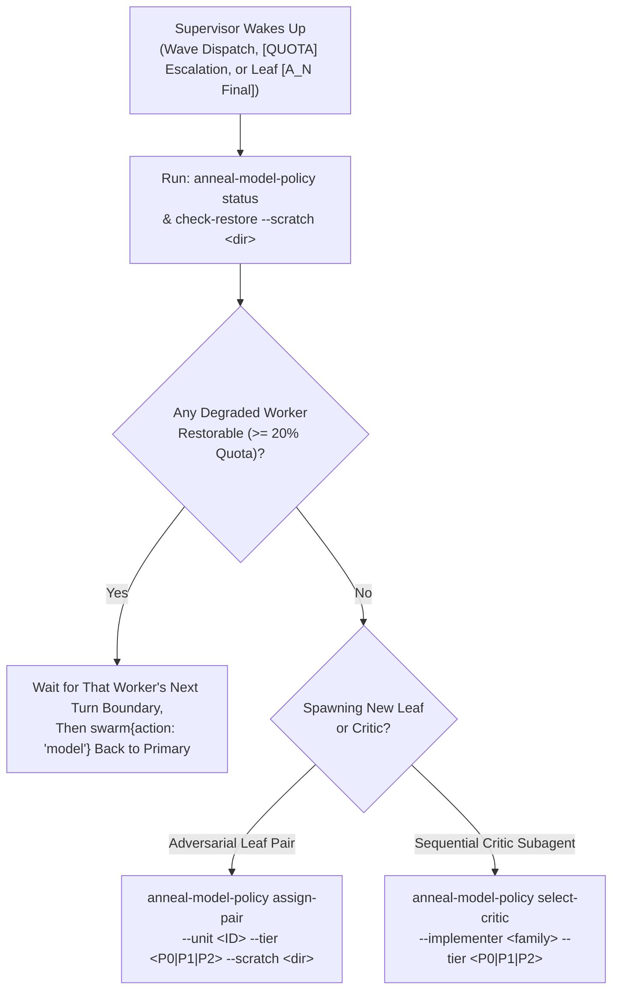

# Quota- & Hardware-Aware Hierarchical Supervision

Use this skill when coordinating large multi-unit engineering or verification
efforts structured either as:

1. **Nested Supervisor + Adversarial Leaf Trees**: A root coordinator and
  non-leaf workstream supervisors (`sup-*`) managing waves of $N$-round
  [`adversarial-rounds`](../adversarial-rounds/SKILL.md) leaf pairs
  (`agent-a` / `agent-b`) across isolated git worktrees; or
2. **Sequential Implementer + Fresh Cross-Family Critic Loops**: A coordinator
  implementing fixes sequentially across a queue of issues (`I-01..I-k`) and
  spawning a fresh falsification critic subagent after each fix.

---

## 1. Abstract Model Slots & Role-to-Pool Partitioning

Keep public repository artifacts free of environment-specific model identifiers
and quota bucket names by routing all roles through five abstract model slots
resolved at runtime via `anneal-model-policy` (configured in your host
environment):

| Abstract Slot | Assigned Roles | Why This Pool Is Separated |
| :--- | :--- | :--- |
| **`<MODEL_X>`** (`<MODEL_X_FALLBACK>`) | Leaf `agent-a` or `agent-b`; fresh falsification critic when implementer is on Family Y | **Frontier Family X** for implementation and cross-family adversarial critique. |
| **`<MODEL_Y>`** (`<MODEL_Y_FALLBACK>`) | Leaf `agent-b` or `agent-a`; fresh falsification critic when implementer is on Family X | **Frontier Family Y** for implementation and cross-family adversarial critique. |
| **`<SUPERVISOR_MODEL>`** | Root coordinator (`BRIEF-0`, `MR-0`) and non-leaf workstream supervisors (`sup-*`) | **Dedicated Supervisor Pool.** Non-leaf supervisors sit idle for 20–40 minutes while leaf pairs execute $N$ rounds, exceeding prompt-cache TTLs and incurring an 8.9x–12.5x cold-cache write cost on every wakeup. Pinning supervisors to `<SUPERVISOR_MODEL>` prevents supervisor wakeups from draining `<MODEL_X>` or `<MODEL_Y>`. |
| **`<MODEL_Z_RESERVE>`** | Overflow leaf / critic model when `<MODEL_X>` or `<MODEL_Y>` breaches a tier reserve floor, or for `P2` mechanical leaves | **High-Thinking Reserve Pool.** Preserves the last `15%` of `<MODEL_X>` and `<MODEL_Y>` for `P0` soundness-critical work. |
| **`<HELPER_MODEL>`** | Swarm `narrator` and `monitor` workers only | **Zero-Frontier-Cost Helper Pool.** Never assign `<HELPER_MODEL>` to a supervisor, leaf, or critic. |

---

## 2. Work-Unit Priority Tiers (`P0` / `P1` / `P2`) & Reserve Floors

Before dispatching a work unit, classify its complexity and soundness impact
into one of three priority tiers so lower-priority leaves never starve
soundness-critical proofs or cross-family critics:

1. **`P0` (`P0-Critical` — `2%` quota reserve floor)**:
  - **Scope**: Trusted boundary changes (`trusted/lean/`, `trusted/audit/`,
    `trusted/rustc-capture/`), core operational semantics (`MirSemantics`,
    MiniRust `Interp`), Tree Borrows / pointer provenance (`MR-3.*`), and
    whole-program soundness theorems.
  - **Policy**: Allocates true cross-family `<MODEL_X>` $\leftrightarrow$
    `<MODEL_Y>` pairs all the way down to `2%` remaining quota before falling
    back to `<MODEL_Z_RESERVE>`.
2. **`P1` (`P1-Standard` — `15%` quota reserve floor, default)**:
  - **Scope**: Standard feature implementation, correspondence leaf units, and
    crate verification obligations outside `trusted/`.
  - **Policy**: Allocates `<MODEL_X>` $\leftrightarrow$ `<MODEL_Y>` while both
    pools remain above `15%`. When either pool drops below `15%`,
    `anneal-model-policy assign-pair --tier P1` substitutes `<MODEL_Z_RESERVE>`
    for the depleted side, sets `DIVERSITY_REDUCED=true`, and logs the entry to
    `<scratch>/quota_ledger.json` so `P0` tasks retain a `15%` frontier reserve.
3. **`P2` (`P2-Mechanical` — `40%` quota reserve floor)**:
  - **Scope**: Boilerplate generation, CLI plumbing, documentation audits, and
    harness wiring.
  - **Policy**: Routes directly to `<MODEL_Z_RESERVE>` and `<MODEL_Y_FALLBACK>`
    whenever frontier pools are below `40%`.

---

## 3. Local Supervisor Execution & Handoff-Boundary Switching

Do not run a separate LLM "quota monitoring agent" that broadcasts messages
across conversations; instead, have each supervising agent query the
zero-token local policy CLI (`anneal-model-policy`) at **dispatch** and
**handoff** boundaries:



### Critical Rules for Model Switching in `swarm` and `invoke_subagent`

1. **Flat-Board Ownership (`swarm{action: "model"}` Authority)**:
  In Jetski's `swarm` tool, a non-root worker (`sup-*`) may only call
  `swarm{action: "model"}` or `swarm{action: "kill"}` on workers **that `sup-*`
  itself spawned** via `swarm{action: "add"}`. If the root `coordinator` spawned
  the leaf workers, `sup-*` must request model switches from `@coordinator` (or
  `sup-*` itself must be the agent that calls `swarm{action: "add"}` for its
  leaves).
2. **Never Switch a Sleeping Counterpart While the Shared Worktree Is Busy**:
  Calling `swarm{action: "model", name: "<worker>", model: "..."}` on a
  `waiting` worker **immediately wakes that worker** and instructs it to resume
  work on the new model. Never switch `agent-b`'s model while `agent-a` is
  actively running in the shared worktree (or vice versa). Perform a model
  switch **only**:
  - when that specific worker is the active turn owner and posts
    `@coordinator [QUOTA]`, or
  - at a round handoff boundary (`[A_k -> B_{k+1}]` or `[B_k -> A_k]`) right
    when that worker owns the next turn.
3. **Sequential Implementer + Fresh Cross-Family Critic (`select-critic`)**:
  When a single-worktree session implements fixes sequentially and uses
  `invoke_subagent` to launch a falsification critic (for example,
  `difftest-critic`), never leave `Model` set to `"inherit"` if the main session
  may have failed over to the same model family. Before calling
  `invoke_subagent`, run:
  ```bash
  anneal-model-policy select-critic --implementer "<current_model_or_family>" --tier "<P0|P1|P2>"
  ```
  and pass the returned `CRITIC_MODEL` explicitly to `invoke_subagent` so every
  critique runs on an independent frontier family.

---

## 4. Hardware-Matched Concurrency Pacing & `anneal-lean-run` Safeguards

Multi-worktree swarms easily exhaust host RAM and trigger multi-hour kernel swap
thrashing if multiple leaves run unbounded `lake build`, `lake env lean`, or
`cargo test` concurrently. Enforce three hardware-matched safeguards across all
worktrees:

### 4.1 Probe Host Capacity & Cap Concurrent Active Leaf Builds ($W$)

Before launching a wave of leaves, probe the host's CPU cores and physical RAM:

```bash
anneal-lean-run --probe
```

- **Wave Concurrency Cap ($W$)**: Limit the number of simultaneously active leaf
  worktrees running heavy Lean/Rust builds to:
  $$W \le \min\left(3,\; \max\left(1, \left\lfloor \frac{M_{\text{total}}}{32\text{ GiB}} \right\rfloor\right)\right)$$
  (For example, $W = 1$ on a 32 GiB host; $W \le 2\text{–}3$ on a 117 GiB host.)
  Keep remaining work units `QUEUED` until an active leaf completes `[A_N Final]`.

### 4.2 Seed Warm `.lake/build` Caches on Worktree Creation

In your worktree provisioning script (`setup_worktree.sh`), always copy or
hardlink the warm `.lake/build` directory from the baseline checkout into the
new worktree before spawning leaf agents. This eliminates redundant cold
rebuilds of `Trusted` and `Anneal` across every leaf worktree.

### 4.3 Wrap Every CLI `lake`, `lean`, and Heavy `cargo test` in `anneal-lean-run`

Lean 4's `-M <MB>` flag bounds only its internal small-object allocator and does
**not** bound total process RSS or child processes. Every supervisor and leaf
brief must require running CLI `lake` and `lean` commands through
`anneal-lean-run`:

```bash
# Single-file Lean proof or reproducer check (caps RAM to min(15% MemTotal, 16 GiB),
# sets MemorySwapMax=0, LEAN_NUM_THREADS=cores/W, and 180s wall-clock timeout):
anneal-lean-run --mode file --concurrency <W> -- lake env lean <path/to/File.lean>

# Workspace or multi-target Lake build (acquires host build slot lock, caps RAM
# to min(70% MemTotal / W, 80% MemAvailable), sets MemorySwapMax=0, and 900s timeout):
anneal-lean-run --mode build --concurrency <W> -- lake build <targets...>
```

Because `anneal-lean-run` sets `MemorySwapMax=0` on its `systemd` user scope, a
runaway kernel `whnf` reduction is terminated immediately by the cgroup OOM
killer (`exit 137`) with zero swap paging, keeping the host, SSH daemon, and
sibling worktrees responsive.
